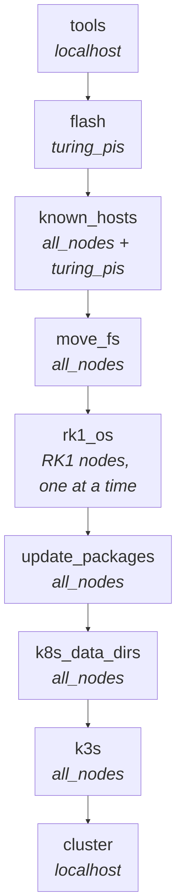

# Ansible Roles in Detail

The playbook `pb_all.yml` runs nine roles in sequence. Each role is fully idempotent —
it checks state before acting and does nothing if the desired state is already achieved.

## Execution order



Each role is tagged with its own name, so you can run individual stages:

```bash
ansible-playbook pb_all.yml --tags tools
ansible-playbook pb_all.yml --tags flash
# etc.
```

The `servers` tag covers `move_fs`, `rk1_os`, `update_packages`, and `k8s_data_dirs`.

---

## `tools` — CLI tool installation

**Runs on:** localhost (devcontainer)
**Tag:** `tools`

Installs command-line tools needed to manage the cluster:

| Tool | Version | Purpose |
|------|---------|---------|
| `helm` | 3.20.0 | Kubernetes package manager |
| `kubectl` | latest stable | Kubernetes CLI |
| `kubeseal` | 0.35.0 | Sealed Secrets CLI |
| `helm-diff` | plugin | Shows Helm upgrade diffs |

Also creates:

- Shell completions for helm, kubectl (bash + zsh)
- `k` alias for kubectl
- Port-forward helper scripts: `argo.sh`, `grafana.sh`, `dashboard.sh`
- Sets PATH to include `$BIN_DIR`

The role is split across multiple task files:

- `shell.yml` — PATH, zsh theme
- `helm.yml` — Helm binary + helm-diff plugin
- `kubectl.yml` — kubectl binary + completions
- `kubeseal.yml` — kubeseal binary
- `scripts.yml` — port-forward helper scripts

---

## `flash` — BMC-based OS flashing

**Runs on:** `turing_pis` (BMC hosts)
**Tag:** `flash`
**Guard:** only runs when `do_flash` is true (`-e do_flash=true` or `-e flash_force=true`)

Installs Ubuntu on Turing Pi compute modules via the BMC's `tpi` CLI: Ubuntu 24.04
for Raspberry Pi on CM4s, and stock Ubuntu 26.04 with mainline U-Boot on RK1s
(see [The RK1 install](#the-rk1-install)).

### How it works

1. **Discover nodes** — looks for the inventory group `<bmc_hostname>_nodes`
   (e.g. `turingpi_nodes` for BMC host `turingpi`).
2. **For each node** (skipped if it answers SSH, unless `flash_force` is set):
   - **CM4:** download the OS image to the controller and copy it to the BMC at
     `tpi_images_path` (`/mnt/sdcard/images/`).
   - **RK1:** build the eMMC staging image on the controller and copy it to the BMC.
   - Power off the node and run `tpi flash --sha256`. The controller runs it on the
     BMC over `ssh` (async, up to 30 minutes; an RK1 image takes about 10), as
     `raw` cannot run async. This and the `scp` copies to the BMC use the play's
     SSH settings for it: `ansible_user`, `ansible_port`, the key from
     `ansible_ssh_private_key_file` or `--private-key`, and
     `ansible_ssh_common_args`.
3. **Bootstrap cloud-init** with the node's eMMC in disk (msd) mode on the BMC:
   - **CM4:** render `cloud.cfg` with the hostname and the `ansible` user and key
     into the root filesystem, and clear the cloud-init cache.
   - **RK1:** write a NoCloud seed (`meta-data`, `user-data`, `network-config`) to
     the staging image's `CIDATA` partition (p14). The image itself is pristine.
   - **RK1 with `root_dev`:** clear the NVMe's partition table from the U-Boot
     prompt over the UART (see below). This happens only after the flash has
     succeeded, so a failed flash leaves the node's old install as it was.
   - Boot the node and wait for SSH.

### The RK1 install

The RK1 has no SPI flash, so U-Boot lives in the eMMC's raw area, from LBA 64
(32 KiB) to about 9.5 MiB, where the Rockchip boot ROM loads it. `tpi flash` writes
only the eMMC, and Ubuntu's official images start their EFI system partition at
1 MiB, on top of U-Boot. So an RK1 is installed in two stages, from two artifacts:
Ubuntu's `ubuntu-26.04.1-preinstalled-server-arm64.img.xz` and Armbian's build of
mainline U-Boot.

1. **eMMC staging image** (controller, `tasks/image_rk1.yml`).
   `files/rk1_emmc_image.py` writes `u-boot-rockchip.bin` from Armbian's package
   at LBA 64 and copies the Ubuntu image's partitions byte for byte to start at
   16 MiB, keeping their GUIDs. The GPT's first usable LBA is that 16 MiB start,
   so partitioning tools cannot place a partition over U-Boot. Nothing inside a
   filesystem changes. It is Python's standard library only, so the controller
   needs no `sfdisk`, just `xz`.
   - The build is deterministic, so the uncompressed result is pinned
     (`flash_rk1_emmc_sha256`): the build fails if it differs.
   - Both downloads are checked against their sha256 on every run. The built
     image is cached in `flash_rk1_cache_dir`, and is rebuilt only when the cached
     copy does not decompress to the pinned checksum. A new build is compressed,
     checked to decompress to the pin, and only then moved into place; each BMC
     builds into its own temporary files, so two BMCs cannot mix their builds.
   - The copy on the BMC is named after its checksums, so it is copied only once.
2. **Flash and seed.** `tpi flash` writes the image to the eMMC; the seed goes on
   its `CIDATA` partition, as above.
3. **Clear the NVMe.** The staging OS mounts its root by label
   (`cloudimg-rootfs`), as every Ubuntu cloud image does, and the staging copy and
   an old install of the same image share their partition GUIDs and filesystem
   UUID too, so an old Ubuntu install on the NVMe could be mounted in its place.
   After the flash, `files/rk1_zap_nvme.sh` runs on the BMC: it stops U-Boot's
   autoboot over `tpi uart`, runs `pci enum` and reads the NVMe's first two
   sectors.
   - With `flash_force`, it zeroes the NVMe's first 1 MiB with `nvme write`,
     checks it reads back as zeros, and resets the node into the staging OS.
   - Without it (`do_flash`, which flashes any node that doesn't answer SSH), a
     blank NVMe is left as it is and the node reset. An NVMe with a partition table
     (an MBR signature, or a GPT header) may hold a working install that was only
     unreachable: the script writes nothing, powers the node off and the play
     stops, asking for `flash_force`.
   - On any failure the script powers the node off rather than leave it at the
     U-Boot prompt.

   The NVMe is cleared here, not from the old OS before the flash, so that it is
   lost only once the new eMMC image is in place. Clearing it from the staging OS
   instead is not possible: the label clash happens in its initramfs, before any
   task can run.
4. **Staging boot.** U-Boot boots the eMMC copy through EFI (shim, then GRUB).
   `move_fs` then installs the NVMe from it (see `move_fs` below).
5. **Final boot.** The eMMC now has no partition table, so U-Boot, which scans
   the eMMC before the NVMe, boots the NVMe's EFI system partition.

End state of an RK1:

- The eMMC holds only U-Boot, with no partition table.
- The NVMe holds Ubuntu's preinstalled server image as Ubuntu ships it: root on
  p1, the cloud-init seed on p14, and the EFI system partition with shim and GRUB
  on p15. cloud-init grows the root to the whole disk on first boot.
- The generic kernel, updated by `apt` like any Ubuntu machine. It boots on
  U-Boot's built-in device tree, with no GRUB `devicetree` line, and
  `flash-kernel` skips itself under EFI.
- `rk1_os` finds a standard install and skips it.
- Every boot passes through U-Boot twice: U-Boot cannot store EFI variables
  on the NVMe, so shim's fallback resets once before GRUB starts. This is
  harmless.

:::{warning}
A re-flash is a fresh install. On an RK1 with `root_dev`, `flash_force` wipes the
NVMe and everything on it is lost, including `local-nvme` PV data under
`/var/lib/k8s-data`. Move or back
up that node's local PV data first (see {doc}`/how-to/reflash-rebuild`).
:::

### OS images

| Type | Image | Source |
|------|-------|--------|
| RK1 | Ubuntu 26.04 preinstalled server (stock, generic kernel) | `cdimage.ubuntu.com` |
| RK1 | Mainline U-Boot, `linux-u-boot-turing-rk1-current` | `apt.armbian.com` (third party) |
| CM4 | Ubuntu 24.04 Server | `cdimage.ubuntu.com` |

All RK1 artifacts are pinned by URL and sha256 in `roles/flash/vars/main.yml`.

### Bumping the RK1 artifacts

Armbian's U-Boot package is the one third-party artifact. It is maintained (Armbian
rebuilds it from mainline U-Boot regularly), but the RK1 is a community-supported
Armbian board, and the package's pool filename changes with every build. Once
Armbian removes the pinned file from its pool, a controller without a cached image
cannot download it, so bump it then (or before):

1. Find the newest `linux-u-boot-turing-rk1-current` in the `Packages` index of
   `apt.armbian.com`. Set `flash_rk1_uboot_deb_file` to its `Filename`'s last part
   and `flash_rk1_uboot_deb.sha256` to its `SHA256`.
2. Download it and set `member_sha256` to the checksum of `u-boot-rockchip.bin`:
   `dpkg-deb --fsys-tarfile <deb> | tar -xO ./usr/lib/linux-u-boot-current-turing-rk1/u-boot-rockchip.bin | sha256sum`.
   If the path inside the package changed, update `member` too.
3. Run the flash once. The build fails and reports the new image's sha256: set
   `flash_rk1_emmc_sha256` to it.
4. Re-flash one RK1 and check it boots before re-flashing the rest.

A new Ubuntu point release is the same: set `flash_rk1_os_vers` and
`flash_rk1_os_image.sha256` (from the release's `SHA256SUMS`), and
`flash_rk1_os_image.raw_sha256` and `raw_size` to the decompressed image's
(`xz -dc <image> | sha256sum`, and the uncompressed size from `xz -l --robot`), then
steps 3 and 4.

### Idempotency

- Node is pinged first — if contactable and `flash_force` is not set, flashing is skipped.
- CM4 images are only downloaded if not already on the BMC.
- RK1 downloads are re-verified on every run; the eMMC image is rebuilt only when
  the cached copy does not match the pinned checksum.

---

## `known_hosts` — SSH host key management

**Runs on:** `all_nodes`, `turing_pis`
**Tag:** `known_hosts`
**Constraint:** the file writes use `throttle: 1`; the scans run in parallel

Updates every file in `known_hosts_files` (`group_vars/all.yml`) with fresh
SSH host keys for each node. By default that is both `~/.ssh/known_hosts` and
the system-wide `/etc/ssh/ssh_known_hosts`:

1. Look up the node's IPv4 addresses (`getent ahostsv4` for
   `<node>{{ local_domain }}`, run on the controller).
2. Scan for current SSH host keys (`ssh-keyscan -T 5`). A host that returns
   no keys fails with a message naming it; the other hosts carry on.
3. Remove every entry recorded by the node's IP, and the entries by hostname
   if any of them is not a freshly scanned key (this drops key types the node
   no longer offers).
4. Add the new keys by hostname.
5. Make `/etc/ssh/ssh_known_hosts` world-readable.

Every step only changes a file when it is out of date, so a second run
reports no changes.

The system-wide file is what the Claude sandbox uses: its `$HOME` is a fresh
tmpfs with no `~/.ssh`, but it sees the devcontainer's `/etc` read-only. The
devcontainer's `postCreate.sh` runs this tag so the file is repopulated on
every rebuild. Because the sandbox cannot write `/etc`, run the tag from a
regular devcontainer terminal, not from inside the sandbox.

:::{note}
Parallel writes to one known_hosts file race and lose entries, so the tasks
that write the files use `throttle: 1` (one host at a time) while the lookups
and scans run for all hosts at once. The role is therefore also safe to run
ad hoc (`ansible all_nodes -m include_role -a name=known_hosts`).
:::

---

## `move_fs` — install the OS on the NVMe

**Runs on:** `all_nodes`
**Tag:** `servers`
**Guard:** only nodes with `root_dev` defined in the inventory whose root is not
already on it; RK1 only

On an RK1 that `flash` has just installed, which runs the staging OS from its eMMC,
it runs `roles/flash/tasks/rk1_install_nvme.yml`:

1. Check that the root is the staging OS (eMMC p1, booted through EFI) and that
   nothing on the NVMe is mounted. Anything else stops the play with a message;
   to reinstall such a node, re-flash it.
2. Wait for the staging OS's cloud-init, and for NTP: the RK1 has no
   battery-backed clock, so TLS downloads fail until the time is set.
3. Download Ubuntu's preinstalled server image and check its sha256. Refuse a
   target that already has signatures (`wipefs --no-act`) unless `flash_force` is
   set. Write the image to the NVMe (`xz -dc | dd conv=fsync`, buffered) and read
   it back: after dropping the page cache, as many bytes as the image has must hash
   to the decompressed image's pinned sha256. A mismatch stops here, while the eMMC
   still boots the staging OS. Neither step uses `O_DIRECT` (see
   {doc}`/reference/troubleshooting`).
4. Seed the NVMe's cloud-init (`CIDATA`, p14), and copy the staging OS's SSH host
   keys onto the NVMe's root, with `ssh_deletekeys: false` in the seed. The node
   keeps the host key that `known_hosts` has just recorded.
5. Clear the eMMC's partition table with `wipefs`. This writes only the
   partition table's signatures (LBA 0–1, and the backup GPT at the end of the
   eMMC); U-Boot, from LBA 64, is untouched.
6. Reboot with `systemctl reboot --check-inhibitors=no` (the staging OS is thrown
   away, so no inhibitor lock may refuse the reboot), then check that the root is
   NVMe p1 and the node booted through EFI.
7. Check that unattended-upgrades is held (below), and wait for apt and dpkg to be
   idle, so that `update_packages` can run apt.

Both cloud-init seeds hold apt's periodic jobs: they write
`/etc/apt/apt.conf.d/99rk1-install-hold` with `APT::Periodic::Enable "0"` before
`network-online.target`, so `apt-daily*.service` never start an upgrade. Otherwise
a fresh install's first-boot unattended-upgrades installs over a hundred packages one
at a time and holds the dpkg lock for over half an hour, and on the staging OS it
slows the NVMe write. `update_packages` then runs one `dist-upgrade` and removes the
file as its last step, which re-enables unattended-upgrades.

Once the root is on `root_dev`, the role only checks the eMMC: if it still has a
partition table with the staging OS's root (`cloudimg-rootfs`) on p1, the install
stopped between writing the NVMe and clearing the eMMC, and either copy of the root
may be mounted, so the play stops and asks for a re-flash. RK1s converted in place
by `rk1_os` keep their vendor eMMC layout (`CIDATA` on p1) and pass. Re-flashing the
node is the only way to reinstall it.

---

## `rk1_os` — stock Ubuntu on RK1 nodes

**Runs on:** `all_nodes`, one node at a time (`serial: 1`), in its own play between
`move_fs` and `update_packages`. With `serial: 1`, one failed RK1 stops the
playbook for all hosts, including those not yet reached.
**Tag:** `servers`, `rk1_os`
**Guard:** only nodes with `type: rk1` whose root is not on the eMMC (`mmcblk`);
standard Ubuntu installs are skipped (below)

Converts an RK1 installed from the archived ubuntu-rockchip vendor image (6.1 vendor
kernel, U-Boot reading extlinux) to stock Ubuntu 26.04: Ubuntu's generic kernel,
booted U-Boot → EFI → GRUB. `flash` and `move_fs` now install stock Ubuntu, which
this role skips, so it only migrates RK1s installed before that, in place. To move
such a node to the layout `flash` installs, re-flash it instead.

Only the vendor layout is converted: root on an NVMe partition other than p1,
and p1 the vendor image's vfat `CIDATA` partition. A standard Ubuntu install, such
as Ubuntu's preinstalled RK1 server image (root on p1, `CIDATA` on p14, its own ESP
on p15 at `/boot/efi`, shim and GRUB), is skipped with a message and left
unchanged. The role counts a node as a standard install when it booted through
EFI, runs the target release, has no release upgrade record from the role, has
`/boot/efi` mounted from a partition other than p1, and has none of the vendor
PPA's packages (`rk1_os_vendor_packages`; the generic extras such as `u-boot-tools`
ship in stock images too) and no enabled `jjriek` PPA source or pin. A converted node mounts p1 at
`/boot/efi`, so it is still checked on every run. Any other layout fails before
the role changes anything. End state of a converted node:

- `flash-kernel` pinned out and purged (it does not support the RK1); the
  ubuntu-rockchip PPA sources and pins renamed `*.disabled`; `Prompt=lts`.
- The GA kernel, `linux-generic`, not HWE: GA stays on one kernel series for the
  life of the release, whereas HWE moves to a new series with each point release.
- Kernel hooks `/etc/kernel/post{inst,rm}.d/zx-rk1-dtb` keep
  `/boot/dtb-<version>` (the kernel's `rk3588-turing-rk1.dtb`), which GRUB's
  `10_linux` loads with a `devicetree` line.
- NVMe p1 retyped to EFI System (not reformatted: it still holds the cloud-init
  seed; the role first checks it is the vfat `CIDATA` partition and not the root) and mounted at `/boot/efi`. `grub-efi-arm64` without recommends (no shim,
  signed GRUB or os-prober), installed to the removable path
  `EFI/BOOT/BOOTAA64.EFI` without touching NVRAM.
  `/etc/default/grub.d/50-rk1.cfg` sets the kernel command line
  (`rk1_os_cmdline`), a 3 second menu (`rk1_os_grub_timeout`) and a console
  terminal.
- No extlinux tooling: `u-boot-menu` purged and `extlinux.conf` removed. U-Boot
  scans p1 first and boots its EFI binary.
- After the release upgrade, the vendor packages purged (the 6.1 kernel,
  `u-boot-turing-rk1`, `ubuntu-rockchip-settings*`, Mali and camera packages, and
  what only they pulled in), along with a few generic Ubuntu packages the vendor
  metapackage recommended and the RK1 does not need (`rk1_os_vendor_packages`,
  `rk1_os_vendor_extra_packages`),
  obsolete libraries autoremoved and `*.dpkg-bak`/`*.distUpgrade` files deleted.
  These removals, and the smaller purges earlier (`flash-kernel`, `u-boot-menu`,
  the HWE metapackages, shim and os-prober), are simulated first and stop if they
  would take a package in
  `rk1_os_protected_packages` (sshd, cloud-init, `nfs-common`, `open-iscsi`, the
  running kernel and others).

The role never writes to the eMMC, whose first 16 MiB hold U-Boot.

### Order for a node on 24.04

1. Pin `flash-kernel` out and disable the PPA.
2. Install `linux-generic-hwe-24.04` (7.0) and GRUB on the ESP as above.
3. Reboot into GRUB through EFI and check `/sys/firmware/efi`.
4. Drain the node, then run `do-release-upgrade` under `systemd-run`, since sshd stops for several
   minutes while openssh moves to socket activation, and poll until it exits.
5. Fail if packages are left half-configured; otherwise reinstall GRUB to the ESP,
   reboot, uncordon and clean up.

Every step is safe to re-run: a running upgrade is waited for (up to two hours),
before any apt task, not restarted. `/var/lib/rk1_os/release-upgrade.rc` records
an upgrade still awaiting its checks and reboot, and `release-upgrade.started`
one that began. An upgrade that died without its exit status, on either release,
gets the same post-upgrade checks, GRUB reinstall and reboot, rather than going
straight to the cleanup or a plain `apt dist-upgrade`; on the old release the
checks fail and say what to fix. Both records are removed as soon as the upgraded
release has booted through EFI, before the wait for k3s, so a k3s problem does not
cause another reboot on a re-run. If the checks fail, fix the packages
(`dpkg --configure -a`, `apt -f install`) and re-run; delete the `.rc` (or
`.started`) file only to retry an upgrade that left `/etc/os-release` on the old
release.

Before any apt task, and again after the release upgrade, the role checks that the
enabled apt sources name no other release than `/etc/os-release` (after the
upgrade, the target release). `do-release-upgrade` rewrites the sources before it
upgrades any package and restores them if it aborts, so a killed or aborted upgrade
can leave them on the wrong release; the role then stops and asks you to check
them (the old files are kept as `*.distUpgrade`). A `dpkg --audit` that is unclean
without a release upgrade record from the role is not treated as an upgrade: the
role waits up to five minutes for apt and dpkg to go idle (unattended-upgrades on a
freshly booted node), then fails if the audit is still unclean, asking you to run
`dpkg --configure -a`. Before each reboot the role checks that `BOOTAA64.EFI` exists, that
grub.cfg boots its first top-level menu entry by default (`GRUB_DEFAULT` 0 or unset)
and that this entry loads the newest kernel with its device tree.

A node counts as in the cluster when its k3s unit (`k3s.service` on the
`control_plane` node, `k3s-agent.service` elsewhere) is installed and the API
server has a Node of its name; with k3s installed, a failed API lookup fails the
run rather than reboot an undrained node. Such a node is drained before each reboot
and before the release upgrade; after the reboot the role waits for the k3s unit
and the Ready node, then uncordons it, unless it was already cordoned before the
role drained it. The drain, wait and uncordon tasks come from the shared
`node_reboot` role. `/var/lib/node_reboot/drained` records that the role cordoned it; the
role's last step uncordons such a node once k3s is active and the node Ready, so a
re-run that needs no reboot does not leave it cordoned.

The release upgrade takes about 15–20 minutes, during which sshd is down for
most of it. A conversion can be followed on the node's serial console with
`tpi uart --node <slot> get` on the BMC.

---

## `update_packages` — OS preparation

**Runs on:** `all_nodes`
**Tag:** `servers`

Prepares each node for K3s:

1. `dpkg --configure -a` (fix any interrupted package operations)
2. `apt dist-upgrade` (full OS upgrade)
3. `apt autoremove` (clean up)
4. Install required packages:
   - `unattended-upgrades` — automatic updates
   - `original-awk` — required by some K3s scripts
5. **Non-workstation nodes only:** configure unattended-upgrades to install
   from the `-updates` pocket as well as `-security` (so kernel updates are
   included), without rebooting, nightly at 00:00 Europe/London
   (`update_packages_upgrade_on_calendar`). kured does the reboot; see
   {doc}`/explanations/upgrade-model`.
6. **NVIDIA GPU nodes only** (when `nvidia_gpu_node: true` in inventory):
   - Install `ubuntu-drivers-common` and run `ubuntu-drivers install` to install the GPU driver
   - Add the NVIDIA container toolkit apt repository and install `nvidia-container-toolkit`
   - Write `/var/lib/rancher/k3s/agent/etc/containerd/config.toml.tmpl` with the NVIDIA
     runtime set as the default containerd runtime. k3s regenerates `config.toml` on
     every agent restart from this template, so the configuration persists across reboots.
   - Restart `k3s-agent` to apply the new containerd config
   - Ask for a reboot (`/var/run/reboot-required`) to load a newly installed driver. On a
     workstation node (`workstation: true`) nothing reboots it automatically, neither the role
     nor kured, so reboot it by hand after the first driver install, or GPU pods fail until it
     is rebooted.

After the dist-upgrade, it removes `/etc/apt/apt.conf.d/99rk1-install-hold`, which a fresh RK1
install's cloud-init seed writes to hold unattended-upgrades until this role's own
`dist-upgrade` has run (see `move_fs` above). On other nodes there is no such file.

**Reboots.** The role's last step decides what to do when `/var/run/reboot-required`
exists:

- **In the cluster** (its k3s unit is installed): no reboot. The file stays for
  kured, which drains and reboots the node in the nightly window, and the role
  prints a message saying so. With `-e reboot_now=true` the next play in
  `pb_all.yml` (`serial: 1`) drains, reboots and uncordons such nodes one at a
  time, using the `node_reboot` role.
- **Not in the cluster yet** (first-time provisioning, before the `k3s` play):
  rebooted at once, so k3s starts on the new kernel. There is nothing to drain.
- **Workstations:** never rebooted, even with `reboot_now`; the role warns that
  the node needs a manual reboot.

---

## `node_reboot` — Drained reboot

**Runs on:** nodes that need a reboot, from the `pb_all.yml` play after
`update_packages`, only with `-e reboot_now=true`
**Tag:** `servers`

Drains the node if it is in the cluster (its k3s unit is installed and the API
server has its Node), reboots it, waits for the k3s unit and for the Node to be
Ready with its new boot ID, then uncordons it if the role cordoned it
(`/var/lib/node_reboot/drained`; a node cordoned by hand stays cordoned). It does
not serialise itself, so it runs from a `serial: 1` play. `rk1_os` includes its
`drain`, `wait_ready` and `uncordon` task files around its own reboot.

---

## `k8s_data_dirs` — Local PV host directories

**Runs on:** `all_nodes`
**Tag:** `servers`

Creates the host directories that back the `local-nvme` PVs defined in
`kubernetes-services/additions/local-storage/`. Each app's PV is pinned via
`nodeAffinity` to one specific node, so the role creates each directory only
on its target node (guarded by `inventory_hostname`).

| Node   | Directory                         | Owner / mode         | Consumed by |
|--------|-----------------------------------|----------------------|-------------|
| node04 | `/var/lib/k8s-data/prometheus`    | 1000:2000 / 0755     | monitoring  |
| node04 | `/var/lib/k8s-data/grafana`       | 472:472 / 0755       | monitoring  |
| nuc2   | `/home/k8s-data/scrap`            | 10001:10001 / 0750   | scrap (frozen pre-Litestream copy) |
| nuc2   | `/home/k8s-data/scrap-backup-copy` | 10001:10001 / 0750  | scrap (off-NAS backup copy) |
| nuc2   | `/home/k8s-data/jellyfin`         | 122:124 / 2770       | jellyfin (`data/`, `config/`, `log/`) |

Data lives outside `/var/lib/rancher` deliberately: `pb_decommission.yml`
wipes `/var/lib/rancher` to reset K3s, but these directories are preserved
**by default** so PVC data survives a cluster rebuild. To wipe them as
part of decommissioning, opt in with the destructive flag:

```bash
ansible-playbook pb_decommission.yml -e wipe_local_data=true
```

To move a PV to another node, see [](#move-a-local-nvme-pv).

The one-time NFS share setup that hosts the backup CronJob output is a
separate manual runbook — see {doc}`../how-to/nas-setup`.

---

## `k3s` — Kubernetes installation

**Runs on:** `all_nodes`
**Tag:** `k3s`

Installs K3s with one control plane node and the rest as workers. The
control plane gets the newest patch of the release channel for `k3s.minor`
in `kubernetes-services/values.yaml`; workers join at the version the
control plane runs. `-e k3s_version=...` pins an exact release on that line.
The role fails rather than install an older minor than a node already runs.
Later patch upgrades are automatic; see {doc}`/how-to/upgrade-k3s`.

### Control plane (`control.yml`)

- Downloads the K3s install script.
- Writes `/etc/rancher/k3s/config.yaml` and runs `k3s server` with it.
- Traefik is disabled because this project uses NGINX Ingress.
- `cluster-init` enables embedded etcd.
- `tls-san` adds `k3s_api_name` to the API server certificate. A config
  change restarts k3s before the workers are touched.

### Workers (`worker.yml`)

- Checks if the node is already in the cluster (skip if so, unless force).
- Gets the join token from the control plane.
- Runs the K3s agent installer with `K3S_URL=https://<k3s_api_name>:6443`.
- Rewrites `K3S_URL` in `/etc/systemd/system/k3s-agent.service.env` on
  agents that joined by IP, and restarts `k3s-agent` if it changed.
- Labels NVIDIA GPU nodes with `nvidia.com/gpu.present=true` (when `nvidia_gpu_node: true`
  in inventory). This bootstraps scheduling for the NVIDIA device plugin DaemonSet, which
  then takes over and advertises `nvidia.com/gpu` allocatable resources to the scheduler.
- Labels Intel iGPU nodes with `intel.feature.node.kubernetes.io/gpu=true` (when
  `intel_gpu_node: true` in inventory), so the Intel GPU device plugin DaemonSet
  schedules there and advertises `gpu.intel.com/i915`.

### Kubeconfig (`kubeconfig.yml`)

- Copies `k3s.yaml` from the control plane to `~/.kube/config` on the devcontainer.
- Replaces `https://127.0.0.1:6443` with `https://<k3s_api_name>:6443`.

Before any of this, the role checks that every address `k3s_api_name`
resolves to (IPv4 and IPv6) belongs to the control plane, on every node and
on the controller. Before the kubeconfig write and any agent change, it also
fetches `https://<k3s_api_name>:6443/ping` against the cluster CA, from the
controller and from each node that already has the CA, so nothing switches
to the name until the server certificate carries it. It stops if either
check fails (in `--check` mode it only warns).

### Force reinstall

With `-e k3s_force=true`, K3s is uninstalled first (`k3s-uninstall.sh` on control plane,
`k3s-agent-uninstall.sh` on workers), then reinstalled.

---

## `cluster` — ArgoCD and service deployment

**Runs on:** localhost (devcontainer)
**Tag:** `cluster`

Bootstraps ArgoCD and the entire service stack:

1. **Taint the control plane** (multi-node only) — applies `NoSchedule` taint so
   workloads only run on worker nodes. Skipped for single-node clusters.
   Also gives the `standby_control_plane` node, if set, a
   `node-role.kubernetes.io/standby-control-plane:PreferNoSchedule` taint and
   removes that taint from any other node. Both use `k8s_taint`, which adds to
   a node's existing taints rather than replacing them.
2. **Install ArgoCD** — deploys the ArgoCD OCI Helm chart (v9.4.17).
3. **Patch ConfigMap** — adds a custom Lua health check for `monitoring.coreos.com/Prometheus`
   (respects a `skip-health-check` annotation).
4. **Create AppProject** — creates the `kubernetes` ArgoCD project allowing access to
   all repos, namespaces, and cluster-scoped resources.
5. **Create root Application** — creates `all-cluster-services` pointing at
   `kubernetes-services/` in the repository. Passes `repo_remote`, `cluster_domain`,
   and `domain_email` as Helm values.
6. **Create ArgoCD Ingress** — creates an Ingress for `argocd.<cluster_domain>` with
   SSL passthrough.

After this role completes, ArgoCD takes over and syncs all services defined in
`kubernetes-services/templates/`.

The `cluster_install_list` variable in `group_vars/all.yml` controls which services
the Ansible role installs directly (currently just `argocd`). Everything else is
managed by ArgoCD once it's running.
