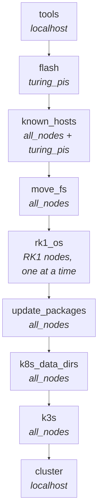

# Ansible Roles in Detail

The playbook `pb_all.yml` runs nine roles in sequence. Each role is fully idempotent —
it checks state before acting and does nothing if the desired state is already achieved.

## Execution order



Each role is tagged with its own name, so you can run individual stages:

```bash
ansible-playbook pb_all.yml --tags tools
ansible-playbook pb_all.yml --tags flash
# etc.
```

The `servers` tag covers `move_fs`, `rk1_os`, `update_packages`, and `k8s_data_dirs`.

---

## `tools` — CLI tool installation

**Runs on:** localhost (devcontainer)
**Tag:** `tools`

Installs command-line tools needed to manage the cluster:

| Tool | Version | Purpose |
|------|---------|---------|
| `helm` | 3.20.0 | Kubernetes package manager |
| `kubectl` | latest stable | Kubernetes CLI |
| `kubeseal` | 0.35.0 | Sealed Secrets CLI |
| `helm-diff` | plugin | Shows Helm upgrade diffs |

Also creates:

- Shell completions for helm, kubectl (bash + zsh)
- `k` alias for kubectl
- Port-forward helper scripts: `argo.sh`, `grafana.sh`, `dashboard.sh`
- Sets PATH to include `$BIN_DIR`

The role is split across multiple task files:

- `shell.yml` — PATH, zsh theme
- `helm.yml` — Helm binary + helm-diff plugin
- `kubectl.yml` — kubectl binary + completions
- `kubeseal.yml` — kubeseal binary
- `scripts.yml` — port-forward helper scripts

---

## `flash` — BMC-based OS flashing

**Runs on:** `turing_pis` (BMC hosts)
**Tag:** `flash`
**Guard:** only runs when `do_flash` is true (`-e do_flash=true` or `-e flash_force=true`)

Flashes Ubuntu 24.04 LTS onto Turing Pi compute modules via the BMC's `tpi` CLI.

### How it works

1. **Discover nodes** — looks for the inventory group `<bmc_hostname>_nodes`
   (e.g. `turingpi_nodes` for BMC host `turingpi`).
2. **For each node:**
   - Check if the node is already contactable via SSH (skip if so, unless force).
   - Download the OS image (RK1 or CM4) to `/tmp` on the devcontainer.
   - SCP the image to the BMC at `/mnt/sdcard/images/`.
   - Power off the node.
   - Run `tpi flash --node <slot>` (async, up to 600 seconds).
   - Wait for flash to complete.
3. **Bootstrap cloud-init:**
   - Enter MSD mode (mount the node's eMMC as USB storage on the BMC).
   - Render `cloud.cfg` with the node's hostname and the `ansible` user + SSH key.
   - SCP the config to the node's filesystem.
   - Clear cloud-init cache, reboot, and wait for SSH.

### OS images

| Type | Image | Source |
|------|-------|--------|
| RK1 | Ubuntu 24.04 (rockchip vendor image; `rk1_os` converts it to stock Ubuntu) | `github.com/Joshua-Riek/ubuntu-rockchip` |
| CM4 | Ubuntu 24.04 Server | `cdimage.ubuntu.com` |

### Idempotency

- Node is pinged first — if contactable and `flash_force` is not set, flashing is skipped.
- Images are only downloaded if not already present.

---

## `known_hosts` — SSH host key management

**Runs on:** `all_nodes`, `turing_pis`
**Tag:** `known_hosts`
**Constraint:** `serial: 1` (must not run in parallel)

Updates every file in `known_hosts_files` (`group_vars/all.yml`) with fresh
SSH host keys for each node. By default that is both `~/.ssh/known_hosts` and
the system-wide `/etc/ssh/ssh_known_hosts`:

1. Look up the node's IP via `dig`.
2. Remove old entries (by hostname and IP).
3. Scan for current SSH host keys (`ssh-keyscan`).
4. Add the new keys.
5. Make `/etc/ssh/ssh_known_hosts` world-readable.

The system-wide file is what the Claude sandbox uses: its `$HOME` is a fresh
tmpfs with no `~/.ssh`, but it sees the devcontainer's `/etc` read-only. The
devcontainer's `postCreate.sh` runs this tag so the file is repopulated on
every rebuild. Because the sandbox cannot write `/etc`, run the tag from a
regular devcontainer terminal, not from inside the sandbox.

:::{warning}
This role must run with `serial: 1` because parallel writes to the known_hosts
files cause race conditions and file corruption.
:::

---

## `move_fs` — OS migration to NVMe

**Runs on:** `all_nodes`
**Tag:** `servers`
**Guard:** only activates for nodes with `root_dev` defined in the inventory

Migrates the root filesystem from eMMC to NVMe using `ubuntu-rockchip-install`:

1. Check the current root device.
2. If not already on the target device, run `ubuntu-rockchip-install` to the NVMe.
3. Reboot.

:::{note}
`ubuntu-rockchip-install` gives the NVMe two partitions: p1, a 4 MB vfat `CIDATA`
partition holding the cloud-init seed, and p2, the ext4 root. U-Boot stays on the
eMMC, but its boot order (`mmc1 nvme scsi usb mmc0 ...`, and the RK1 has no `mmc1`)
tries the NVMe before the eMMC.

`tpi flash` rewrites only the eMMC (U-Boot plus the vendor OS), so it does not take
over a node whose NVMe is bootable: the node keeps booting the NVMe OS.
:::

---

## `rk1_os` — stock Ubuntu on RK1 nodes

**Runs on:** `all_nodes`, one node at a time (`serial: 1`), in its own play between
`move_fs` and `update_packages`. With `serial: 1`, one failed RK1 stops the
playbook for all hosts, including those not yet reached.
**Tag:** `servers`, `rk1_os`
**Guard:** only nodes with `type: rk1` whose root is not on the eMMC (`mmcblk`);
`move_fs` moves it to the NVMe; standard Ubuntu installs are skipped (below)

Converts an RK1 from the archived ubuntu-rockchip vendor image (6.1 vendor kernel,
U-Boot reading extlinux) to stock Ubuntu 26.04: Ubuntu's generic kernel, booted
U-Boot → EFI → GRUB. It runs after `move_fs`, which needs the vendor PPA this role
removes.

Only the vendor layout is converted: root on an NVMe partition other than p1,
and p1 the vendor image's vfat `CIDATA` partition. A standard Ubuntu install, such
as Ubuntu's preinstalled RK1 server image (root on p1, `CIDATA` on p14, its own ESP
on p15 at `/boot/efi`, shim and GRUB), is skipped with a message and left
unchanged. The role counts a node as a standard install when it booted through
EFI, runs the target release, has no release upgrade record from the role, has
`/boot/efi` mounted from a partition other than p1, and has none of the vendor
PPA's packages (`rk1_os_vendor_packages`; the generic extras such as `u-boot-tools`
ship in stock images too) and no enabled `jjriek` PPA source or pin. A converted node mounts p1 at
`/boot/efi`, so it is still checked on every run. Any other layout fails before
the role changes anything. End state of a converted node:

- `flash-kernel` pinned out and purged (it does not support the RK1); the
  ubuntu-rockchip PPA sources and pins renamed `*.disabled`; `Prompt=lts`.
- The GA kernel, `linux-generic`, not HWE: GA stays on one kernel series for the
  life of the release, whereas HWE moves to a new series with each point release.
- Kernel hooks `/etc/kernel/post{inst,rm}.d/zx-rk1-dtb` keep
  `/boot/dtb-<version>` (the kernel's `rk3588-turing-rk1.dtb`), which GRUB's
  `10_linux` loads with a `devicetree` line.
- NVMe p1 retyped to EFI System (not reformatted: it still holds the cloud-init
  seed; the role first checks it is the vfat `CIDATA` partition and not the root) and mounted at `/boot/efi`. `grub-efi-arm64` without recommends (no shim,
  signed GRUB or os-prober), installed to the removable path
  `EFI/BOOT/BOOTAA64.EFI` without touching NVRAM.
  `/etc/default/grub.d/50-rk1.cfg` sets the kernel command line
  (`rk1_os_cmdline`), a 3 second menu (`rk1_os_grub_timeout`) and a console
  terminal.
- No extlinux tooling: `u-boot-menu` purged and `extlinux.conf` removed. U-Boot
  scans p1 first and boots its EFI binary.
- After the release upgrade, the vendor packages purged (the 6.1 kernel,
  `u-boot-turing-rk1`, `ubuntu-rockchip-settings*`, Mali and camera packages, and
  what only they pulled in), along with a few generic Ubuntu packages the vendor
  metapackage recommended and the RK1 does not need (`rk1_os_vendor_packages`,
  `rk1_os_vendor_extra_packages`),
  obsolete libraries autoremoved and `*.dpkg-bak`/`*.distUpgrade` files deleted.
  These removals, and the smaller purges earlier (`flash-kernel`, `u-boot-menu`,
  the HWE metapackages, shim and os-prober), are simulated first and stop if they
  would take a package in
  `rk1_os_protected_packages` (sshd, cloud-init, `nfs-common`, `open-iscsi`, the
  running kernel and others).

The role never writes to the eMMC, whose first 16 MiB hold U-Boot.

### Order for a node on 24.04

1. Pin `flash-kernel` out and disable the PPA.
2. Install `linux-generic-hwe-24.04` (7.0) and GRUB on the ESP as above.
3. Reboot into GRUB through EFI and check `/sys/firmware/efi`.
4. Drain the node, then run `do-release-upgrade` under `systemd-run`, since sshd stops for several
   minutes while openssh moves to socket activation, and poll until it exits.
5. Fail if packages are left half-configured; otherwise reinstall GRUB to the ESP,
   reboot, uncordon and clean up.

Every step is safe to re-run: a running upgrade is waited for (up to two hours),
before any apt task, not restarted. `/var/lib/rk1_os/release-upgrade.rc` records
an upgrade still awaiting its checks and reboot, and `release-upgrade.started`
one that began. An upgrade that died without its exit status, on either release,
gets the same post-upgrade checks, GRUB reinstall and reboot, rather than going
straight to the cleanup or a plain `apt dist-upgrade`; on the old release the
checks fail and say what to fix. Both records are removed as soon as the upgraded
release has booted through EFI, before the wait for k3s, so a k3s problem does not
cause another reboot on a re-run. If the checks fail, fix the packages
(`dpkg --configure -a`, `apt -f install`) and re-run; delete the `.rc` (or
`.started`) file only to retry an upgrade that left `/etc/os-release` on the old
release.

Before any apt task, and again after the release upgrade, the role checks that the
enabled apt sources name no other release than `/etc/os-release` (after the
upgrade, the target release). `do-release-upgrade` rewrites the sources before it
upgrades any package and restores them if it aborts, so a killed or aborted upgrade
can leave them on the wrong release; the role then stops and asks you to check
them (the old files are kept as `*.distUpgrade`). A `dpkg --audit` that is unclean
without a release upgrade record from the role is not treated as an upgrade: the
role waits up to five minutes for apt and dpkg to go idle (unattended-upgrades on a
freshly booted node), then fails if the audit is still unclean, asking you to run
`dpkg --configure -a`. Before each reboot the role checks that `BOOTAA64.EFI` exists, that
grub.cfg boots its first top-level menu entry by default (`GRUB_DEFAULT` 0 or unset)
and that this entry loads the newest kernel with its device tree.

A node counts as in the cluster when its k3s unit (`k3s.service` on the
`control_plane` node, `k3s-agent.service` elsewhere) is installed and the API
server has a Node of its name; with k3s installed, a failed API lookup fails the
run rather than reboot an undrained node. Such a node is drained before each reboot
and before the release upgrade; after the reboot the role waits for the k3s unit
and the Ready node, then uncordons it, unless it was already cordoned before the
role drained it. `/var/lib/rk1_os/drained` records that the role cordoned it; the
role's last step uncordons such a node once k3s is active and the node Ready, so a
re-run that needs no reboot does not leave it cordoned.

The release upgrade takes about 15–20 minutes, during which sshd is down for
most of it. A conversion can be followed on the node's serial console with
`tpi uart --node <slot> get` on the BMC.

---

## `update_packages` — OS preparation

**Runs on:** `all_nodes`
**Tag:** `servers`

Prepares each node for K3s:

1. `dpkg --configure -a` (fix any interrupted package operations)
2. `apt dist-upgrade` (full OS upgrade)
3. Reboot if required (kernel updates)
4. `apt autoremove` (clean up)
5. Install required packages:
   - `unattended-upgrades` — automatic updates
   - `original-awk` — required by some K3s scripts
6. **Non-workstation nodes only:** configure unattended-upgrades to install
   from the `-updates` pocket as well as `-security` (so kernel updates are
   included), without rebooting, nightly at 00:00 Europe/London
   (`update_packages_upgrade_on_calendar`). kured does the reboot; see
   {doc}`/explanations/upgrade-model`.
7. **NVIDIA GPU nodes only** (when `nvidia_gpu_node: true` in inventory):
   - Install `ubuntu-drivers-common` and run `ubuntu-drivers install` to install the GPU driver
   - Add the NVIDIA container toolkit apt repository and install `nvidia-container-toolkit`
   - Write `/var/lib/rancher/k3s/agent/etc/containerd/config.toml.tmpl` with the NVIDIA
     runtime set as the default containerd runtime. k3s regenerates `config.toml` on
     every agent restart from this template, so the configuration persists across reboots.
   - Restart `k3s-agent` to apply the new containerd config

---

## `k8s_data_dirs` — Local PV host directories

**Runs on:** `all_nodes`
**Tag:** `servers`

Creates the host directories that back the `local-nvme` PVs defined in
`kubernetes-services/additions/local-storage/`. Each app's PV is pinned via
`nodeAffinity` to one specific node, so the role creates each directory only
on its target node (guarded by `inventory_hostname`).

| Node   | Directory                         | Owner / mode         | Consumed by |
|--------|-----------------------------------|----------------------|-------------|
| node02 | `/var/lib/k8s-data/prometheus`    | 1000:2000 / 0755     | monitoring  |
| node03 | `/var/lib/k8s-data/grafana`       | 472:472 / 0755       | monitoring  |
| nuc2   | `/home/k8s-data/scrap`            | 10001:10001 / 0750   | scrap (frozen pre-Litestream copy) |
| nuc2   | `/home/k8s-data/scrap-backup-copy` | 10001:10001 / 0750  | scrap (off-NAS backup copy) |

Data lives outside `/var/lib/rancher` deliberately: `pb_decommission.yml`
wipes `/var/lib/rancher` to reset K3s, but these directories are preserved
**by default** so PVC data survives a cluster rebuild. To wipe them as
part of decommissioning, opt in with the destructive flag:

```bash
ansible-playbook pb_decommission.yml -e wipe_local_data=true
```

The one-time NFS share setup that hosts the backup CronJob output is a
separate manual runbook — see {doc}`../how-to/nas-setup`.

---

## `k3s` — Kubernetes installation

**Runs on:** `all_nodes`
**Tag:** `k3s`

Installs K3s with one control plane node and the rest as workers. The
control plane gets the newest patch of the release channel for `k3s.minor`
in `kubernetes-services/values.yaml`; workers join at the version the
control plane runs. `-e k3s_version=...` pins an exact release on that line.
The role fails rather than install an older minor than a node already runs.
Later patch upgrades are automatic; see {doc}`/how-to/upgrade-k3s`.

### Control plane (`control.yml`)

- Downloads the K3s install script.
- Runs: `k3s server --disable=traefik --cluster-init`
- Traefik is disabled because this project uses NGINX Ingress.
- `--cluster-init` enables embedded etcd.

### Workers (`worker.yml`)

- Checks if the node is already in the cluster (skip if so, unless force).
- Gets the join token from the control plane.
- Runs the K3s agent installer.
- Labels NVIDIA GPU nodes with `nvidia.com/gpu.present=true` (when `nvidia_gpu_node: true`
  in inventory). This bootstraps scheduling for the NVIDIA device plugin DaemonSet, which
  then takes over and advertises `nvidia.com/gpu` allocatable resources to the scheduler.

### Kubeconfig (`kubeconfig.yml`)

- Copies `k3s.yaml` from the control plane to `~/.kube/config` on the devcontainer.
- Replaces `127.0.0.1` with the control plane's actual IP.

### Force reinstall

With `-e k3s_force=true`, K3s is uninstalled first (`k3s-uninstall.sh` on control plane,
`k3s-agent-uninstall.sh` on workers), then reinstalled.

---

## `cluster` — ArgoCD and service deployment

**Runs on:** localhost (devcontainer)
**Tag:** `cluster`

Bootstraps ArgoCD and the entire service stack:

1. **Taint the control plane** (multi-node only) — applies `NoSchedule` taint so
   workloads only run on worker nodes. Skipped for single-node clusters.
2. **Install ArgoCD** — deploys the ArgoCD OCI Helm chart (v9.4.17).
3. **Patch ConfigMap** — adds a custom Lua health check for `monitoring.coreos.com/Prometheus`
   (respects a `skip-health-check` annotation).
4. **Create AppProject** — creates the `kubernetes` ArgoCD project allowing access to
   all repos, namespaces, and cluster-scoped resources.
5. **Create root Application** — creates `all-cluster-services` pointing at
   `kubernetes-services/` in the repository. Passes `repo_remote`, `cluster_domain`,
   and `domain_email` as Helm values.
6. **Create ArgoCD Ingress** — creates an Ingress for `argocd.<cluster_domain>` with
   SSL passthrough.

After this role completes, ArgoCD takes over and syncs all services defined in
`kubernetes-services/templates/`.

The `cluster_install_list` variable in `group_vars/all.yml` controls which services
the Ansible role installs directly (currently just `argocd`). Everything else is
managed by ArgoCD once it's running.
