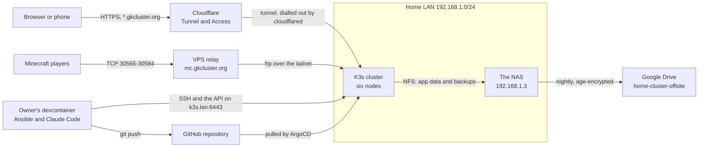
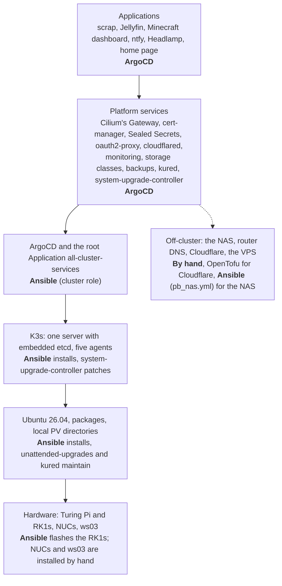

# Architecture overview

This is a six-node K3s homelab at `gkcluster.org`. Three Turing RK1 modules
on a Turing Pi board (node02, node03, node04), two Intel NUCs (nuc1, nuc2)
and a GPU workstation (ws03) make up the cluster. A QNAP NAS holds the data,
Cloudflare is the public edge, and a small VPS relays the ports that
Cloudflare cannot carry. Ansible provisions the machines, ArgoCD delivers
everything that runs on them from this repository, and Claude Code does much
of the day-to-day work from a sandbox on the owner's workstation.

It runs scrap (a personal knowledge store with an MCP endpoint), Jellyfin, a
Minecraft dashboard that launches game worlds, ntfy for push notifications,
and the platform under them: Cilium's Gateway, cert-manager, Sealed Secrets,
oauth2-proxy, Prometheus and Grafana, nightly self-patching and nightly
encrypted backups.

## System context

Who reaches the cluster, and by which route:



Nothing listens on the home's public address. Web traffic arrives through a
tunnel that `cloudflared` dials out from the cluster, game traffic arrives
through a tunnel that `frpc` dials out to the VPS over the tailnet, and
administration happens on the LAN or the tailnet.

## Layers

Each layer has one owner. Knowing the owner tells you where a change goes:
an Ansible variable, a file under `kubernetes-services/`, or a job done by
hand.



## The pages in this set

- {doc}`/explanations/architecture/hardware`:
  The six nodes, what each one is, what is pinned to it and why, and the
  kit around the cluster: the BMC, the NAS, the router and the VPS.
- {doc}`/explanations/architecture/provisioning`:
  What Ansible owns: flashing the RK1s, the operating system, K3s and the
  ArgoCD bootstrap, and where it hands over to ArgoCD.
- {doc}`/explanations/architecture/gitops`:
  How a merged commit becomes a running workload: the app-of-apps, how
  values flow, sync policy, and the path of a change through PR and CI.
- {doc}`/explanations/architecture/networking`:
  The routes into the cluster: Cloudflare Tunnel to Cilium's Gateway, the LAN
  and tailnet names, the VPS relay for game ports, and DNS inside and out.
- {doc}`/explanations/architecture/authentication`:
  Who is allowed in: Cloudflare Access at the edge, then GitHub sign-in
  through Dex or oauth2-proxy, and the services that carry their own tokens.
- {doc}`/explanations/architecture/security`:
  Secrets as `SealedSecret` resources in Git, network policy, pod hardening
  and what each credential can reach.
- {doc}`/explanations/architecture/storage`:
  Three storage classes and when each is used: `nfs-stable` on the NAS for
  application data, node-pinned `local-nvme` volumes, and `nfs-rwx` scratch.
- {doc}`/explanations/architecture/backups`:
  What is backed up nightly, to the NAS and then off-site, and how each
  piece is restored, up to losing the control plane.
- {doc}`/explanations/architecture/claude-code`:
  Where Claude Code runs, what it can reach and with which credential, and
  what stops it doing damage.

## Why these choices?

| Choice | Reason |
|--------|--------|
| K3s over full Kubernetes | One binary with a small footprint, which matters on 8 GB RK1s; CoreDNS, metrics-server and a service load balancer come with it |
| One K3s server, plus a warm standby | Three etcd members would spend half the small nodes on quorum. Instead node02 runs alone, its etcd is backed up nightly, and node03 is kept lightly loaded to take a restore ({doc}`/how-to/recover-control-plane`) |
| A stable API name, `k3s.lan` | Agents, the server certificate and the kubeconfig use a router DNS record, so the control plane can move to another node without re-joining the agents |
| ArgoCD over Flux | Its UI makes a homelab's state visible at a glance, and the app-of-apps pattern keeps one file per service |
| Cilium's Gateway API over an ingress controller | Cilium already runs Envoy on every node, and its ExternalAuth filter puts oauth2-proxy in front of an app; it replaced ingress-nginx, retired upstream (ADR 0016). K3s's Traefik is disabled |
| cert-manager with DNS-01 | No service has a public HTTP route for an HTTP-01 challenge; one wildcard certificate covers every hostname |
| Sealed Secrets over SOPS | Secrets live in Git encrypted to a key only the cluster holds, with no external key service to run |
| Cloudflare Tunnel and Access | No open ports or public IP at home, and a login wall in front of every hostname before traffic reaches the cluster, except the two that are public on purpose (`pages` and `ntfy`) |
| Cloudflare as OpenTofu code | DNS records, tunnel routes, Access applications and WAF rules are reviewed and applied from `cloudflare/` (`just cf-plan`, `just cf-apply`) instead of clicked in a dashboard |
| VPS relay for non-HTTP ports | Cloudflare Tunnel carries only HTTP(S). Minecraft's TCP ports are published on a VPS that the cluster dials over the tailnet, so the home address stays private |
| Tailnet for remote shell and Jellyfin | Neither suits a public tunnel: SSH needs no public hostname at all, and video streaming is outside what the Cloudflare proxy is for. Jellyfin has no HTTPRoute |
| `nfs-stable` as the default storage class | Each claim gets a fixed folder on the NAS, so application data survives a cluster rebuild and a pod can run on any node |
| Static `local-nvme` volumes for the few that need local disk | Prometheus, Grafana and Jellyfin's database want a local filesystem. Each gets one pinned PV; there is no replicated block storage to run (ADR 0012) |
| Litestream on NFS for scrap | SQLite on NFS is unsafe, so scrap's database lives on the pod's node and Litestream replicates it to the NAS about once a second. scrap can then start on any node (ADR 0013) |
| Self-patching nodes | unattended-upgrades, system-upgrade-controller and kured apply OS and K3s patch releases and reboot nodes overnight, one at a time ({doc}`/explanations/upgrade-model`) |
| A devcontainer as the controller | Ansible, `kubectl`, `helm`, `kubeseal` and OpenTofu at known versions, with nothing installed on the host |
| claude-sandbox around Claude Code | The agent holds real cluster credentials, so the boundary is enforced outside it: a `bwrap` jail and a fail-closed egress filter that allows only the cluster hosts and the NAS |

The decisions with a longer history are recorded in
{doc}`/explanations/decisions`.

## What is deliberately manual

Some things are left out of the automation on purpose.

- **The NAS is outside the cluster playbooks.** `pb_nas.yml` manages it
  (Ubuntu Server and ZFS) on its own, and never destroys data: no task destroys a
  pool, dataset or snapshot (checked by `just check`; sanoid's timer does
  prune snapshots past their retention), pool creation is opt-in and refuses
  an existing pool (with `nas_force` it does wipe the named disks, which is
  its purpose), and the cluster playbooks never touch it
  ({doc}`/how-to/nas-ubuntu-zfs`).
- **Cloudflare login methods.** The Access identity providers are set up
  once in the dashboard; everything else at Cloudflare is code
  ({doc}`/how-to/cloudflare-as-code`).
- **The offline age key.** Backups are encrypted to a public key in the
  repository. The private key is kept offline by the owner, so nothing in
  the cluster or on the NAS can decrypt them ({doc}`/how-to/backup-restore`).
- **Workstation reboots.** ws03 is the owner's desktop. kured does not run
  on it and no playbook reboots it.
- **K3s minor upgrades.** Patch releases arrive on their own; a new minor
  is an edit to `k3s.minor` in `kubernetes-services/values.yaml`
  ({doc}`/how-to/upgrade-k3s`).
- **The VPS side of the relay.** frps and its firewall are set up by a
  script run on the VPS, and re-run when a forwarded port changes
  ({doc}`/how-to/vps-relay`).

Where a visitor's setup would differ is mostly here and in the inventory:
the node names, addresses, NAS paths and domain are this site's, and are
spread across `hosts.yml`, `group_vars/all.yml` and
`kubernetes-services/values.yaml`.

```{toctree}
:hidden:
:maxdepth: 1

architecture/hardware
architecture/provisioning
architecture/gitops
architecture/networking
architecture/authentication
architecture/security
architecture/storage
architecture/backups
architecture/claude-code
```
