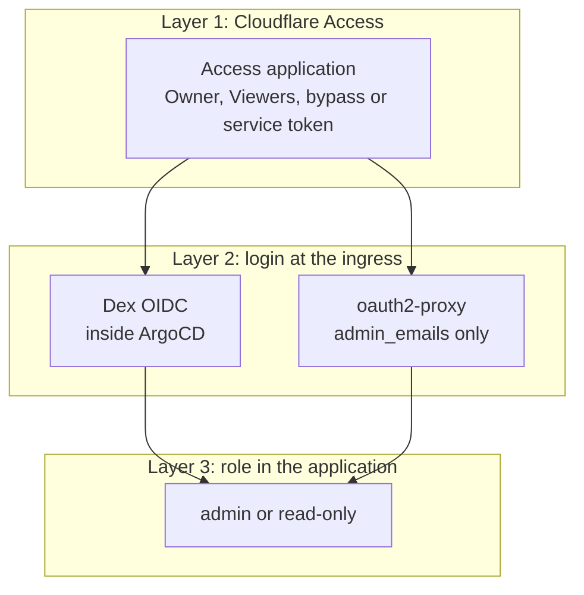
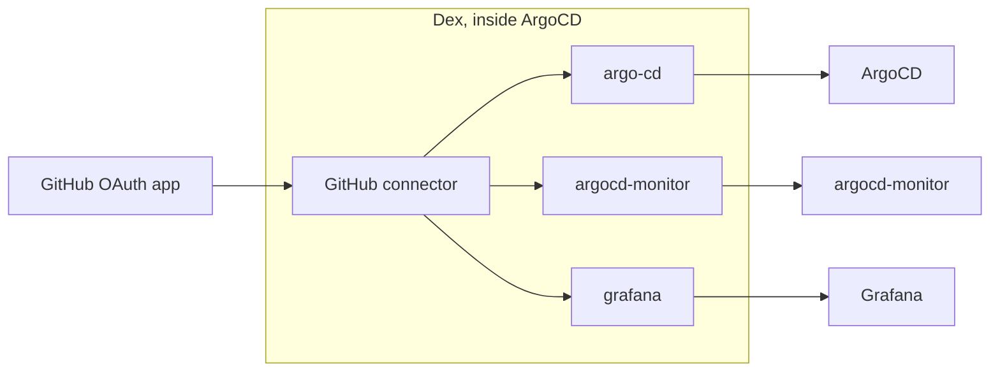
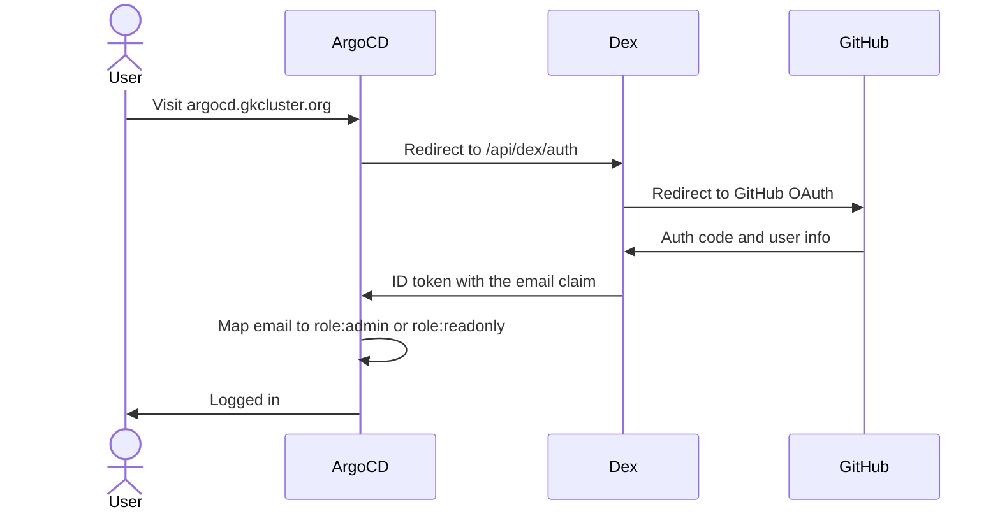
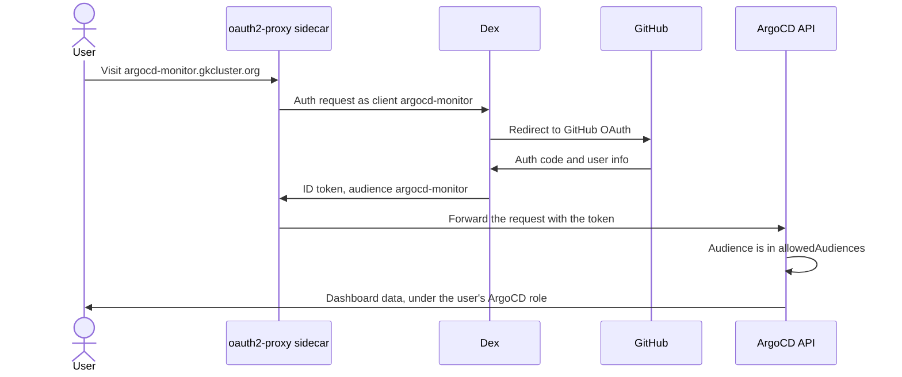
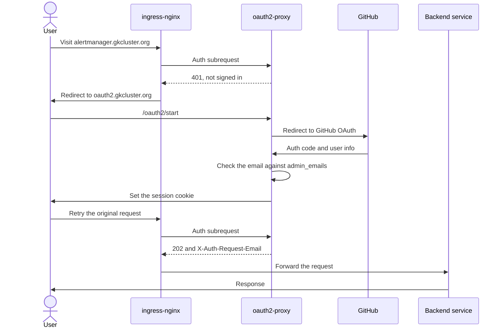
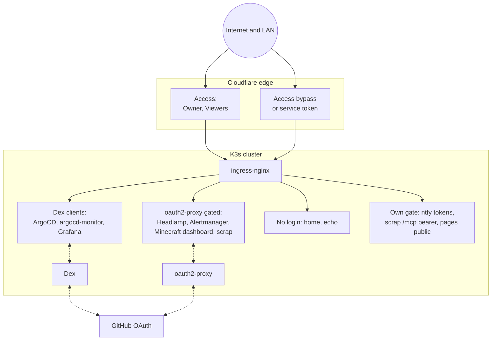

# Authentication

Every web service on the cluster is published through Cloudflare, and a
request passes up to three checks before it gets a response: Cloudflare
Access at the edge, a GitHub login at the ingress, and a role inside the
application. This page says which service uses which, and why there are two
different login mechanisms. How a request physically reaches ingress-nginx is
on the {doc}`networking page </explanations/architecture/networking>`.

## Three layers

**Layer 1, Cloudflare Access,** decides who reaches the cluster at all. It
runs at Cloudflare's edge, before anything is sent down the tunnel.

**Layer 2** proves identity again inside the cluster, with GitHub as the
identity source both times. Services that speak OIDC use Dex, the provider
built into ArgoCD. Services with no login of their own sit behind
oauth2-proxy, which ingress-nginx consults on every request.

**Layer 3** maps the email address from layer 2 to a role. The addresses in
`admin_emails` are administrators; anyone else who got this far is read-only.

The layers overlap on purpose. Access is the one that matters from the
internet, but ingress-nginx also answers on the LAN, where Access is not in
the path, so layer 2 has to stand on its own.

## Layer 1: Cloudflare Access

The Access configuration is code, in `cloudflare/access.tf`. There are four
reusable policies:

| Policy | Lets in | Session |
|--------|---------|---------|
| Owner | The addresses in `owner_emails`, and only through the GitHub login method | 24 h |
| Viewers | The addresses in `viewer_emails` and the domains in `viewer_email_domains`, by any login method (one-time PIN or GitHub) | 6 h |
| bypass | Everyone | n/a |
| scrap-mcp-policy | Requests carrying the `mcp-access` service token | n/a |

and five applications that use them:

| Application | Covers | Policies |
|-------------|--------|----------|
| `clusterapps` | `*.gkcluster.org` | Owner |
| `Demo` | `argocd`, `grafana`, `argocd-monitor` | Viewers, then Owner |
| `pages` | `pages.gkcluster.org` | bypass |
| `ntfy` | `ntfy.gkcluster.org` | bypass |
| `scrap` | `scrap.gkcluster.org/mcp` | scrap-mcp-policy |

Cloudflare applies the most specific application to a request. So the
wildcard makes everything owner-only by default, and each exception is a
visible, named application: three read-only dashboards that invited viewers
may see, two hostnames that are public on purpose, and one path for a
non-browser client.

**The guard.** `cloudflare/access_guard.tf` turns that default into a rule
the plan enforces. Every `tunnel_services` entry, and every proxied
`dns_only_records` entry, must be covered by an application whose policies
all ask for an identity or a service token; an application that lets anyone
in may only target a hostname marked `access_bypass = true` in
`cloudflare/locals.tf`. A breach of either half fails `tofu plan` before
anything reaches Cloudflare. Publishing a hostname with nothing in front of
it therefore takes two deliberate edits, not one omission. See
{ref}`public and service-token services <cf-access-bypass>`.

The login methods themselves (one-time PIN and GitHub) are set up once in
the Zero Trust dashboard: Cloudflare never returns an OAuth client secret,
so code could not keep them in step. The `mcp-access` service token is also
created in the dashboard, because its secret is shown once and belongs with
the client, not in state.

## Layer 2: Dex

ArgoCD ships with [Dex](https://dexidp.io/). Rather than run a separate
identity provider, every OIDC-capable service shares it. Dex has one
connector, to a GitHub OAuth app whose callback is
`https://argocd.gkcluster.org/api/dex/callback`, and three static clients,
declared in the `dex.config` block of `roles/cluster/tasks/argocd.yml`:

The `argo-cd` client's secret is derived from ArgoCD's own server key
(`scripts/derive-argocd-client-secret`); the other two come from the
`argocd-dex-secret` SealedSecret. Dex accepts any GitHub account: it is
Access, in front, that decides who gets as far as the login button.

Dex is used because a full identity provider such as Keycloak or Authentik
wants around 2 GB of memory, which is a quarter of an 8 GB RK1. Dex adds one
small pod to an ArgoCD that is already running.

### ArgoCD: native login

The built-in `admin` account is disabled (`admin.enabled: "false"`); the only
way in is GitHub through Dex.

The RBAC lives in `configs.rbac` in the same task file. `scopes` is
`[email]`, each address in `admin_emails` gets `g, <email>, role:admin`, and
`policy.default` is `role:readonly`, with log reading added.

### argocd-monitor: a second client of the same Dex

argocd-monitor is a dashboard over the ArgoCD API. Its chart runs its own
oauth2-proxy as a sidecar (not the cluster-wide one), configured as the
`argocd-monitor` Dex client.

ArgoCD accepts the token because its `oidc.config` lists both `argo-cd` and
`argocd-monitor` under `allowedAudiences`, and the `argo-cd` client names
`argocd-monitor` as a trusted peer. The dashboard therefore shows exactly
what the user's own ArgoCD role allows.

### Grafana: generic OAuth

Grafana uses its `auth.generic_oauth` provider against the same Dex
endpoints. The login form is disabled, so the only button is "GitHub (via
Dex)". A `role_attribute_path` expression built from `admin_emails` gives
those addresses `Admin` and everyone else `Viewer`.

## Layer 2: oauth2-proxy

Headlamp, Alertmanager, the Minecraft dashboard and scrap have no usable
login of their own. They share one cluster-wide oauth2-proxy (two replicas,
sessions in an encrypted cookie on `.gkcluster.org`), which talks to GitHub
directly, not through Dex, and admits only the addresses in `admin_emails`.

The shared Ingress chart (`kubernetes-services/additions/ingress/`) adds the
`auth-url` and `auth-signin` annotations when a service sets
`oauth2_proxy: true`. Headlamp follows the `enable_oauth2_proxy` switch; the
Minecraft dashboard and scrap have it hard-wired on, so that without the
proxy they fail closed.

:::{important}
`auth-url` uses the Service's cluster address,
`http://oauth2-proxy.oauth2-proxy.svc.cluster.local/oauth2/auth`, not
`oauth2.gkcluster.org`. The public name resolves to Cloudflare, over an IPv6
address the pods cannot reach, and the subrequest would fail with
intermittent 500 errors.
:::

Three services add something on top:

- **Headlamp** then asks for a Kubernetes token. `just headlamp-token` mints
  one for the `headlamp` ServiceAccount, which is bound to `cluster-admin`.
- **The Minecraft dashboard** does no authentication itself, but logs
  `X-Auth-Request-Email` with every action.
- **scrap** has a second Ingress for `/mcp` only, without the oauth2-proxy
  annotations, because an MCP client cannot do a browser login. That path is
  protected by the Access service token at the edge and by scrap's own
  bearer token. A NetworkPolicy admits only ingress-nginx to the scrap pod,
  so nothing else in the cluster can forge the identity headers.

## Who can reach what

| Endpoint | Layer 1: Access | Layer 2: login | Layer 3: role |
|----------|-----------------|----------------|---------------|
| `argocd` | Viewers or Owner | Dex (GitHub) | `role:admin` for `admin_emails`, else `role:readonly` |
| `argocd-monitor` | Viewers or Owner | Dex, through its own sidecar | The user's ArgoCD role |
| `grafana` | Viewers or Owner | Dex (GitHub) | `Admin` for `admin_emails`, else `Viewer` |
| `headlamp` | Owner | oauth2-proxy | Pasted ServiceAccount token: `cluster-admin` |
| `alertmanager` | Owner | oauth2-proxy | None |
| `hubble` | Owner | oauth2-proxy | None; the Hubble UI has no login and shows every flow |
| `minecraft` (dashboard) | Owner | oauth2-proxy | None; actions logged by email |
| `scrap` | Owner | oauth2-proxy | None; scrap has no login |
| `scrap` `/mcp` | Service token | scrap's bearer token | None |
| `pages` | Bypass: public | None | Static files only |
| `ntfy` | Bypass: public | ntfy's own access tokens | Per-user topic permissions; anonymous is denied |
| `home` | Owner | None | Static landing page |
| `echo` | Owner | None | Test service |
| `oauth2` | Owner | It is the login | n/a |
| Jellyfin | Not on Cloudflare: LAN and tailnet only | Jellyfin's own users | Jellyfin's own |
| Minecraft game ports | Not on Cloudflare: VPS relay | Minecraft account (online mode) | The world's whitelist and ops |
| Kubernetes API (`k3s.lan:6443`) | Not on Cloudflare: LAN and tailnet | Client certificate in the kubeconfig | `cluster-admin` |
| SSH to nodes | Not on Cloudflare: LAN and tailnet | Key, as the `ansible` account | Passwordless sudo |

## The whole picture

Solid lines are requests; dashed lines are login redirects.

## Managing access

- **Owner and viewers** live at Cloudflare: `owner_emails`, `viewer_emails`
  and `viewer_email_domains` in the gitignored `cloudflare/live.auto.tfvars`,
  applied with `just cf-apply`
  ({doc}`/how-to/cloudflare-as-code`). There is no viewer list in the
  cluster: a viewer is simply someone Access lets through who is not an
  administrator.
- **Administrators** are `admin_emails`, which exists in two files because
  Helm and Ansible each render part of the configuration:

  | File | Rendered into |
  |------|---------------|
  | `kubernetes-services/values.yaml` | oauth2-proxy's allowed-emails file; Grafana's `role_attribute_path` |
  | `group_vars/all.yml` | ArgoCD's RBAC policy (`roles/cluster/tasks/argocd.yml`) |

  Change both, push, then run
  `ansible-playbook pb_all.yml --tags cluster` for the ArgoCD half; ArgoCD
  syncs the other.

The OAuth client secrets and cookie secrets are SealedSecrets
(`argocd-dex-secret`, `grafana-oauth-secret`, `argocd-monitor-oauth-secret`,
`oauth2-proxy-credentials`). The full list, and how to rotate one, is in
{doc}`/how-to/manage-sealed-secrets`; first-time setup of the GitHub OAuth
apps is in {doc}`/how-to/oauth-setup`. A pod reads these values at start, so
a reseal needs a restart of the pods that use it.

## Why it is built this way

**Why two login paths.** Dex issues real OIDC tokens with an email claim, so
ArgoCD and Grafana can tell an administrator from a viewer. oauth2-proxy can
only say yes or no. Each is used where it fits: Dex for the applications
that have roles, oauth2-proxy for the ones that do not.

**Why oauth2-proxy is administrators only.** Alertmanager, Headlamp, the
Minecraft dashboard and scrap have no notion of a read-only user. Letting a
viewer through the proxy would give them everything, so the proxy's list is
`admin_emails` and nothing else.

**Why Dex lives inside ArgoCD.** It saves a deployment and reuses the GitHub
connector ArgoCD needs anyway. The cost is that Dex's configuration is part
of the ArgoCD Helm values that Ansible applies, so changing a client means a
`--tags cluster` run and not a Git push alone.

**Why Access and GitHub both.** Access keeps the whole internet away from
the login pages, and its policies are the only place viewers are listed.
The in-cluster login is what still holds when a request arrives without
passing Cloudflare, from the LAN.
