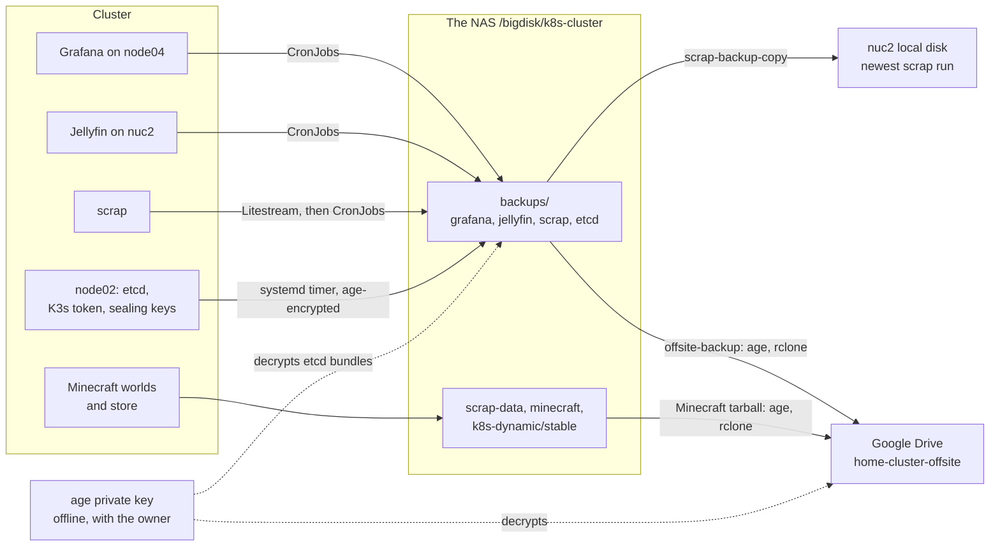
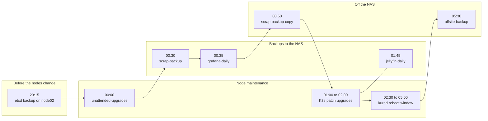
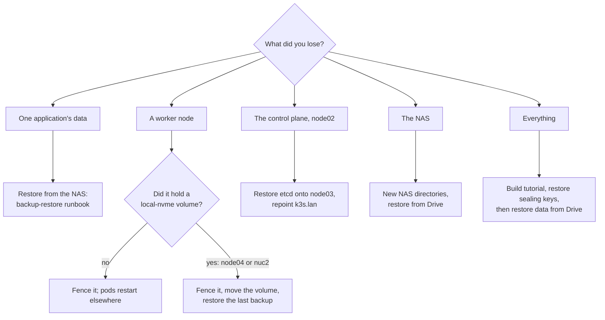

# Backups and disaster recovery

Git is the backup for configuration. Every manifest, chart version, role and
sealed credential is in this repository, and ArgoCD rebuilds the cluster's
contents from it. So the backup system only has to cover what Git cannot
hold: application data, the cluster's own state, and a handful of keys.

This page is the overview: what is backed up, when, to where, and which
runbook brings it back. The procedures themselves are in
{doc}`/how-to/backup-restore` and {doc}`/how-to/recover-control-plane`.

## The shape of it

Backups move outwards in three steps, and every step that leaves the house
is encrypted to a key the cluster does not have.

1. **To the NAS.** Each stateful workload has a job that writes a
   consistent copy to `/bigdisk/k8s-cluster/backups/` on the NAS. The NAS
   is a different machine from every node, so this covers a dead disk or a
   dead node.
2. **Off the NAS.** scrap's newest backup is also copied to nuc2's local
   disk, and everything under `backups/` is uploaded to Google Drive. That
   covers a dead NAS.
3. **Encrypted to an offline key.** The etcd bundles are encrypted before
   they reach the NAS, and everything is encrypted before it reaches Drive,
   with [age](https://github.com/FiloSottile/age) to one public key. The
   private key is not on the cluster, the NAS or Drive.

## What is not in Git

| Data | Lives on | Backed up by | When | To | Kept | Encrypted | Restore |
|------|----------|--------------|------|----|------|-----------|---------|
| Grafana database and provisioning | node04, `local-nvme` | `grafana-daily`, `grafana-weekly` CronJobs (`backups`): `sqlite3 .backup`, tarred | 00:35 daily; 00:40 Sundays | NAS `backups/grafana/`, `weekly/` | 7 days; 28 days | On Drive only | {doc}`/how-to/backup-restore` |
| Jellyfin database, config, plugins, library definitions | nuc2, `local-nvme` | `jellyfin-daily`, `jellyfin-weekly` CronJobs (`backups`) | 01:45 daily; 01:50 Sundays | NAS `backups/jellyfin/`, `weekly/` | 7 days; 28 days | On Drive only | {doc}`/how-to/jellyfin` |
| scrap database | The pod's `emptyDir` | Litestream replica | Continuous, about a second behind | NAS `scrap-data/litestream` | n/a | No | Automatic at pod start |
| scrap database and files | NAS `scrap-data` | `scrap-backup` and `scrap-backup-monthly` CronJobs (`scrap`) | 00:30 daily; 00:40 on the 1st | NAS `backups/scrap/`, `monthly/` | 7 runs; 12 runs | On Drive only | {doc}`/how-to/backup-restore` |
| scrap's newest backup run | NAS `backups/scrap/` | `scrap-backup-copy` CronJob | 00:50 daily | nuc2 `/home/k8s-data/scrap-backup-copy` | 3 runs | No | {doc}`/how-to/backup-restore` |
| Prometheus metrics | node04, `local-nvme` | Nothing | n/a | n/a | n/a | n/a | None: history starts again |
| Minecraft worlds | NAS `k8s-dynamic/stable/minecraft/` | The dashboard's snapshots and promoted backups, on demand | When the owner takes one | NAS `k8s-cluster/minecraft/` | The dashboard's own rules | No | {doc}`/how-to/minecraft` |
| Minecraft store, live worlds, deleted worlds | The NAS | `offsite-backup` (`minecraft` container): one tarball | 05:30 daily | Drive `minecraft/nightly/` | 7 tarballs | Yes | {ref}`offsite-backup` |
| Minecraft world archive | NAS `/bigdisk/minecraft-archive` | `offsite-backup` | Once, and again if it changes | Drive `minecraft/archive/` | Never pruned | Yes | {ref}`offsite-backup` |
| etcd snapshot, K3s server token, node password, K3s config | node02 | `k3s-etcd-backup.timer` (systemd, `etcd_backup` role) | 23:15 daily | NAS `backups/etcd/` | 14 bundles | Yes, before leaving the node | {doc}`/how-to/recover-control-plane` |
| Pre-upgrade etcd snapshots | node02 | Taken by the K3s upgrade Plan; shipped by the same timer | Before each K3s patch upgrade | NAS `backups/etcd/pre-upgrade/` | 4 | Yes | {doc}`/how-to/recover-control-plane` |
| Sealed Secrets private keys | `kube-system` Secrets | The same timer | 23:15 daily | NAS `backups/etcd/sealed-secrets-keys/` | 14 dated copies, plus the current one | Yes | {ref}`sealed-secrets-key-backup` |
| Everything under `backups/` on the NAS | The NAS | `offsite-backup` CronJob (`backups`): rclone | 05:30 daily | Drive `home-cluster-offsite/backups/` | Until gone from the NAS for 180 days, and never the 4 newest of a series | Yes | {ref}`offsite-backup` |
| OpenTofu state for Cloudflare | `cloudflare/terraform.tfstate` in the working copy (gitignored) | By hand | After a change | The owner's own copy | n/a | Yes, by OpenTofu with a passphrase | {doc}`/how-to/cloudflare-as-code` |
| `admin-auth` (Grafana's built-in admin password) | A Secret in `monitoring` | Not backed up | n/a | Password manager | n/a | n/a | `just set-admin-password` |
| The age private key | Offline | The owner, in two places | n/a | n/a | n/a | n/a | Without it no encrypted backup can be read |

Times are Europe/London. Every CronJob sets that time zone, so none follows
the control plane's clock (UTC).

Three things in that table deserve a reason:

- **Prometheus is not backed up.** Metrics refill by scraping, a consistent
  copy needs the snapshot API, and the history is not worth that machinery.
  Its volume still survives a cluster rebuild.
- **scrap has three layers** because it is the one application whose data
  cannot be recreated. The Litestream replica makes a node loss cost about a
  second. The nightly runs are point-in-time copies of the database and the
  files together. The copy on nuc2 exists because the live data, the
  replica and the backups are all on the same NAS.
- **etcd is backed up outside Kubernetes.** A systemd timer on the control
  plane keeps working when the API server does not, which is exactly when
  the backup matters. K3s also takes its own snapshots twice a day, but they
  stay on node02 and are lost with it.

## The off-site copy

The `offsite-backup` CronJob (`kubernetes-services/additions/backups/`,
settings in `offsite_backup` in `values.yaml`) uploads to the folder
`home-cluster-offsite` in a personal Google Drive with rclone. Its rules are
what make it safe to leave running:

- **Encrypted first.** Each file is streamed through `age` straight into
  the upload, so nothing readable is staged anywhere. Files that are
  already `.age` (the etcd bundles) go up as they are.
- **Add only.** It never mirrors a deletion. A backup that the NAS's own
  retention removes, or that a wiped or encrypted NAS loses, stays on
  Drive.
- **Cautious pruning.** A file on Drive is deleted only when its source has
  been gone from the NAS for more than `prune_days` (180) **and** it is not
  among the `keep_min` (4) newest of its series. An empty `backups/` (a
  missing mount, a wiped NAS) stops the job before it uploads or prunes.
- **A size check on Minecraft.** A nightly tarball smaller than
  `min_size_percent` (50) of the largest one on Drive fails the run and
  stops pruning, so a wiped source cannot push the good copies out.
- **Least privilege.** rclone's token has the `drive.file` scope: it sees
  only files it created. It can delete those, which is an accepted risk
  ({doc}`/explanations/architecture/security`).
- **Three identities.** The NAS squashes root and no single user can read
  everything, so three containers run side by side: `backups` as `nobody`
  for the etcd bundles and tarballs, `scrap` as uid 10001 for scrap's runs,
  and `minecraft` as uid 1000 for the worlds.

What does **not** go off site: scrap's live data volume (only its backup
runs do), the `local-nvme` volumes themselves (only the backups made from
them), other `nfs-stable` claims, the OpenTofu state, and the media
library.

## One night

Every job is timed around the nodes' own maintenance: the etcd backup before
anything changes, the backups to the NAS in the gap before the windows that
drain nodes, and the off-site copy after the last of them.

Arrows give the order in time, not a dependency between jobs.
`jellyfin-daily` runs inside the K3s upgrade window.

| Time | What | Where it is set |
|------|------|-----------------|
| 23:15 | etcd, token and sealing keys to the NAS, encrypted | `etcd_backup_on_calendar` (`roles/etcd_backup/defaults`) |
| 00:00, up to 30 min later | unattended-upgrades installs packages | `roles/update_packages/defaults` |
| 00:30 | `scrap-backup` (1st of the month, 00:40: `scrap-backup-monthly`) | the scrap chart; schedule and time zone in `templates/scrap.yaml` |
| 00:35 | `grafana-daily` (Sundays 00:40: `grafana-weekly`) | `additions/backups/templates/` |
| 00:50 | `scrap-backup-copy` to nuc2 | `additions/scrap/values.yaml` |
| 01:00 to 02:00 | system-upgrade-controller starts K3s patch upgrades; a pre-upgrade etcd snapshot comes first | `k3s.upgrade_window` |
| 01:45 | `jellyfin-daily` (Sundays 01:50: `jellyfin-weekly`) | `additions/backups/templates/cronjob-jellyfin.yaml` |
| 02:30 to 05:00 | kured drains and reboots nodes that need it, one at a time; never ws03 | `kured` |
| 05:30 | `offsite-backup` to Drive | `offsite_backup.schedule` |

The order is the design. The etcd backup runs before anything changes the
nodes, so there is always a snapshot from before the night's patching. The
off-site job runs last so that it carries that night's backups, not the
previous night's. The scrap and Grafana jobs, and scrap's copy to nuc2, run
between 00:30 and 01:00, after unattended-upgrades (which never drains or
reboots) and before the two windows that do. `jellyfin-daily` stays at 01:45,
after Jellyfin's own 01:00 tasks: a K3s patch round that drains nuc2 then
delays it, and a job interrupted that way is retried.

## Knowing when a backup failed

- **etcd:** the backup script writes `k3s_etcd_backup_*` metrics through
  node-exporter's textfile collector. Four rules in
  `additions/grafana/etcd-backup-rules.yaml` fire on a failed run, a bundle
  older than 36 hours, no success ever, or missing metrics. Alertmanager
  pushes these to the phone through ntfy.
- **Off-site:** `OffsiteBackupFailed`, `OffsiteBackupStale` and
  `OffsiteBackupNeverSucceeded` (`offsite-backup-rules.yaml`) fire from
  kube-state-metrics. They are warnings on the push list, so like the etcd
  alerts they reach the phone through ntfy.
- **The CronJobs to the NAS** are covered by kube-prometheus-stack's stock
  `KubeJobFailed`, also shown but not pushed.
- **scrap** has a cross-check: `scrap-backup-copy` fails if the newest
  complete run is more than 26 hours old, so a backup that silently stopped
  shows up as a failed Job the next morning.

Which alerts are pushed, and how to add one, is in
{doc}`/how-to/monitoring`.

## Recovery

| Lost | What to do | Runbook | Data lost |
|------|-----------|---------|-----------|
| Grafana or Jellyfin data (bad upgrade, deleted dashboard) | Restore a daily or weekly tarball from the NAS | {doc}`/how-to/backup-restore`, {doc}`/how-to/jellyfin` | Up to a day |
| scrap data | Restore a backup run; a lost pod alone restores itself from the replica | {doc}`/how-to/backup-restore` | Up to a day from a run; about a second from the replica |
| A Minecraft world | Restore a snapshot in the dashboard | {doc}`/how-to/minecraft` | Since the last snapshot |
| A worker with no local volume (node03, nuc1) | Fence it once it is powered off; pods restart elsewhere | {ref}`fence-a-dead-node` | None |
| node04 (Grafana, Prometheus) | Fence, move the volumes to another node, restore Grafana | {ref}`move-a-local-nvme-pv` | Grafana: up to a day. Prometheus: all history |
| nuc2 (Jellyfin, Minecraft, scrap's copy) | Fence; scrap moves by itself. Move Jellyfin's volume and restore it; point `minecraft.worlds.node` and the relay at another node | {ref}`fence-a-dead-node`, {ref}`move-a-local-nvme-pv` | Jellyfin: up to a day. Worlds and scrap: none |
| The control plane (node02) | Restore the newest etcd bundle onto node03, then point `k3s.lan` at it | {doc}`/how-to/recover-control-plane` | Cluster changes since 23:15; application data is untouched |
| The NAS | Recreate the directories, then restore from Drive | {doc}`/how-to/nas-setup`, {ref}`offsite-backup` | scrap: up to a day (or the nuc2 copy). Worlds: up to a day. Grafana, Jellyfin, etcd: nothing live is lost |
| Everything | Build the cluster again, restore the sealing keys so the SealedSecrets in Git decrypt, then restore each data set from Drive | {doc}`/tutorials/build-the-cluster`, {ref}`sealed-secrets-key-backup`, {ref}`offsite-backup` | Up to a day everywhere; Prometheus history |

Two cases need no restore at all:

- **A planned rebuild** (`pb_decommission.yml`, then `pb_all.yml`) keeps the
  local volumes and re-binds scrap's NFS volumes and the worlds'
  `nfs-stable` folders. The sealing key does not survive it: the new cluster
  makes its own, and the rebuild seals every secret again under that key
  ({doc}`/how-to/reflash-rebuild`). The reasoning is on
  the {doc}`storage page </explanations/architecture/storage>`.
- **Losing Drive** loses only the third copy.

The one loss with no recovery is the age private key together with the
cluster: the encrypted backups then cannot be read. That is why the key is
kept offline in two places, and why proving a bundle decrypts is part of the
setup in {ref}`etcd-offsite-backup`.
