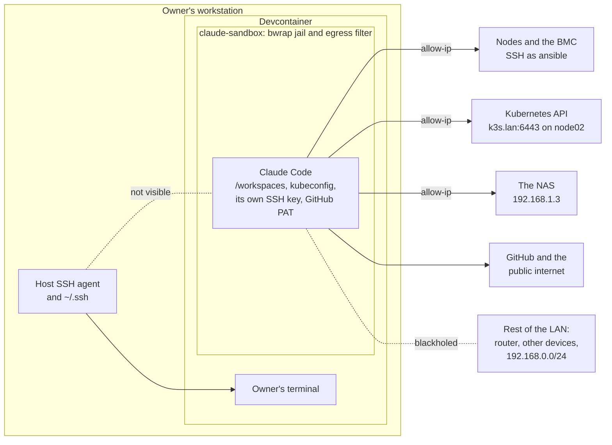
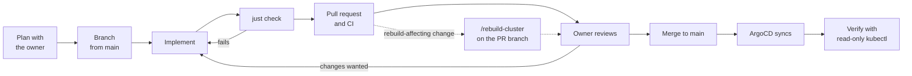

# Claude Code integration

Claude Code does much of the work on this cluster: it writes the changes,
runs the playbooks, reads the cluster's state and opens the pull requests.
To do that it holds real credentials, so where it runs and what it can
reach are part of the architecture. This page describes that structure.
{doc}`/how-to/claude-code` has the setup steps, and
{doc}`/explanations/claude-code-capability` covers the working practices
and what was learned from them.

## Where it runs

Claude runs in three nested layers on the owner's workstation:

1. **The devcontainer** (`.devcontainer/`). The same container that is the
   Ansible controller, with `kubectl`, `helm`, `kubeseal`, `argocd` and
   OpenTofu. It uses the host's network.
2. **The claude-sandbox jail.** `claude` on the `PATH` is a wrapper that
   starts the real binary inside a `bwrap` jail. `$HOME` is replaced by an
   empty tmpfs and only an allow-list of paths is bound back in. A guard
   installed in `/etc` refuses to start Claude outside the wrapper.
3. **The egress jail.** Claude gets its own network namespace in which
   every private (RFC 1918) address is unreachable, except the hosts named
   by `allow-ip`. It needs `/dev/net/tun` (a `runArgs` entry in
   `devcontainer.json`) and fails closed: without the device Claude does
   not start.

The sandbox's configuration is `.devcontainer/claude-sandbox.conf`, copied
to `/etc/claude-sandbox.conf` when the container is created. It is read
from `/etc` and never from the workspace, because the workspace is
writable from inside the sandbox: a session could otherwise widen the next
session's reach. It sets three things:

| Key | Value | Why |
|-----|-------|-----|
| `workspace-root` | `/workspaces` | The parent of this repository, so sibling repositories can be edited in the same session |
| `allow-write` | `/cache`, `/root/bin`, `/root/.kube`, `/root/.config/claude-ssh` | The Python environment, the CLIs the `tools` role installs, the kubeconfig and Claude's SSH key. Everything else under `/root` is absent |
| `allow-ip` | The BMC (.80), node02 to node04 (.82 to .84), nuc1 (.91), nuc2 (.92), ws03 (.10) and the NAS (.3) | Without these, `ssh`, `ansible-playbook` and `kubectl` cannot reach the cluster. The list is kept in step with `hosts.yml` |

`just sandbox-conf` re-applies the file after the claude-sandbox VS Code
extension updates the sandbox, whose installer restores the upstream
defaults.

## What it can reach, and with which credential

| Target | Credential | Where it lives | Scope |
|--------|-----------|----------------|-------|
| Nodes, over SSH | Claude's own ed25519 key for the `ansible` account | The `iac2-claude-ssh` volume, at `/root/.config/claude-ssh` | Full: `ansible` has passwordless sudo |
| Kubernetes API | The admin kubeconfig | The `iac2-kube` volume, at `/root/.kube` | Full cluster admin |
| GitHub | A fine-grained personal access token | A per-repository volume, `gh-auth-<folder>`, at `/root/.config/gh` | Only the repositories the token names |
| The NAS | None | | Network reach only (it is the NFS server) |
| scrap's `/mcp` | A Cloudflare Access service token and a scrap bearer token | The MCP server entry in Claude's own configuration, outside this repository | scrap's tools only |

**The SSH key is separate and revocable.** `just claude-ssh-bootstrap`
generates the key pair on first use and runs the `claude_key` play in
`pb_all.yml`, which adds the public key to the `ansible` account on every
node; `just claude-ssh-bootstrap revoke` removes it everywhere. The recipe
is run from an ordinary devcontainer terminal, because it needs the
owner's key to reach the nodes the first time. Nothing passes the key
automatically: inside the sandbox it is named explicitly
(`ssh -i /root/.config/claude-ssh/id_ed25519 ansible@node02`, or
`--private-key` for Ansible). Host keys come from
`/etc/ssh/ssh_known_hosts`, which the `known_hosts` play fills when the
container is created and which the sandbox sees read-only.

**The owner's SSH identity never enters the sandbox.** VS Code forwards
the host's SSH agent into the devcontainer for the owner's own terminals.
The sandbox clears the environment, so `SSH_AUTH_SOCK` is not set inside
it, and `~/.ssh` is not on the allow-list. The keys that can push to every
repository the owner has, or log in to other machines, are out of reach.

**Git can only use the token.** `postStart.sh` blanks the credential
helpers that VS Code copies in from the host and rewrites GitHub SSH URLs
to HTTPS, so the only way to push is the token in `gh`'s own store.

Claude's node and cluster credentials are as powerful as the owner's. The
design does not pretend otherwise: it limits where they can be used from
(one jail), what else that jail can touch (nothing on the LAN but the
cluster), and makes them cheap to revoke.

## What constrains it

Three different kinds of constraint apply, and they should not be
confused.

| Kind | What | Holds even if the agent is misled? |
|------|------|------------------------------------|
| **Hard boundary** | The `bwrap` jail, the egress filter, the missing SSH agent, the scoped GitHub token | Yes. It is enforced outside the agent |
| **Convention** | The hard rules in `CLAUDE.md` | No. The agent follows them; nothing enforces them |
| **Process** | Branches, pull request review, CI, ArgoCD self-heal | Mostly. A bad change is visible in a diff before it merges, and cluster drift is reverted |

The repository commits no permission policy. Tool approvals are personal,
accumulate in `.claude/settings.local.json` (gitignored), and are a
convenience, not a boundary.

The conventions in `CLAUDE.md` are the ones a new session most needs:

- Never mutate the live cluster; changes go through Git
  ({doc}`/explanations/architecture/gitops` lists the sanctioned
  exceptions).
- Never commit to `main`; rebase over `main` before new work.
- Run `just check` before pushing, and resolve warnings instead of
  suppressing them.
- The local volume paths (`/home/k8s-data`, `/var/lib/k8s-data`) and the
  NAS directories are never wiped; nothing touches `/var/lib/k8s-data` on
  an RK1 or the first 16 MiB of its eMMC outside the roles built for it.
- A new `local-nvme` workload names its node explicitly.
- The browser used for testing is the owner's logged-in Chrome: no Google
  services, and no changes to GitHub through it.
- A subagent's negative finding ("X is never used") is verified with a
  search before anything is deleted because of it.

## The toolkit

What is checked in under `.claude/` is the agent's toolkit for this
cluster.

Commands (`.claude/commands/`):

| Command | Does |
|---------|------|
| `/bootstrap-cluster` | Walks through building the cluster from scratch: configuration, secrets, playbooks |
| `/rebuild-cluster` | Decommissions and rebuilds the cluster, preserving local volume and NAS data; the test for rebuild-affecting changes |
| `/add-node` | Adds a worker: inventory, `pb_add_nodes.yml`, the playbooks, and the settings that depend on the node list |
| `/test-oauth-flow` | Checks every service's sign-in end to end in a browser, in a subagent |
| `/pr-squash` | Regroups a branch into logical commits on a new branch and opens the pull request |

Skills (`.claude/skills/`), loaded when the topic comes up:

| Skill | Covers |
|-------|--------|
| `ansible` | Playbook structure, tags, topology rules, branch switching and known foot-guns |
| `argocd` | Branch repointing, wiring OCI charts, clearing a stuck spec error |
| `cloudflare` | The tunnel and Access configuration |
| `oauth` | The oauth2-proxy and Dex sign-in paths and how they fail |
| `sealed-secrets` | Sealing, rotating and troubleshooting, including the file-naming rule gitleaks enforces |

The cluster also serves Claude. scrap, the owner's knowledge store, has an
MCP endpoint at `scrap.gkcluster.org/mcp` that Claude sessions use to
search and write notes. An MCP client cannot complete a browser sign-in,
so that path skips oauth2-proxy and is protected by a Cloudflare Access
service token plus scrap's own bearer token ({doc}`/how-to/scrap`).

## The working loop

The loop is the same whether the owner or Claude makes the change
({doc}`/how-to/work-in-branches`). What Claude adds is that it can carry
the whole loop: write the change, run the checks, open the pull request,
watch ArgoCD apply it and confirm the result from the cluster. The owner's
part is the plan and the review. Because delivery is by Git, everything
Claude changes is in a diff that was reviewed, and can be reverted the
same way.

A few operations are outside the sandbox's reach by design and are run by
the owner in a devcontainer terminal: `just claude-ssh-bootstrap`, the
`known_hosts` play (it writes `/etc`), and `just upgrade-workstation`.
