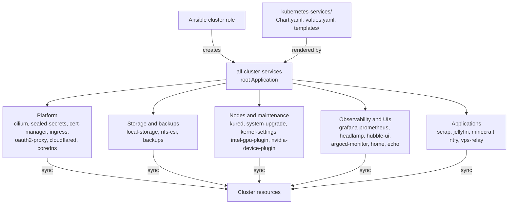
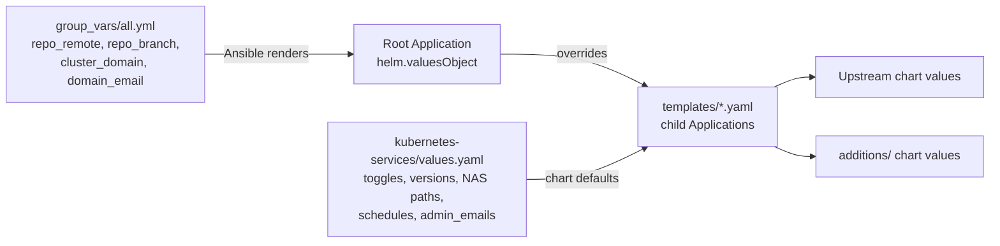
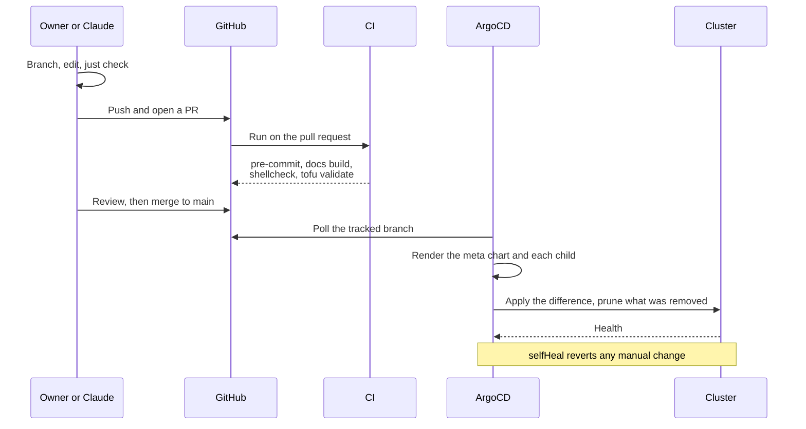

# GitOps delivery with ArgoCD

Everything that runs in the cluster is described in this repository, under
`kubernetes-services/`, and ArgoCD keeps the cluster equal to it. A change
is a merged commit; there is no other deployment step.

## The golden rule

**Never change an ArgoCD-managed resource in the live cluster.** No
`kubectl apply`, `patch`, `edit` or `delete`. ArgoCD would revert the change
within minutes, and until it did, the cluster and the repository would
disagree about what is running. Every fix goes the same way: change the
repository, push, let ArgoCD sync.

Reading is always fine: `kubectl get`, `describe`, `logs`, `exec` and
`port-forward`.

A short list of write operations is sanctioned, because each one either
leaves no drift or has no Git equivalent:

| Operation | Why it is allowed |
|-----------|-------------------|
| `kubeseal` | It only reads the cluster's public key; the `SealedSecret` it produces is committed |
| `ansible-playbook pb_all.yml --tags cluster` | The bootstrap and update path for ArgoCD itself |
| `kubectl annotate ... argocd.argoproj.io/refresh=hard` | Makes ArgoCD re-fetch the repository now (`just argocd-sync` does it for every app) |
| `kubectl rollout restart`, or deleting a pod for its controller to re-create | Restarts a workload, for example to pick up a re-sealed secret; nothing in Git changes |
| `just node-fence <node>` and `just node-unfence <node>` | The `out-of-service` taint, only for a node confirmed powered off ({ref}`fence-a-dead-node`) |

## App of apps

Ansible creates exactly one ArgoCD Application, `all-cluster-services`,
from `argo-cd/argo-git-repository.yaml`. It points at `kubernetes-services/`,
which is a Helm chart whose templates are themselves ArgoCD Applications.
Rendering the chart produces one child Application per service, and each
child then syncs its own chart or manifests.



Those are the 26 child Applications in the live cluster
(`kubectl get applications -n argo-cd` shows 27 with the root). A 27th
template, `kyverno.yaml`, renders nothing because `enable_kyverno` is
`false`: the app never settled to Synced and no policies were in use.

All Applications belong to the AppProject `kubernetes`, which may deploy to
any namespace but only from the sources on its `sourceRepos` allow-list in
`argo-cd/argo-project.yaml`: this repository and the chart registries in
use. Adding a chart from a new registry therefore takes two steps: add the
registry there and apply it with `--tags cluster`, then add the
Application.

### Repository layout

```
argo-cd/                  # root Application, AppProject and ArgoCD's Ingress (applied by Ansible)
kubernetes-services/
├── Chart.yaml            # the meta chart
├── values.yaml           # every setting ArgoCD-delivered services share
├── templates/            # one ArgoCD Application per service
└── additions/            # this repository's own manifests and charts, one folder per service
    └── ingress/          # the reusable Ingress sub-chart
```

{doc}`/reference/services` is the catalogue: each service's chart, version,
namespace and hostname.

## How values flow



Two sources feed the templates. `values.yaml` is read from Git on the
tracked branch and holds almost everything. Four values come instead from
Ansible, through the root Application's `valuesObject`: `repo_remote`,
`repo_branch`, `cluster_domain` and `domain_email`. Passing `repo_branch`
this way is what lets the cluster be pointed at a branch without that
branch having to contain the change.

Each template then hands the values its service needs to the chart it
deploys. Nothing reaches a service except through its template, so a
template is the complete answer to "how is this configured?".

Optional services are switched in `values.yaml`:

| Toggle | Effect |
|--------|--------|
| `enable_jellyfin`, `enable_minecraft`, `enable_vps_relay`, `enable_kyverno` | The Application exists only when `true` |
| `enable_oauth2_proxy` | Whether the Headlamp Ingress carries the oauth2-proxy annotations; scrap and the Minecraft dashboard are always behind oauth2-proxy |
| `enable_cloudflare_tunnel` | Turns off the HTTP-to-HTTPS redirect on tunnelled Ingresses, since Cloudflare terminates TLS at the edge |
| `offsite_backup.enabled` | Runs the nightly off-site copy and enables its alerts |

All are `true` on this cluster except `enable_kyverno`.

## What an Application is made of

### Upstream chart plus additions

Most services combine up to three sources in one Application: an upstream
Helm chart, a folder of this repository's own manifests, and the Ingress
sub-chart. Headlamp is a short real example
(`templates/dashboard.yaml`, abridged):

```yaml
sources:
  # 1. The upstream chart, version pinned
  - chart: headlamp
    repoURL: https://kubernetes-sigs.github.io/headlamp/
    targetRevision: 0.46.0
    helm:
      valuesObject: { ... }

  # 2. The Ingress, from the shared sub-chart
  - path: ./kubernetes-services/additions/ingress
    repoURL: {{ .Values.repo_remote }}
    targetRevision: {{ .Values.repo_branch }}
    helm:
      valuesObject:
        name: headlamp
        cluster_domain: {{ .Values.cluster_domain }}
        service_name: headlamp
        service_port: 80
        oauth2_proxy: {{ .Values.enable_oauth2_proxy }}
        ssl_redirect: {{ if .Values.enable_cloudflare_tunnel }}false{{ else }}true{{ end }}
```

A service with secrets or extra resources adds a third source,
`additions/<service>/`. For `grafana-prometheus` that folder holds alert
rules, a ServiceMonitor and the `SealedSecret` resources; for
`cert-manager` it is a small chart with the ClusterIssuer and the wildcard
Certificate.

### The Ingress sub-chart

`additions/ingress/` is a one-template chart that produces `<name>-ingress`
for the host `<name>.gkcluster.org`, so no service repeats Ingress
boilerplate. TLS needs no per-service secret: ingress-nginx serves the
wildcard certificate `cert-manager/wildcard-tls` by default.

| Value | Effect |
|-------|--------|
| `name`, `cluster_domain` | The Ingress name and host |
| `service_name`, `service_port` | The backend. Port `443` makes ingress-nginx speak HTTPS to the backend |
| `oauth2_proxy: true` | Adds the `auth-url` and `auth-signin` annotations, so requests must pass oauth2-proxy ({doc}`/explanations/architecture/authentication`) |
| `basic_auth: true` | nginx basic auth from the `admin-auth` secret (no service uses it today) |
| `ssl_redirect` | Defaults to `true`; tunnelled services set it `false` |
| `extra_annotations` | Any further annotations, as used by scrap and ntfy |

An Application can use the sub-chart more than once: `home` creates
`home`, `home-lan` and `home-tailnet`.

### Other shapes

- **This repository only.** `echo`, `cloudflared`, `coredns` and
  `kernel-settings` are plain manifests in `additions/<service>/`;
  `backups`, `home`, `local-storage`, `ntfy` and `vps-relay` are small
  local charts there, given their values by the template.
- **Vendored upstream manifests.** `system-upgrade` (the controller's
  release manifests plus a local chart of upgrade Plans) and
  `intel-gpu-plugin` (the upstream DaemonSet patched with kustomize) are
  copied into `additions/`, because upstream publishes no chart that fits.
  Upgrading one means re-vendoring the files.
- **OCI charts.** `scrap` and `minecraft` come from
  `ghcr.io/gilesknap/charts`, and `argocd-monitor` from
  `ghcr.io/epics-containers/charts`. The `repoURL` is the bare registry
  path with no `oci://` prefix, and must match the AppProject entry
  exactly (the `/argocd` skill has the details).

Secrets reach the cluster the same way as everything else, as
`SealedSecret` resources in `additions/`. That flow is drawn on
{doc}`/explanations/architecture/security`; the storage classes and static
volumes that `local-storage` and `nfs-csi` deliver are on
{doc}`/explanations/architecture/storage`.

## Sync policy

Every Application, the root included, has the same core policy:

```yaml
syncPolicy:
  automated:
    prune: true      # a resource removed from Git is removed from the cluster
    selfHeal: true   # a resource changed in the cluster is changed back
```

Options are added only where a service needs them:

| Option | Where | Why |
|--------|-------|-----|
| `CreateNamespace=true` | Every app with a namespace of its own | The namespace is not in any chart. Apps that deploy into `kube-system`, or whose manifests include their Namespace, omit it |
| `ServerSideApply=true` | `grafana-prometheus` | The Prometheus CRDs are too large for the client-side apply annotation |
| `SkipDryRunOnMissingResource=true`, with retries | `kured`, `system-upgrade` | Each applies a resource whose CRD may not exist yet on a fresh cluster: kured's ServiceMonitor (the CRD arrives with `grafana-prometheus`) and the upgrade Plans (the CRD is in the same Application) |
| `RespectIgnoreDifferences=true` | Root app, `nvidia-device-plugin` | Fields listed under `ignoreDifferences` (finalizers ArgoCD adds to child apps, pod-template annotations on the DaemonSet) are left alone on sync instead of fought over |
| `retry` | Root app, `sealed-secrets`, `system-upgrade`, `kured` | Ordering problems on a fresh cluster resolve themselves on a later attempt |

Sync waves are used sparingly. The `local-storage` Application is in wave
`-5`, so the `local-nvme` StorageClass and its pre-bound volumes exist
before any chart creates a claim; otherwise the claim would be provisioned
by the default class and never bind to its volume. Inside `scrap` and
`jellyfin`, the static volumes and claims are in wave `-2`, ahead of the
workloads that mount them.

Two ordering problems are solved outside ArgoCD. On a fresh cluster
Ansible creates the `sealed-secrets` Application before the root one, so the
controller is ready before any `SealedSecret` is applied
({doc}`/explanations/architecture/provisioning`). And Cilium, the CNI, has
to run before ArgoCD can: the `k3s` role installs its chart, with the
version and values of the `cilium` Application, on a cluster that has no
Cilium yet, and ArgoCD adopts those resources when the root Application
syncs ({doc}`ADR 15 </explanations/decisions/0015-cilium-network-layer>`).
That is why `templates/cilium.yaml` holds no Helm template expressions:
Ansible reads it as plain YAML.

## Branch tracking

The cluster tracks one branch, `repo_branch` in `group_vars/all.yml`
(`main`). The root Application passes it to every child as its
`targetRevision`, so the whole cluster moves together.

```bash
just switch-branch my-feature   # ansible-playbook pb_all.yml --tags cluster -e repo_branch=my-feature
just switch-branch main         # and back
```

This is how a change is tried on the real cluster before it is merged
({doc}`/how-to/work-in-branches`).

## The life of a change



- **Before pushing**, `just check` compares the two copies of the age
  public key, then runs `ansible-lint` and the Sphinx build in parallel.
  All must pass with no warnings.
- **CI** (`.github/workflows/docs.yml`) runs four jobs on every pull
  request: the pre-commit hooks (YAML checks, `ansible-lint`, gitleaks and
  the age-key comparison), the documentation build, `shellcheck` over
  `scripts/`, and `tofu fmt` plus `tofu validate` on `cloudflare/`. On
  `main` the docs job also publishes these pages.
- **Merging** is always through a pull request; nothing is committed to
  `main` directly. The merge is a merge commit, which keeps the branch's
  commits as they are; `/pr-squash` first tidies a branch whose history
  is exploratory.
- **Syncing** needs no action. ArgoCD notices the new commit on its next
  poll; `just argocd-sync` forces an immediate re-fetch.

A change to Ansible roles, secret generation, CoreDNS or the Application
templates can leave the running cluster healthy while breaking a rebuild.
`/rebuild-cluster` on the PR branch is the test for those.

## Renovate

Renovate (`renovate.json`) opens pull requests for new versions. Its
`argocd` manager reads the `targetRevision` of each chart in
`kubernetes-services/templates/`, and those updates are set to auto-merge;
its `kubernetes` manager covers image tags in the manifests under
`kubernetes-services/`. The vendored manifests are excluded, because they
are upgraded by re-vendoring. A chart whose version is a value in
`values.yaml` rather than a literal in its template (`nfs_csi`, `minecraft`,
`jellyfin`) is bumped by hand.

## When ArgoCD itself is down

Workloads keep running without ArgoCD; only reconciliation stops. ArgoCD
is installed by Ansible, not by itself, so the repair is the bootstrap
path:

```bash
ansible-playbook pb_all.yml --tags cluster
```

That re-applies the Helm release, the AppProject and the root Application.
Once ArgoCD is back it syncs every service from Git on its own.
