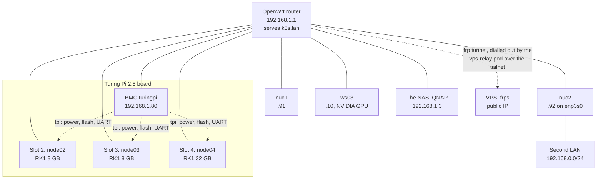
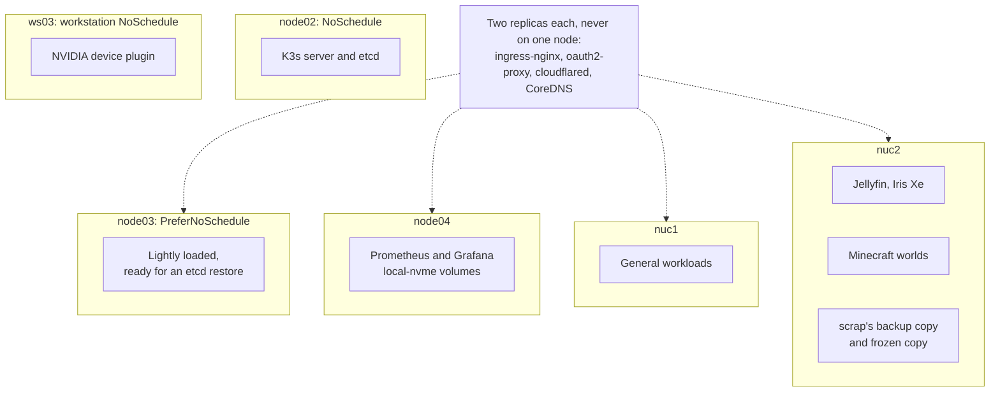

# Hardware and nodes

The cluster is six machines of three kinds: three ARM compute modules in one
Turing Pi board, two Intel NUCs, and the owner's GPU workstation. All run
Ubuntu 26.04 and the same K3s release. This page says what each one is, what
is pinned to it, and why.

## The nodes

| Node | IP | Hardware | Arch | CPU / RAM | Role |
|------|----|----------|------|-----------|------|
| `node02` | 192.168.1.82 | Turing RK1, slot 2 | arm64 | 8 / 8 GB | Control plane and etcd |
| `node03` | 192.168.1.83 | Turing RK1, slot 3 | arm64 | 8 / 8 GB | Worker, warm-standby control plane |
| `node04` | 192.168.1.84 | Turing RK1, slot 4 | arm64 | 8 / 32 GB | Worker |
| `nuc1` | 192.168.1.91 | Intel NUC | amd64 | 12 / 32 GB | Worker |
| `nuc2` | 192.168.1.92 | Intel NUC, Iris Xe graphics, two NICs | amd64 | 8 / 64 GB | Worker |
| `ws03` | 192.168.1.10 | Desktop workstation, NVIDIA GPU | amd64 | 16 / 32 GB | Workstation worker |

Taints, the labels this repository sets, and what is tied to each node:

| Node | Taint | Labels and devices | Pinned here |
|------|-------|--------------------|-------------|
| `node02` | `node-role.kubernetes.io/master:NoSchedule` | | etcd, and the nightly etcd backup timer |
| `node03` | `node-role.kubernetes.io/standby-control-plane:PreferNoSchedule` | | Nothing: it is kept light on purpose |
| `node04` | | | The Prometheus and Grafana `local-nvme` volumes (`/var/lib/k8s-data/*`) |
| `nuc1` | | | Nothing |
| `nuc2` | | `intel.feature.node.kubernetes.io/gpu=true`, one `gpu.intel.com/i915` | Jellyfin and its volume, every Minecraft world pod, scrap's backup copy and its frozen pre-Litestream copy (`/home/k8s-data/*`) |
| `ws03` | `workstation=true:NoSchedule` | `node-role=workstation`, `nvidia.com/gpu.present=true`, one `nvidia.com/gpu` | The NVIDIA device plugin |

The inventory (`hosts.yml`) is where these properties come from:
`workstation: true`, `nvidia_gpu_node: true`, `intel_gpu_node: true`,
`node_ip` and `flannel_iface` are host variables that the `k3s` role turns
into agent flags, labels and taints. The control plane and its standby are
named by `control_plane` and `standby_control_plane` in
`group_vars/all.yml`. See {doc}`/reference/inventory`.

## Physical layout

### The Turing Pi and its BMC

The Turing Pi 2.5 is a mini-ITX carrier with four module slots, an Ethernet
switch and a baseboard management controller. The BMC is the inventory host
`turingpi` (192.168.1.80), reached over SSH as `root`. Its `tpi` command
powers a slot on and off, writes an image to a module's eMMC (`tpi flash`),
exposes the eMMC as a disk (`tpi advanced msd`) and gives a serial console
(`tpi uart`). That is everything Ansible needs to install a node that has no
operating system, so re-installing an RK1 never needs hands on the hardware.
OS images are staged on the BMC's SD card (`tpi_images_path`,
`/mnt/sdcard/images`).

### The RK1s

Each Turing RK1 is an eight-core RK3588 module with an NVMe drive. An RK1
has no SPI flash, so its boot loader lives on the eMMC:

- **eMMC**: U-Boot, in the raw area from LBA 64. Nothing boots from the
  eMMC's partitions.
- **NVMe** (`root_dev: /dev/nvme0n1` in the inventory): stock Ubuntu 26.04
  with the generic kernel, booted by U-Boot through EFI and GRUB.

All three run the same Ubuntu and kernel, but they got there by two routes
and their disks differ. node02 was installed by the current `flash` and
`move_fs` roles: its eMMC holds mainline U-Boot and no partition table, and
its NVMe is Ubuntu's preinstalled server image as shipped (root on p1, the
EFI system partition on p15). node03 and node04 were installed from the
older vendor image and converted in place by the `rk1_os` role: root is on
NVMe p2, the EFI system partition is p1, and the eMMC still carries the
vendor image's unused partition table. A re-flash would bring either to
node02's layout.

{doc}`/explanations/architecture/provisioning` describes how a node gets
into that state. Two hard rules follow from the layout. Nothing but the
U-Boot image itself may write the first 16 MiB of an RK1's eMMC, because a
damaged U-Boot leaves the module unbootable. And nothing but the
`k8s_data_dirs` role may touch `/var/lib/k8s-data` on an RK1: it holds the
`local-nvme` volumes ({doc}`/explanations/architecture/storage`), and a
re-flash with `flash_force` wipes the NVMe and that data with it.

node04 has 32 GB of memory where the other two have 8 GB, which is why
Prometheus and Grafana are pinned to it.

### node01

`node01` (a Raspberry Pi CM4 in slot 1, 192.168.1.81) was the control
plane before that role moved to node02. It is no longer in `hosts.yml` or
the sandbox's `allow-ip` list, and is not a member of the cluster.

### The NUCs

**nuc1** is a plain amd64 worker with a single NIC. Nothing is pinned to it,
which makes it the spare capacity that drained pods move to.

**nuc2** has the most memory and carries the node-bound workloads. It is
multi-homed: `enp3s0` is on the cluster LAN and a second interface is on
192.168.0.0/24. K3s must use the cluster LAN address, so
the inventory sets `node_ip: 192.168.1.92` and `flannel_iface: enp3s0`,
which become `--node-ip` and `--flannel-iface` on its agent. Its Iris Xe
iGPU is advertised by the Intel GPU device plugin as `gpu.intel.com/i915`
and used by Jellyfin for hardware transcoding. Jellyfin runs on the host
network there, so it listens on both LANs and on the tailnet interface. The
VPS relay forwards the Minecraft game ports to nuc2's LAN address, which is
why every world is pinned to it (`minecraft.worlds.node`).

### ws03

ws03 is the owner's desktop, with an NVIDIA GPU, that also runs a K3s
agent. A desktop is rebooted and updated when its user chooses, so it
carries `workstation=true:NoSchedule` and only pods that tolerate the taint
run there: the NVIDIA device plugin, node-exporter and the NFS CSI node
plugin. The `update_packages` role installs the NVIDIA driver and container
toolkit and makes the NVIDIA runtime containerd's default on it. kured does
not run on it, the K3s upgrade Plans exclude it, and no playbook reboots
it. The reasoning is in ADR 0005
({doc}`/explanations/decisions/0005-ws03-workstation-taint`).

## Where things run

The scheduling rules behind the picture:

- **Control plane: `NoSchedule`.** node02 has 8 GB and runs the API server
  and etcd, so ordinary workloads are kept off it. Only DaemonSets and the
  few controllers that tolerate the taint run there.
- **Warm standby: `PreferNoSchedule`.** node03 is where the etcd bundle
  would be restored if node02 died
  ({doc}`/how-to/recover-control-plane`). The soft taint keeps it mostly
  empty without making it unusable when other nodes are full or drained.
- **Workstation: `NoSchedule`**, as above.
- **GPU labels.** The NVIDIA and Intel device plugins are DaemonSets
  selected by the node labels in the table, so each runs only where its
  GPU is.
- **Node-pinned volumes.** Every `local-nvme` PersistentVolume names its
  node in `spec.nodeAffinity`, so a pod that claims one can only run there.
  A new workload of this kind gets its own volume and an explicit node
  choice, never a shared pool.
- **Shared services run twice.** ingress-nginx and oauth2-proxy spread
  their two replicas with a `topologySpreadConstraints` rule on hostname,
  cloudflared uses a required pod anti-affinity, and CoreDNS is held at two
  by a fixed HorizontalPodAutoscaler. A node reboot or drain therefore
  always leaves one of each serving. They can land on any untainted worker
  or the standby.
- **Everything else floats.** scrap, ntfy, ArgoCD, cert-manager and the
  rest keep their data on the NAS (or have none), so they run wherever
  there is room and move when a node is drained.

## Off-cluster kit

**The NAS** (QNAP TS-253D, 192.168.1.3, Ubuntu Server and ZFS) exports
`/bigdisk/k8s-cluster`, `/bigdisk/media`, `/bigdisk/minecraft-archive` and
`/k8s-dynamic` (holding `stable/`) to the cluster over NFS. It stores
application data, the media library and every backup. `pb_nas.yml`
manages it, apart from the cluster playbooks
({doc}`/how-to/nas-ubuntu-zfs`).

**The router** (OpenWrt, 192.168.1.1) resolves the `.lan` node names and
serves `k3s.lan`, the name of the Kubernetes API, which currently points at
node02. `just k3s-api-dns <ip>` repoints it when the control plane moves.

**The VPS** runs frps and publishes the Minecraft game ports as
`mc.gkcluster.org`. It is reached only over the tailnet and never connects
into the home network: the `vps-relay` pod dials out to it
({doc}`/how-to/vps-relay`).

**The owner's workstation** runs the devcontainer that is the Ansible
controller, with `kubectl`, `helm`, `kubeseal` and OpenTofu, and Claude
Code inside its sandbox
({doc}`/explanations/architecture/claude-code`).
