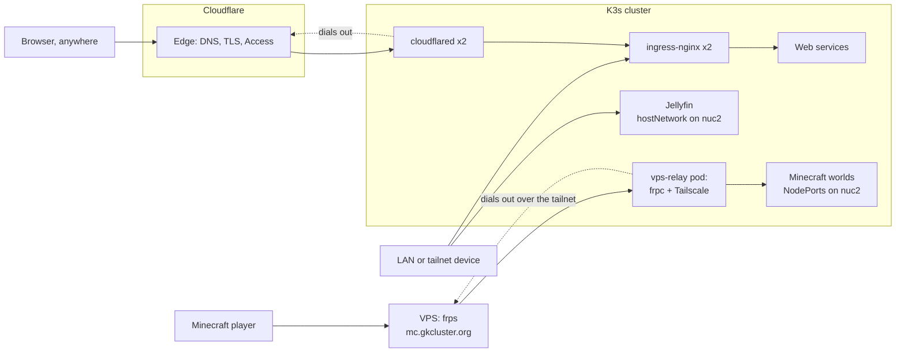
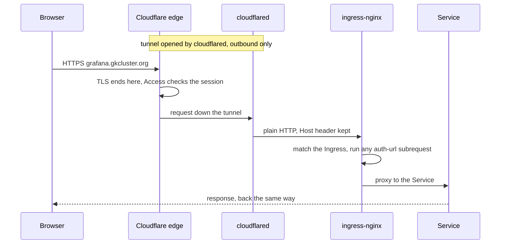
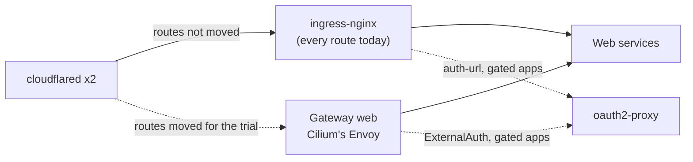
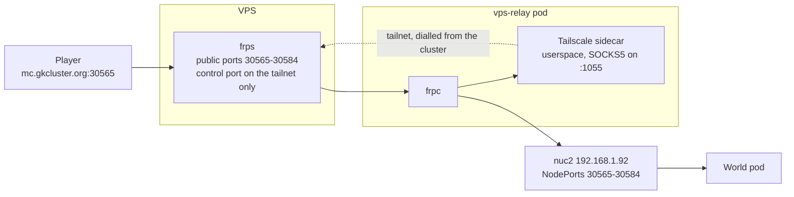
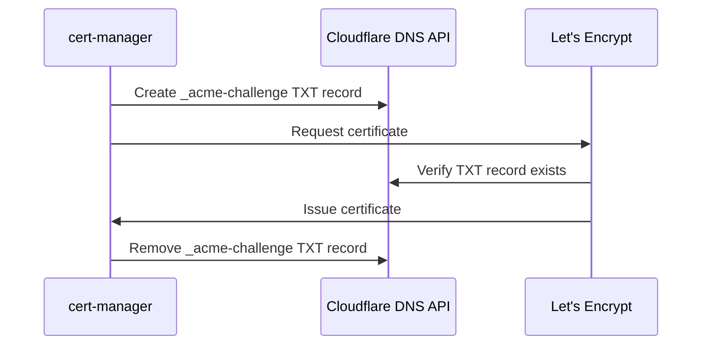

# Networking and ingress

Nothing at home listens on the internet. Web traffic comes in through a
Cloudflare Tunnel that the cluster dials out to, game traffic comes in through
a VPS that the cluster also dials out to, and everything else (Jellyfin, SSH,
`kubectl`) stays on the LAN and the tailnet. This page follows a packet along
each of those routes. Who is allowed through is on the
{doc}`authentication page </explanations/architecture/authentication>`; the
NetworkPolicies inside the cluster are on the
{doc}`security page </explanations/architecture/security>`.

## The LAN

All six nodes sit on one flat network, `192.168.1.0/24`, behind an OpenWrt
router at `192.168.1.1`.

| Host | Address | Notes |
|------|---------|-------|
| `turingpi` (BMC) | `192.168.1.80` | Powers and flashes the RK1s |
| `node02` | `192.168.1.82` | Control plane; `k3s.lan` resolves here |
| `node03` | `192.168.1.83` | Warm-standby control plane, takes workloads |
| `node04` | `192.168.1.84` | Worker |
| `nuc1` | `192.168.1.91` | Worker |
| `nuc2` | `192.168.1.92` | Worker; second NIC on `192.168.0.0/24` |
| `ws03` | `192.168.1.10` | GPU workstation, tainted |
| the NAS | `192.168.1.3` | NFS only; not a cluster node |

Two details matter to the cluster:

- **`k3s.lan`** is a DNS record on the router that points at the control
  plane (`k3s_api_name` in `group_vars/all.yml`). Agents join through it,
  Cilium's agents reach the API server by it, the API server certificate
  carries it as a SAN, and the kubeconfig uses it, so
  moving the control plane is a DNS change (`just k3s-api-dns <ip>`) and not a
  re-join of every node.
- **nuc2 is multi-homed.** It has a second LAN, `192.168.0.0/24`, so
  `hosts.yml` pins K3s to the right side with `node_ip: 192.168.1.92`.
  Without it K3s may advertise the other interface's address, and Cilium's
  tunnel to nuc2, which uses the node's advertised address, breaks.

## Inside the cluster

- **Pod network, Services and NetworkPolicy:** Cilium
  ({doc}`ADR 15 </explanations/decisions/0015-cilium-network-layer>`). K3s
  runs no flannel, no kube-proxy and no policy controller of its own
  (`flannel-backend: none`, `disable-kube-proxy`, `disable-network-policy`
  in `roles/k3s/templates/k3s-server-config.yml.j2`). Cilium's agent, a
  DaemonSet on every node including node02 and ws03, gives each pod an
  address in `10.42.0.0/16` (a /24 per node), tunnels pod traffic between
  nodes over VXLAN, and serves every ClusterIP and NodePort in eBPF instead
  of kube-proxy's iptables rules. Because nothing serves the `kubernetes`
  Service before Cilium runs, the agents reach the API server by its name,
  `k3s.lan` (`k8sServiceHost` in `kubernetes-services/templates/cilium.yaml`),
  so moving the control plane is still only a DNS change.
- **How Cilium gets there:** nodes stay NotReady until a CNI runs, and ArgoCD
  needs pod networking, so the `k3s` Ansible role installs the Cilium chart
  once, on a cluster that has none, with the version and values from that
  same ArgoCD Application (`roles/k3s/tasks/cilium.yml`). ArgoCD adopts it
  when the root Application syncs, and owns it from then on.
- **Hubble:** Cilium's flow visibility. Hubble Relay gathers flows from
  every agent, and the Hubble UI shows them at `hubble.gkcluster.org`,
  behind oauth2-proxy (admins only). From a shell,
  `kubectl -n kube-system exec ds/cilium -c cilium-agent -- hubble observe`
  shows one node's flows. Flow, drop, DNS and policy-verdict metrics go to
  Prometheus, with the chart's Grafana dashboards.
- **Ingress controller:** ingress-nginx, two replicas spread over different
  nodes with a PodDisruptionBudget, so a drain or a nightly reboot always
  leaves one serving. K3s's bundled Traefik is disabled
  (`roles/k3s/templates/k3s-server-config.yml.j2`); ingress-nginx is used
  because oauth2-proxy relies on its `auth-url` and `auth-signin`
  annotations.
- **Gateway API, on trial:** Cilium's Gateway, which is to replace
  ingress-nginx, runs beside it on Cilium's Envoy (see
  {ref}`below <net-gateway-trial>`). It carries a hostname only once
  that hostname's tunnel route points at it.
- **Load balancer:** K3s's ServiceLB publishes the ingress-nginx Service on
  ports 80 and 443 of every node that its pods can run on (Cilium serves the
  host ports and the load-balancer addresses in kube-proxy's place). Today that is
  `192.168.1.83`, `.84`, `.91` and `.92`: node02 (control-plane taint) and
  ws03 (workstation taint) are left out. Any of the four addresses reaches
  either controller replica.
- **Cluster DNS:** K3s owns the CoreDNS Deployment, so the `coredns` app
  only adds an HPA with `minReplicas` and `maxReplicas` both 2, plus a PDB.
  That holds CoreDNS at two replicas on different nodes without fighting
  K3s for the Deployment.
- **Kernel settings:** the `kernel-settings` app is a privileged DaemonSet
  that raises the socket buffer limits `net.core.rmem_max` and `wmem_max` to
  7500000 on the nodes it can schedule on (not node02 or ws03).

## Three ways in

### 1. The Cloudflare Tunnel: every web service

Each web hostname is one entry in `tunnel_services` in
`cloudflare/locals.tf`. An entry produces two things: a proxied CNAME to the
tunnel, and a tunnel ingress rule that sends the hostname to
`http://ingress-ingress-nginx-controller.ingress-nginx.svc.cluster.local`.
Anything else that reaches the tunnel gets a 404.

The `cloudflared` Deployment runs two replicas that never share a node. They
only dial out to Cloudflare, so the router forwards no ports and the home IP
address appears in no DNS record. Cloudflare ends TLS at its edge, applies
Cloudflare Access, and passes the request down the tunnel; cloudflared hands
it to ingress-nginx as plain HTTP inside the cluster.

Two consequences of that last hop being HTTP:

- `enable_cloudflare_tunnel: true` in `kubernetes-services/values.yaml` sets
  `ssl-redirect: "false"` on every tunnelled Ingress. With the redirect on,
  ingress-nginx would answer each tunnelled request with a redirect to HTTPS
  and the browser would loop.
- ArgoCD runs with `server.insecure: "true"` and lets ingress-nginx front it
  like any other service, so it can go through the tunnel too.

LAN clients take the same route. The public names resolve to Cloudflare from
everywhere, so a laptop at home reaches `grafana.gkcluster.org` through the
edge and Access exactly as a phone on mobile data does. There is one model to
reason about, and no split DNS on the router.

The tunnel, its DNS records and the Access applications are OpenTofu code in
`cloudflare/`, applied with `just cf-plan` and `just cf-apply`; see
{doc}`/how-to/cloudflare-as-code`.

(net-gateway-trial)=
### Cilium's Gateway, on trial

ingress-nginx is retired upstream, and Cilium's Gateway API implementation
is to replace it
({doc}`ADR 16 </explanations/decisions/0016-cilium-gateway-api>`). For now
the two run side by side:

- **The Gateway** is `web` in the `gateway` namespace, with an HTTP listener
  on port 80 (what cloudflared sends) and an HTTPS one on 443 with the same
  wildcard certificate. Cilium serves it from its Envoy DaemonSet, through
  the Service `cilium-gateway-web`.
- **Each Ingress has an HTTPRoute twin** with the same host, path and
  backend, made from the same values by the ingress sub-chart. The five apps
  behind oauth2-proxy get an ExternalAuth filter that asks oauth2-proxy about
  every request, as nginx's `auth-url` does.
- **Off the node addresses.** A servicelb node-pool label that no node
  carries keeps servicelb from publishing the Gateway on ports 80 and 443 of
  the nodes, which ingress-nginx holds. The Gateway's Service has only its
  ClusterIP, and the Gateway reports that it is waiting for an address.
- **The trial** moves one tunnel route at a time to
  `http://cilium-gateway-web.gateway.svc.cluster.local` (`local.gateway` in
  `cloudflare/locals.tf`), and back the same way:
  {doc}`/how-to/gateway-trial`.

### 2. Direct, on the LAN or the tailnet

A few things are deliberately not behind Cloudflare:

- **Jellyfin** runs on nuc2 with `hostNetwork` (`jellyfin.host_network`), so
  it listens on port 8096 of every interface nuc2 has: both LANs and
  `tailscale0`. That keeps video off Cloudflare, and lets UDP 7359 client
  discovery work. It has no Ingress and no tunnel route.
- **Minecraft RCON** ports are NodePorts `30600` to `30619` on nuc2, for
  build tools on the LAN. RCON is plain text, so a NetworkPolicy limits it to
  LAN sources and the range is never added to the VPS relay.
- **`home-lan` and `home-tailnet`** are DNS-only A records that point at a
  LAN address and a tailnet address of a node running the ingress load
  balancer. Both serve the landing page's `/healthz`. The page at
  `home.gkcluster.org` fetches both in the background: a probe only succeeds
  when the browser is on that network, and the page then enables its LAN and
  tailnet links (Jellyfin, for example).
- **SSH and `kubectl`** go straight to the nodes: `ssh ansible@node02`, and
  the API at `https://k3s.lan:6443`. From outside the house that means the
  tailnet. There is no Cloudflare route for SSH.

The ingress-nginx load balancer addresses also answer on the LAN, which is
what the `home-lan` probe uses. The web services' own names never resolve to
them.

Tailscale on the hosts (nuc2 and ws03) is installed and signed in by hand.
Ansible touches one setting: the `k3s` role (`roles/k3s/tasks/tailscale.yml`,
`--tags tailscale`) turns Tailscale's netfilter mode off and
`net.ipv4.conf.all.src_valid_mark` back to 0, which Cilium's DNS proxy needs
(ADR 0015). It refuses a node that advertises routes or uses an exit node.

### 3. The VPS relay: game ports

Cloudflare's tunnel carries HTTP only, and Minecraft speaks its own TCP
protocol. Players therefore connect to `mc.gkcluster.org`, a DNS-only record
for a small VPS, and the VPS relays them home.

The `vps-relay` pod has two containers. The Tailscale sidecar joins the
tailnet as an ephemeral, tagged node in userspace mode, with no extra
capabilities, and offers a SOCKS5 proxy inside the pod. `frpc` connects
through that proxy to `frps` on the VPS, whose control port (7000) is bound
to the VPS's tailnet address only. `frps` then accepts players on the public
ports and passes each connection back down the link that `frpc` opened.

Every connection is opened from the cluster side. The VPS never dials into
the house, and the tailnet policy lets the relay's tag reach nothing but the
VPS's frp port. The forwards are a list in `vps_relay.forwards`: today one
entry, TCP `30565-30584` to `192.168.1.92`, which is the game NodePort range
of `minecraft.worlds` on nuc2. The price is that every player appears to
come from the relay, so IP bans do not work; whitelists do. Setup and adding
a forward: {doc}`/how-to/vps-relay`.

## Hostnames

Every name under `gkcluster.org`, from `cloudflare/locals.tf` and the
`dns_only_records` variable.

| Name | Route | Backend |
|------|-------|---------|
| `home` | Tunnel | Landing page (`home` namespace) |
| `argocd` | Tunnel | ArgoCD server |
| `argocd-monitor` | Tunnel | argocd-monitor |
| `grafana` | Tunnel | Grafana (`monitoring`) |
| `alertmanager` | Tunnel | Alertmanager (`monitoring`) |
| `headlamp` | Tunnel | Headlamp |
| `hubble` | Tunnel | Hubble UI (`kube-system`), admins only |
| `oauth2` | Tunnel | oauth2-proxy's sign-in and callback |
| `minecraft` | Tunnel | Minecraft dashboard |
| `scrap` | Tunnel | scrap, including `/mcp` |
| `pages` | Tunnel, public, cached at the edge | scrap's public pages (`scrap-public`) |
| `ntfy` | Tunnel, public, ntfy's own tokens | ntfy |
| `echo` | Tunnel | Echo test service |
| `home-lan` | DNS only, LAN address | Landing page `/healthz` through ingress-nginx |
| `home-tailnet` | DNS only, tailnet address | The same, over the tailnet |
| `mc` | DNS only, the VPS | frps, then nuc2's game NodePorts |

Jellyfin has no name: it is reached by nuc2's address on port 8096.

Publishing a new hostname is one line in `tunnel_services` and
`just cf-apply`: see {ref}`publishing a hostname <cf-add-service>`.

## TLS

Browsers see Cloudflare's certificate, because Cloudflare ends TLS for every
tunnelled name. The cluster still holds its own certificate for the names
that are reached directly (`home-lan`, `home-tailnet`) and so that
ingress-nginx always has a valid one to present.

cert-manager issues a single wildcard certificate, for `*.gkcluster.org` and
`gkcluster.org`, into the Secret `cert-manager/wildcard-tls`. ingress-nginx
serves it as its default certificate (`default-ssl-certificate`), so no
Ingress carries a cert-manager annotation or a certificate of its own.

**Why DNS-01.** It is the only ACME challenge that can issue a wildcard, and
it needs nothing to be reachable from the internet: Let's Encrypt checks a
TXT record, which cert-manager writes through the Cloudflare API. HTTP-01
would need a public route to every hostname, which the direct names do not
have. The API token is a SealedSecret
({ref}`cert-manager's DNS-01 token <cf-dns01-token>`).

**Why there is no wildcard DNS record.** A proxied `*` record makes Chrome
try Encrypted Client Hello through Cloudflare for every subdomain, including
the DNS-only ones that Cloudflare holds no certificate for, and those fail
with `ERR_ECH_FALLBACK_CERTIFICATE_INVALID`. So each hostname has its own
record, and the certificate is the only wildcard.

## One DNS override inside the cluster

ArgoCD, Grafana and argocd-monitor all use Dex, whose issuer URL is
`https://argocd.gkcluster.org/api/dex`. A pod that resolves that name through
public DNS gets Cloudflare, and Cloudflare Access answers a pod's OIDC
discovery request with a login page.

The `cluster` role therefore writes a `coredns-custom` ConfigMap
(`roles/cluster/tasks/main.yml`) with one extra server block: inside the
cluster, `argocd.gkcluster.org` resolves to the ClusterIP of the
ingress-nginx Service. Token exchanges stay inside the cluster and never
meet Access. The role looks the ClusterIP up at run time, so after a rebuild
`ansible-playbook pb_all.yml --tags cluster` puts the new address in place.

It is the only name overridden. oauth2-proxy's `auth-url` avoids the same
trap in a different way, by using the Service's cluster address directly.
