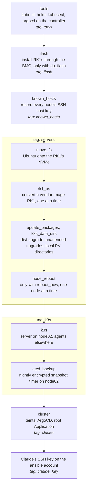
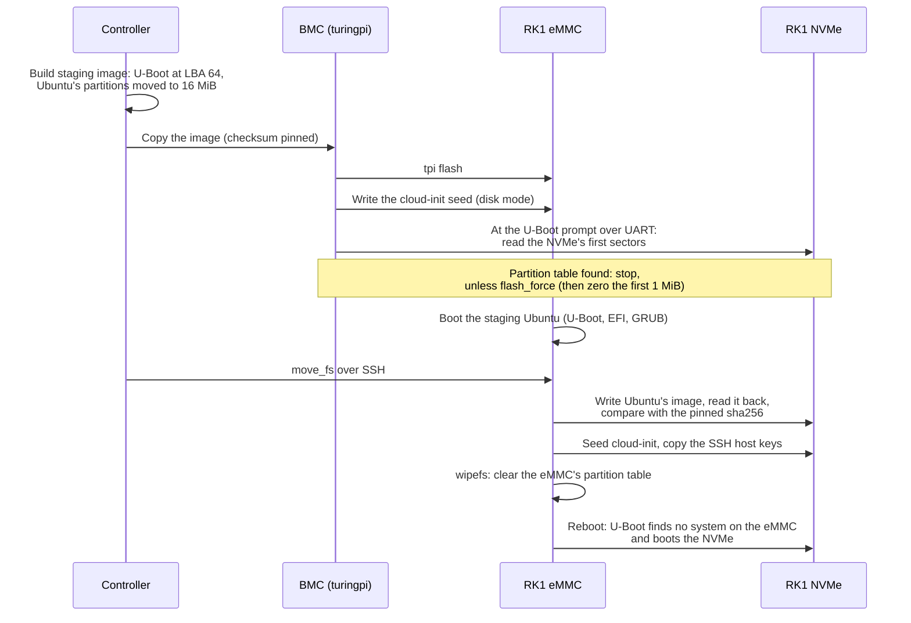
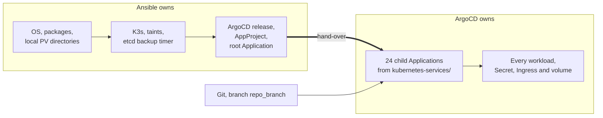

# Provisioning with Ansible

Ansible owns everything below Kubernetes and the first step above it: the
operating system on each node, K3s, and the ArgoCD installation with its
root Application. From there ArgoCD takes over
({doc}`/explanations/architecture/gitops`). This page is the summary;
{doc}`/explanations/ansible-roles` documents each role task by task.

The controller is the devcontainer on the owner's workstation. One playbook,
`pb_all.yml`, builds the whole cluster and is safe to re-run at any time:
every role checks the current state and changes only what differs.

## The play pipeline



Each play has a tag, so one stage can be run alone:
`ansible-playbook pb_all.yml --tags cluster` is by far the most used.
`rk1_os`, `k8s_data_dirs` and `etcd_backup` have their own tags inside
their stage. {doc}`/reference/playbook-tags` lists them all with the extra
variables each accepts.

## Installing an RK1

An RK1 is installed from bare metal with no hands on the hardware. The
difficulty is the boot loader: the RK1 has no SPI flash, so U-Boot must sit
in the raw area at the start of the eMMC, exactly where Ubuntu's own image
puts its first partition, and the BMC can only write the eMMC. The install
therefore goes through a throwaway staging system.



The `flash` role does the first half on the BMC and `move_fs` the second on
the node. The result is an eMMC that holds only U-Boot and an NVMe that
holds Ubuntu's preinstalled server image exactly as Ubuntu ships it, with
the generic kernel, updated by `apt` like any other machine. Both artifacts
(Ubuntu's image and Armbian's build of mainline U-Boot) are pinned by URL
and sha256 in `roles/flash/vars/main.yml`.

The `rk1_os` play that follows converts an RK1 installed from the older
vendor image to the same stock Ubuntu and generic kernel in place, keeping
its partition layout. node03 and node04 were converted this way; node02 was
installed by the flow above. On every run the role skips node02 as a
standard install and re-checks node03 and node04, changing nothing. It
stays in the playbook because its kernel hooks and GRUB settings are what
those two nodes boot with ({doc}`/explanations/ansible-roles`).

### Safety rules

A flash destroys data, so the roles are built to refuse rather than guess.

- **`do_flash` and `flash_force` are different.** `-e do_flash=true`
  flashes only nodes that do not answer SSH. `-e flash_force=true` also
  re-flashes nodes that are running. Without either, the `flash` play does
  nothing.
- **An NVMe with a partition table is refused.** A node that does not
  answer SSH may only be unreachable, not empty. With plain `do_flash` the
  role flashes the eMMC but writes nothing to such an NVMe: it powers the
  node off and stops, asking for `flash_force`.
- **`flash_force` on an RK1 is a fresh install.** It wipes the NVMe,
  including the `local-nvme` data under `/var/lib/k8s-data`. node04 holds
  Prometheus's and Grafana's volumes, so that is a decision for the owner
  ({doc}`/how-to/reflash-rebuild`).
- **Only the U-Boot image writes the first 16 MiB of the eMMC.** The
  staging image's partition table sets its first usable block to 16 MiB,
  so no partitioning tool can place anything over U-Boot. The only other
  writes to the eMMC touch the partition table: cloud-init growing the
  staging root, and the `wipefs` that clears the table at the end.

## The NUCs and ws03

These are installed by hand with Ubuntu, then brought under Ansible's
control by `pb_add_nodes.yml`, which creates the `ansible` account with the
controller's public key and passwordless sudo:

```bash
ansible-playbook pb_add_nodes.yml --limit nuc1 -e ansible_user=<login> -K
ansible-playbook pb_all.yml --limit nuc1 --tags known_hosts,servers,k3s
ansible-playbook pb_all.yml --tags cluster
```

The node then goes through the same `servers` and `k3s` plays as the RK1s
(the RK1-only roles skip it), and the `cluster` tag re-applies the taints. The `/add-node` Claude command walks
through the whole procedure, including the settings elsewhere that depend
on the list of nodes ({doc}`/how-to/node-operations`).

## K3s as deployed

- **One server, embedded etcd.** node02 runs `k3s server` with
  `cluster-init: true`; the other five run agents. There is no second
  server: resilience comes from the nightly etcd backup and the warm
  standby ({doc}`/how-to/recover-control-plane`).
- **Traefik is disabled** (`disable: [traefik]`). ingress-nginx, delivered
  by ArgoCD, is the ingress controller.
- **A stable API name.** `k3s_api_name` (`k3s.lan`, a record on the
  router) is in the server certificate (`tls-san`), is what agents join
  (`https://k3s.lan:6443`), and is the server in the exported kubeconfig.
  The role checks on every node that the name resolves only to the control
  plane before it changes anything.
- **One minor line.** The server installs the newest patch of `k3s.minor`
  (read from `kubernetes-services/values.yaml`, so Ansible and the
  in-cluster upgrade Plans share one setting). An agent installs the
  version the server runs, so it is never ahead. The role refuses to
  downgrade a minor.
- **Labels and taints at registration.** A workstation agent registers with
  `--node-label=node-role=workstation` and
  `--node-taint=workstation=true:NoSchedule`, and a GPU node with its GPU
  label, so no pod lands on ws03 in the moments after it joins.
- **Multi-homed nodes.** `node_ip` and `flannel_iface` in the inventory
  become `--node-ip` and `--flannel-iface` (nuc2).
- **Control plane taints.** The `cluster` role taints `control_plane`
  `NoSchedule` and `standby_control_plane` `PreferNoSchedule`, and moves
  the soft taint when the standby changes.
- **AppArmor.** A corrected containerd profile is installed before K3s
  starts (`--tags apparmor` runs it alone).

## The `cluster` role: bootstrapping GitOps

The last stage runs on the controller against the Kubernetes API, in an
order that matters:

1. Taint the control plane and the standby.
2. Install the ArgoCD Helm chart into `argo-cd`, then upgrade it with the
   full configuration: Dex with the GitHub connector, RBAC from
   `admin_emails`, the local admin account disabled.
3. Create the AppProject `kubernetes` (the allow-list of chart sources) and
   ArgoCD's own Ingress.
4. Create the `sealed-secrets` Application on its own and wait for the
   controller. It must be running before anything applies a
   `SealedSecret`.
5. Only on a rebuild (`GENERATE_SECRETS=true`): generate every secret, seal
   it with the new cluster's key, commit and push.
6. Create the root Application `all-cluster-services`. ArgoCD now deploys
   everything else.
7. Wait for ingress-nginx, then write the `coredns-custom` ConfigMap that
   resolves `argocd.gkcluster.org` to the ingress controller inside the
   cluster, so ArgoCD's sign-in does not loop out through Cloudflare.



After the hand-over, Ansible is needed again only to change something on
its side of the line: a node, K3s itself, ArgoCD's own configuration, or
the branch the cluster tracks.

## Tearing down: `pb_decommission.yml`

The decommission playbook removes K3s from every node so that `pb_all.yml`
can build a fresh cluster. It is written around what it must not destroy:

- It stops the etcd backup timer first, so no backup of a half-removed
  cluster replaces a good one on the NAS.
- It then deletes the ArgoCD Applications with an orphan cascade, before
  it touches any workload, or ArgoCD would re-create workloads as they are
  removed.
- It scales scrap down gracefully, so Litestream makes its final sync to
  the NAS.
- It never deletes a namespace that holds `nfs-stable` claims, because
  deleting such a claim archives its folder on the NAS.
- It uninstalls agents before the server, and checks nothing is still
  mounted under `/var/lib/rancher` or `/var/lib/kubelet` before removing
  them, so a delete can never follow a mount into a volume.
- It **preserves** `/home/k8s-data` (nuc2) and `/var/lib/k8s-data` (RK1s).
  The rebuilt cluster binds the same static volumes and the applications
  come back with their data. Only `-e wipe_local_data=true` removes them.

The NAS is never touched: `just check` fails if a cluster playbook targets
it. `/rebuild-cluster` drives decommission and rebuild end to end and is
the test for any change that affects this path.

## Configuration: three files

| File | Holds |
|------|-------|
| `hosts.yml` | The inventory: the BMC, each node's slot, type and `root_dev`, and the per-node flags (`workstation`, `nvidia_gpu_node`, `intel_gpu_node`, `node_ip`, `flannel_iface`) |
| `group_vars/all.yml` | Ansible's settings: `control_plane`, `standby_control_plane`, `k3s_api_name`, `cluster_domain`, `repo_remote`, `repo_branch`, `admin_emails`, `k8s_data_dirs`, the backup's age public key |
| `kubernetes-services/values.yaml` | What ArgoCD deploys: the `enable_*` toggles, versions, NAS paths, schedules, `local_storage` |

The first two are read by Ansible and the third by Helm, so a few values
exist in two places, with a comment at each end naming the other:

- **Local volume directories.** Each `k8s_data_dirs` entry (Ansible creates
  the directory) must match the `node` and `path` of its `local_storage`
  entry (ArgoCD creates the PersistentVolume). If they drift, the volume
  points at a directory that does not exist and its claim stays Pending.
- **`admin_emails`.** Ansible renders the list into ArgoCD's RBAC; Helm
  renders it into Grafana's role mapping.

Two smaller pairs are marked the same way (`SYNC:`, like the local volume
directories): the age public key
(`etcd_backup_age_recipient` and `offsite_backup.age_recipient`, compared
by a pre-commit hook and by `just check`) and Jellyfin's uid and gid.
`k3s.minor` avoids the problem altogether: Ansible reads it out of
`values.yaml`.

{doc}`/reference/inventory` and {doc}`/reference/variables` describe every
setting.
