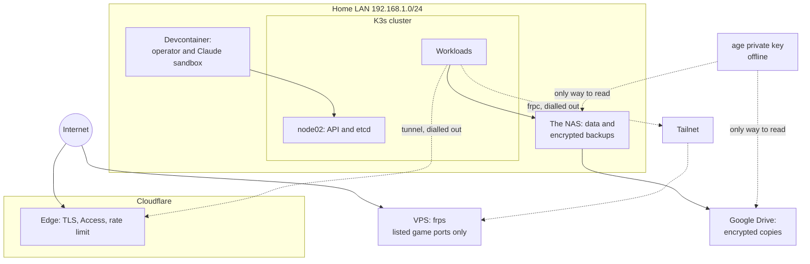
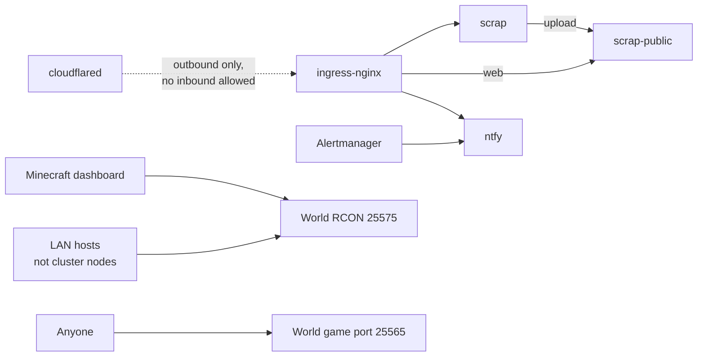
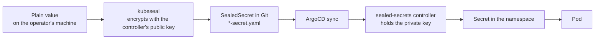

# Security model

This is a single-administrator homelab that happens to be reachable from the
internet. The design goal is that nothing at home accepts an inbound
connection, every published hostname has an identity check in front of it,
and no credential that matters sits in Git or on the NAS in a readable form.
This page walks the trust boundaries from the outside in, and ends with the
risks that are accepted on purpose.

## Trust zones

Dashed lines are connections opened from inside. No arrow from the internet
ends inside the house.

## The edge

**No inbound ports.** The router forwards nothing. Web traffic arrives over a
tunnel that `cloudflared` opens outwards, and game traffic over a link that
`frpc` opens outwards ({doc}`/explanations/architecture/networking`). The
home IP address is in no DNS record.

**Access in front of every hostname.** A wildcard Access application makes
`*.gkcluster.org` owner-only, and `cloudflare/access_guard.tf` fails
`tofu plan` if any tunnelled or proxied hostname is not covered by an
application that asks for an identity or a service token. The only exceptions
are the hostnames flagged `access_bypass = true` in `cloudflare/locals.tf`:
`pages` (public static pages) and `ntfy` (its own token authentication). The
guard works in both directions, so an application that lets everyone in
cannot be pointed at a hostname that is not on that list. Details:
{doc}`/explanations/architecture/authentication`.

**One rate-limit rule.** The Free plan allows a single rule, and it is spent
on ntfy, the one service whose own login faces the internet
(`cloudflare/waf.tf`): about 100 requests a minute per client on ntfy's
paths, then a 10-second block. The Free plan cannot match on hostname, so
the rule matches those paths on every host; a new service must not use a
path that starts with a topic name or `/v1/`.

**The VPS relay publishes only what is listed.** `frps` on the VPS accepts
only the ports in its `allowPorts`, which mirror `vps_relay.forwards` (today
the Minecraft game range, `30565-30584`). Its control port listens on the
VPS's tailnet address only, the tailnet policy lets the relay's tag reach
that one port and nothing else, and the relay pod advertises no routes. The
VPS has no way to open a connection into the house. Plain-text RCON
(`30600-30619`) is never forwarded.

## The cluster

### Scheduling and delivery

- **The control plane runs no workloads.** node02 carries
  `node-role.kubernetes.io/master:NoSchedule`, so application pods never
  share a node with etcd and the API server. node03, the warm standby, has
  only a soft `PreferNoSchedule` taint.
- **ArgoCD can only deploy from an allow-list.** The `kubernetes` AppProject
  (`argo-cd/argo-project.yaml`) restricts `sourceRepos` to this repository,
  the scrap repository and the named Helm registries the services use.
  Someone with ArgoCD admin rights cannot point an Application at an
  arbitrary repository. The project does allow every namespace and every
  cluster-scoped kind: it is the cluster's own platform project, not a
  tenant sandbox.
- **The ArgoCD `admin` account is disabled.** All logins go through Dex and
  GitHub.
- **No admission policy engine.** Kyverno is present in the repository but
  switched off (`enable_kyverno: false`); no policies were in use.

### Pod security

There is no cluster-wide Pod Security Standard, because a handful of system
workloads genuinely need privilege. Security contexts are set per workload.
The workloads this repository writes the pod spec for are non-root with
every capability dropped; two upstream charts (Headlamp, argocd-monitor) are
left at their weaker defaults.

| Workload | Runs as | Root filesystem | Privilege | Notes |
|----------|---------|-----------------|-----------|-------|
| cloudflared | 65532, non-root | Read-only | None, all capabilities dropped | Token from the environment, not the command line |
| echo | 65534, non-root | Read-only | None | |
| home | 101, non-root | Read-only | None | |
| ntfy | 10001, non-root | Read-only | None | State on an `emptyDir` |
| vps-relay (Tailscale and frpc) | 1000, non-root | Read-only | None | Tailscale in userspace: no `NET_ADMIN`, no `/dev/net/tun`; no API token mounted |
| scrap | 10001, non-root | Read-only | None | Every container, including Litestream |
| scrap-public | 10001, non-root | Read-only | None | Namespace enforces the `restricted` standard; no egress |
| oauth2-proxy | 2000, non-root | Read-only | None | |
| Minecraft worlds and dashboard | 1000, non-root | Read-only | None | |
| Grafana and Jellyfin backup CronJobs | 472 (Grafana's), 122 (Jellyfin's), non-root | Writable | None, all capabilities dropped | Each reads its app's data through a read-only mount, as the uid that owns it |
| Headlamp | 100, non-root | Writable | None, but capabilities not dropped | Chart defaults; its ServiceAccount is `cluster-admin` (below) |
| argocd-monitor (and its oauth2-proxy sidecar) | The images' own users | Writable | None, but no security context set | Chart defaults |
| Jellyfin | 122, non-root | Writable | None | `hostNetwork`; GPU through the Intel device plugin, not `privileged` |
| `kernel-settings` (`sysctl-tuning`) | root | Writable | **Privileged** init container, `hostNetwork` | Sets two host sysctls, then sleeps |
| kured | root | Read-only | **Privileged** | Has to reboot the host |
| NFS CSI driver | root | Mixed | **Privileged** `nfs` container | Has to mount on the host |
| ServiceLB (`svclb-*`) | root | Writable | `NET_ADMIN` | K3s's own load balancer pods |
| Cilium agent and Envoy | root | Writable | `NET_ADMIN`, `SYS_ADMIN`, `SYS_MODULE` and other capabilities; one **privileged** init container (mounts the BPF filesystem); `hostNetwork` | The CNI: it programs eBPF and routes on every node (chart defaults) |
| Cilium operator | root | Writable | None, `hostNetwork` | Hands out pod ranges, cleans up identities |
| Hubble Relay | 65532, non-root | Read-only | None | |
| Hubble UI | The image's users | Writable | None | Behind oauth2-proxy, admins only |

**Headlamp is a known soft spot.** Its ServiceAccount is bound to
`cluster-admin` by the chart, and the token that `just headlamp-token` mints
for the login page lasts 100 days. Anyone who gets past Access and
oauth2-proxy and holds that token has the whole cluster.

### Images and charts

Every image and chart is pinned to a version tag in Git, never `latest`.
Renovate (`renovate.json`) watches the Application templates and the
manifests under `kubernetes-services/`, opens a pull request for each new
version, and merges Helm chart bumps automatically, except Cilium's: a
Cilium bump restarts the CNI agent on every node, so its pull requests wait
for a person.

A few pins carry an extra, manual rule: when chosen, the version was the
newest release **at least two weeks old**, as a buffer against a compromised
release. That applies to ntfy, the Jellyfin chart and image, and the rclone,
age and SQLite tools the backup jobs use. Renovate still offers newer
versions for these; the rule is recorded beside each pin and kept by hand.
Tools that are downloaded at run time (age, the Headlamp ArgoCD plugin) are
checked against a SHA-256 in `values.yaml` and the pod fails if it differs.

### NetworkPolicies

Cilium enforces them
({doc}`ADR 15 </explanations/decisions/0015-cilium-network-layer>`). There
is no default-deny. With one administrator and every workload deployed from
this repository, namespace-wide deny rules would mostly generate debugging
work. Policies exist where a pod trusts its network neighbours in a way that
matters:

| Namespace | Policy | Admits |
|-----------|--------|--------|
| `scrap` | `scrap` | Only the `ingress-nginx` namespace. scrap trusts the identity headers oauth2-proxy sets, so no other pod may reach it and forge them |
| `scrap-public` | `scrap-public` | ingress-nginx to the web port; scrap's pod to the upload receiver. All egress is denied |
| `ntfy` | `ntfy` | The `ingress-nginx` namespace and the Alertmanager pods in `monitoring`, on port 8080 |
| `minecraft` | `minecraft-dashboard-worlds` | The game port (25565) from anywhere. RCON (25575) only from the dashboard pod, from LAN addresses that are not cluster nodes, and from nuc2's second LAN |
| `cloudflared` | `cloudflared` | Nothing. The tunnel only dials out, and nothing scrapes its metrics port |
| `backups` | `backups-egress` (a CiliumNetworkPolicy) | Egress only: cluster DNS, and on port 443 Google Drive, Backblaze B2 and the GitHub release download for age. Everything else the backup jobs try is dropped |

Three properties of Cilium's enforcement are worth knowing:

- It **always admits traffic from a pod's own node**. Kubelet probes keep
  working under a deny-all rule, but so do host-network pods on that node.
- **CIDR rules match node addresses**, because the chart sets
  `policyCIDRMatchMode: [nodes]` (Cilium's default is never to). The RCON
  rule depends on it: it excludes the cluster nodes' addresses from the LAN
  range (`minecraft.worlds.rcon_allowed_cidrs`), so host processes on other
  nodes cannot reach RCON, while nuc2 and ws03 stay allowed so that build
  tools can run on them. A node that joins the cluster must be added to the
  exclusion list.
- A pod that reaches a NodePort keeps its own pod address: Cilium
  translates the NodePort to the backend in the pod's own socket. No CIDR
  rule matches a pod address, so pods are refused RCON unless a rule names
  them (the dashboard's).

The `backups-egress` rule works by name: the backup pods' DNS queries go
through Cilium's DNS proxy, which learns the addresses behind the allowed
names and opens only those. `hubble observe -n backups --verdict DROPPED`
(in an agent pod, or the Hubble UI) shows what it refused.

The ntfy and scrap policies limit who reaches the pod directly. Anything
that can reach ingress-nginx can still reach them through it, which is why
ntfy's tokens and the oauth2-proxy check are the real gates.

## The nodes

- **SSH is by key, to one account.** Ansible connects as `ansible`, an
  account with no password and passwordless sudo, whose authorised keys come
  from `pub_keys/ansible_rsa.pub`. Only the public key is in Git. The
  private key stays on the operator's machine and reaches the devcontainer
  through VS Code's forwarded SSH agent, so it is never copied into the
  container.
- **Nodes patch themselves.** unattended-upgrades installs packages, kernels
  included, from 00:00; system-upgrade-controller applies K3s patch releases
  from 01:00; kured drains and reboots one node at a time between 02:30 and
  05:00 when a reboot is pending ({doc}`/explanations/upgrade-model`). ws03
  is the exception: it is a desktop, keeps its own update policy, and no
  automation reboots it.
- **Multipath TCP is off** on every node (`net.mptcp.enabled=0`, in
  `/etc/sysctl.d/90-disable-mptcp.conf`), as a mitigation for a kernel MPTCP
  vulnerability (CVE-2026-98432). Nothing in the cluster uses MPTCP. Ansible
  sets it, not the `kernel-settings` DaemonSet, because that DaemonSet cannot
  run on the tainted nodes. `ansible-playbook pb_all.yml --tags sysctl`
  applies it alone.
- **A corrected containerd AppArmor profile** is loaded before K3s starts
  (`roles/k3s/tasks/apparmor.yml`). Ubuntu 25.04 and later stack container
  profiles with `unconfined`, and containerd's stock profile then denies
  every signal sent inside a container: nginx reloads, graceful shutdowns,
  Go's preemption. The role ships containerd's template with the extra peer
  rule, so containers stay confined and signals work again.

## Secrets

Nothing secret is in Git in a readable form.

- **Sealed Secrets.** Each credential is encrypted with `kubeseal` against
  the controller's public key and committed as a `SealedSecret`. Only the
  controller, in `kube-system`, can turn it back into a Secret, and a sealed
  value is bound to its name and namespace. Procedures and the full list:
  {doc}`/how-to/manage-sealed-secrets`.
- **Automatic key renewal is off** (`keyrenewperiod: "0"` in
  `kubernetes-services/templates/sealed-secrets.yaml`). Renewal only adds a
  key: it retires nothing and re-encrypts nothing, so it bought no security,
  and it made every offline key backup stale within a month. The key is
  rotated by hand instead ({ref}`rotate-sealing-key`).
- **The sealing keys are backed up, encrypted.** The nightly etcd backup on
  the control plane also exports them, age-encrypted, to the NAS
  ({ref}`sealed-secrets-key-backup`). With that file and the repository, a
  dead cluster's secrets can be recovered.
- **One secret is created out of band.** `admin-auth`, Grafana's built-in
  administrator account, is set with `just set-admin-password` and never
  committed.
- **The backups cannot be read by anything that holds them.** etcd
  snapshots contain every Secret in plain text, so every backup is encrypted
  with [age](https://github.com/FiloSottile/age) to a public key
  (`etcd_backup_age_recipient`, and the same key in
  `offsite_backup.age_recipient`; a pre-commit hook checks they match). The
  private key is kept offline by the owner. The cluster, the NAS and Google
  Drive hold only ciphertext
  ({doc}`/explanations/architecture/backups`).
- **The Cloudflare state is encrypted too.** OpenTofu's state file holds
  the tunnel secret and the Access email lists; it is local, gitignored and
  encrypted with a passphrase.
- **gitleaks runs in pre-commit** with the default rules.
  `.gitleaks.toml` allow-lists files named `*-secret.yaml` (singular), which
  is where the encrypted SealedSecrets live. A file named `*-secrets.yaml`
  is not allow-listed and is blocked.

## Operator tooling

Day-to-day operation is done by Claude Code inside the devcontainer, and it
runs only inside claude-sandbox: a `bwrap` jail with no SSH agent, no
`~/.ssh`, and a network egress filter that reaches private addresses only
if they are listed (the nodes, the BMC and the NAS). It holds its own SSH
key for the `ansible` account, which `just claude-ssh-bootstrap revoke`
removes from every node. The full account is on
{doc}`/explanations/architecture/claude-code`.

## Accepted risks

These are known and left as they are.

- **One control plane.** node02 holds the only etcd member. Its loss stops
  the API, though running pods keep serving, until it is restored onto
  node03 from the nightly backup
  ({doc}`/how-to/recover-control-plane`). Three RK1 servers would spend
  memory the 8 GB nodes do not have.
- **The Headlamp token is cluster-admin**, lasts 100 days, and is pasted
  into a browser. It is protected by Access and oauth2-proxy and by nothing
  else.
- **The Drive token can delete what it uploaded.** rclone's `drive.file`
  scope lets it see and change only its own files, but that includes
  deleting them. Someone who takes over the cluster cannot read the
  off-site backups, but could destroy the Drive copy, and with root on the
  cluster the NAS copies too. The second off-site copy covers this
  ({ref}`offsite-b2`, {doc}`ADR 14 </explanations/decisions/0014-immutable-offsite-copy>`): the NAS backups also go to a Backblaze B2
  bucket under Object Lock in compliance mode, where no key, the account
  owner's included, can delete or overwrite a version for 30 days. The
  Minecraft tarballs and archive stay on Drive only (the archive has other
  copies). This holds once `offsite_backup.b2.enabled` is on.
- **Pinned workloads go down with their node.** Grafana and Prometheus
  (node04), and Jellyfin and the Minecraft worlds (nuc2), have no replica.
  That is the price of not running replicated storage
  ({doc}`/explanations/architecture/storage`).
- **The LAN is trusted more than the internet.** ingress-nginx answers on
  the LAN without Cloudflare Access in front. The in-cluster login still
  applies, but the services with no login at the ingress (`home`, `echo`)
  are open to any device on the LAN, and Jellyfin and RCON are LAN services
  by design.
- **No default-deny between namespaces.** A compromised pod can reach most
  other Services in the cluster.
- **NFS trusts its clients.** The NAS's exports take a client's word for its
  uid (`AUTH_SYS`, no Kerberos). A host allowed to mount an export can read
  and write anything in it as any uid but root (squashed to `65534`, except
  on `/k8s-dynamic`, where the NFS CSI driver needs root), so a compromised
  node, or a privileged pod on one, reaches every service's files on the
  NAS, backups included. The `nas` role admits only the nodes and `ws03`,
  gives the nodes only the exports the cluster mounts (the media library
  read-only), keeps `ws03`'s desktop mount out of the cluster's data
  (`/bigdisk/k8s-cluster` is the nodes' alone), and owns each backup directory by its one writer
  ({doc}`/how-to/nas-ubuntu-zfs`).
- **Viewer rules are only as narrow as their values.** The guard detects an
  open policy, not a wide one, such as a public email domain in
  `viewer_email_domains`.
