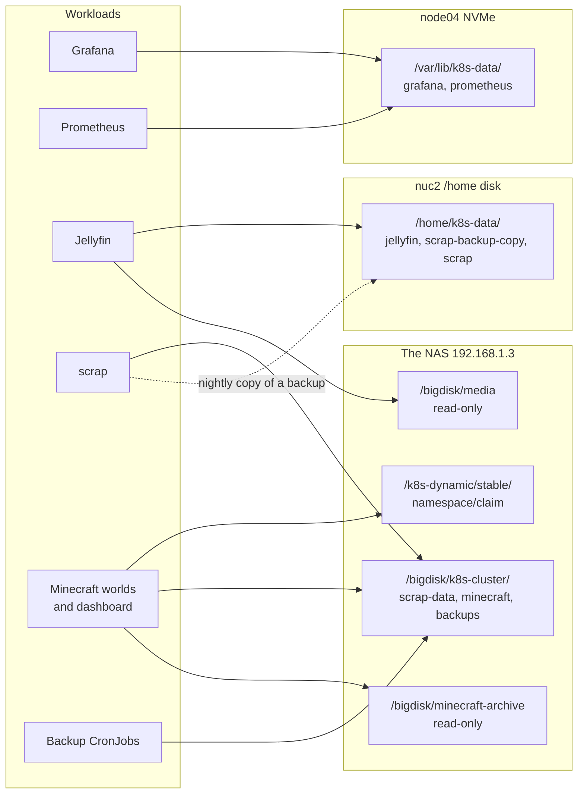
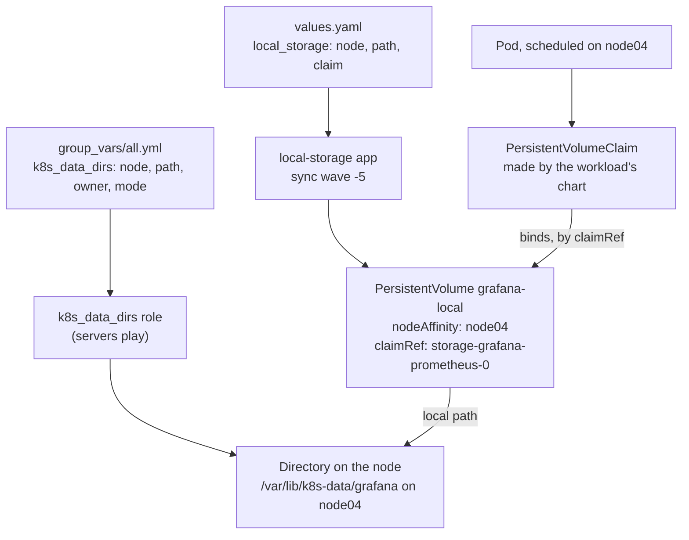
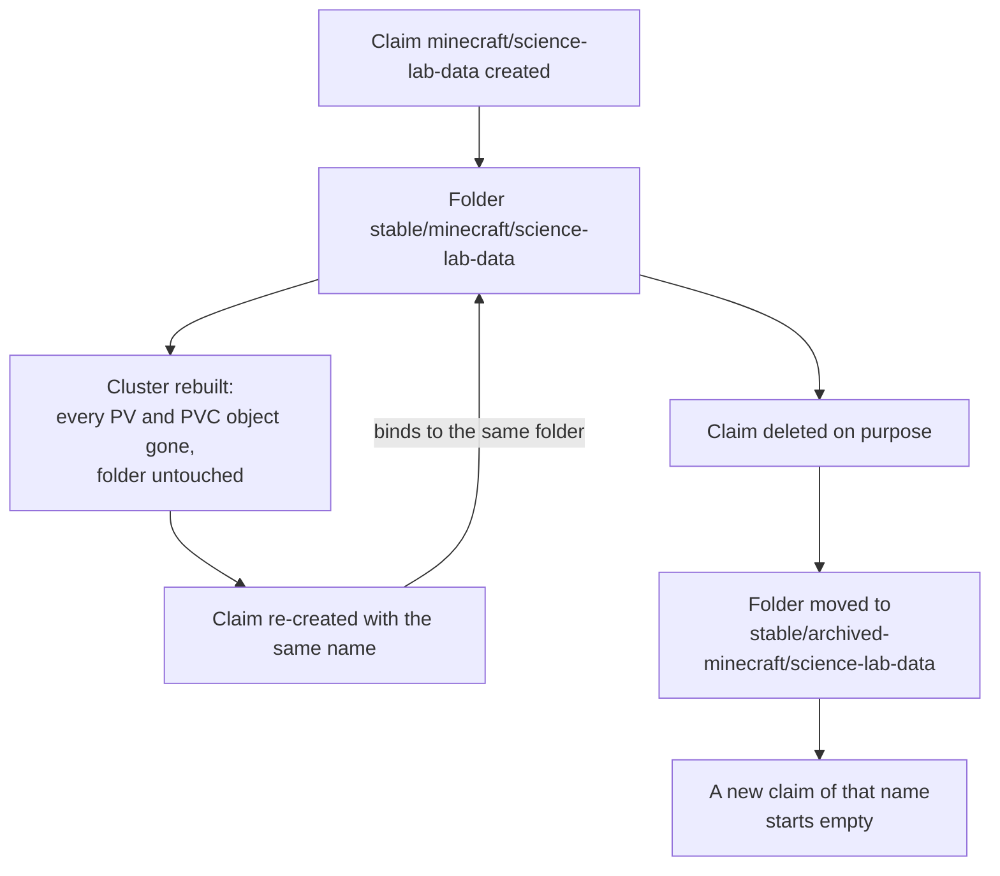

# Storage

The cluster has no replicated block storage. A few workloads that need a
fast local disk (SQLite databases and Prometheus's time series) each get a
plain directory on one named node, and everything else lives on the NAS over
NFS. A workload on a local disk is tied to that node and is down when the
node is; in exchange there is no storage system to run, no replica traffic
on 8 GB nodes, and all data survives a full rebuild of the cluster. The
decision and what it replaced (Longhorn) are recorded in
{doc}`ADR 0012 </explanations/decisions/0012-drop-longhorn>`.

This page describes where every byte is. Procedures are in the how-tos it
links to.

## The map



## Storage classes

| Class | Provisioner | Reclaim | What it is for |
|-------|-------------|---------|----------------|
| `local-nvme` | none (`kubernetes.io/no-provisioner`) | Retain | Static, node-pinned volumes declared by hand in `local_storage` |
| `nfs-stable` (default) | NFS CSI driver | Delete, but the driver archives the folder | Any claim that names no class: a fixed folder per claim on the NAS |
| `nfs-rwx` | NFS CSI driver | Delete, data removed | Scratch volumes that must start empty; only when named. Nothing uses it today |
| `local-path` | K3s's bundled provisioner | Delete | Installed by K3s; kept, with its default flag turned off, and unused |
| (none) | n/a | Retain | Static NFS volumes that point at a fixed NAS directory: scrap's, Jellyfin's media, the backups share, the Minecraft dashboard's |

`nfs-stable` is the default so that a claim written without thinking about
storage gets data that survives a rebuild. `local-nvme` has no provisioner at
all, so a claim can only bind to a volume someone deliberately declared.

## Every volume

From `kubectl get pv`. Capacities are labels: neither a local directory nor
an NFS folder enforces them.

| Volume | Used by | Class | Where the bytes are | Size | Backed up by |
|--------|---------|-------|---------------------|------|--------------|
| `grafana-local` | Grafana | `local-nvme` | node04 `/var/lib/k8s-data/grafana` | 30Gi | `grafana-daily`, `grafana-weekly` to the NAS, then Drive |
| `prometheus-local` | Prometheus | `local-nvme` | node04 `/var/lib/k8s-data/prometheus` | 40Gi | Nothing, on purpose |
| `jellyfin-local` | Jellyfin data, config, logs | `local-nvme` | nuc2 `/home/k8s-data/jellyfin` | 60Gi | `jellyfin-daily`, `jellyfin-weekly` to the NAS, then Drive |
| `scrap-backup-copy-local` | `scrap-backup-copy` CronJob | `local-nvme` | nuc2 `/home/k8s-data/scrap-backup-copy` | 10Gi | It is a backup: the newest scrap run, kept off the NAS |
| `scrap-local` | Nothing (frozen copy) | `local-nvme` | nuc2 `/home/k8s-data/scrap` | 5Gi | Nothing; see the note under scrap below |
| `scrap-data-nfs` | scrap: files, previews, database replica | static NFS | NAS `/bigdisk/k8s-cluster/scrap-data` | 5Gi | scrap's own backup CronJobs |
| `scrap-backups-nfs` | scrap's backup runs | static NFS | NAS `/bigdisk/k8s-cluster/backups/scrap` | 20Gi | Copied to nuc2 and to Drive |
| `jellyfin-media-nfs` | Jellyfin library | static NFS, read-only | NAS `/bigdisk/media` | 4Ti | Not the cluster's data |
| `k8s-cluster-nfs` | Backup CronJobs in `backups` | static NFS | NAS `/bigdisk/k8s-cluster` | 500Gi | The off-site job reads `backups/` from it |
| `minecraft-minecraft-dashboard-store` | Dashboard: backups, snapshots, registry | static NFS | NAS `/bigdisk/k8s-cluster/minecraft` | 1Ti | Nightly tarball to Drive |
| `minecraft-minecraft-dashboard-archive` | Dashboard: precious world archive | static NFS, read-only | NAS `/bigdisk/minecraft-archive` | 1Ti | Uploaded to Drive once, and again if it changes |
| `minecraft-minecraft-dashboard-volumes` | Dashboard: view of the worlds' share | static NFS, read-only | NAS `/k8s-dynamic/stable` | 1Ti | n/a (a second mount of the worlds below) |
| `pvc-...` (six today) | One per Minecraft world, `<world>-data` | `nfs-stable` | NAS `/k8s-dynamic/stable/minecraft/<world>-data` | 10Gi each | Dashboard snapshots; nightly tarball to Drive |

What each backup is, and when it runs, is on the
{doc}`backups page </explanations/architecture/backups>`.

## Local disks: `local-nvme`

A `local-nvme` volume is a directory, and four separate things have to agree
about it.



- **The directory** is created by the `k8s_data_dirs` role from the
  `k8s_data_dirs` list in `group_vars/all.yml`, on the entry's node only,
  with the owner and mode the pod's `securityContext` expects. It is the
  only thing in the repository that creates these directories.
- **The volume** comes from `local_storage` in
  `kubernetes-services/values.yaml`: the `local-storage` app renders one
  PersistentVolume per entry, with `nodeAffinity` for the node and a
  `claimRef` naming the exact claim that will use it.
- **The claim** is created later by the workload's own chart (Grafana,
  Prometheus) or by a small template beside it (Jellyfin, scrap). Because the
  volume already reserves that claim's name, the claim binds to it and to
  nothing else. Deleting an Application leaves its claim: the templates
  carry `Prune=false,Delete=false`, and ArgoCD does not track the claims
  the StatefulSets make. Deleting a claim by hand leaves its volume
  `Released`; see {ref}`local-nvme-pv-released`.
- **The pod** follows the volume: the class binds
  `WaitForFirstConsumer`, so the scheduler places the pod on the node the
  volume is pinned to.

The `local-storage` app syncs in wave `-5`, ahead of everything else. If a
chart created its claim first, the claim would have no volume waiting and
would fall through to the default class, `nfs-stable`, and Grafana would
start on an empty NFS folder.

**The SYNC contract.** `node` and `path` appear twice, once for Ansible and
once for Helm, and must match. If they drift the volume points at a
directory that does not exist and the pod never starts. Both files carry a
`SYNC:` comment saying so.

**One volume, one workload, one chosen host.** There is no shared pool. A
new workload that needs a local disk gets its own entry in both lists and an
explicit node. Current placement:

| Workload | Node | Why there |
|----------|------|-----------|
| Prometheus, Grafana | node04 | The 32 GB RK1, with a mostly empty NVMe |
| Jellyfin | nuc2 | The Intel Iris Xe for transcoding |
| scrap's backup copy | nuc2 | A disk that is not the NAS |

**These paths are sacred.** `/var/lib/k8s-data/*` on the RK1s and
`/home/k8s-data/*` on nuc2 sit outside `/var/lib/rancher` deliberately.
`pb_decommission.yml` removes K3s and everything under `/var/lib/rancher`,
and leaves these directories alone, so a rebuilt cluster finds Grafana's
dashboards and Jellyfin's database where they were. Only
`-e wipe_local_data=true` deletes them. On an RK1 the directory is on the
NVMe that also holds the root filesystem, so a forced re-flash
(`flash_force`) of node04 wipes it: that is a deliberate, announced act, not
part of a rebuild. Moving a volume to another node is a runbook:
{ref}`move-a-local-nvme-pv`.

## The NAS

The NAS is a QNAP at `192.168.1.3`. Ansible never touches it: it also holds
personal data, so its directories are created once by hand
({doc}`/how-to/nas-setup`) and the cluster is only ever an NFS client.

```text
/bigdisk/
  k8s-cluster/              the cluster's own tree (nfs.cluster_share_path)
    scrap-data/             scrap: files, preview cache, database replica
    minecraft/              dashboard store: backups, snapshots, registry
    backups/
      grafana/  jellyfin/   daily tarballs, and weekly/ below each
      scrap/                scrap's backup runs, and monthly/
      scrap-curated/        scrap runs kept by hand
      etcd/                 encrypted etcd bundles and sealing keys
  media/                    Jellyfin's library, mounted read-only
  minecraft-archive/        precious world archive, read-only
/k8s-dynamic/               NFS CSI share (nfs_csi.share): nfs-rwx volumes
  stable/                   nfs-stable volumes (nfs_csi.stable_share)
    minecraft/<world>-data  one folder per claim
    archived-minecraft/     folders of deleted claims
```

Two of those are protected by where they are:

- `/bigdisk/media` is mounted read-only three times over (the volume, its
  access mode and the pod's mount), so Jellyfin cannot alter the library.
- `/bigdisk/minecraft-archive` is **outside** `k8s-cluster/` on purpose. No
  tool that works on "the cluster's share" can reach it, it is read-only on
  the NAS and in the mount, and the dashboard only ever reads it.

### `nfs-stable`: a folder that depends only on the claim's name

The NFS CSI driver normally names a volume's folder after the volume, which
is a random ID. `nfs-stable` names it `<namespace>/<claim>` instead, and on
delete it archives the folder and does not remove it (`onDelete: archive`).



That one rule is what carries dynamic volumes across a rebuild. A rebuild
wipes etcd, so the cluster forgets every volume, but the folders are still
on the NAS under names that can be worked out again. The Minecraft
dashboard keeps a registry of its worlds on its store; after a rebuild it
re-creates each world, the claims come back under the same names, and they
bind to the old data.

The other side of the rule: deleting a claim never deletes data, and the
driver keeps only one archive per name. An old archive has to be cleared on
the NAS before a claim of the same name is deleted again. The details are in
{doc}`/how-to/nfs-stable-paths`.

### scrap: a database that is not on NFS

SQLite on NFS is unsafe, and a local volume would pin scrap to one node. So
scrap does neither ({doc}`ADR 0013
</explanations/decisions/0013-scrap-litestream-on-nfs>`):

- the database is on the pod's `emptyDir`, on whichever node the pod is on;
- Litestream replicates it, about a second behind, to
  `/data/litestream` on `scrap-data-nfs`;
- uploaded files and the preview cache are ordinary files on the same
  volume;
- every new pod's init container restores the database from the replica
  before scrap starts, and refuses to start empty if the volume looks wrong.

scrap therefore has no node selector. It restarts on any node after a drain,
and after a node is fenced. Both of its volumes are static NFS volumes bound
to fixed NAS directories, with `Prune=false,Delete=false`, so neither a
rebuild nor an ArgoCD mistake can detach them from their data.

:::{note}
`scrap-local` (`/home/k8s-data/scrap` on nuc2) is scrap's volume from before
that change, kept as a frozen copy. Nothing mounts it. Its entries stay in
`local_storage` and `k8s_data_dirs` because removing them would prune a
volume that still has a bound claim.
:::

### Ephemeral on purpose

Some state is deliberately not kept:

- **ntfy** keeps its user database and message cache on an `emptyDir`. The
  users are provisioned from configuration at every start, and the cache
  only serves phones that were offline. Alerts are often about a node going
  down, so the pod must be free to move.
- **Jellyfin's cache and transcodes** are a 20Gi `emptyDir`
  (`jellyfin.cache_size`).
- **Alertmanager** has no volume: silences and notification state do not
  survive a pod restart.

## What survives what

"Kept" means the data is there when the workload comes back. A rebuild here
is `pb_decommission.yml` without `wipe_local_data`, followed by `pb_all.yml`.

| Data | Pod restart | Node reboot | Node lost for good | Cluster rebuild | NAS lost |
|------|-------------|-------------|--------------------|-----------------|----------|
| Grafana (node04) | Kept | Kept; down meanwhile | Restore the last daily backup onto another node | Kept | Kept; its backups are on Drive |
| Prometheus (node04) | Kept | Kept; a gap in the metrics | Lost: history starts again | Kept | Kept |
| Jellyfin config (nuc2) | Kept | Kept; down meanwhile | Restore the last daily backup; a library scan rebuilds metadata and subtitles | Kept | Kept; the media library itself is gone |
| scrap | Restored from the replica | Restored on another node | Fence the node; restored on another node, about a second lost | Kept: volumes re-bind | Restore the newest backup run from nuc2 or Drive: up to a day lost |
| Minecraft worlds | Kept | Kept; worlds are pinned to nuc2, so down meanwhile | Kept on the NAS; worlds need a new node | Kept: the dashboard re-creates them | Restore the nightly tarball from Drive: up to a day lost |
| Minecraft store and archive | Kept | Kept | Kept | Kept | Restore from Drive |
| ntfy cache | Lost, by design | Lost | Lost | Lost | n/a |
| Cluster state (etcd) | n/a | Kept | Restore the nightly bundle onto node03 | Rebuilt from Git | Kept; older bundles are on Drive |

The recovery procedures behind each cell are indexed on the
{doc}`backups page </explanations/architecture/backups>`.

## What this design does not give

- **No failover for pinned workloads.** If node04 is down there is no
  Grafana or Prometheus; if nuc2 is down there is no Jellyfin and no
  Minecraft. Moving one is manual.
- **No replication of live local data.** Between two nightly backups, a
  dead disk loses up to a day of Grafana or Jellyfin changes.
- **The NAS is a single point** for scrap, the Minecraft worlds and every
  first-level backup. It is one box, not a cluster.
- **No snapshots, no volume UI, no automatic rebalancing** when nodes come
  and go.
- **Capacity is not enforced.** A volume can fill the disk under it.
- **A volume cannot be resized or moved by Kubernetes.** Moving one means
  copying a directory and editing two lists.

For a homelab with one administrator these are the right things to give up:
what remains is directories and NFS folders that can be read with `ls`, and
a cluster that can be torn down and rebuilt without losing anything.
