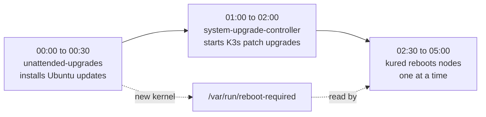

# Automatic maintenance

The cluster's nodes patch and reboot themselves overnight, one at a time,
so nobody has to remember to. Larger changes, such as a new K3s minor
version or an Ubuntu release upgrade, stay deliberate edits to the
repository. `ws03`, the owner's workstation, is left out of all of it.

## The nightly cycle

All times are Europe/London and set in `kubernetes-services/values.yaml`
(`k3s.upgrade_window`, `kured`) and the `update_packages` role defaults.

| Time | What | Component |
|------|------|-----------|
| 00:00–00:30 | Install Ubuntu updates, including new kernels | unattended-upgrades |
| 01:00–02:00 | Apply K3s patch releases, control plane first | system-upgrade-controller |
| 02:30–05:00 | Reboot nodes that need it, one at a time | kured |

The order is deliberate: a kernel installed at midnight is booted the same
night, and the two components that drain nodes never share a window. The
backups are scheduled around the same windows;
{doc}`/explanations/architecture/backups` has the whole night on one
timeline.

| Node | unattended-upgrades | K3s patch Plan | kured reboot |
|------|---------------------|----------------|--------------|
| `node02` (control plane) | Nightly, `-security` and `-updates` | `k3s-server` | Yes |
| `node03`, `node04`, `nuc1`, `nuc2` | Nightly, `-security` and `-updates` | `k3s-agent` | Yes |
| `ws03` (workstation) | Ubuntu's default policy, untouched | None: by hand | Never |

**OS updates.** The `update_packages` role configures unattended-upgrades on
every node but `ws03` to install from both the `-security` and
`-updates` pockets, so kernel updates are included. Its timer fires at 00:00
with a random delay of up to 30 minutes
(`update_packages_upgrade_on_calendar`, `update_packages_upgrade_random_delay`).
A package that needs a reboot writes `/var/run/reboot-required`.

**K3s patches.** [system-upgrade-controller](https://github.com/rancher/system-upgrade-controller)
runs two Plans that follow the K3s release channel for one minor version
(`k3s.minor`, `v1.34` today). The `k3s-server` Plan takes an etcd snapshot,
cordons `node02` and upgrades it. The `k3s-agent` Plan then drains and
upgrades `node03`, `node04`, `nuc1` and `nuc2` one at a time; it selects
every node that is neither a control plane nor labelled
`node-role=workstation`. A new minor version is never installed on its
own: see {doc}`/how-to/upgrade-k3s`. `node02` is the only etcd member, so
a failed server upgrade leaves the API down until it is fixed or restored
from the `pre-upgrade-*` snapshot in
`/var/lib/rancher/k3s/server/db/snapshots` on `node02`
({doc}`/how-to/recover-control-plane`).

**The server Job retries.** Upgrading the server stops k3s, and with it the
kubelet and containerd that run the upgrade Job's pod. The pod's final
state is lost, so the Job usually counts it as failed and starts a second
pod once k3s is back. That second pod finds the binary already at the
target version: its `prepare` step skips the snapshot, and its upgrade step
does nothing. Before this check, a retry saved a second, post-upgrade
snapshot under the same `pre-upgrade-<version>` name. If a server shows two
snapshots for one version, the **earliest** is the real pre-upgrade one.
The nightly backup ships only that one to the NAS
(`backups/etcd/pre-upgrade/`), and replaces a bundle of the same name made
from a later file.

**Reboots.** [kured](https://kured.dev/) runs as a DaemonSet on five nodes:
it tolerates the control-plane taint, so `node02` is included, but not the
workstation taint, so `ws03` is not. Each pod checks its node for
`/var/run/reboot-required` every 10 minutes. Inside the window it takes a
cluster-wide lock, drains the node, reboots it and uncordons it when it is
back, then holds the lock for 5 more minutes so rescheduled pods settle
before the next node goes. If a drain does not finish within 15 minutes,
the node is uncordoned and retried later instead of being forced.

**No overlap.** kured and system-upgrade-controller each drain nodes and
know nothing about each other, so they get separate windows; keep the gap
if you move either one. system-upgrade-controller only starts a round of
upgrades inside its window, but it finishes a round it has started, node by
node, even after the window closes. A slow round can therefore reach the
kured window, so kured never reboots a node while an upgrade Job runs on it
(its `blockingPodSelector`).

Both drain through the eviction API, so PodDisruptionBudgets are respected
even if they ever drain two nodes at once.

## Running the servers play by hand

`ansible-playbook pb_all.yml --tags servers` dist-upgrades every node in
parallel, but it never reboots a node that is in the cluster (its k3s unit
is installed). It leaves `/var/run/reboot-required` in place and reports
that kured will reboot the node in its next window, so the play is safe to
run at any time.

To reboot such nodes straight away, add `-e reboot_now=true`. A later play
in `pb_all.yml` then takes the nodes that need it one at a time
(`serial: 1`): it drains the node, reboots it, waits until the Node is
Ready with its new boot ID and uncordons it, unless it was already
cordoned before the drain. The drain, wait and uncordon logic is the
`node_reboot` role, which the `rk1_os` conversion shares.

A node without K3s, being provisioned for the first time, is rebooted at
the end of `update_packages` if the dist-upgrade asks for it, so k3s is
installed on the new kernel. It has nothing to drain. `ws03` is never
rebooted, even with `reboot_now`; the play warns instead. That includes the
reboot after its first NVIDIA driver install: do it by hand before relying
on GPU pods.

## What stays up during a reboot

Shared services run two replicas on different nodes, each with a
PodDisruptionBudget of `maxUnavailable: 1`, so a drain always leaves one
running:

- CoreDNS (see below)
- ingress-nginx controller
- oauth2-proxy
- cloudflared

Workloads pinned to one node are down while it reboots, typically a few
minutes: Prometheus and Grafana on `node04` (`local-nvme` volumes), and
Jellyfin and the Minecraft worlds on `nuc2`. scrap runs a single pod but is
not pinned: a drain moves it to another node, where it restores its
database from its Litestream replica
({doc}`/explanations/decisions/0013-scrap-litestream-on-nfs`).

Rebooting `node02` takes the Kubernetes API down for a few minutes while
running pods keep serving: `kubectl`, ArgoCD syncs and anything else that
talks to the API wait until it is back. Alertmanager, the Prometheus operator and
kube-state-metrics do not tolerate the workstation taint, so they run on
cluster nodes and move with drains like everything else.

### CoreDNS

K3s deploys CoreDNS itself and re-applies its manifest whenever the K3s
server restarts, so edits to the Deployment do not last. That manifest
leaves `replicas` unset, so the `coredns` ArgoCD app adds a
HorizontalPodAutoscaler fixed at two replicas plus a PodDisruptionBudget;
the bundled pod spec already spreads replicas across nodes. It does not
tolerate the control plane's `node-role.kubernetes.io/master` taint, so
replicas are scheduled onto workers and DNS stays up while the control plane
reboots. A replica started on the control plane before the taint was applied
(during bootstrap) moves to a worker at its first drain.

This was chosen over disabling the bundled CoreDNS and installing the Helm
chart: K3s still provides DNS from the first boot, before ArgoCD (which
needs DNS to reach Git) is running, so the rebuild path is unchanged.

## ws03, the workstation

`ws03` (`workstation: true` in `hosts.yml`) is a desktop in daily use, so
its owner reboots and upgrades it. Neither kured, system-upgrade-controller
nor Ansible reboots it, and unattended-upgrades keeps Ubuntu's default
(security-only) policy. Its K3s agent is upgraded by hand with
`just upgrade-workstation ws03`, after the rest of the cluster
({doc}`/how-to/upgrade-k3s`).

## What stays manual

- **K3s minor versions:** edit `k3s.minor`; see {doc}`/how-to/upgrade-k3s`.
- **Ubuntu release upgrades and re-flashing:** Ansible runs
  ({doc}`/how-to/reflash-rebuild`).
- **`ws03`:** everything, as above.
- **Service versions:** chart and image pins in this repository, applied by
  ArgoCD on merge.
