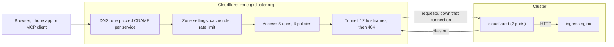

# Manage Cloudflare: DNS, tunnel and Access

Everything the cluster has at Cloudflare (DNS records, the tunnel and its
public hostnames, Zero Trust Access applications and policies, zone
security settings, the cache rule and the rate-limiting rule) is
[OpenTofu](https://opentofu.org) code in `cloudflare/`, using the
[Cloudflare provider](https://registry.terraform.io/providers/cloudflare/cloudflare/latest/docs).
A change is made in the repo and reviewed like any other, then applied by
the owner with `just cf-apply`. A change made in the dashboard shows up as
drift in the next `just cf-plan`, and the next `just cf-apply` reverts it.

This page is the runbook. For how a request travels from the edge to a
pod, and why the edge is built this way, see
{doc}`/explanations/architecture/networking` and
{doc}`/explanations/architecture/authentication`.

## What is at Cloudflare



- **The zone** `gkcluster.org`, with strict SSL, TLS 1.2 or later,
  "always use HTTPS" and HSTS (180 days, including subdomains).
- **One remotely-managed tunnel.** Two `cloudflared` pods in the
  `cloudflared` namespace dial out to it, so the home router forwards no
  ports. Every route points at ingress-nginx
  (`http://ingress-ingress-nginx-controller.ingress-nginx.svc.cluster.local`),
  never straight at a Service, so the ingress rules and oauth2-proxy
  apply to everything.
- **Twelve public hostnames**, the `tunnel_services` list in
  `cloudflare/locals.tf`. Each is a tunnel route and a proxied CNAME to
  the tunnel:

  | Hostname | Service | Access |
  |---|---|---|
  | `echo.gkcluster.org` | echo test server | Owner |
  | `grafana.gkcluster.org` | Grafana | Viewers, Owner |
  | `headlamp.gkcluster.org` | Headlamp | Owner |
  | `oauth2.gkcluster.org` | oauth2-proxy's sign-in and callback | Owner |
  | `argocd-monitor.gkcluster.org` | argocd-monitor | Viewers, Owner |
  | `home.gkcluster.org` | The cluster home page | Owner |
  | `argocd.gkcluster.org` | ArgoCD and Dex | Viewers, Owner |
  | `alertmanager.gkcluster.org` | Alertmanager | Owner |
  | `minecraft.gkcluster.org` | Minecraft dashboard | Owner |
  | `scrap.gkcluster.org` | scrap | Owner; `/mcp` takes a service token |
  | `pages.gkcluster.org` | scrap's public pages | Public, cached at the edge |
  | `ntfy.gkcluster.org` | ntfy | Public; ntfy's own tokens |

  Anything else that reaches the tunnel gets a 404.
- **DNS-only records** that do not go through the tunnel, in
  `dns_only_records` (their addresses are in the gitignored
  `live.auto.tfvars`):

  | Record | Points at | Purpose |
  |---|---|---|
  | `home-lan` | The LAN address of a node that answers for the ingress LoadBalancer | The home page's "am I on the LAN?" probe |
  | `home-tailnet` | That node's tailnet address | The same probe for the tailnet |
  | `mc` | The VPS's public address | Minecraft game ports ({doc}`vps-relay`) |

- **Access applications and policies** (`cloudflare/access.tf`):

  | Application | Destination | Policies, in order |
  |---|---|---|
  | `clusterapps` | `*.gkcluster.org` | Owner |
  | `Demo` | `argocd`, `grafana`, `argocd-monitor` | Viewers, Owner |
  | `pages` | `pages.gkcluster.org` | bypass |
  | `scrap` | `scrap.gkcluster.org/mcp` | scrap-mcp-policy (service token) |
  | `ntfy` | `ntfy.gkcluster.org` | bypass |

  **Owner** allows the addresses in `owner_emails` and requires the
  GitHub login method (24-hour session). **Viewers** allows
  `viewer_emails` and `viewer_email_domains` with any login method, in
  practice the emailed one-time PIN (6-hour session). The most specific
  destination wins, so `Demo` beats the wildcard for its three hostnames
  and the `/mcp` app beats it for that one path.

Remote shell and `kubectl` access do not go through Cloudflare at all:
they use the LAN or, from outside it, the tailnet, and the tunnel has no
SSH route.

:::{note}
`home-lan` resolves to a private address from public DNS. The OpenWrt
router's dnsmasq drops such answers (DNS rebinding protection) unless
`gkcluster.org` is on its rebind whitelist (`list rebind_domain` in
`/etc/config/dhcp`). That setting lives on the router, not in this repo:
if `home-lan.gkcluster.org` stops resolving on the LAN but resolves
through `1.1.1.1`, the whitelist entry has been lost.
:::

## What each file manages

| File | Contents |
|------|----------|
| `locals.tf` | `tunnel_services`: the list of public services. Each entry is a tunnel ingress rule (in list order, before the 404 catch-all) and a proxied CNAME to the tunnel; `cache = true` adds a cache rule for it; `access_bypass = true` puts it on the Access bypass allowlist |
| `tunnel.tf` | The tunnel, its secret (and so the tunnel token, output `tunnel_token`) and its ingress configuration |
| `dns.tf` | The tunnel CNAMEs, plus `dns_only_records` |
| `access.tf` | Reusable policies (Owner, Viewers, bypass, service token) and the Access applications |
| `access_guard.tf` | The rule that every public hostname is behind Access unless allowlisted ({ref}`below <cf-access-guard>`) |
| `zone.tf` | Zone settings (SSL mode, minimum TLS, HSTS, security level, ...) and the zone's cache rules |
| `waf.tf` | The zone's rate-limiting rule (the `http_ratelimit` ruleset) |
| `imports.tf` | `import` blocks that adopt existing objects into state |
| `variables.tf` | Per-account inputs; the values go in the gitignored `live.auto.tfvars` |
| `versions.tf` | Provider pins and the state encryption settings |

### Login methods are set up in the dashboard

The Access login methods (identity providers) are **not** managed here:
Cloudflare never returns an OAuth client secret through its API, so code
cannot keep a login method in step with what is live. They are set once
in the Zero Trust dashboard under **Settings > Authentication > Login
methods**:

- **One-time PIN** (emailed code; no configuration).
- **GitHub**, with the client ID and secret of a GitHub OAuth app whose
  callback URL is
  `https://<team>.cloudflareaccess.com/cdn-cgi/access/callback`, where
  `<team>` is `cf_access_team` in `kubernetes-services/values.yaml`. This
  is a third GitHub OAuth app, separate from the two in
  {doc}`oauth-setup`.

The Owner policy requires the GitHub login method and finds it by name
(`owner_login_method`, default `GitHub`); a plan fails with a clear error
if no login method of that name exists.

### Also not managed

- Cloudflare's managed rulesets (DDoS, the free managed WAF ruleset) and
  zone settings left at their defaults.
- The Access service token `mcp-access`, which scrap's `/mcp` policy looks
  up by name. Its secret is shown only once, when it is created, and has
  to be handed to the client, so it is created and rotated in the Zero
  Trust dashboard (**Access > Service auth**). Managing it here would
  also put the secret in state.
- The zone's (empty) custom WAF ruleset and the Zero Trust organization
  settings.
- The Access apps' `eager_redirect_cookie_setting`, which the provider's
  schema does not have: check it in the dashboard after changing one of
  those apps.

(cf-access-guard)=
### Every public hostname in the code is behind Access

The repo is public, so a hostname left open by mistake is easy for
anyone to find. `access_guard.tf` makes `tofu plan` (and so
`just cf-plan` and `just cf-apply`) fail, before anything reaches
Cloudflare, when:

- a tunnel service, or a proxied entry in `dns_only_records`, is not
  covered by an Access app whose policies all ask for an identity or a
  service token. The `*.gkcluster.org` wildcard app covers every hostname
  one label below the domain (`a.gkcluster.org`, not
  `a.b.gkcluster.org`); an app for exactly one hostname covers that
  hostname; an app with a path (such as `scrap.gkcluster.org/mcp`) covers
  only that path, never the whole hostname. The error reads `<host> is
  routed through the tunnel but no Access app protects it`.
- an Access app lets anyone in (a policy with the `bypass` decision, or
  one that includes everyone, a login method on its own or the whole
  internet's IP range) for a hostname that is not on the bypass
  allowlist. One such policy opens the whole app, as Cloudflare evaluates
  bypass policies first. The error reads `Access app "<name>" lets anyone
  in ... not on the bypass allowlist`. This also catches a bypass app
  with a path, and a bypass policy added to the wildcard app.

The allowlist is the `tunnel_services` entries with
`access_bypass = true` ({ref}`cf-access-bypass`). It lives in the code,
next to the services, so that opening a service to the internet is a
visible line in a reviewed change. A service-token-only policy (the
`non_identity` decision) counts as protected, not as bypass. A hostname
on the allowlist is not checked at all, so it may have a bypass app or
none. Only tunnel services can be allowlisted: a proxied
`dns_only_records` entry must always be behind Access.

The guard sees only this code. It does not judge rules that are wide by
their values (a public email domain in `viewer_email_domains`, say), and
it knows nothing of hostnames created outside `cloudflare/`.

To fix either error, add or correct the Access app in `access.tf`; or,
if the service really is meant to be public, set `access_bypass = true`
on its `tunnel_services` entry. A flag that no open app needs gives a
warning (not an error), so the allowlist does not outgrow its use.

### Rate limiting on the Free plan

The zone is on Cloudflare's Free plan, which allows one rate-limiting
rule, with a 10-second counting period and a 10-second block, counted
per client IP, and an expression that may only use the URI path (and
Verified Bot), not the hostname. The rule in `waf.tf` fits those limits
and belongs to ntfy: it matches ntfy's topic paths (`/cluster-alerts*`,
`/vps-alerts*`), `/v1/*` and `/` on every host in the zone (it cannot
name one), allows 17 requests in 10 seconds (about 100 a minute) per IP,
then blocks for 10 seconds. The zone's one rule is then taken: a second
rule, for another service, needs a paid plan, which also allows matching
on the hostname and longer periods (see Cloudflare's
[rate limiting rules](https://developers.cloudflare.com/waf/rate-limiting-rules/)).

Only the edit token can ask Cloudflare to check a rule against the plan
(see the note in step 1), so a rule the plan does not allow shows up in
`just cf-apply`, not in `just cf-plan`.

## Set up the code against the account

The steps in this section are needed once per checkout: on a new
workstation, after losing the state, or against a fresh Cloudflare
account. Run every `cf-*` recipe in the devcontainer, which has `tofu`
installed (pinned in `.devcontainer/Dockerfile`), and from the main
checkout: a git worktree has neither the state nor `live.auto.tfvars`.

### 1. Create two API tokens

Plan and apply use separate tokens, and neither is stored in the repo.
Create both under **My Profile > API Tokens > Create Token > Create
Custom Token**, scoped to the account and to the `gkcluster.org` zone
only.

**Plan token (read-only)**: all of these with **Read**:

| Scope | Permission |
|-------|------------|
| Account | Access: Apps and Policies |
| Account | Access: Organizations, Identity Providers, and Groups |
| Account | Access: Service Tokens |
| Account | Cloudflare Tunnel |
| Zone | Zone |
| Zone | DNS |
| Zone | Zone Settings |
| Zone | Cache Rules |
| Zone | Zone WAF |

**Apply token (edit)**: the same list with **Edit** in place of
**Read**, except Zone: Zone, Access: Service Tokens and Access:
Organizations, Identity Providers, and Groups, which stay at Read (those
are only looked up). Give it a short expiry, or create it when it is
needed and delete it afterwards: it can change the edge.

The plan token is read from `CF_PLAN_TOKEN`, else from
`cloudflare/.secrets/plan-token` (gitignored), else the recipe prompts
for it. The apply token is read from `CF_APPLY_TOKEN`, else prompted
for; it is deliberately never read from a file.

```bash
mkdir -p -m 700 cloudflare/.secrets
read -rsp 'Plan token: ' t && printf '%s\n' "$t" > cloudflare/.secrets/plan-token && unset t
chmod 600 cloudflare/.secrets/plan-token
```

:::{note}
For a ruleset it is about to create or change, the provider asks
Cloudflare to check it with a dry-run API call, which needs the edit
token. With the plan token, `just cf-plan` prints a warning, `failed to
make http request for the dry run` (403), and carries on; the check
runs again, with the edit token, when `just cf-apply` plans.
:::

These two tokens are not the token cert-manager uses, which is a third,
narrower one ({ref}`cf-dns01-token`).

### 2. State and its encryption key

State is **local** (`cloudflare/terraform.tfstate`, gitignored) and
encrypted with OpenTofu's
[state encryption](https://opentofu.org/docs/language/state/encryption/)
(PBKDF2 key from a passphrase, AES-GCM). Saved plan files are encrypted
the same way. State holds the IDs and settings of everything managed,
the owner and viewer emails, and the tunnel's secret, which is why it is
encrypted and kept out of git.

The passphrase (16 characters or more) is read from
`TF_VAR_state_passphrase`, else from `cloudflare/.secrets/state-passphrase`
(gitignored), else prompted for:

```bash
openssl rand -base64 24 > cloudflare/.secrets/state-passphrase
chmod 600 cloudflare/.secrets/state-passphrase
```

Keep a copy of the passphrase in the password manager. **Without it the
state cannot be read**; the encrypted state file itself is safe to copy
to a backup location such as the NAS.

If the state is lost, nothing at Cloudflare is affected: recreate it by
filling `import_ids` again and running the first plan and apply
([step 4](#4-first-init-and-plan)), which imports the objects afresh.
That apply also sets a new tunnel secret, so it needs the edit token and
ends with the token rotation steps. The rate-limiting ruleset has no
import yet: adopt it by hand first, as step 4 describes.

Local state suits a single operator. Sharing it, or planning in CI,
would mean adding an S3-compatible backend to `cloudflare/versions.tf`
and running `tofu init -migrate-state`; the state would stay encrypted
with the same passphrase.

### 3. Fill in the account values

```bash
cp cloudflare/live.auto.tfvars.example cloudflare/live.auto.tfvars
```

Edit `cloudflare/live.auto.tfvars` (gitignored): account and zone IDs,
domain, tunnel name, owner and viewer emails, the DNS-only records, and
the IDs of the existing objects for the import blocks. These values live
here, not in the code, because the repo is public.

The IDs come from the API (read-only calls with the plan token), for
example:

```bash
T=$(cat cloudflare/.secrets/plan-token); A=<account_id>; Z=<zone_id>
api() { curl -s -H "Authorization: Bearer $T" "https://api.cloudflare.com/client/v4/$1"; }
api "zones/$Z/dns_records?per_page=100" | jq -r '.result[] | "\(.name) \(.id)"'
api "accounts/$A/cfd_tunnel?is_deleted=false" | jq -r '.result[] | "\(.name) \(.id)"'
api "accounts/$A/access/apps" | jq -r '.result[] | "\(.name) \(.id)"'
api "accounts/$A/access/policies" | jq -r '.result[] | "\(.name) \(.id)"'
api "zones/$Z/rulesets" | jq -r '.result[] | select(.phase == "http_request_cache_settings") | .id'
```

The cache rule's `ref`, for `cache_rule_refs`, is in
`api "zones/$Z/rulesets/<ruleset_id>"` under `.result.rules[].ref`.

### 4. First init and plan

```bash
just cf-init
just cf-plan
```

The first plan after filling `import_ids` shows the imports, the
tunnel's secret and the rate-limiting ruleset:

```
Plan: N to import, 2 to add, 1 to change, 0 to destroy.
```

One `to add` is `random_bytes.tunnel_secret`: the secret exists only
in the state, so nothing can import it and a state that starts empty
gets a new one. The one `to change` is
`cloudflare_zero_trust_tunnel_cloudflared.cluster`, updated in place
with that secret.

The other `to add` is `cloudflare_ruleset.rate_limit`, a known gap:
`imports.tf` has no import block for it and `import_ids` has no key. A
zone has one `http_ratelimit` ruleset, so if the zone already has it the
apply may fail on the clash. Do not apply while the plan adds it and the
zone still has one. List the zone's rate-limiting ruleset, with the
variables and `api` function of step 3 (no output means the zone has
none, and the apply can create it):

```bash
api "zones/$Z/rulesets" | jq -r '.result[] | select(.phase == "http_ratelimit") | .id'
```

Either adopt the ruleset with a temporary import block, in a file such
as `cloudflare/import-rate-limit.tf` that you delete after the apply and
do not commit:

```hcl
import {
  to = cloudflare_ruleset.rate_limit
  id = "zones/<zone_id>/<ruleset_id>"
}
```

The ruleset ID is the one that command printed. Or delete the zone's
rate-limiting ruleset first (the API's
`DELETE zones/<zone_id>/rulesets/<ruleset_id>`, with the edit token) and
let the apply create it: the plan then still shows `2 to add`, which is
right. With the import block the plan shows one more import and
`1 to add`.

Any other `to add` or `to change`, or any `to destroy`, means the code
does not match the live configuration: fix the code (or the values in
`live.auto.tfvars`) until only these are left. Then apply:

```bash
just cf-apply
```

The imports only write state, but the new secret is a change at
Cloudflare, so this apply needs the edit token. It also rotates the
tunnel token: `cloudflared` keeps the connections it has, but cannot
make new ones until it has the new token, so carry on straight away
with {ref}`the rotation steps <cf-rotate-tunnel-token>`, from
`just cf-seal-tunnel-token` (step 4) onwards.

Those steps need a running cluster: `just cf-seal-tunnel-token` seals
against its Sealed Secrets controller, and stops before it updates `.env`
if it cannot. If the cluster is down too (a rebuild after losing both),
put the new token in `.env` instead, with the command under "Collect the
credentials" in {doc}`/tutorials/build-the-cluster`, which replaces an old
`CLOUDFLARE_TUNNEL_TOKEN` line. The playbook then seals it with every
other secret, and the new pods start with it.
From then on `just cf-plan` prints `No changes. Your infrastructure
matches the configuration.` and the import blocks are no-ops.

### Fresh account

Against a Cloudflare account that has none of these objects (a new
account, or a visitor's own), the order is:

1. Add the domain to Cloudflare and enable Zero Trust (which sets the
   team name).
2. Add the two login methods by hand
   ([above](#login-methods-are-set-up-in-the-dashboard)), and create the
   `mcp-access` service token under **Access > Service auth**: the plan
   looks up the GitHub login method and the service token by name.
3. Steps 1 to 3 above, leaving `import_ids` and `cache_rule_refs` empty.
4. `just cf-init`, then `just cf-plan`: everything shows as `to add`.
5. `just cf-apply` with the edit token.
6. `just cf-seal-tunnel-token`, commit the SealedSecret and merge:
   `cloudflared` then connects with the new tunnel's token. This step
   needs a running cluster to seal against. When the cluster is still to
   be built, put the token in `.env` instead and the build seals it
   ({doc}`/tutorials/build-the-cluster`).

A rebuild of the *cluster* is not this case. The account, the tunnel and
its token are unchanged, and the rebuild reseals the same token from
`.env` ({doc}`manage-sealed-secrets`).

## Day to day

1. Change `cloudflare/` in a branch.
2. `just cf-plan` and check that the plan does what was meant.
3. Open the PR; CI runs `tofu fmt -check` and `tofu validate` (no
   credentials, no Cloudflare access).
4. After review, `just cf-apply` with the edit token, then merge.

`just cf-apply` shows the plan and asks for `yes` before it changes
anything. Claude sessions plan but never apply: the edit token is only
ever typed by the owner. Extra arguments pass through to `tofu`, for
example `just cf-plan -target=cloudflare_dns_record.tunnel`. After a
change of providers in `cloudflare/versions.tf`, run `just cf-init` once
to install them.

(cf-add-service)=
## Publish a new hostname

A service becomes reachable at `<name>.gkcluster.org` when two things
exist: an Ingress for that host in the cluster, and a `tunnel_services`
entry at Cloudflare.

1. **Ingress.** Give the service's ArgoCD Application an ingress from
   the shared chart in `kubernetes-services/additions/ingress`
   ({doc}`add-remove-services`), with:

   ```yaml
   ssl_redirect: {{ if .Values.enable_cloudflare_tunnel }}false{{ else }}true{{ end }}
   ```

   `enable_cloudflare_tunnel` is `true` in
   `kubernetes-services/values.yaml`, and the templates under
   `kubernetes-services/templates/` set their ingresses from it this way
   (echo's, and ArgoCD's in `argo-cd/ingress.yaml`, are always `false`),
   so every Ingress in the
   cluster carries `nginx.ingress.kubernetes.io/ssl-redirect: "false"`.
   Cloudflare terminates TLS at its edge and `cloudflared`
   hands ingress-nginx plain HTTP; with the redirect on, nginx would
   answer every request with a redirect to HTTPS, which the browser is
   already using, and the page would loop (`ERR_TOO_MANY_REDIRECTS`).
   Check with:

   ```bash
   kubectl get ingress -A -o json | jq -r '.items[] |
     "\(.metadata.name) \(.metadata.annotations["nginx.ingress.kubernetes.io/ssl-redirect"])"'
   ```

2. **Route and DNS record.** Add an entry to `tunnel_services` in
   `cloudflare/locals.tf`:

   ```hcl
   { name = "myservice" },
   ```

   The route defaults to ingress-nginx. Keep it that way: a route
   straight to a Service skips the ingress, so oauth2-proxy never runs
   and the `X-Auth-Request-Email` header is empty.

3. **Access.** Nothing to add for an owner-only service: the
   `clusterapps` wildcard already covers every name one label below the
   domain. To let viewers in as well, add the hostname to the `Demo`
   app's `uris` in `access.tf`. For a non-browser client or a service
   that is public on purpose, see {ref}`cf-access-bypass`.

4. **Rate-limit paths.** The zone's one rate-limiting rule matches ntfy's
   paths on every host. Check that the new service's URLs do not start
   with `/cluster-alerts`, `/vps-alerts` or `/v1/`, or its clients share
   ntfy's limit.

5. **Plan and apply.** `just cf-plan` should show one DNS record to add
   and the tunnel configuration updated in place; then `just cf-apply`.

No certificate step is needed. Cloudflare serves its own edge
certificate for the public name, and inside the cluster ingress-nginx
serves the wildcard certificate for any host without one of its own
({ref}`cf-dns01-token`).

A record that must not go through the tunnel (a non-HTTP port on the
VPS, a LAN-only name) goes in `dns_only_records` in `live.auto.tfvars`
instead, with `proxied` left at its default of `false`.

(cf-access-bypass)=
## Services that are public on purpose, and service tokens

The wildcard Access app puts a browser login in front of everything.
Three things here cannot or should not have one, and each is a visible
line in the code:

| What | In the code | The gate instead |
|---|---|---|
| `pages.gkcluster.org` | `{ name = "pages", cache = true, access_bypass = true }`, and the `pages` app with the `bypass` policy | None: scrap's public pages are meant for anyone |
| `ntfy.gkcluster.org` | `{ name = "ntfy", access_bypass = true }`, the `ntfy` app with the `bypass` policy, and the rate-limiting rule in `waf.tf` | ntfy's own access tokens, deny-all by default ({doc}`ntfy`) |
| `scrap.gkcluster.org/mcp` | The `scrap` app, whose destination has the path `/mcp`, with the `scrap-mcp-policy` policy (`non_identity`, the `mcp-access` service token) | The service token at the edge, then scrap's own bearer token ({doc}`scrap`) |

**To make a hostname public**, do both of these, or the plan fails
({ref}`cf-access-guard`):

1. Set `access_bypass = true` on its `tunnel_services` entry.
2. Add an app for exactly that hostname to `local.access_apps` in
   `access.tf` with `policies = ["bypass"]`. It is more specific than
   the wildcard, so it wins for that hostname.

A public hostname has only the service's own authentication in front of
it, so do this only for a service built to face the internet.

**For a non-browser client** (an MCP client, a script), prefer a service
token to a bypass: the path stays closed to everyone without the token,
and the guard counts it as protected. Create the token in the Zero Trust
dashboard (**Access > Service auth**), look it up by name with a
`cloudflare_zero_trust_access_service_token` data source as `mcp` is in
`access.tf`, add a `non_identity` policy that includes it, and add an app
for the hostname or path. The client sends the token's ID and secret as
the `CF-Access-Client-Id` and `CF-Access-Client-Secret` headers.

(cf-dns01-token)=
## cert-manager's DNS-01 token

cert-manager holds a Cloudflare API token of its own, with which it
writes the `_acme-challenge` TXT records that prove to Let's Encrypt
that the cluster controls `gkcluster.org`. DNS-01 is used because it
needs no public HTTP route, and it is the only challenge type that can
issue a wildcard.

- The `ClusterIssuer` `letsencrypt-prod`
  (`kubernetes-services/additions/cert-manager/templates/issuer-letsencrypt-prod.yaml`)
  reads the token from the Secret `cloudflare-api-token`, key
  `api-token`, in the `cert-manager` namespace.
- The one `Certificate`, `wildcard-cert`
  (`templates/wildcard-certificate.yaml`), covers `*.gkcluster.org` and
  `gkcluster.org` and is stored as `cert-manager/wildcard-tls`.
- ingress-nginx uses that Secret as its `default-ssl-certificate`
  (`kubernetes-services/templates/ingress.yaml`), and no Ingress names a
  certificate of its own, so every host is served the wildcard. Clients
  that reach ingress-nginx directly see it: LAN and tailnet browsers
  (`home-lan`, `home-tailnet`) and pods that resolve
  `argocd.gkcluster.org` to the ingress inside the cluster.

### Create the token

In the Cloudflare dashboard, **My Profile > API Tokens > Create Token**,
with the **Edit zone DNS** template:

| Setting | Value |
|---|---|
| Permissions | Zone > DNS > Edit |
| Zone Resources | Include > Specific zone > `gkcluster.org` |

The token is shown once. It can edit DNS for this zone and nothing else.

### Seal it

A rebuild seals it without a prompt: `just export-external-creds` saves
the live value to `.env` as `CLOUDFLARE_API_TOKEN`, and
`just generate-and-seal-all` reseals it for the new cluster
({doc}`manage-sealed-secrets`). To replace the token on the running
cluster, seal the new value by hand:

```bash
printf 'Cloudflare API token: ' && read -rs TOKEN && echo
printf '%s' "$TOKEN" | \
  kubectl create secret generic cloudflare-api-token \
    --namespace cert-manager \
    --from-file=api-token=/dev/stdin \
    --dry-run=client -o yaml | \
  kubeseal --controller-name sealed-secrets --controller-namespace kube-system -o yaml > \
    kubernetes-services/additions/cert-manager/templates/cloudflare-api-token-secret.yaml
unset TOKEN
```

Commit the file, merge, and let ArgoCD sync the `cert-manager`
Application. Then delete the old token in the Cloudflare dashboard.

### Check the wildcard certificate

```bash
kubectl get certificate -n cert-manager wildcard-cert
kubectl describe certificate -n cert-manager wildcard-cert   # renewal time, events
kubectl get challenges -A                                     # empty unless one is in progress
```

`READY` must be `True`. cert-manager renews the certificate by itself
before it expires, and the `CertManagerCertificateExpiringSoon` alert
pushes to the phone if a renewal is failing ({doc}`monitoring`). A
challenge stuck in `pending` with a Cloudflare API error in its events
means the token is wrong, expired or scoped to another zone.

(cf-rotate-tunnel-token)=
## Rotate the tunnel token

The tunnel's secret is 32 random bytes generated by the code
(`random_bytes.tunnel_secret` in `tunnel.tf`) and kept only in the
local, encrypted state, and the `tunnel_token` output is the token
`cloudflared` runs with. The state therefore holds a live credential:
keep it, and its passphrase, private. A new secret is an in-place update
of the tunnel: its ID, DNS records and public hostnames do not change.

Rotate only by changing `tunnel_secret_rotation`, never with **Rotate
token** in the dashboard. OpenTofu does not read the secret back from
Cloudflare, so after a dashboard rotation the state keeps the old,
dead secret and `just cf-seal-tunnel-token` would seal it.

Run every step from the main checkout of the repo, where the state and
`live.auto.tfvars` are, not from a git worktree. Do the whole procedure
in one go: from the apply onwards, the running `cloudflared` pods hold a
token that Cloudflare no longer accepts, and crash-loop the next time
they restart.

To rotate the token, for example after it has leaked:

1. In a branch, change `tunnel_secret_rotation` to any new value, either
   its default in `cloudflare/variables.tf` or by setting it in
   `cloudflare/live.auto.tfvars`.
2. `just cf-plan` should show `random_bytes.tunnel_secret` replaced and
   `cloudflare_zero_trust_tunnel_cloudflared.cluster` **updated in
   place**, never replaced.
3. `just cf-apply`. Cloudflare now refuses new connections that use the
   old token, but connections already up stay up until they are
   disconnected (step 7), including any connector someone else started
   with a leaked token. If such a connector is a live threat, run
   `just cf-tunnel-disconnect` straight away as well; the tunnel is then
   down until step 6 has deployed the new token.
4. `just cf-seal-tunnel-token`. It reads the token from the state (it
   asks for the state passphrase only, not an API token) and seals it into
   `kubernetes-services/additions/cloudflared/tunnel-secret.yaml` without
   printing it. If `.env` at the repo root (from
   `just export-external-creds`, for a rebuild) has a
   `CLOUDFLARE_TUNNEL_TOKEN` line, it updates that too, so a rebuild does
   not reseal the old token. The rebuild playbook reads
   `CLOUDFLARE_TUNNEL_TOKEN` from the environment, so before a rebuild run
   `set -a && source .env && set +a` again in the shell that runs the
   playbook.
5. Commit the SealedSecret (and the variable change), open the PR and
   merge it.
6. Wait for ArgoCD to sync it and for the sealed-secrets controller to
   update the Secret: the SealedSecret's observed generation must equal its
   generation, with `Synced` `True` (this prints no secret). A restart
   before that starts the pods with the old token. Then restart
   `cloudflared` so that it reads the new Secret:

   ```bash
   kubectl -n cloudflared get sealedsecret cloudflared-credentials -o \
     jsonpath='{.metadata.generation} {.status.observedGeneration} {.status.conditions[?(@.type=="Synced")].status}{"\n"}'
   kubectl -n cloudflared rollout restart deployment/cloudflared
   kubectl -n cloudflared rollout status deployment/cloudflared
   ```

7. `just cf-tunnel-disconnect`. It asks for the edit token, lists the
   tunnel's connections, and after confirmation disconnects every one of
   them. The cluster's pods reconnect within seconds with the new token,
   so expect a brief blip in public traffic; a connector that holds only
   the old token cannot reconnect.
8. Check the list it prints after reconnecting: every connector ID must be
   one of the cluster's pods (it prints their IDs from the pods' logs
   below the list), and every origin IP the home connection's own public
   address. Any other connector means something still holds a valid
   token: rotate again.

:::{note}
A tunnel adopted with an `import` block has no secret in state, so the
first `just cf-apply` after an import sets a new one. That apply is a
rotation, whatever it was run for: do steps 4 to 8 straight after it.
:::

The pods take the token from the `TUNNEL_TOKEN` environment variable
only, never as a `--token` argument, so it does not appear in the process
command line. A NetworkPolicy
(`kubernetes-services/additions/cloudflared/networkpolicy.yaml`) denies
inbound traffic to them, since the tunnel only dials out.

## Removing a service

Delete its entry from `tunnel_services` or `dns_only_records` (and any
Access app that only served it), and its ID from `import_ids` in
`live.auto.tfvars` (an import block for an object no longer in the
code is skipped; for DNS records a check also warns about the stale
key). Check that `just cf-plan` destroys exactly those objects, and
apply. Then remove the service's Ingress with the rest of its
Application ({doc}`add-remove-services`).

## Troubleshooting

Tunnel, DNS and certificate problems are collected in
{doc}`/reference/troubleshooting`.
