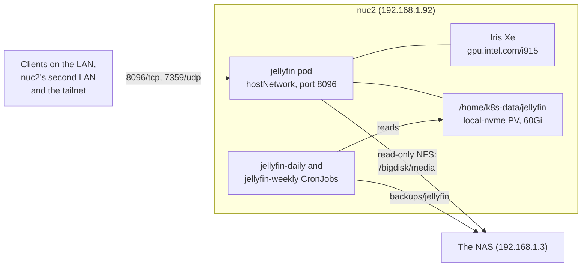

# Run Jellyfin

[Jellyfin](https://jellyfin.org) is the cluster's media server. It runs as one
pod on nuc2, on the node's own network, and transcodes on nuc2's Intel Iris Xe.
It is reachable on the LAN and the tailnet only: there is no Ingress, no
Cloudflare route and no oauth2-proxy in front of it, and Jellyfin's own user
accounts are the login.

## How it runs



The ArgoCD Application is `kubernetes-services/templates/jellyfin.yaml`,
switched on by `enable_jellyfin` and configured from the `jellyfin` block in
`kubernetes-services/values.yaml`. Its first source is the upstream
[jellyfin/jellyfin](https://github.com/jellyfin/jellyfin-helm) chart (its
repository is in the AppProject's `sourceRepos`, `argo-cd/argo-project.yaml`);
the second is `kubernetes-services/additions/jellyfin/`, with the claims and
volumes.

| Piece | Where | Why |
|-------|-------|-----|
| Deployment, one pod, `Recreate` strategy | Namespace `jellyfin`, pinned to nuc2 by `nodeSelector` and by the PV's `nodeAffinity` | One SQLite database on one RWO volume: never two pods |
| Network | `hostNetwork` (`jellyfin.host_network: true`) | The pod listens on every interface of nuc2 (both LANs and `tailscale0`), and UDP 7359 client discovery works |
| Data (database, metadata, subtitles, plugins), XML config, logs | Static `local-nvme` PV `jellyfin-local` at `/home/k8s-data/jellyfin` (`local_storage.jellyfin`), claim `jellyfin-config` | SQLite does not belong on NFS. The directory is made by the `k8s_data_dirs` role and survives a cluster rebuild |
| Media library | Static NFS PV `jellyfin-media-nfs` of `/bigdisk/media` on the NAS, claim `jellyfin-media` | Read-only three times over: the PV, the access mode and the mount |
| Cache and transcodes | `emptyDir` at `/var/cache/jellyfin`, 20Gi (`jellyfin.cache_size`) | Losing it on a restart is harmless |
| GPU | `gpu.intel.com/i915: 1` from the [Intel GPU device plugin](../reference/services.md#intel-gpu-device-plugin) | The pod is not privileged |

The pod:

- runs as uid 122, gid 124 (`jellyfin.uid`, `jellyfin.gid`): nuc2's own
  `jellyfin` account, which owns the files on the volume;
- has nuc2's `render` (992) and `video` (44) group IDs in
  `supplementalGroups` (`jellyfin.render_gid`, `jellyfin.video_gid`), for
  `/dev/dri/renderD128` (`root:render`, mode 0660 on nuc2) and
  `/dev/dri/card0` (`root:video`). In the running pod both device nodes show
  as owned by the pod's own uid and gid (`ls -ln /dev/dri`), so today the
  groups are a second line of access, not the only one;
- drops every capability and mounts no service-account token;
- requests 500m CPU and 1Gi memory, with a 4Gi memory limit and no CPU limit,
  so a transcode burst is not throttled;
- has generous probes on `/health`: startup allows 15 minutes, because a
  database migration after an upgrade can take that long.

Jellyfin sees the paths of the Debian/Ubuntu package, not the image's
`/config` layout, because its database and XML config store absolute paths:

| Pod path | Variable | Comes from |
|----------|----------|------------|
| `/var/lib/jellyfin` (data, and `HOME`) | `jellyfin.data_dir` | the config volume's `data/` |
| `/etc/jellyfin` (XML config) | `jellyfin.config_dir` | the config volume's `config/` |
| `/var/log/jellyfin` | `jellyfin.log_dir` | the config volume's `log/` |
| `/var/cache/jellyfin` | `jellyfin.cache_dir` | the cache `emptyDir` |
| `/media/bigdisk/media` | `jellyfin.media.mount_path` | the media NFS volume |

Jellyfin is pointed at them with its `JELLYFIN_*_DIR` environment variables,
and the volume's subdirectories are mounted there with `subPath`. The chart's
own `/config`, `/media` and `/cache` are unused `emptyDir`s. An init container,
`layout`, creates `data/`, `config/` and `log/` as the pod's uid if they are
missing, so kubelet never creates them as root.

:::{note}
The cache `emptyDir` has a `sizeLimit`, and the transcode segments are written
under it. If it fills, kubelet **evicts the pod**, which stops every stream.
Jellyfin deletes old segments as playback moves on, so one stream uses a few
GB at most, but several concurrent 4K transcodes, or seeking far ahead in
them, can reach the limit. Raise `jellyfin.cache_size` if that happens.
:::

:::{note}
The `render` group ID is allocated dynamically and can change across an OS
release upgrade of nuc2. Check it with `getent group render` on the node and
set `jellyfin.render_gid` to match. Where a pod sees the devices with their
host ownership, a wrong ID leaves the GPU silently unusable and Jellyfin
falls back to software transcoding.
:::

There is no PodDisruptionBudget, so kured can drain nuc2 in the nightly reboot
window ({doc}`/explanations/upgrade-model`). Jellyfin is then down until nuc2
is back. Nothing else can run it: the data and the GPU are both on nuc2.

## Reach it

Open port 8096 on any of nuc2's addresses, over plain HTTP:

- `http://192.168.1.92:8096` from the LAN;
- nuc2's address on its second LAN (`192.168.0.0/24`);
- nuc2's tailnet name or address from a device on the tailnet.

Client apps on the same LAN find it by themselves (UDP 7359). It has no
`gkcluster.org` hostname and no TLS certificate: away from home, the tailnet
is the way in.

## Check hardware transcoding

1. **Dashboard › Playback › Transcoding** shows **Hardware acceleration** set
   to **Video Acceleration API (VAAPI)** and **VA-API Device**
   `/dev/dri/renderD128`.
2. Play a file and force a transcode: in the player's settings pick a lower
   **Quality** (bitrate) than the file's.
3. **Dashboard › Activity** shows the playback as transcoding. Its FFmpeg log,
   `/var/log/jellyfin/FFmpeg.Transcode-*.log` in the pod, has `vaapi` in the
   command line and no error opening the device.
4. Query the GPU from inside the pod with the `vainfo` bundled in the image:

   ```bash
   kubectl -n jellyfin exec deploy/jellyfin -- ls -l /dev/dri
   kubectl -n jellyfin exec deploy/jellyfin -- \
     /usr/lib/jellyfin-ffmpeg/vainfo --display drm --device /dev/dri/renderD128
   ```

   It lists the iHD driver and its `VAProfile…` entrypoints. A
   `permission denied` means `jellyfin.render_gid` does not match nuc2's
   `render` group. No `/dev/dri` at all means the pod did not get the
   `gpu.intel.com/i915` resource; check that nuc2 advertises it:

   ```bash
   kubectl get nodes -o custom-columns='NODE:.metadata.name,I915:.status.allocatable.gpu\.intel\.com/i915'
   ```

   nuc2 is the only node that does, because it is the only host with
   `intel_gpu_node: true` in `hosts.yml`.

## Backups

The `backups` Application runs two CronJobs on nuc2, as Jellyfin's uid, with
the config volume's directory mounted read-only
(`kubernetes-services/additions/backups/templates/cronjob-jellyfin.yaml`):

| CronJob | Schedule (Europe/London) | On the NAS, under `/bigdisk/k8s-cluster` | Kept |
|---------|--------------------------|------------------------------------------|------|
| `jellyfin-daily` | 01:45 daily | `backups/jellyfin/<date>_<time>.tar.gz` | 7 days |
| `jellyfin-weekly` | 01:50 Sundays | `backups/jellyfin/weekly/<date>.tar.gz` | 28 days |

01:45 is after Jellyfin's 01:00 scheduled tasks and before the kured reboot
window (02:30). Each tarball holds a consistent `sqlite3 .backup` snapshot of
the database (checked with `PRAGMA quick_check`), and from the volume
`config/`, `data/.aspnet` (data-protection keys), `data/plugins/`,
`data/root/` (library definitions) and `data/data`'s `playlists/`,
`ScheduledTasks/` and `*.txt`. It is laid out like the volume, so it unpacks
at the volume's root. Extracted subtitles and metadata, tens of GB, are not
backed up: a library scan rebuilds them.

The tarballs then go off-site with every other backup on the NAS
({ref}`the nightly copy to Google Drive <offsite-backup>`).

Run one now:

```bash
kubectl create job --from=cronjob/jellyfin-daily manual-$(date +%s) -n backups
kubectl logs -n backups job/manual-<timestamp> -f
```

### Restore from a backup

1. Set `enable_jellyfin: false` and push, so nothing has the database open.
   Set `jellyfin.seed_from_host: false` in the same change unless the
   volume's root (`/home/k8s-data/jellyfin` on nuc2) holds `SEEDED-FROM-HOST`.
   Without that marker the seed runs on the restored volume: it fails on a
   new one, and a `SEED-IN-PROGRESS` left by an interrupted seed makes it
   clear the volume and copy the host install over the restore. See
   [The seed flag](#the-seed-flag).
2. On nuc2, unpack the tarball over the volume's root as the `jellyfin`
   account, for example with the NAS share mounted on the node:

   ```bash
   sudo -u jellyfin tar --no-overwrite-dir \
     -xzf <nas>/backups/jellyfin/<date>_<time>.tar.gz \
     -C /home/k8s-data/jellyfin
   sudo -u jellyfin rm -f /home/k8s-data/jellyfin/data/data/jellyfin.db-wal \
     /home/k8s-data/jellyfin/data/data/jellyfin.db-shm
   ```

   This replaces the database and the config and leaves the subtitles and
   metadata in place. Without the share on the node, do the same from a pod
   pinned to nuc2 that mounts the `k8s-cluster-nfs` claim and the volume's
   directory.
3. Set `enable_jellyfin: true` and push. If the volume was empty, Jellyfin
   rebuilds the metadata and subtitles on its next library scan.

## Upgrade Jellyfin

The chart and the image are both pinned in `kubernetes-services/values.yaml`:

```yaml
jellyfin:
  chart_version: "3.7.0"
  image_tag: "12.4.20261026-211555"
```

- Pick the newest release that is **at least two weeks old**, as a
  supply-chain buffer, and use the image's immutable dated tag rather than
  `12.4` or `latest`. (The current pin was a one-off exception to the two
  weeks, recorded in the comment above it.)
- Never go backwards: an older Jellyfin cannot open a database that a newer
  one has migrated. Run a backup first, so a bad upgrade can be undone by
  restoring it and reverting the pin.
- The seed and the backups use `jellyfin.seed.sqlite_image`; bump it under
  the same rule.

Push the change. ArgoCD stops the old pod and starts the new one
(`Recreate`); the startup probe waits up to 15 minutes for a database
migration.

## Turn it off

Set `enable_jellyfin: false` and push. ArgoCD deletes the pod, the Service and
the media volume. The config claim is kept
(`Prune=false,Delete=false`), its PV is `Retain`, and nothing in ArgoCD ever
deletes `/home/k8s-data/jellyfin` on nuc2. The two backup CronJobs go with it.

## Moving it to another node

Jellyfin is tied to nuc2 by three things that must move together: the
`local_storage.jellyfin` entry in `values.yaml`, the `jellyfin` entry in
`k8s_data_dirs` (`group_vars/all.yml`), and `intel_gpu_node: true` in
`hosts.yml`. The uid, gid and `render` group ID are nuc2's, so re-check them on
the new node. {ref}`Moving a local-nvme PV <move-a-local-nvme-pv>` has the
procedure for the data.

## How it got here: the move from the host install

Jellyfin first ran as the apt package on nuc2's host OS. It moved into the
cluster in two steps: a trial pod with a throwaway config beside the host
install, then a cutover in which init containers copied the stopped host
install into the config volume. The move is done, and the pod above is the
only Jellyfin. This is why it uses the host package's paths and nuc2's
`jellyfin` account. What remains of the move in the code:

### The seed flag

`jellyfin.seed_from_host` is still `true`. It adds two init containers,
`seed-copy` and `seed-verify`
(`kubernetes-services/additions/jellyfin/files/`), and read-only `hostPath`
mounts of nuc2's `/var/lib/jellyfin` and `/etc/jellyfin`. Marker files at the
config volume's root decide what they do:

| Marker | Meaning |
|--------|---------|
| `SEEDED-FROM-HOST` | Seeded (with a timestamp): both steps do nothing, on every later start |
| `TRIAL-CONFIG-SAFE-TO-DELETE` | A trial config: the seed may clear it |
| `SEED-IN-PROGRESS` | The seed owns the volume's contents, and clears and recopies them if interrupted |
| `SEED-COPY-COMPLETE` | The copy is done, waiting for `seed-verify` |

The volume on nuc2 is marked `SEEDED-FROM-HOST`, so on every start both
containers log that and exit. That is why the flag is safe to leave on:

- the seed never writes to the host directories (they are mounted read-only);
- it never clears a volume that is neither empty nor trial-marked: unmarked
  data makes it fail loudly, not copy over it;
- on an empty volume it refuses while anything is listening on port 8096 of
  the node, and it verifies the copy (byte-for-byte database comparison, file
  counts and sizes, then `PRAGMA integrity_check`) before writing the marker.

Two things follow from leaving it on:

- The pod needs `/var/lib/jellyfin` and `/etc/jellyfin` to exist on nuc2
  (`hostPath` type `Directory`). Do not remove the host install's
  directories while the flag is on.
- A volume restored from a backup onto an empty disk has no
  `SEEDED-FROM-HOST` marker, so the seed refuses it. Turn the flag off for a
  restore, as above.

Turning it off (`jellyfin.seed_from_host: false`) drops both init containers,
the host mounts and the `jellyfin-seed-scripts` ConfigMap, and changes nothing
else.

### The trial switch

`jellyfin.trial` is `false`. Set to `true` (with `seed_from_host: false`; the
template refuses both), it adds a `mark-trial` init container that writes
`TRIAL-CONFIG-SAFE-TO-DELETE`, but only on an empty or already marked volume,
so it can never mark real data as throwaway. With `jellyfin.host_network:
false` the pod is then reachable only through its ClusterIP Service
(`kubectl -n jellyfin port-forward svc/jellyfin 8097:8096`), which is how the
trial ran beside the host install without clashing on ports 8096 and 7359.

### The host install as a rollback copy

The host's `/var/lib/jellyfin` and `/etc/jellyfin` were never written by the
move, so they are a cold copy of the data as it was when the host service was
stopped (`systemctl disable --now jellyfin`; the packages are still
installed, with the unit disabled). Rolling back would mean
`enable_jellyfin: false`, which frees port 8096, then
`sudo systemctl enable --now jellyfin` on nuc2; watch history and changes made
since the cutover are not in that copy. The nightly backups are the better
recovery path now. Keep nuc2's `jellyfin` account whatever happens to the
package: it owns the files on the config volume.
