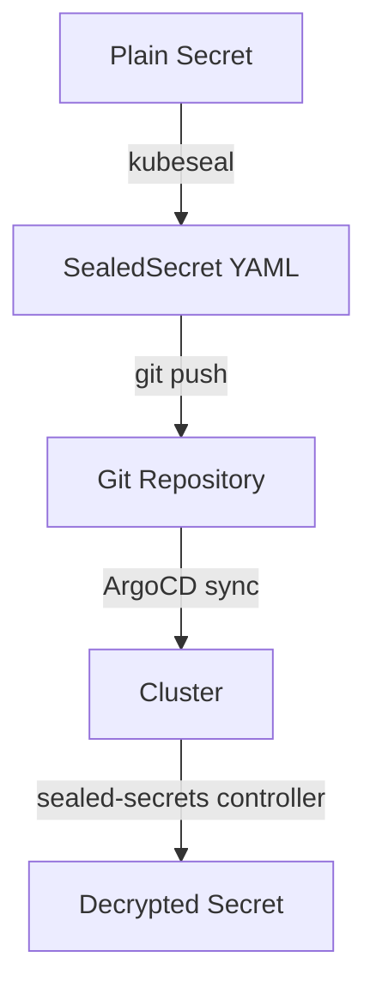

# Manage Sealed Secrets

This project uses [Sealed Secrets](https://sealed-secrets.netlify.app/) to store
encrypted secrets in the Git repository. The `sealed-secrets` controller in the
cluster decrypts them at deploy time.

## How it works



1. You create a standard Kubernetes Secret (dry-run, not applied to the cluster).
2. `kubeseal` encrypts it using the cluster's public key — only that specific cluster
   can decrypt it.
3. The resulting `SealedSecret` YAML is safe to commit to Git.
4. ArgoCD syncs the SealedSecret to the cluster.
5. The sealed-secrets controller decrypts it into a regular Secret.

## Existing SealedSecrets

:::{important}
SealedSecrets are encrypted for a **specific cluster**. If you forked this repo,
the existing sealed secret files will not decrypt on your cluster — the
sealed-secrets controller will log errors but the cluster will otherwise run
normally. You must create your own secrets by following {doc}`cloudflare-tunnel`
and {doc}`oauth-setup`.
:::

These secrets are created during the setup guides:

| Secret | Namespace | Purpose | File |
|--------|-----------|---------|------|
| `cloudflared-credentials` | `cloudflared` | Cloudflare tunnel token | additions/cloudflared/tunnel-secret.yaml |
| `cloudflare-api-token` | `cert-manager` | DNS-01 API token | additions/cert-manager/templates/cloudflare-api-token-secret.yaml |
| `oauth2-proxy-secret` | `oauth2-proxy` | OAuth2 cookie + client secrets | additions/oauth2-proxy/oauth2-proxy-secret.yaml |
| `vps-relay-credentials` | `vps-relay` | Tailscale OAuth client secret + frp token for the VPS relay (optional — see {doc}`vps-relay`) | additions/vps-relay/templates/vps-relay-secret.yaml |
| `scrap-secrets` | `scrap` | Claude API key + `/mcp` bearer token for scrap (see {doc}`scrap`) | additions/scrap/templates/scrap-secret.yaml |
| `ntfy-auth` | `ntfy` | ntfy users (bcrypt hashes) and access tokens (see {doc}`ntfy`) | additions/ntfy/templates/ntfy-auth-secret.yaml |
| `alertmanager-ntfy` | `monitoring` | Alertmanager's copy of the ntfy `alertmanager` token, sealed with `ntfy-auth` (see {doc}`monitoring`) | additions/grafana/alertmanager-ntfy-secret.yaml |
| `scrap-publish` | `scrap`, `scrap-public` | scrap's public-pages upload token, the same in both namespaces | additions/scrap/templates/scrap-publish-secret.yaml, additions/scrap/templates/scrap-public-publish-secret.yaml |

## Prerequisites

- `kubeseal` is installed in the devcontainer (via the `tools` role)
- The `sealed-secrets` controller is running in the cluster (deployed by ArgoCD)
- `kubectl` has access to the cluster (kubeconfig configured)

## Create a new SealedSecret

### From a literal value

```bash
# Prompt for the secret value (not echoed, not stored in shell history)
printf 'Secret value: ' && read -rs SECRET_VALUE && echo

# Create the SealedSecret
printf '%s' "$SECRET_VALUE" | \
  kubectl create secret generic my-secret-name \
    --namespace my-namespace \
    --from-file=my-key=/dev/stdin \
    --dry-run=client -o yaml | \
  kubeseal --controller-name sealed-secrets \
    --controller-namespace kube-system -o yaml > \
    kubernetes-services/additions/my-service/my-secret.yaml

unset SECRET_VALUE
```

### From a file

```bash
kubectl create secret generic my-secret-name \
  --namespace my-namespace \
  --from-file=my-key=path/to/secret-file \
  --dry-run=client -o yaml | \
kubeseal --controller-name sealed-secrets \
  --controller-namespace kube-system -o yaml > \
  kubernetes-services/additions/my-service/my-secret.yaml
```

### With multiple keys

```bash
kubectl create secret generic my-secret-name \
  --namespace my-namespace \
  --from-literal=username=admin \
  --from-literal=password=supersecret \
  --dry-run=client -o yaml | \
kubeseal --controller-name sealed-secrets \
  --controller-namespace kube-system -o yaml > \
  kubernetes-services/additions/my-service/my-secret.yaml
```

## Commit and deploy

```bash
git add kubernetes-services/additions/my-service/my-secret.yaml
git commit -m "Add my-secret SealedSecret"
git push
```

ArgoCD syncs the SealedSecret automatically.

## The `seal-argocd-dex` recipe

`scripts/seal-argocd-dex` rotates a single authentication-related
secret in the live cluster. For full sealing during a rebuild, use
`just generate-and-seal-all` instead — it runs `seal-from-json` over
freshly generated values.

### Secrets it manages

| Secret | Namespace | Subcommand | Source |
|--------|-----------|------------|--------|
| `argocd-dex-secret` | `argo-cd` | `github` / `argocd` | GitHub OAuth credentials + every Dex static client secret |
| `argocd-monitor-oauth` | `argocd-monitor` | `monitor` | oauth2-proxy client + fresh cookie secret |
| `grafana-oauth-secret` | `monitoring` | `grafana` | Grafana Dex client secret |

### Rotate a single secret

The subcommands re-seal one logical secret without re-prompting for
unrelated values. They read existing keys from the running
`argocd-dex-secret` to preserve everything they don't touch, so the
secret must already exist (it is created during the rebuild path).

```bash
scripts/seal-argocd-dex github       # Update GitHub OAuth credentials
scripts/seal-argocd-dex argocd       # Re-derive argo-cd client from server.secretkey
scripts/seal-argocd-dex monitor      # Rotate argocd-monitor client + cookie
scripts/seal-argocd-dex grafana      # Rotate grafana Dex client secret
```

### After running

Commit the updated `*-secret.yaml` files and push. ArgoCD syncs them
and the sealed-secrets controller decrypts them. Pods that read
secrets via `envFrom` or `secretKeyRef` (Dex, Grafana,
Headlamp, argocd-monitor) cache values at startup, so the script also
rolls out the affected workloads automatically.

(rotate-a-secret)=
## Rotate a secret

To update an existing SealedSecret with a new value:

1. Re-run the `kubeseal` command above, overwriting the existing file.
2. Commit and push.
3. ArgoCD syncs the updated SealedSecret.
4. The sealed-secrets controller replaces the decrypted Secret.
5. Restart any pods that use the secret to pick up the new value:

```bash
kubectl rollout restart deployment/my-deployment -n my-namespace
```

## Troubleshooting

### SealedSecret not decrypting

Check the sealed-secrets controller logs:

```bash
kubectl logs -n kube-system deployment/sealed-secrets -f
```

Common issues:

- **Wrong controller name/namespace** — ensure `kubeseal` flags match the deployed
  controller (`--controller-name sealed-secrets --controller-namespace kube-system`).
- **Wrong cluster** — SealedSecrets are encrypted for a specific cluster. A SealedSecret
  created against one cluster cannot be decrypted by another.
- **Namespace mismatch** — by default, SealedSecrets are scoped to the namespace
  specified at creation time. The Secret must be deployed to the same namespace.

### Re-seal after cluster rebuild

If you rebuild the cluster (new sealed-secrets controller = new keypair), all existing
SealedSecrets become undecryptable. You must re-seal every secret:

1. Retrieve the original plain-text values.
2. Re-run `kubeseal` against the new cluster.
3. Commit and push the updated SealedSecret files.

The rebuild path does this for every secret in the table above:
`scripts/export-external-creds` saves the values that cannot be generated
to `.env` while the old cluster is up, and `just generate-and-seal-all`
(run by `pb_all.yml` with `GENERATE_SECRETS=true`) generates the rest and
seals them all. Two generated values are exported and kept, not
regenerated: `SCRAP_MCP_TOKEN`, because every scrap MCP client holds a copy
(set `SCRAP_ROTATE_MCP_TOKEN=true` to replace it, then update every
client), and `SCRAP_PUBLISH_TOKEN`. scrap's secrets are sealed only when
`SCRAP_ANTHROPIC_API_KEY` is set. ntfy's access tokens (one
`NTFY_<USER>_TOKEN` per user, for example `NTFY_PHONE_TOKEN`) are kept the
same way, since the phone app and the VPS hold copies; any left unset is
generated. To rotate one on a live cluster, use
`just seal-ntfy --rotate <user>` (see {doc}`ntfy`).

A planned rebuild does not need the old sealing keys: it reads the
plaintext values from the old cluster and reseals them. It does make a new
key, so re-export your offline key copy afterwards
({ref}`sealed-secrets-key-backup`). The key backup is for a cluster that
died before you could export its values.

### Decrypt SealedSecrets without a cluster

With a key backup, `kubeseal` can decrypt the SealedSecrets in Git offline.
`--recovery-private-key` takes the exported key Secrets as they are:

```bash
kubeseal --recovery-unseal \
  --recovery-private-key <(age -d -i ~/k3s-etcd-backup.agekey sealed-secrets-keys.yaml.age) \
  < kubernetes-services/additions/grafana/grafana-oauth-secret.yaml
```

This prints the Secret in plaintext: read the value you need, and don't
save it to a file.

(sealing-key-renewal)=
## Sealing keys and renewal

The controller seals with the newest of its keys and decrypts with any of
them. Its automatic renewal, which by default adds a new key every 30 days,
is turned off here (`keyrenewperiod: "0"` in
`kubernetes-services/templates/sealed-secrets.yaml`):

- Renewal never retires the old keys, so anything sealed with them still
  decrypts, and an attacker holding an old key loses nothing.
- It re-encrypts nothing: the SealedSecrets in Git stay sealed with
  whichever key was newest when they were made.
- It makes every offline export of the keys stale within a month.

With renewal off, the key changes only when you rotate it by hand or rebuild
the cluster, and an offline export stays valid until then. Keep that export
up to date: {ref}`sealed-secrets-key-backup`.

Rotating the key does not protect a secret value that has leaked. Change
the value itself, then reseal it ({ref}`rotate-a-secret`).

(rotate-sealing-key)=
### Rotate the key by hand

The controller makes a new key at startup when its newest key is older than
its `--key-cutoff-time` (the chart's `keycutofftime` value, in RFC 1123
form with a numeric zone, as `date -R` prints it). Set it through Git:

1. Add the current time to the chart values in
   `kubernetes-services/templates/sealed-secrets.yaml`:

   ```yaml
   helm:
     valuesObject:
       keyrenewperiod: "0"
       keycutofftime: "Wed, 11 Nov 2026 10:00:00 +0000"   # date -R
   ```

2. Commit and push. When Argo CD syncs, the controller restarts and adds a
   new key; its log says `New key written`. Old keys stay, so every
   existing SealedSecret still decrypts. The setting can stay: on later
   restarts the newest key is newer than the cutoff, so nothing happens.
3. Optionally, re-encrypt the SealedSecrets in Git with the new key. This
   reads the live controller and changes nothing in the cluster:

   ```bash
   for f in $(grep -rl '^kind: SealedSecret' kubernetes-services); do
     kubeseal --re-encrypt --controller-name sealed-secrets \
       --controller-namespace kube-system -o yaml < "$f" > "$f.new" \
       && mv "$f.new" "$f"
   done
   ```

   Commit and push the result. The old keys can be deleted only once
   nothing sealed with them is left, in Git or in the cluster; leaving
   them costs nothing.
4. Re-export the offline copy of the keys ({ref}`sealed-secrets-key-backup`).
   The nightly NAS copy picks up the new key by itself.

## Gotchas

### Encryption is bound to name and namespace

SealedSecrets are encrypted for a **specific Secret name and namespace**. You
cannot rename a SealedSecret YAML file's `metadata.name` or `metadata.namespace`
and expect it to decrypt — you must re-run `kubeseal` with the new name/namespace.

### Merging into existing Secrets

If a Secret already exists in the cluster (e.g., created by a Helm chart) and you
want the sealed-secrets controller to manage it, add this annotation to the
**existing** Secret:

```yaml
metadata:
  annotations:
    sealedsecrets.bitnami.com/managed: "true"
```

Without this annotation, the controller will not overwrite the existing Secret.

### Avoid sealing into `argocd-secret`

The ArgoCD `argocd-secret` in the `argo-cd` namespace is managed by ArgoCD itself.
Sealing values into it causes conflicts — ArgoCD and the sealed-secrets controller
fight over the Secret contents. Use a separate SealedSecret and mount it where
needed instead.

### File naming for gitleaks

SealedSecret files must be named `*-secret.yaml` (singular) to match the
`.gitleaks.toml` allowlist. Files named `*-secrets.yaml` (plural) will be flagged
as leaked secrets by the pre-commit hook.
