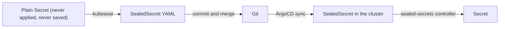

# Manage Sealed Secrets

Every secret the cluster needs is in this public repo as a
[Sealed Secrets](https://sealed-secrets.netlify.app/) `SealedSecret`:
ciphertext that only this cluster's `sealed-secrets` controller (in
`kube-system`) can decrypt. Nothing secret is ever committed in the
clear, and no secret store runs outside the cluster. The model, and what
protects the sealing keys, is in
{doc}`/explanations/architecture/security`; this page is the runbook.

## How it works



1. A recipe builds an ordinary Kubernetes Secret with
   `kubectl create secret --dry-run=client`, so it never reaches the
   cluster.
2. `kubeseal` encrypts it with the controller's public key, which it
   fetches from the live cluster. This is one of the few commands that
   talk to the cluster outside the GitOps path, and it only reads.
3. The `SealedSecret` YAML is committed. ArgoCD syncs it and the
   controller decrypts it into the Secret that pods mount.

## Existing SealedSecrets

All thirteen are under `kubernetes-services/additions/`. Find them with
`grep -rl '^kind: SealedSecret' kubernetes-services`.

| Secret | Namespace | Holds | File under `additions/` | Sealed on the running cluster by |
|--------|-----------|-------|------|------|
| `argocd-dex-secret` | `argo-cd` | GitHub OAuth app for Dex, and every Dex static client secret | `argocd/argocd-dex-secret.yaml` | `just seal-argocd-dex github` or `argocd` ({doc}`oauth-setup`) |
| `argocd-monitor-oauth` | `argocd-monitor` | argocd-monitor's Dex client secret and cookie secret | `argocd-monitor/argocd-monitor-oauth-secret.yaml` | `just seal-argocd-dex monitor` |
| `grafana-oauth-secret` | `monitoring` | Grafana's Dex client secret | `grafana/grafana-oauth-secret.yaml` | `just seal-argocd-dex grafana` |
| `oauth2-proxy-credentials` | `oauth2-proxy` | GitHub OAuth app for oauth2-proxy, and its cookie secret | `oauth2-proxy/oauth2-proxy-secret.yaml` | By hand ({doc}`oauth-setup`, B2) |
| `cloudflared-credentials` | `cloudflared` | The Cloudflare Tunnel token | `cloudflared/tunnel-secret.yaml` | `just cf-seal-tunnel-token` ({ref}`cf-rotate-tunnel-token`) |
| `cloudflare-api-token` | `cert-manager` | cert-manager's DNS-01 API token | `cert-manager/templates/cloudflare-api-token-secret.yaml` | By hand ({ref}`cf-dns01-token`) |
| `ntfy-auth` | `ntfy` | ntfy's users (bcrypt hashes) and access tokens | `ntfy/templates/ntfy-auth-secret.yaml` | `just seal-ntfy` ({doc}`ntfy`) |
| `alertmanager-ntfy` | `monitoring` | Alertmanager's copy of the ntfy `alertmanager` token | `grafana/alertmanager-ntfy-secret.yaml` | `just seal-ntfy`, together with `ntfy-auth` |
| `scrap-ntfy` | `scrap` | scrap's copy of the ntfy `scrap` token, and its `SCRAP_NOTIFY_URL` | `scrap/templates/scrap-ntfy-secret.yaml` | `just seal-ntfy`, together with `ntfy-auth` |
| `scrap-secrets` | `scrap` | Claude API key and the `/mcp` bearer token | `scrap/templates/scrap-secret.yaml` | By hand ({doc}`scrap`) |
| `scrap-publish` | `scrap` | scrap's public-pages upload token | `scrap/templates/scrap-publish-secret.yaml` | By hand; the same token as the next row |
| `scrap-publish` | `scrap-public` | The same token, for the public-pages server | `scrap/templates/scrap-public-publish-secret.yaml` | By hand |
| `vps-relay-credentials` | `vps-relay` | Tailscale OAuth client secret and the frp token | `vps-relay/templates/vps-relay-secret.yaml` | By hand ({doc}`vps-relay`) |
| `offsite-backup-rclone` | `backups` | rclone's Google Drive OAuth client and token | `backups/templates/offsite-backup-rclone-secret.yaml` | `just seal-rclone-drive <client_secret.json>` ({ref}`offsite-backup`) |

On a rebuild all thirteen are sealed in one pass by
`just generate-and-seal-all` ({ref}`below <reseal-after-rebuild>`; the
scrap, VPS relay and off-site backup ones only when their values
are present),
which runs `scripts/generate-secrets` and then `just seal-from-json` on
its output. `seal-from-json` is the one place that knows every Secret's
name, namespace, keys and file, so a new SealedSecret that must survive
a rebuild is added there too.

:::{important}
These files decrypt only on this cluster, with its sealing keys. Anyone
reusing the repo gets the structure and the recipes, not the values: on
another cluster the controller logs a decryption error for each one, and
every secret has to be sealed again from that cluster's own credentials.
:::

## Prerequisites

- `kubeseal`, installed in the devcontainer by the `tools` role.
- The `sealed-secrets` controller running (the `sealed-secrets` ArgoCD
  Application, `kubernetes-services/templates/sealed-secrets.yaml`).
- `kubectl` access to the cluster.

Every recipe uses the same flags, from `scripts/lib/seal.sh`:
`--controller-name sealed-secrets --controller-namespace kube-system`.
The scripts seal through `seal_to`, which writes to a temporary file and
moves it into place only if `kubeseal` succeeds, so a failed run never
truncates the existing file.

## Create a new SealedSecret

### From a literal value

```bash
# Prompt for the secret value (not echoed, not stored in shell history)
printf 'Secret value: ' && read -rs SECRET_VALUE && echo

printf '%s' "$SECRET_VALUE" | \
  kubectl create secret generic my-secret-name \
    --namespace my-namespace \
    --from-file=my-key=/dev/stdin \
    --dry-run=client -o yaml | \
  kubeseal --controller-name sealed-secrets \
    --controller-namespace kube-system -o yaml > \
    kubernetes-services/additions/my-service/my-secret.yaml

unset SECRET_VALUE
```

### From a file

```bash
kubectl create secret generic my-secret-name \
  --namespace my-namespace \
  --from-file=my-key=path/to/secret-file \
  --dry-run=client -o yaml | \
kubeseal --controller-name sealed-secrets \
  --controller-namespace kube-system -o yaml > \
  kubernetes-services/additions/my-service/my-secret.yaml
```

### With several keys

Read each value as above and pass one `--from-literal=<key>="$VAR"` per
key, as the `oauth2-proxy-credentials` command in {doc}`oauth-setup`
does. Do not type a secret value on the command line itself, where shell
history keeps it.

### Commit and deploy

Name the file `*-secret.yaml` ({ref}`why <sealed-secret-file-naming>`),
commit it in a branch and merge. ArgoCD syncs the SealedSecret and the
controller creates the Secret; the namespace does not need to exist when
sealing. Check it with:

```bash
kubectl -n my-namespace get sealedsecret my-secret-name \
  -o jsonpath='{.status.conditions[?(@.type=="Synced")].status}{"\n"}'
```

## The `seal-argocd-dex` recipe

`just seal-argocd-dex <subcommand>` rotates one authentication secret on
the running cluster. The subcommand is required.

| Subcommand | Reseals | What changes |
|------------|---------|--------------|
| `github` | `argocd-dex-secret` | Prompts for a new GitHub OAuth client ID and secret (or reads `GITHUB_CLIENT_ID` and `GITHUB_CLIENT_SECRET`) |
| `argocd` | `argocd-dex-secret` | Re-derives the `argo-cd` client secret from ArgoCD's `server.secretkey` |
| `monitor` | `argocd-dex-secret`, `argocd-monitor-oauth` | New argocd-monitor client secret and cookie secret |
| `grafana` | `argocd-dex-secret`, `grafana-oauth-secret` | New Grafana client secret |

Each subcommand reads the keys it does not change from the live
`argocd-dex-secret`, so that Secret must already exist; the rebuild path
creates it.

Commit the updated files and merge. The script restarts nothing, and
these pods read their secrets once, at start, so restart them after
ArgoCD has synced: `just restart-dex` for Dex,
`kubectl -n monitoring rollout restart sts grafana-prometheus` for
Grafana, and `kubectl -n argocd-monitor rollout restart deployment` for
argocd-monitor.

(rotate-a-secret)=
## Rotate a secret

To give an existing SealedSecret a new value:

1. Change the value at its source first, if it has one (a new client
   secret at GitHub, a new API token at Cloudflare).
2. Run the recipe in the table above, or the `kubeseal` command, which
   overwrites the existing file.
3. Commit and merge. ArgoCD syncs the SealedSecret and the controller
   replaces the Secret.
4. Restart the pods that use it. A pod that reads a secret through an
   environment variable (`envFrom`, `secretKeyRef`) keeps the value it
   started with, and login then fails with errors such as
   `invalid client_secret` although the Secret is correct:

   | Secret | Restart |
   |---|---|
   | `argocd-dex-secret` | `just restart-dex` |
   | `grafana-oauth-secret` | `kubectl -n monitoring rollout restart sts grafana-prometheus` |
   | `argocd-monitor-oauth` | `kubectl -n argocd-monitor rollout restart deployment` |
   | `oauth2-proxy-credentials` | `kubectl -n oauth2-proxy rollout restart deployment/oauth2-proxy` |
   | `cloudflared-credentials` | `kubectl -n cloudflared rollout restart deployment/cloudflared`, as one step of {ref}`cf-rotate-tunnel-token` |
   | `ntfy-auth` | `kubectl delete pod -n ntfy -l app.kubernetes.io/name=ntfy`: a new pod, not a restarted container ({doc}`ntfy`) |
   | `vps-relay-credentials` | `kubectl -n vps-relay rollout restart deployment/vps-relay` |

`kubeseal` adds random padding, so sealing the same value twice gives
different ciphertext. A diff of a sealed file says nothing about whether
the value changed.

## Troubleshooting

### SealedSecret not decrypting

Check the sealed-secrets controller logs:

```bash
kubectl logs -n kube-system deployment/sealed-secrets -f
```

Common issues:

- **Wrong controller name/namespace** — ensure `kubeseal` flags match the deployed
  controller (`--controller-name sealed-secrets --controller-namespace kube-system`).
- **Wrong cluster or key** — a SealedSecret decrypts only with the keys of the
  cluster it was sealed against. After a rebuild, anything not resealed fails
  this way ({ref}`reseal-after-rebuild`).
- **Placeholder data** — a file committed with text such as `REPLACE_ME` in
  `encryptedData` fails with `illegal base64 data`, the Secret is never
  created, and a Prometheus or Alertmanager resource that lists it under
  `secrets:` silently leaves out the mount. Seal a real value, or leave the
  file out until there is one.
- **Namespace mismatch** — by default, SealedSecrets are scoped to the namespace
  specified at creation time. The Secret must be deployed to the same namespace.

(reseal-after-rebuild)=
### Reseal after a cluster rebuild

A rebuilt cluster's controller makes a new key pair, so none of the
SealedSecrets in Git decrypt on it and every one has to be sealed again.
The rebuild (`/rebuild-cluster`) does that in three steps:

1. **While the old cluster is still up**, `just export-external-creds`
   reads the values that cannot be generated out of the live Secrets
   into `.env` at the repo root (gitignored): the two GitHub OAuth apps,
   cert-manager's Cloudflare API token and the tunnel token, and, where
   they exist, the VPS relay's credentials, scrap's Claude API key and
   the off-site backup's `rclone.conf`.
2. `set -a && source .env && set +a`, then the playbook runs with
   `GENERATE_SECRETS=true`. Its `cluster` role installs the
   sealed-secrets controller, calls `just generate-and-seal-all`
   (random values for everything else: cookie secrets, the Dex client
   secrets for Grafana and argocd-monitor, the shared admin password),
   and commits and pushes the resealed files.
3. Only then does it create the root ArgoCD Application, so every
   service starts with a Secret that decrypts.

Some generated values are exported and kept, not regenerated, because
something outside the cluster holds a copy:

- `SCRAP_MCP_TOKEN`: every scrap MCP client has it. Set
  `SCRAP_ROTATE_MCP_TOKEN=true` to replace it, then update every client.
- `SCRAP_PUBLISH_TOKEN`.
- ntfy's access tokens, one `NTFY_<USER>_TOKEN` per user (for example
  `NTFY_PHONE_TOKEN`): the phone app and the VPS hold them. Any left
  unset is generated. To rotate one on the running cluster, use
  `just seal-ntfy --rotate <user>` ({doc}`ntfy`).

scrap's secrets are sealed only when `SCRAP_ANTHROPIC_API_KEY` is set,
and the VPS relay's only when both of its values are.

The off-site backup's `offsite-backup-rclone` is kept the same way: its
token came from a browser consent, so `scripts/export-external-creds`
exports the whole `rclone.conf`, base64-encoded, as
`OFFSITE_BACKUP_RCLONE_CONF_B64`, and the rebuild reseals it as it is
(skipped if unset). No new consent is needed ({ref}`offsite-backup`).

A planned rebuild does not need the old sealing keys: it reads the
plaintext values from the old cluster and reseals them. It does make a new
key, so re-export the offline key copy afterwards
({ref}`sealed-secrets-key-backup`). The key backup is for a cluster that
died before its values could be exported.

### Decrypt SealedSecrets without a cluster

With a key backup, `kubeseal` can decrypt the SealedSecrets in Git offline.
`--recovery-private-key` takes the exported key Secrets as they are:

```bash
kubeseal --recovery-unseal \
  --recovery-private-key <(age -d -i ~/k3s-etcd-backup.agekey sealed-secrets-keys.yaml.age) \
  < kubernetes-services/additions/grafana/grafana-oauth-secret.yaml
```

This prints the Secret in plaintext: read the value you need, and don't
save it to a file.

(sealing-key-renewal)=
## Sealing keys and renewal

The controller seals with the newest of its keys and decrypts with any of
them. Its automatic renewal, which by default adds a new key every 30 days,
is turned off here (`keyrenewperiod: "0"` in
`kubernetes-services/templates/sealed-secrets.yaml`):

- Renewal never retires the old keys, so anything sealed with them still
  decrypts, and an attacker holding an old key loses nothing.
- It re-encrypts nothing: the SealedSecrets in Git stay sealed with
  whichever key was newest when they were made.
- It makes every offline export of the keys stale within a month.

With renewal off, the key changes only on a rotation by hand or a rebuild
of the cluster, and an offline export stays valid until then. Keep that export
up to date: {ref}`sealed-secrets-key-backup`.

Rotating the key does not protect a secret value that has leaked. Change
the value itself, then reseal it ({ref}`rotate-a-secret`).

(rotate-sealing-key)=
### Rotate the key by hand

The controller makes a new key at startup when its newest key is older than
its `--key-cutoff-time` (the chart's `keycutofftime` value, in RFC 1123
form with a numeric zone, as `date -R` prints it). The controller also
makes one on `SIGUSR1`, but its image has no shell to send that from, so
set the cutoff through Git:

1. Add the current time to the chart values in
   `kubernetes-services/templates/sealed-secrets.yaml`:

   ```yaml
   helm:
     valuesObject:
       keyrenewperiod: "0"
       keycutofftime: "Wed, 11 Nov 2026 10:00:00 +0000"   # date -R
   ```

2. Commit and push. When ArgoCD syncs, the controller restarts and adds a
   new key; its log says `New key written`. Old keys stay, so every
   existing SealedSecret still decrypts. The setting can stay: on later
   restarts the newest key is newer than the cutoff, so nothing happens.
3. Optionally, re-encrypt the SealedSecrets in Git with the new key. This
   reads the live controller and changes nothing in the cluster:

   ```bash
   for f in $(grep -rl '^kind: SealedSecret' kubernetes-services); do
     kubeseal --re-encrypt --controller-name sealed-secrets \
       --controller-namespace kube-system -o yaml < "$f" > "$f.new" \
       && mv "$f.new" "$f"
   done
   ```

   Commit and push the result. The old keys can be deleted only once
   nothing sealed with them is left, in Git or in the cluster; leaving
   them costs nothing.
4. Re-export the offline copy of the keys ({ref}`sealed-secrets-key-backup`).
   The nightly NAS copy picks up the new key by itself.

## Gotchas

### Encryption is bound to name and namespace

SealedSecrets are encrypted for a **specific Secret name and namespace**. You
cannot rename a SealedSecret YAML file's `metadata.name` or `metadata.namespace`
and expect it to decrypt — you must re-run `kubeseal` with the new name/namespace.

### Merging into existing Secrets

If a Secret already exists in the cluster (e.g., created by a Helm chart) and you
want the sealed-secrets controller to manage it, add this annotation to the
**existing** Secret:

```yaml
metadata:
  annotations:
    sealedsecrets.bitnami.com/managed: "true"
```

Without this annotation, the controller will not overwrite the existing Secret.

### Avoid sealing into `argocd-secret`

The ArgoCD `argocd-secret` in the `argo-cd` namespace is managed by ArgoCD itself.
Sealing values into it causes conflicts — ArgoCD and the sealed-secrets controller
fight over the Secret contents. Use a separate SealedSecret and mount it where
needed instead.

(sealed-secret-file-naming)=
### File naming for gitleaks

SealedSecret files must be named `*-secret.yaml` (singular) to match the
`.gitleaks.toml` allowlist. Files named `*-secrets.yaml` (plural) will be flagged
as leaked secrets by the pre-commit hook.
