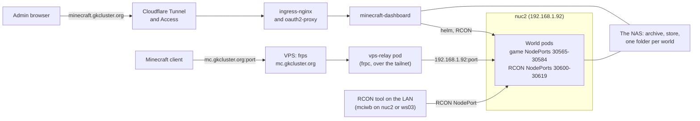

# Run the Minecraft dashboard

The Minecraft dashboard at <https://minecraft.gkcluster.org> is an admin-only
web UI that launches Minecraft Java servers from world backups, monitors them,
stops and starts them while keeping their data, and saves their state back as
snapshots and backups. Players never see it: they point an ordinary Minecraft
client at `mc.gkcluster.org:<port>`.

The dashboard application and its Helm chart live in a separate repository,
[gilesknap/k3s-minecraft](https://github.com/gilesknap/k3s-minecraft), and are
published as the OCI chart `ghcr.io/gilesknap/charts/minecraft-dashboard`.
This repository provides the cluster wiring:

- the ArgoCD Application `kubernetes-services/templates/minecraft.yaml`,
  switched on by `enable_minecraft` and configured from the `minecraft` block
  in `kubernetes-services/values.yaml`;
- an Ingress for `minecraft.gkcluster.org` behind oauth2-proxy (`admin_emails`
  only, like Headlamp);
- the `minecraft` forward on the {doc}`VPS relay </how-to/vps-relay>`, which
  is how players reach the game ports;
- the `minecraft` tunnel route and the `mc` DNS record in `cloudflare/`.

## How it fits together



| Piece | Where | Notes |
|-------|-------|-------|
| Dashboard Deployment, Service, ServiceAccount, namespace-scoped Role | OCI chart, namespace `minecraft` | The dashboard runs `helm` against the [itzg Minecraft chart](https://github.com/itzg/minecraft-server-charts) inside its own namespace only. It is not pinned to a node |
| World servers | One Helm release, Deployment and Service pair per world, made by the dashboard at runtime, not by ArgoCD | All pinned to nuc2 (`minecraft.worlds.node`), the node the relay forwards to |
| Archive of precious world backups | The NAS, `/bigdisk/minecraft-archive` | Read-only twice over: `a-w` on the NAS **and** a read-only mount. Outside `/bigdisk/k8s-cluster` on purpose, so no cluster-wide tooling targets it |
| Store: promoted backups, rolling snapshots, dashboard state | The NAS, `/bigdisk/k8s-cluster/minecraft` | Written by the dashboard as uid/gid 1000 |
| Live world data | One dynamic `nfs-stable` claim per world (`<world>-data`, 10Gi), at `/k8s-dynamic/stable/minecraft/<world>-data` on the NAS | The folder is named after the claim, so it survives a cluster rebuild; archived when the world is deleted |
| World registry | `/bigdisk/k8s-cluster/minecraft/dashboard/registry/` | The dashboard's record of each world, used to re-create it after a rebuild |
| Game ports | NodePorts `30565`–`30584` on nuc2 | 20 slots; one per world for the world's lifetime |
| RCON ports | NodePorts `30600`–`30619` on nuc2 | LAN only (NetworkPolicy); one per world, for build tools |
| `mc.gkcluster.org` | Cloudflare **DNS-only** A record to the VPS | Not a tunnel route: see below |
| `minecraft.gkcluster.org` | Cloudflare Tunnel route | Cloudflare Access, then oauth2-proxy |

:::{important}
The game hostname is **not** a tunnel route. The Cloudflare Tunnel and proxy
carry only HTTP(S), and Minecraft speaks its own TCP protocol. So `mc` is a
grey-cloud record that points straight at the VPS, and the VPS relays each
connection over the tailnet to nuc2.
:::

Game servers see every player as coming from the relay. Whitelists and ops are
by name and work normally; IP bans do not.

The dashboard does no authentication itself; it logs the
`X-Auth-Request-Email` header that oauth2-proxy sets, per action. Its Ingress
therefore has `oauth2_proxy: true` hard-wired in the template, not tied to
`enable_oauth2_proxy`: without the proxy the Ingress fails closed.

## Configuration

The `minecraft` block of `kubernetes-services/values.yaml`:

```yaml
enable_minecraft: true
minecraft:
  chart_version: "0.5.2"          # the only version pin: the image follows the chart
  image:
    repository: ghcr.io/gilesknap/k3s-minecraft
  archive_path: /bigdisk/minecraft-archive
  store_subdir: minecraft         # under nfs.cluster_share_path
  dns_name: mc                    # players use mc.gkcluster.org
  worlds:
    node: nuc2                    # every world runs here
    port_min: 30565
    port_max: 30584
    rcon_port_min: 30600
    rcon_port_max: 30619
    rcon_allowed_cidrs: [...]     # see "Direct RCON" below
```

The chart also takes its NFS server from `nfs.server`, the worlds' storage
class from `nfs_csi.stable_storage_class` (`nfs-stable`), and the share it
mounts read-only from `nfs_csi.server` and `nfs_csi.stable_share`. The template
turns on `worlds.restore` and the chart's NetworkPolicy.

Three things outside this block must agree with it:

| Setting | Must match | Where |
|---------|-----------|-------|
| `worlds.port_min`–`port_max` | the `minecraft` entry in `vps_relay.forwards` (`ports: 30565-30584`), and the ports opened on the VPS | `values.yaml`; `scripts/vps-relay-setup` on the VPS ({doc}`/how-to/vps-relay`) |
| `worlds.node` | the forward's `target` (`192.168.1.92`, nuc2's LAN address) | `values.yaml` |
| `ghcr.io/gilesknap/charts` | an entry in the AppProject's `sourceRepos`, bare, with no `oci://` prefix | `argo-cd/argo-project.yaml`, applied with `ansible-playbook pb_all.yml --tags cluster` |

### Bump the dashboard

`minecraft.chart_version` is the only pin. Check that the version is published
before pushing, because a missing tag leaves the Application in an error
state:

```bash
helm pull oci://ghcr.io/gilesknap/charts/minecraft-dashboard --version <version>
```

## The NAS directories

The archive directory and the store tree are created by hand on the NAS
while it runs QTS, and by the `nas` role after its switchover:
{ref}`minecraft-nas-directories`. World data needs
the `nfs-stable` share root: {ref}`nfs-csi-nas-share`.

### Ingest the world archive

World backups downloaded from Google Drive arrive as a set of split wrapper
zips (`minecraft-k8s-backup-*-NNN.zip`), each holding one inner zip per world.
`scripts/ingest-archive.sh` in the k3s-minecraft repository extracts the inner
zips **flat, keeping their original filenames**, checks each one (`unzip -t`
plus a `world/level.dat` entry), and is idempotent, so re-run it later to add
more files.

Run it on the NAS, or on a host with the NAS share mounted read-write:

```bash
git clone https://github.com/gilesknap/k3s-minecraft.git
cd k3s-minecraft

# <dest> first, then every downloaded wrapper zip
scripts/ingest-archive.sh /share/CACHEDEV1_DATA/bigdisk/minecraft-archive \
  ~/Downloads/minecraft-k8s-backup-*.zip
```

Ingest **every** version of every world: older copies can hold builds that
were lost from newer ones. Never rename the files; the dashboard parses the
world name and date from them.

Then lock the archive so nothing can modify it, on the NAS:

```bash
chmod -R a-w /share/CACHEDEV1_DATA/bigdisk/minecraft-archive
```

To add files later, restore write access to the directory (`chmod u+w`),
re-run the ingest script, and lock it again.

## Cloudflare

Both names are code in `cloudflare/` ({doc}`/how-to/cloudflare-as-code`):

- **The dashboard.** `{ name = "minecraft" }` in `tunnel_services` in
  `cloudflare/locals.tf` creates the tunnel route to ingress-nginx and the
  proxied CNAME. The `clusterapps` Access application (`*.gkcluster.org`,
  owner only) already covers the hostname, so there is nothing to add in
  `access.tf`.
- **The game hostname.** `mc` is an A record in `dns_only_records` (in the
  gitignored `cloudflare/live.auto.tfvars`; `live.auto.tfvars.example` shows
  the shape) whose content is the VPS's public address, not proxied. It must
  never become a `tunnel_services` entry.

Apply a change to either with `just cf-plan`, then `just cf-apply`
({ref}`publish or remove a hostname <cf-add-service>`).

## Direct RCON for build tools (LAN only)

Each world also gets an **RCON NodePort** from `minecraft.worlds.rcon_port_min`
to `rcon_port_max` (`30600`–`30619`), shown on the world's page with a
**Reveal** button for the password. It is for tools such as
[mciwb](https://github.com/gilesknap/mciwb) that send many RCON commands.

```python
from mciwb.imports import Iwb

# on nuc2 itself (fastest: about 0.04 ms per command)
world = Iwb(server="127.0.0.1", port=30600, passwd="<password from the world page>")
# or from another LAN host: server="192.168.1.92"
```

`kubectl port-forward` also works but is about 1000 times slower (about 44 ms
per command), too slow for building.

RCON is plain text, so two rules keep it on the LAN:

- **Never add the RCON range to `vps_relay.forwards`.**
- The chart's NetworkPolicy `minecraft-dashboard-worlds` admits the game port
  (25565) from anywhere, but RCON (25575) only from the dashboard pod, the
  world's own node, and `minecraft.worlds.rcon_allowed_cidrs`.

`rcon_allowed_cidrs` is the LAN minus the cluster nodes, plus nuc2's second
LAN:

```yaml
rcon_allowed_cidrs:
  - cidr: 192.168.1.0/24
    except:
      - 192.168.1.81/32   # node01
      - 192.168.1.82/32   # node02
      - 192.168.1.83/32   # node03
      - 192.168.1.84/32   # node04
      - 192.168.1.91/32   # nuc1
  - cidr: 192.168.0.0/24  # nuc2's second LAN
```

NodePort clients keep their own address (`externalTrafficPolicy: Local`), but
a pod on another cluster node arrives as that node's address. Excepting the
node addresses therefore stops every other workload in the cluster from
reaching RCON. Two nodes are left allowed on purpose, so RCON clients can run
on the hosts themselves: nuc2 (the world node) and ws03, whose
`workstation` taint keeps workload pods off it.

:::{important}
**A new node must be added to the `except` list** when it joins the cluster
(the `/add-node` command covers it). Until then, any pod scheduled on it can
reach every world's RCON port.
:::

## Day-to-day checks

```bash
kubectl get application minecraft -n argo-cd
kubectl get pods,svc,pvc -n minecraft -o wide
```

- Every world pod is on nuc2. A stopped world is a Deployment scaled to 0;
  its claim and its Services stay.
- Each world has a `<world>` NodePort Service (game) and a `<world>-rcon`
  Service. A world that has not been started since RCON NodePorts were
  introduced still has a ClusterIP `-rcon` Service; start it, or save its
  settings while it runs, to give it a port.
- The archive is read-only; a write through its mount must fail:

  ```bash
  kubectl exec -n minecraft deploy/minecraft-dashboard -- \
    touch /archive/should-fail    # expect "Read-only file system"
  ```

### Prove the whole path with a disposable world

After a change to the relay, the ports or the chart, test with a world that
does not matter before touching a precious one:

1. Open <https://minecraft.gkcluster.org>: Cloudflare Access first, then the
   GitHub login through oauth2-proxy. A GitHub account outside `admin_emails`
   is refused.
2. **Launch** a disposable world from the archive list. It goes seeding,
   starting, running; note its port.
3. **Connect** a Minecraft Java client to `mc.gkcluster.org:<port>` from
   outside the LAN (a phone hotspot will do), which proves DNS and the relay.
   The player must be on the world's whitelist.
4. **Stop** the world and **start** it again: the world data survives.
5. **Snapshot** it, change something in game, then **restore** the snapshot.
6. **Delete** the world. A final snapshot is taken first and the port is
   freed.

Then try a modded (Forge) world, and only then a precious one.

## Cluster rebuilds

A rebuild wipes the dashboard's world records and Helm releases with etcd, but
not the world data on the NAS. The dashboard keeps a copy of each world in its
registry on the store and re-creates every world it does not find
(`worlds.restore: true` in the template). Each world comes back with the same
name, game and RCON ports, settings, whitelist and admins, and running or
stopped as it was. Its `<world>-data` claim binds to the world's folder on the
NAS, because `nfs-stable` folders are named after the claim
({doc}`/how-to/nfs-stable-paths`). The world page says "restored after the
cluster lost it" until the next start or stop.

Each world gets a new RCON password: reveal it again on the world page for
RCON clients.

The stable share and the store belong to this one cluster. A second cluster
pointed at them would restore this cluster's worlds.

Deleting a world archives its volume as `archived-minecraft/<world>-data` in
the stable share. The dashboard mounts that share read-only (the
`minecraft-dashboard-volumes` claim) and refuses a new world of the same name
until the archive is removed or renamed on the NAS, because a second archive
of one name would fail.

:::{note}
Every world here is on `nfs-stable`. They were created on `nfs-rwx` and moved
with `scripts/nfs-stable-paths`, which stays in the repository;
{doc}`/how-to/nfs-stable-paths` describes it. A world still on `nfs-rwx` would
be skipped on restore.
:::

## Backups

The dashboard's own snapshots and promoted backups are on the store. The
nightly off-site job ({ref}`offsite-backup`) uploads a tarball of the store and
of the worlds' folders (live and archived) to Google Drive, keeps seven, and
uploads the archive once. B2 holds no Minecraft data. To bring one world
back from Drive, see {ref}`restore-minecraft-world`.

## Troubleshooting

### The `minecraft` app shows `InvalidSpecError` or a 403/404

One of three things: the AppProject does not list `ghcr.io/gilesknap/charts`
(run `ansible-playbook pb_all.yml --tags cluster`), the `repoURL` has an
`oci://` prefix, or the chart version is not published. The `/argocd` skill
(`.claude/skills/argocd/SKILL.md`) has the details, including how to clear
ArgoCD's cached error.

### Players cannot connect

- `dig +short mc.gkcluster.org` returns the VPS's public address.
- frpc logged `start proxy success` for the world's port
  (`kubectl logs -n vps-relay deploy/vps-relay -c frpc`); see the
  troubleshooting in {doc}`/how-to/vps-relay`.
- From the LAN, try `192.168.1.92:<port>` directly, to separate a cluster
  problem from a relay or DNS problem.
- nuc2 is the only node that can run worlds. While it is down or draining,
  every world is down.

### An RCON tool is refused

Check where it runs. From a pod, or from a host that is a cluster node other
than nuc2 and ws03, the NetworkPolicy drops it by design.

## Removing the dashboard

First **delete every world from the dashboard**; each delete takes a final
snapshot. Worlds are Helm releases and claims created by the dashboard at
runtime, not by ArgoCD, so ArgoCD does not clean them up. Deleting a world's
claim by hand leaves the world without a volume, and moves its data to the
archive folder on the NAS ({doc}`/how-to/nfs-stable-paths`).

Then:

1. Set `enable_minecraft: false` and push. ArgoCD prunes the dashboard and its
   Ingress. The archive and the store are static NFS volumes and are never
   deleted by the cluster.
2. Remove `{ name = "minecraft" }` from `tunnel_services` and `mc` from
   `dns_only_records`, then `just cf-apply`.
3. Remove the `minecraft` entry from `vps_relay.forwards`, and close its ports
   on the VPS ({doc}`/how-to/vps-relay`).
