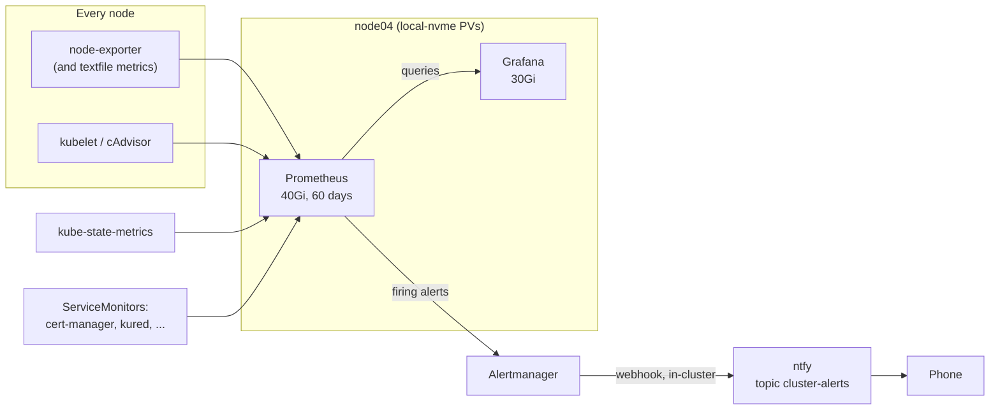

# Monitoring and alerts

The cluster is monitored by the
[kube-prometheus-stack](https://github.com/prometheus-community/helm-charts/tree/main/charts/kube-prometheus-stack)
chart: Prometheus collects metrics, Grafana shows them, and Alertmanager
pushes the alerts worth acting on to the owner's phone through the
self-hosted ntfy. It is the ArgoCD Application `grafana-prometheus`
(`kubernetes-services/templates/grafana.yaml`), in the `monitoring` namespace,
with this cluster's own rules and Secrets in
`kubernetes-services/additions/grafana/`.



## Where to look

| What | URL | Login |
|------|-----|-------|
| Grafana | <https://grafana.gkcluster.org> | **Sign in with GitHub (via Dex)**. Emails in `admin_emails` get the Admin role, everyone else Viewer; the password form is disabled |
| Alertmanager | <https://alertmanager.gkcluster.org> | oauth2-proxy (GitHub, `admin_emails` only) |
| Prometheus | No Ingress | `kubectl -n monitoring port-forward svc/grafana-prometheus-kube-pr-prometheus 9090`, then <http://localhost:9090> |

Both hostnames go through the Cloudflare Tunnel, so Cloudflare Access comes
first. Grafana is also in the `Demo` Access application, which lets the
listed viewers in as well as the owner; Alertmanager is owner only.
{doc}`/tutorials/tour` walks through both, and
{doc}`/reference/services` has the port-forward fallbacks for when the edge is
down.

Grafana comes with the chart's dashboards (**Dashboards** in the sidebar). The
ones used most here:

| Dashboard | What it shows |
|-----------|---------------|
| Kubernetes / Compute Resources / Cluster | Cluster-wide CPU, memory, network |
| Kubernetes / Compute Resources / Namespace (Pods) | Per-namespace usage |
| Kubernetes / Compute Resources / Pod | One pod's CPU and memory |
| Node Exporter / Nodes | A node's CPU, memory, disk, network |
| CoreDNS | DNS query rates and errors |

### From argocd-monitor

<https://argocd-monitor.gkcluster.org> links each workload, pod and node on an
Application's detail page to the matching Grafana dashboard, with the
namespace already selected. The `grafana` values in
`kubernetes-services/templates/argocd-monitor.yaml` map the in-cluster
destination to `https://grafana.gkcluster.org`. Explore links are off, because
Grafana's Viewer role cannot open Explore. The argocd-monitor
[observability links guide](https://epics-containers.github.io/argocd-monitor/main/how-to/observability-links.html)
lists the links.

## Where it runs

| Component | Node | Why |
|-----------|------|-----|
| Prometheus (`prometheus-grafana-prometheus-kube-pr-prometheus-0`) | node04 | Its data is the static `local-nvme` PV `prometheus-local`, `/var/lib/k8s-data/prometheus`, 40Gi |
| Grafana (`grafana-prometheus-0`) | node04 | Its SQLite database is the PV `grafana-local`, `/var/lib/k8s-data/grafana`, 30Gi |
| Alertmanager, the Prometheus operator, kube-state-metrics | Any worker but ws03 (nuc2 today) | Stateless enough to move. They do not tolerate the `workstation` taint, because ws03 reboots outside the kured window |
| node-exporter | Every node, including node02 and ws03 | A DaemonSet |

The two PVs are entries in `local_storage` in
`kubernetes-services/values.yaml`, pre-bound to the claim names the chart
generates, and their directories on node04 are created by the `k8s_data_dirs`
role, outside `/var/lib/rancher`, so they survive a cluster rebuild. node04 is
the 32 GB RK1, which is why both are there. While node04 is down or draining,
Grafana and Prometheus are down and there is a gap in the metrics; nothing
else can mount their volumes. {ref}`move-a-local-nvme-pv` is the procedure for
moving one.

Grafana's database is backed up to the NAS by the `grafana-daily` and
`grafana-weekly` CronJobs ({doc}`/how-to/backup-restore`). Prometheus's data
is not backed up: it is 60 days of metrics.

## Retention

Prometheus keeps **60 days**, capped at **35 GB**: `grafana.yaml` sets
`retention: 60d` and `retentionSize: 35GB` under `prometheus.prometheusSpec`.
It writes about 0.5 GB a day (about 4.2 GB for 8.5 days in November 2026),
so 60 days is about 30 GB. If it ever grows faster, the size cap drops the
oldest blocks first, so the 40Gi volume on node04 never fills; with a cap
hit, the history shown is simply shorter than 60 days. A rebuild still
starts the history again (see {doc}`/explanations/architecture/backups`).

## How scraping is wired

Prometheus scrapes every 30 seconds. It finds targets through
**ServiceMonitor** objects, and rules through **PrometheusRule** objects, in
any namespace, but only those labelled `release: grafana-prometheus`. An
object without that label is ignored without an error.

| Source | How |
|--------|-----|
| API server, kubelet and cAdvisor, CoreDNS, kube-state-metrics, node-exporter, and the stack itself | The chart's own ServiceMonitors |
| cert-manager | `additions/grafana/cert-manager-servicemonitor.yaml`. It lives here, not in the cert-manager chart's values, because this Application installs the ServiceMonitor CRD and cert-manager syncs before it on a fresh bootstrap |
| kured | The kured chart's ServiceMonitor (`kubernetes-services/templates/kured.yaml`), in the `kured` namespace |
| etcd | A static `kube-etcd` scrape job (`additionalScrapeConfigs` in `grafana.yaml`; not the chart's Service and ServiceMonitor, whose hand-made Endpoints ArgoCD never applies), targeting the control plane's address (`k3s.etcd_metrics_endpoints` in `values.yaml`), port 2381. K3s serves etcd's metrics there because the `k3s` role sets `etcd-expose-metrics: true` in node02's `/etc/rancher/k3s/config.yaml` |
| Host-side jobs | node-exporter's **textfile collector** reads `/var/lib/node_exporter/textfile_collector` on each node. The etcd backup timer on node02 (`roles/etcd_backup`) writes its `k3s_etcd_backup_*` metrics there |

Three chart defaults are switched off: the scrape targets and rules for
kube-scheduler, kube-controller-manager and kube-proxy. K3s runs all three
inside the `k3s` server process, so there are no such pods and the chart's
"down" alerts would fire for ever.

etcd runs inside the `k3s` server process too, but it does serve metrics, so
it is scraped and the **etcd** dashboard works. The endpoint is plain HTTP,
so the ServiceMonitor sends no credentials (`authorization: null`). It is a
fixed address, not a pod: when the control plane moves to another node,
change `k3s.etcd_metrics_endpoints` with it
({doc}`/how-to/recover-control-plane`), or the target goes down.

Of the chart's etcd rules, three are switched off with
`defaultRules.disabled`: `etcdMembersDown`, `etcdInsufficientMembers` and
`etcdNoLeader`. etcd has one member, so they only say that it is down, which
happens on every reboot of node02; `KubeAPIDown` already covers a dead
control plane. The rest stay: leader changes, failed and slow gRPC requests,
slow member communication, failed proposals, fsync and commit durations,
database quota, growth and fragmentation.

To monitor something new, give its chart `serviceMonitor.enabled: true` (with
the `release: grafana-prometheus` label) or add a ServiceMonitor manifest
beside the app.

:::{note}
The Prometheus operator images are pinned to `v0.94.2` in `grafana.yaml`,
because the newer release the chart defaults to was published without arm64
images. A chart bump does not override the pin; re-check it on every bump, as
the comment there says.
:::

## Alert rules

The chart ships its default rules (node health, pod restarts, volumes filling,
API server, kubelet and so on). This cluster adds four rule files in
`kubernetes-services/additions/grafana/`:

| File | Alerts | Fires when |
|------|--------|-----------|
| `etcd-backup-rules.yaml` | `K3sEtcdBackupFailed` | The last run of node02's etcd backup job failed (for 10 minutes) |
| | `K3sEtcdBackupStale` | The newest successful backup is over 36 hours old (for 30 minutes) |
| | `K3sEtcdBackupNeverSucceeded` | No backup has ever succeeded (for 36 hours) |
| | `K3sEtcdBackupMetricsMissing` | The job's metrics are absent (for 2 hours): the timer or the textfile collector is broken |
| `offsite-backup-rules.yaml` | `OffsiteBackupFailed` | The newest run of an off-site CronJob failed: `offsite-backup` (Google Drive) or `offsite-backup-b2` (Backblaze B2), named in its `cronjob` label |
| | `OffsiteBackupStale` | That CronJob has not succeeded for over 36 hours |
| | `OffsiteBackupNeverSucceeded` | That CronJob has existed for over 36 hours without a success |
| `backup-job-rules.yaml` | `BackupJobFailed` | The newest run of a Grafana, Jellyfin or scrap backup CronJob (`grafana-*`, `jellyfin-*`, `scrap-backup*`) failed |
| | `BackupJobStale` | Its last success is older than its schedule allows: 36 hours for a daily job, 8.5 days for a weekly one, 32 days for `scrap-backup-monthly` |
| | `BackupJobNeverSucceeded` | The CronJob has existed for that long without a success |
| `cert-expiry-rules.yaml` | `CertManagerCertificateExpiringSoon` | A certificate expires in under 14 days (warning) or under 7 (critical). cert-manager renews 30 days ahead, so this means renewal is failing |

The off-site and backup-job rules use kube-state-metrics' CronJob and Job
series, which exist only while the CronJob does, so the off-site ones are
silent for a target that is not enabled. The B2 CronJob needs both
`offsite_backup.enabled` and `offsite_backup.b2.enabled`: with the first
off, there is neither job, and so no off-site alert at all. A new backup CronJob is
covered once its name is added to the lists in `backup-job-rules.yaml`. All of the above are `severity: warning` except the 7-day
certificate alert.

The directory also holds two SealedSecrets: `grafana-oauth-secret.yaml`
(Grafana's Dex client secret) and `alertmanager-ntfy-secret.yaml` (the ntfy
token, below).

See what is firing:

```bash
kubectl get prometheusrules -n monitoring
kubectl exec -n monitoring \
  alertmanager-grafana-prometheus-kube-pr-alertmanager-0 -c alertmanager -- \
  amtool --alertmanager.url=http://localhost:9093 alert query
```

## Phone notifications through ntfy

Alertmanager pushes selected alerts to the `cluster-alerts` topic of the
self-hosted ntfy ({doc}`/how-to/ntfy`). scrap also publishes its own notices
there, such as a pause of its Claude ingest ({ref}`ntfy-scrap`); they do not
go through Alertmanager. Every other alert goes to the `null`
receiver: it still shows in Alertmanager and Grafana, but nothing is sent.
The configuration is the `alertmanager.config` block in `grafana.yaml`.

| Alerts | Pushed |
|--------|--------|
| Any `severity=critical` | Yes, ntfy priority 5 (urgent) |
| The chart's etcd rules at `severity=critical`: `etcdHighNumberOfFailedGRPCRequests`, `etcdGRPCRequestsSlow`, `etcdHighFsyncDurations` (critical variants) and `etcdDatabaseQuotaLowSpace` | Yes, as any critical. Their warning variants and the other etcd rules go to `null` |
| `K3sEtcdBackup*` (the four etcd backup alerts) | Yes, priority 3 |
| `OffsiteBackup*` (the three off-site backup alerts, for either target) | Yes, priority 3 |
| `BackupJob*` (the three alerts for the Grafana, Jellyfin and scrap CronJobs) | Yes, priority 3 |
| `KubeNodeNotReady` (fires after 15 minutes; not for a cordoned node) | Yes, priority 3 |
| Volumes and filesystems filling up: `KubePersistentVolumeFillingUp`, `KubePersistentVolumeInodesFillingUp`, `NodeFilesystemSpaceFillingUp`, `NodeFilesystemAlmostOutOfSpace`, `NodeFilesystemFilesFillingUp`, `NodeFilesystemAlmostOutOfFiles` | Yes, priority 3 (5 for their critical variants) |
| `CertManagerCertificateExpiringSoon` | Yes |
| `KubeJobFailed` (any failed Job; a failed backup Job also raises `BackupJobFailed`) | No (`null`): a warning not in the list |
| `Watchdog`, `InfoInhibitor` and everything else | No (`null`) |

- **Grouping:** one notification per alert name (`group_by: [alertname]`),
  sent 2 minutes after the first alert of a group fires (`group_wait`), with
  changes to the group at most every 30 minutes (`group_interval`). A
  still-firing alert is pushed again once a day (`repeat_interval: 24h`).
- **Resolved:** when a group clears, a low-priority (2) "Resolved"
  notification follows.
- **Content:** ntfy formats Alertmanager's webhook JSON with its own
  `alertmanager-cluster` template
  (`kubernetes-services/additions/ntfy/files/alertmanager-cluster.yml`): the
  alert name in the title, then each alert's state, severity, node or
  namespace, summary and description. Tapping the notification opens
  <https://alertmanager.gkcluster.org>. At most 5 alerts are listed (ntfy
  messages are limited to 4 KB); the rest are counted.
- **Node down:** while a node is `KubeNodeNotReady`, its
  `KubeNodeUnreachable` and `KubeletInstanceUnreachable` are inhibited, and so
  are `KubePodNotReady`, `KubeDaemonSetRolloutStuck`,
  `KubeDaemonSetMisScheduled` and `TargetDown` cluster-wide (they carry no
  node label to match on). So a powered-off node is one push, not a dozen
  alerts.
- **Planned outages:** `KubeNodeNotReady` ignores cordoned nodes, so a node
  that was drained (which cordons it) before being powered off pushes nothing.
  To power a node off without draining it, silence the alert first in the
  Alertmanager UI, or with:

  ```bash
  kubectl exec -n monitoring \
    alertmanager-grafana-prometheus-kube-pr-alertmanager-0 -c alertmanager -- \
    amtool --alertmanager.url=http://localhost:9093 silence add \
    node=<node> --duration=2h --comment="planned outage"
  ```

### How the push is authenticated

Alertmanager posts to the ntfy Service inside the cluster
(`http://ntfy.ntfy.svc.cluster.local`), not through Cloudflare; ntfy's
NetworkPolicy admits the Alertmanager pods for this (`allowed_pods` in
`kubernetes-services/additions/ntfy/values.yaml`). It authenticates as the
ntfy `alertmanager` user, which can only publish to `cluster-alerts`, with a
Bearer token read from the `alertmanager-ntfy` Secret (key `token`). That
Secret is a copy of the `alertmanager-token` key of `ntfy-auth`, because a pod
can only mount a Secret from its own namespace; `just seal-ntfy` and the
rebuild (`scripts/seal-from-json`) seal both together, so they stay in step.

Alertmanager reads the token file on every notification, so it needs no
restart for a rotated token (`just seal-ntfy --rotate alertmanager`). ntfy
accepts the new token only once its pod is recreated, and until then publishes
fail, so recreate the ntfy pod as soon as both Secrets have synced
({doc}`/how-to/ntfy`).

:::{note}
Nothing pushes when the cluster, Alertmanager or ntfy itself is down. The
`Watchdog` alert, which always fires, could feed an external dead-man's switch
that alerts when it *stops* arriving. This cluster does not use one, so such an
outage goes unnoticed until someone looks.
:::

### Test the notifications

Fire a short-lived test alert with `amtool` inside the Alertmanager pod. It is
critical, so it is pushed with urgent priority after the 2 minute
`group_wait`, and resolves (with a "Resolved" push up to 30 minutes later)
when it expires:

```bash
kubectl exec -n monitoring \
  alertmanager-grafana-prometheus-kube-pr-alertmanager-0 -c alertmanager -- \
  amtool --alertmanager.url=http://localhost:9093 alert add \
  alertname=NtfyTestAlert severity=critical \
  '--annotation=summary="Test alert, please ignore"' \
  --start="$(date -u +%Y-%m-%dT%H:%M:%SZ)" \
  --end="$(date -u -d '+5 minutes' +%Y-%m-%dT%H:%M:%SZ)"
```

Give the start time explicitly: without it, Alertmanager starts the alert at
its end time, so it does not fire when expected.

To see which receiver a set of labels would reach, without sending anything:

```bash
kubectl exec -n monitoring \
  alertmanager-grafana-prometheus-kube-pr-alertmanager-0 -c alertmanager -- \
  amtool config routes test --config.file=/etc/alertmanager/config_out/alertmanager.env.yaml \
  alertname=KubeNodeNotReady severity=warning
```

It prints `ntfy` or `null`.

If nothing arrives, check the Alertmanager logs (a rejected publish shows the
HTTP status) and the ntfy logs:

```bash
kubectl logs -n monitoring \
  alertmanager-grafana-prometheus-kube-pr-alertmanager-0 \
  -c alertmanager --tail=30
kubectl logs -n ntfy -l app.kubernetes.io/name=ntfy --tail=30
```

### Push a new alert

Add the alert name to the `matchers` regular expression of the second `ntfy`
route in `alertmanager.config`, or give the rule `severity: critical`. `routes`,
`receivers` and `inhibit_rules` are lists, so the template's values replace the
chart's defaults instead of merging with them: keep the `Watchdog` route and
the inhibit rules when editing.
