# Rebuild from nothing

This runbook is for the worst case: the house and every machine in it are
gone. The NAS, the Turing Pi, the NUCs and `ws03` are lost, and so is
everything stored on them. What is left:

- the **paper kit** (printed; regenerated with the kit script kept outside
  Git): the age private key, the account recovery codes, the local
  passwords, the Ansible SSH key and the cluster's external credentials
  ({ref}`dr-paper-kit`);
- **a laptop**;
- **GitHub**: this repository, and with it every manifest, role and
  SealedSecret;
- **the off-site copies**: Google Drive, folder `home-cluster-offsite`
  (`backups/` and the Minecraft nightly tarballs and archive), and the
  Backblaze B2 bucket `gk-cluster-offsite` (`backups/` only, each upload
  locked for 30 days).

The plan is to buy new hardware, build the NAS, build a cluster, put back
the sealing keys so the SealedSecrets in Git decrypt, then restore the data
from B2 or Drive. The other recovery cases (one node, the control plane,
the NAS alone, an attacker) are in {doc}`/explanations/architecture/backups`
and {doc}`/how-to/backup-restore`.

## What comes back, and what does not

| Data | Off site in | After the rebuild |
|------|-------------|-------------------|
| Configuration: roles, manifests, SealedSecrets | GitHub | Everything |
| Sealing keys | B2 and Drive, `backups/etcd/sealed-secrets-keys/` | Restored, so the SealedSecrets in Git decrypt |
| scrap | B2 and Drive, `backups/scrap/` | Up to a day lost (the nightly run at 00:30) |
| Grafana dashboards and settings | B2 and Drive, `backups/grafana/` | Up to a day lost |
| Jellyfin database and config | B2 and Drive, `backups/jellyfin/` | Up to a day lost; metadata and subtitles are rebuilt by a library scan |
| Minecraft store, worlds and deleted worlds | Drive only, `minecraft/nightly/` | Up to a day lost |
| Minecraft world archive | Drive only, `minecraft/archive/` | Everything |
| etcd snapshot | B2 and Drive, `backups/etcd/` | Not needed: see {ref}`dr-etcd` |
| Cloudflare OpenTofu state | B2 and Drive, `backups/config/cloudflare/`, if it was copied there | The newest copy; or re-import it |
| The media library | Nowhere: the owner's choice | **Lost** |
| The photo archive | Its own copy on Drive, outside this cluster | Restored by hand, outside this runbook |
| Prometheus history | Nowhere | **Lost**: history starts again |
| The OpenWrt router's settings | Nowhere | **Lost**: set up again by hand |

(dr-before)=
## Before a disaster: what must be off site

(dr-paper-kit)=
### The paper kit

The paper kit is a printed document, a few pages long. It is regenerated
with the kit script, which is kept outside Git because it carries the
encrypted credentials. It holds:

| Part | What is in it |
|------|---------------|
| Page 1 | Where the printed copies are kept. The age private key, as text and as a QR code, and the public key it must match (`age-keygen -y`) |
| Account recovery | The Google address and its 2-step backup codes; the GitHub username and recovery codes; the Cloudflare login and recovery codes; the Tailscale login provider; the registrar for `gkcluster.org` and its login; the Hostinger account (the VPS) and its 2FA recovery codes |
| Local passwords | The OpenWrt router's root password; the Turing Pi BMC password; the password manager's name and master password; the OpenTofu state passphrase. (The QNAP passwords are obsolete since the NAS moved to Ubuntu) |
| SSH access | The private key Ansible uses (and its passphrase, if any), as QR codes and as text, with its fingerprint and public key |
| Appendix | The cluster's external credentials, age-encrypted to the same key, as QR codes. Decrypted, they are the values of `.env`: the GitHub OAuth apps, the Cloudflare API and tunnel tokens, the VPS relay's, scrap's and ntfy's tokens, the admin password, the Drive rclone config and the Tailscale OAuth client. The appendix says how to turn them into `.env` |
| Rebuild notes | The order of the work, and the network: hosts and addresses |

The appendix is a snapshot from the day it was generated (the date is
printed on page 1). Regenerate and reprint the kit after any change to
those credentials, or to the sealing key.

### Check it, and the off-site copies

Read the kit's page 1 for where its copies are. At least one must be away
from the house: a kit that burns with the house is no kit.

Every few months, with the cluster up, check that the B2 copy restores
with the age key on paper. Run the restore test against B2, and when it
asks for the age private key, type it from the kit's page 1 (not from a
file on `ws03`):

```bash
just restore-test --target b2
```

It downloads and decrypts the newest backups and checks them, changing
nothing ({ref}`offsite-restore-test`). A PASS proves both the B2 copy and
the key on paper. `just unseal-check --target b2 --all` proves, the same
way, that the sealing keys in it open every SealedSecret in Git
({ref}`unseal-check`).

Check too that the Cloudflare state copy is current. It is copied by hand
to the NAS after each `just cf-apply` ({doc}`/how-to/nas-setup`), and from
there goes off site each night. Compare the newest date with the last
apply:

```bash
ssh nas ls -l /bigdisk/k8s-cluster/backups/config/cloudflare
```

(dr-gaps)=
### Gaps

These are open, not fixed. Each is a question for the owner.

- **Backblaze is not in the kit.** It has no Backblaze login or 2FA
  recovery codes. Without them the B2 copy can still be read through the
  job's key (step 3 rebuilds it from Git), but not managed: no new
  read-only key, no web UI, nothing after an attack
  ({ref}`restore-after-attack`).
- **The B2 key may be missing from the appendix.**
  `just export-external-creds` writes `OFFSITE_BACKUP_B2_RCLONE_CONF_B64` to
  `.env`, but check the printed appendix has it. Without it, a fresh
  reseal (step 7, path B) needs it added from Git with the sealing keys,
  or a new key sealed afterwards with `just seal-b2-offsite`.
- **Google's backup codes may be missing.** The kit has a field for them;
  check it is filled in on the printed copy, not "(not recorded)". The
  same goes for every other field.
- **The router's settings are not backed up.** The kit has the router's
  password, but nothing holds its configuration: the fixed DHCP leases
  (192.168.1.3 for the NAS, .82 to .92 for the nodes), the local DNS that
  resolves bare names (`nuc2`) and `.lan` names, and the `k3s.lan` record.
  The repository relies on all three; on a new router they are set up by
  hand (step 4).
- **Where the age key's copies are.** The docs say "offline, in two
  places"; the kit's page 1 records where. Check that one is outside the
  house.
- **The QNAP rows are obsolete.** The NAS now runs Ubuntu, with no
  passwords: drop them at the next reprint.
- **The Anthropic console login** is not in the kit. The appendix has
  scrap's API key, so it only matters to replace that key.
- **The devcontainer needs a Linux host** with podman: it runs with
  `--net=host` and its `initializeCommand` calls `xhost`. A macOS or
  Windows laptop needs a Linux VM, or work on the devcontainer first.
- **The Minecraft data is on Drive only.** Drive and the house together
  lose the worlds.
- **Restoring old sealing keys onto a fresh install has not been run end
  to end.** `just unseal-check` proves the keys open the SealedSecrets
  offline, and `/rebuild-cluster` reseals instead. Path A of step 7 is
  untried.

## Hardware

### What is tied to the old hardware

| Part | Where in the repo | On new hardware |
|------|-------------------|-----------------|
| Turing Pi BMC and RK1 flashing | `roles/flash`, `move_fs`, `rk1_os`; `turing_pis` and `turingpi_nodes` in `hosts.yml` | Not needed for x86 boxes. Leave the groups empty: the `flash` play then has no hosts |
| The QNAP embedded controller (fans) | `nas_qnap_ec_driver` in `roles/nas/defaults/main.yml` | Set it to `false` on anything that is not a TS-253D |
| The NAS's network ports | `nas_netplan_ethernets` (matched by MAC) | Set the new MACs (the same as `gknas`'s `install_machine_macs`) **before** the first `pb_nas.yml`: the role removes the installer's netplan |
| The NAS's pool disks | `nas_pool_disks` (by `/dev/disk/by-id/`), `nas_backup_pool_disks` | Set the new disk ids (see the NAS's step 3 in {doc}`/how-to/nas-ubuntu-zfs`) |
| Each x86 host's OS disk and network ports | `install_disk_serial`, `install_disk_model` and `install_machine_macs` in `hosts.yml`. `gknas`'s OS disk is the Fanxiang NVMe in its PCIe slot | The install stick ({doc}`/how-to/install-stick`) erases only the disk with that serial, on a machine with one of those MACs. Read the new ones with the stick's `New hardware` entry and set them before building the stick (step 5). Give the NAS an internal OS disk: one in a USB enclosure reports the enclosure's serial |
| `nuc2`'s other disks | `install_ansible_uid` and `extra_mounts` on `nuc2` (its 870 QVO `/home` and the Crucial X6) | Drop both: the `servers` tag would fail to mount disks that no longer exist |
| Intel iGPU for Jellyfin | `intel_gpu_node` in `hosts.yml`; Jellyfin requests `gpu.intel.com/i915`; `jellyfin.render_gid` | Without an Intel iGPU the Jellyfin pod stays `Pending`: set `enable_jellyfin: false`, or buy a box with one |
| NVIDIA GPU | `nvidia_gpu_node`, `workstation` on `ws03` | Not needed: only GPU and monitoring pods ran there |
| nuc2's two NICs | `node_ip`, `flannel_iface` on `nuc2` | Drop both on a single-NIC box |
| Fixed addresses | DHCP leases on the router; `nfs.server`, `nas_nfs_clients`, `vps_relay.forwards`, `k3s.etcd_metrics_endpoints` | Keep the old addresses on the new router and almost nothing changes |
| `k3s.lan` | `k3s_api_name`, `dns_router` in `group_vars/all.yml`; `just k3s-api-dns` assumes OpenWrt | On another router, add the record by hand, or set `k3s_api_name` to the server's IP |

### The smallest rebuild: two x86 boxes

Two boxes are enough. Give them the old names and addresses, and most of
the configuration stays as it is:

| Box | Name and address | What it needs |
|-----|------------------|---------------|
| The NAS | `gknas`, 192.168.1.3 | Any x86 box that runs Ubuntu Server 26.04. A small OS disk, plus two data disks for the `tank` mirror. Without the media library, the data is the backups, scrap, and the Minecraft store and archive: tens of GB, so the size is set by what you want to add back later |
| The cluster | `nuc2`, 192.168.1.92 | An amd64 box with an NVMe and 32 GB or more. On 17 November 2026 the five nodes other than `ws03` used about 17.5 GiB together (`kubectl top nodes`), with Minecraft worlds stopped. An Intel iGPU for Jellyfin's transcoding |

The cluster is then one K3s server. The `cluster` role taints the control
plane `NoSchedule` only when there is more than one node, so a single
server runs every workload.

The edits, made on a branch (step 5):

- `hosts.yml`: remove `turingpi`, `node02`, `node03`, `node04`, `nuc1` and
  `ws03`. Keep `nuc2`, without `node_ip` and `flannel_iface` if it has one
  NIC, with `intel_gpu_node: true` only if it has an Intel iGPU, and
  without `install_ansible_uid` and `extra_mounts`. Keep `gknas` in `nas`.
  On both, keep `install_profile: server`, and set `install_disk_serial`,
  `install_disk_model` and `install_machine_macs` to the new machine's
  (step 5).
- `group_vars/all.yml`: `control_plane: nuc2`, `standby_control_plane: ""`.
  Move the `grafana` and `prometheus` entries of `k8s_data_dirs` to
  `node: nuc2`, with paths `/home/k8s-data/grafana` and
  `/home/k8s-data/prometheus`.
- `kubernetes-services/values.yaml`: the same two moves in `local_storage`
  (node and path must match `k8s_data_dirs`), and
  `k3s.etcd_metrics_endpoints: [192.168.1.92]`. `minecraft.worlds.node` and
  the `minecraft` relay forward already name `nuc2` and .92.
- `roles/nas/defaults/main.yml`: `nas_pool_disks`, `nas_netplan_ethernets`,
  `nas_qnap_ec_driver: false` (unless it is a QNAP again); leave
  `nas_backup_pool_disks` empty until there is a backup disk. Leave
  `nas_nfs_clients` and `nas_nfs_exports` alone: they name `nuc2` at .92,
  and the entries for the missing hosts admit nobody.
- The defaults that keep in step with these for a standalone
  `helm template`: `node` and `path` in
  `kubernetes-services/additions/local-storage/values.yaml` and
  `kubernetes-services/additions/backups/values.yaml`.

(dr-single-box)=
### Why not one box

One x86 box running both `pb_nas.yml` and K3s is not possible without
changing the roles, on purpose. The blockers:

1. **The `nas` role refuses.** Its first task asserts that the host is in
   `nas` and not in `all_nodes`.
2. **`just check` refuses.** `scripts/check-no-destroy` fails if any
   cluster playbook (every `pb_*.yml` but `pb_nas.yml`) targets a host of
   the `nas` group, and each of them targets cluster nodes.
3. **That guard is there for a reason.** `pb_decommission.yml` would run on
   the NAS: it uninstalls K3s, removes `/var/lib/rancher` and
   `/var/lib/kubelet`, and with `wipe_local_data=true` deletes the local
   data directories. Two inventory names for one address would get past
   both checks, and past their purpose with them.
4. **The two roles fight over unattended-upgrades.** Both `nas` and
   `update_packages` write `/etc/apt/apt.conf.d/20auto-upgrades`. The NAS
   is set never to reboot itself, while kured reboots every node in its
   nightly window.
5. **Port 9100 clashes.** The `nas` role installs Ubuntu's
   `prometheus-node-exporter` on port 9100; the cluster's node-exporter
   DaemonSet listens on the host's port 9100 too.
6. **NFS to itself.** Every pod would mount 192.168.1.3 from the same
   kernel. Loopback NFS works, but can deadlock under memory pressure.
7. **The OS settings are for a NAS.** The journal is kept in RAM only, so
   K3s's logs would be lost on every reboot.
8. **The design loses a copy.** The NAS is there to be a different machine
   from every node, and scrap's off-NAS copy (`scrap-backup-copy`) would
   land on the same disks. Off site would be the only second copy.

A way round that needs no role changes, untested: run the cluster node as
a virtual machine on the NAS box, with its own address (.92). Ansible then
sees two hosts and every guard holds. Jellyfin's iGPU would need passing
through to the VM, so plan to run it without hardware transcoding, or
not at all.

## The rebuild, in order

```mermaid
flowchart LR
    kit["1. The<br/>paper kit"] --> laptop["2. Laptop<br/>devcontainer"]
    laptop --> keys["3. age key,<br/>sealing keys,<br/>rclone config"]
    keys --> hw["4. Buy the<br/>hardware"]
    hw --> cfg["5. Inventory and<br/>install stick"]
    cfg --> nas["6. NAS<br/>pb_nas.yml"]
    nas --> data1["Unpack scrap<br/>and Minecraft<br/>onto the NAS"]
    data1 --> k3s["7. Cluster<br/>pb_all.yml"]
    k3s --> edge["8. Edge<br/>and relay"]
    edge --> data2["9. Restore scrap,<br/>Grafana, Jellyfin"]
    data2 --> done["10. Back to main,<br/>backups running"]
```



### 1. Get the paper kit

Fetch a printed copy of the paper kit ({ref}`dr-paper-kit`); its page 1
says where the copies are. Recover the Google account first, with its
backup codes: the Drive copy is in it. Then GitHub, and the others as they
are needed. Cross out each recovery code as it is used.

### 2. A laptop with the repository

1. Install a Linux desktop, podman, VS Code and the Dev Containers
   extension (with `dev.containers.dockerPath` set to `podman`), as in
   {doc}`/tutorials/build-the-cluster`.
2. Sign in to GitHub in the browser with the kit's login, and clone the
   repository.
3. Put the Ansible SSH key from the kit on the laptop: scan its QR codes
   in order into `~/.ssh/ansible_rsa`, as the kit says, then check its
   fingerprint against the one printed and load it into the laptop's
   agent, before the container opens (it forwards the agent):

   ```bash
   chmod 600 ~/.ssh/ansible_rsa
   ssh-keygen -lf ~/.ssh/ansible_rsa   # the fingerprint in the kit
   ssh-add ~/.ssh/ansible_rsa
   ```

   Its public half is already `pub_keys/ansible_rsa.pub`, which the
   {doc}`install stick </how-to/install-stick>` puts on the machines.
4. Open the repository in its container (**Reopen in Container**). There,
   `just setup` checks the forwarded agent and signs `gh` in. The Claude
   sandbox gets its own key once the node exists (step 7;
   {doc}`/how-to/claude-code`).

The container has `age`, `rclone`, `kubeseal`, `kubectl`, `yq` and `jq`.

The {doc}`install stick </how-to/install-stick>` is built on the laptop
itself, in its clone, not in the container: the script needs the
internet, `sudo` and the stick. Install what it needs there:
`sudo apt install xorriso curl python3-yaml` (its "Build the stick" runs
it on `ws03`, which is gone).

### 3. The keys, and a way to read the off-site copies

Do this before buying anything: it proves the backups can be read.

1. **The age key.** Type it from the kit's page 1 (or scan its QR code)
   into RAM, and check it:

   ```bash
   (umask 077; cat >/dev/shm/age.key)    # type the key, then Ctrl-D
   age-keygen -y /dev/shm/age.key        # must equal etcd_backup_age_recipient
   ```

2. **The sealing keys.** In Google Drive's web page (the Google account
   from step 1; the kit has no Backblaze login), open
   `home-cluster-offsite/backups/etcd/sealed-secrets-keys/` and download
   the newest `sealed-secrets-keys-<UTC time>.yaml.age`. The browser saves
   it on the laptop, which the container cannot see: move it into the
   clone's gitignored `build/` folder. It is encrypted, so it may sit on
   disk. Check that it opens every SealedSecret in Git:

   ```bash
   just unseal-check --keys build/sealed-secrets-keys-<time>.yaml.age \
       --identity /dev/shm/age.key --all
   ```

   Then decrypt it into RAM for later steps:

   ```bash
   (umask 077; age -d -i /dev/shm/age.key \
       build/sealed-secrets-keys-<time>.yaml.age >/dev/shm/keys.yaml)
   ```

3. **rclone's config, from Git.** The off-site jobs' rclone configs are
   SealedSecrets in Git, and the keys open them. This needs no browser
   consent and no new key:

   ```bash
   for s in offsite-backup-rclone offsite-backup-b2; do
       KUBECONFIG=/nonexistent kubeseal --recovery-unseal \
           --recovery-private-key /dev/shm/keys.yaml -o json \
           < kubernetes-services/additions/backups/templates/$s-secret.yaml |
       jq -r '.data["rclone.conf"]' | base64 -d
       echo
   done | (umask 077; cat >/dev/shm/rclone.conf)
   rclone --config /dev/shm/rclone.conf listremotes   # drive: and b2:
   ```

   The `b2` remote uses the job's own key, which can write and hide
   files. After a fire that is fine. If an attack is possible, make a
   read-only key in the web UI instead ({ref}`offsite-b2-restore`), and
   follow {ref}`restore-after-attack`.

4. **Prove a restore.** Both off-site copies, without the cluster:

   ```bash
   just restore-test --target b2 --rclone-config /dev/shm/rclone.conf --identity /dev/shm/age.key
   just restore-test --target drive --with-minecraft \
       --rclone-config /dev/shm/rclone.conf --identity /dev/shm/age.key
   ```

`/dev/shm` here is the container's own, so it empties whenever the
container or the laptop restarts. Repeat these steps then.

### 4. Buy the hardware

See [the smallest rebuild](#the-smallest-rebuild-two-x86-boxes). Set the
new router up: fixed DHCP leases by MAC (192.168.1.3 for the NAS,
192.168.1.92 for the cluster node; the MACs are read in step 5, so add
the leases then, before installing either machine), local DNS for bare names and `.lan`
names (`known_hosts` looks up `<host>.lan` and Ansible connects to bare
`nuc2` and `gknas`), and a `k3s.lan` record pointing at 192.168.1.92. On
OpenWrt, `just k3s-api-dns 192.168.1.92` adds the last one later.

### 5. The inventory and the install stick

1. Branch, as nothing is committed to `main`:

   ```bash
   git checkout -b rebuild-$(date +%Y%m%d)
   ```

2. Make the edits listed under
   [the smallest rebuild](#the-smallest-rebuild-two-x86-boxes), all but
   the install entries' disks and MACs.
3. Read the new machines with the install stick
   ({doc}`/how-to/install-stick`). Its host entries match only the old
   machines, so first build a stick just to read the new ones. On the
   laptop, outside the container, find the stick and write it:

   ```bash
   lsblk -o NAME,SIZE,MODEL,SERIAL,TRAN   # the stick, e.g. /dev/sdb
   scripts/make-install-stick --write /dev/sdb
   ```

   The laptop has no Claude sandbox key, so the script warns and puts only
   `pub_keys/ansible_rsa.pub` on the machines; `--claude-key FILE` adds
   one if there is. The menu has no default: nothing installs until an
   entry is picked. Boot each new machine from the stick in UEFI mode and
   pick `New hardware`, open a shell from the installer's **Help** menu
   (**Enter shell**), and note the OS disk and the network ports:

   ```bash
   lsblk -o NAME,SIZE,MODEL,SERIAL,TRAN
   cat /sys/class/net/*/address
   ```

   Then power off without installing. Never note a USB network dongle's
   MAC.
4. Set them on the branch, in `hosts.yml`: `install_disk_serial`,
   `install_disk_model` and `install_machine_macs` (lower case) for
   `gknas` and `nuc2`, and the NAS's MACs in `nas_netplan_ethernets`
   (`roles/nas/defaults/main.yml`) too.
   The NAS's pool disk ids are read on the NAS once it runs (step 6).
5. Update `scripts/test-make-install-stick` to match, or every
   `just check` fails. It requires `gknas`, `nuc1` and `nuc2` to have
   `install_profile`: drop `nuc1`. Its `guard_case` fixtures hold the old
   machines' disks and MACs: delete the `nuc1` cases (and the `nuc2` case
   that uses `nuc1`'s MAC, or give it another MAC), and in the `gknas` and
   `nuc2` cases put the new MACs (`nas_mac` and the `nuc2` lines) and the
   new OS disk's serial, udev `ID_SERIAL` (as
   `udevadm info -q property -n <disk> | grep ID_SERIAL=` shows it) and
   model. Then run `just check` (the test renders each host's install
   from `hosts.yml` and checks it), commit, and push the branch: ArgoCD
   will track it.
6. Add the DHCP leases for the new MACs on the router (step 4).
7. Build the {doc}`install stick </how-to/install-stick>` again, now with an `Install gknas` and an
   `Install nuc2` entry for the new machines:
   `scripts/make-install-stick --write /dev/sdb`.

### 6. The NAS

1. Install Ubuntu from the {doc}`install stick </how-to/install-stick>`,
   with the data disks out: boot the stick
   in UEFI mode, pick `Install gknas`, and it installs on its own and
   powers off ({doc}`/how-to/nas-ubuntu-zfs`, step 1). Remove the stick,
   power on, and configure the OS from the container (step 2 there; the
   `nas_fan` tag does nothing with `nas_qnap_ec_driver: false`):

   ```bash
   ansible-playbook pb_nas.yml --tags known_hosts
   ansible-playbook pb_nas.yml --tags nas_os,nas_fan
   ```

2. Put the data disks in, read their ids
   (`ls -l /dev/disk/by-id/ | grep -v -- -part` on the NAS), set
   `nas_pool_disks` on the branch, then create the pool and everything on
   it (run `just check` before pushing, as for every push). New disks are
   blank, so `nas_force` is not needed:

   ```bash
   ansible-playbook pb_nas.yml -e nas_create_pool=true
   ```

   This makes the datasets, the cluster's directories with their owners
   ({doc}`/how-to/nas-setup`), the exports, snapshots and health checks.
3. Add `Host nas` to the container's `~/.ssh/config`
   (`HostName 192.168.1.3`, `User ansible`, `HostKeyAlias gknas`: the
   `known_hosts` tag recorded the key under that name), as the other restore pages use `ssh nas`. A rebuilt container loses
   it: add it again then.

Put back the data that only lived on the NAS now, before the cluster
starts. Pick the newest of each with `rclone lsf`.

**scrap's newest run**, into `backups/` (its paths start `scrap/<run>/`).
scrap then refuses to start empty, and step 9 restores it:

```bash
rclone --config /dev/shm/rclone.conf lsf b2:gk-cluster-offsite/backups/scrap
rclone --config /dev/shm/rclone.conf cat b2:gk-cluster-offsite/backups/scrap/<run>.tar.age |
    age -d -i /dev/shm/age.key |
    ssh nas "sudo tar -xf - -C /bigdisk/k8s-cluster/backups &&
             sudo chown -R 10001:10001 /bigdisk/k8s-cluster/backups/scrap"
```

**Minecraft**, from Drive only. Stage the newest nightly on the NAS, then
unpack each part into its place ({ref}`restore-after-nas-loss` says what
each part is):

```bash
S=/bigdisk/k8s-cluster/restore-scratch
ssh -t nas "sudo mkdir -p $S && sudo chown \$(id -u) $S"
rclone --config /dev/shm/rclone.conf lsf drive:home-cluster-offsite/minecraft/nightly
rclone --config /dev/shm/rclone.conf cat \
    drive:home-cluster-offsite/minecraft/nightly/minecraft-<time>.tar.age |
    age -d -i /dev/shm/age.key | ssh nas "cat >$S/mc.tar"
ssh -t nas "set -e
  sudo tar --numeric-owner -xpf $S/mc.tar -C /bigdisk/k8s-cluster/minecraft --strip-components=1 store
  sudo tar --numeric-owner -xpf $S/mc.tar -C /k8s-dynamic stable
  sudo rm $S/mc.tar"
```

Then the world archive. `CURRENT.age` names the copy to restore:

```bash
rclone --config /dev/shm/rclone.conf cat drive:home-cluster-offsite/minecraft/archive/CURRENT.age |
    age -d -i /dev/shm/age.key
rclone --config /dev/shm/rclone.conf cat \
    drive:home-cluster-offsite/minecraft/archive/minecraft-archive-<fingerprint>.tar.age |
    age -d -i /dev/shm/age.key |
    ssh nas "sudo tar --numeric-owner -xpf - -C /bigdisk/minecraft-archive --strip-components=1 archive &&
             sudo chmod -R a-w /bigdisk/minecraft-archive"
```

The store and the worlds must be owned by `1000:1000`; `ls -ln` them to
check. Remove the scratch folder: `ssh -t nas "sudo rm -rf ${S:?}"`.

Grafana, Jellyfin and the etcd bundles need nothing on the NAS: the nightly
jobs refill `backups/`.

### 7. The cluster

Install the cluster box from the {doc}`install stick </how-to/install-stick>`: boot it in UEFI mode, pick
`Install nuc2`, and it installs on its own and powers off. The install
made the `ansible` account with the key from the kit, so
`pb_add_nodes.yml` is not needed. Remove the stick, power on, and build
it up to K3s, without the `cluster` stage yet:

```bash
ansible-playbook pb_all.yml --tags tools,known_hosts,servers,k3s
```

`servers` makes `/home/k8s-data/*`, and `k3s` installs the server and the
nightly etcd backup timer. The `k3s` role stops unless `k3s_api_name`
resolves to the server.

The sealing keys can come back in two ways:

| | A: restore the old keys | B: reseal everything fresh |
|---|---|---|
| Needs | `/dev/shm/keys.yaml` from step 3 | `.env`, from the kit's appendix, plus the B2 key's config |
| Git | Nothing to commit but one stale Dex secret | Every SealedSecret is resealed and committed |
| Tokens held outside (scrap MCP, ntfy, the Drive consent, the B2 key) | Kept as they are now | Kept as they were when the kit was printed |
| How well trodden | Never run end to end: `just unseal-check` proves the keys offline | `/rebuild-cluster` runs it every time |

Use A. Fall back to B if A fails.

**A: restore the old keys.** Put the keys in before the controller starts,
so it uses them and makes none of its own, then run the `cluster` stage:

```bash
yq 'del(.metadata.resourceVersion, .metadata.uid, .metadata.creationTimestamp,
        .items[].metadata.resourceVersion, .items[].metadata.uid,
        .items[].metadata.creationTimestamp)' /dev/shm/keys.yaml |
    kubectl apply -f -
ansible-playbook pb_all.yml --tags cluster -e repo_branch=$(git branch --show-current)
just set-admin-password
```

The export is `kubectl get -o yaml` output (one Secret, or a List of
several), so `yq` drops the fields the API server refuses on a create.
When `set-admin-password` asks, give the admin password from the kit's
appendix, or a new one.

If the controller made a key of its own anyway, it seals new secrets with
that one, and the restored keys still decrypt the SealedSecrets in Git
({ref}`sealed-secrets-key-backup`). `admin-auth` is not in Git, so
`set-admin-password` makes it again. One
SealedSecret is stale: `argocd-dex-secret`'s `argo-cd.clientSecret` is
derived from the old ArgoCD's `server.secretkey`. Sign-in still works, as
the `cluster` role writes the value derived from the new key straight into
ArgoCD's and Dex's config, but Git should match. Re-derive it, run
`just check`, commit, push, then restart Dex once ArgoCD has synced:

```bash
just seal-argocd-dex argocd
git add kubernetes-services/additions/argocd/argocd-dex-secret.yaml
git commit -m "Re-derive the Dex argo-cd client secret" && git push
just argocd-sync && just restart-dex
```

**B: reseal fresh.** Make `.env` from the kit's appendix, as the kit
says (scan the QR codes into `build/creds.age`, decrypt it, and turn the JSON
into `.env` with `jq`; delete it once the rebuild is verified). If the appendix has no B2 key,
add it from Git with the sealing keys:

```bash
printf 'OFFSITE_BACKUP_B2_RCLONE_CONF_B64=%s\n' "$(KUBECONFIG=/nonexistent kubeseal \
    --recovery-unseal --recovery-private-key /dev/shm/keys.yaml -o json \
    < kubernetes-services/additions/backups/templates/offsite-backup-b2-secret.yaml |
    jq -r '.data["rclone.conf"]')" >>.env
```

A value changed since the kit was printed is stale in `.env`: read the
current one from the SealedSecret the same way
({doc}`/how-to/manage-sealed-secrets`, "Decrypt SealedSecrets without a
cluster"). Then run the rest as in {doc}`/tutorials/build-the-cluster`:

```bash
set -a && source .env && set +a
GENERATE_SECRETS=true ansible-playbook pb_all.yml --tags cluster \
    -e repo_branch=$(git branch --show-current)
```

Either way, give the Claude sandbox its key on the node:
`just claude-ssh-bootstrap` ({doc}`/how-to/claude-code`). It reaches only
the cluster's nodes, and the stick was built without a Claude key, so add
the key to the NAS by hand if Claude is to reach it:
`ssh nas 'cat >>~/.ssh/authorized_keys' </root/.config/claude-ssh/id_ed25519.pub`
from the container.

Then check the result as in {doc}`/tutorials/build-the-cluster`,
"Verify": `just status`, `kubectl get sealedsecrets -A` (every one
`True`), `kubectl get certificate -A` (a new wildcard certificate from
Let's Encrypt in a few minutes), `kubectl get pv` (all `Bound`). One
`cloudflared` pod stays `Pending`: the two tunnel connectors must run on
different nodes, and there is one. The other serves the tunnel.

(dr-etcd)=
#### The etcd bundle is not used

Restoring it
({doc}`/how-to/recover-control-plane`) brings back the old cluster's
state: six Node objects, five of them dead, and PersistentVolumes pinned
to node04, whose node affinity cannot be changed. It would also bring back
the old keys and `admin-auth`, which A gets more simply. Keep the bundle
for the case it is made for: the same cluster with a lost control plane.

### 8. DNS, the tunnel and the relay

With path A nothing at Cloudflare changes. The zone, the tunnel, its
hostnames and Access are all at Cloudflare, and `cloudflared` connects
with the restored tunnel token. Check from outside the house that
<https://home.gkcluster.org> asks for a login.

The OpenTofu state is needed only to change the edge. Restore the newest
copy from `backups/config/cloudflare/` (decrypt it with the age key) to
`cloudflare/terraform.tfstate`, with `live.auto.tfvars` beside it in
`cloudflare/`. The state itself is also encrypted, with the OpenTofu state
passphrase from the kit: put it in `cloudflare/.secrets/state-passphrase`
({doc}`/how-to/cloudflare-as-code`, "State and its encryption key"). Then expect `just cf-plan` to show no changes. If
there is no copy, re-import ({doc}`/how-to/cloudflare-as-code`, steps 3
and 4); that apply rotates the tunnel token, so finish with
{ref}`the rotation steps <cf-rotate-tunnel-token>`.

The VPS is not in the house. The relay pod reconnects over the tailnet with
its restored credentials, and its `minecraft` forward still targets
192.168.1.92. Install Tailscale on the new node by hand and sign it in
(Ansible does not manage it), for Jellyfin over the tailnet.

### 9. Restore the applications' data

**scrap.** Follow "Restore scrap" in {doc}`/how-to/backup-restore`: pause
it through Git, run the staged restore from the run unpacked in step 6
(`/backups/<run>`, with the `scrap-backups-nfs` claim), and revert the
pause. Pages written after that run are lost.

**Grafana.** Grafana's volume is new and empty. Restore the newest daily
tarball the same way as {doc}`/how-to/backup-restore`, "Restore — Grafana
sqlite": stop it through Git, then put `grafana.db` on the volume. On the
single node the volume is `/home/k8s-data/grafana`, so with Grafana stopped
the restore pod can be replaced by:

```bash
rclone --config /dev/shm/rclone.conf lsf b2:gk-cluster-offsite/backups/grafana
rclone --config /dev/shm/rclone.conf cat b2:gk-cluster-offsite/backups/grafana/<date>_<HHMM>.tar.gz.age |
    age -d -i /dev/shm/age.key |
    ssh ansible@nuc2 "sudo rm -f /home/k8s-data/grafana/grafana.db-journal /home/k8s-data/grafana/grafana.db-wal /home/k8s-data/grafana/grafana.db-shm &&
        sudo tar -xzf - -C /home/k8s-data/grafana grafana.db &&
        sudo chown 472:472 /home/k8s-data/grafana/grafana.db"
```

**Jellyfin.** Follow {doc}`/how-to/jellyfin`, "Restore from a backup":
`enable_jellyfin: false`, unpack the newest daily tarball over
`/home/k8s-data/jellyfin` as uid 122, then turn it back on. The new box
may have no `jellyfin` account, so use numbers:

```bash
rclone --config /dev/shm/rclone.conf cat b2:gk-cluster-offsite/backups/jellyfin/<date>_<time>.tar.gz.age |
    age -d -i /dev/shm/age.key |
    ssh ansible@nuc2 "sudo tar --numeric-owner --no-overwrite-dir -xzf - -C /home/k8s-data/jellyfin &&
        sudo rm -f /home/k8s-data/jellyfin/data/data/jellyfin.db-wal /home/k8s-data/jellyfin/data/data/jellyfin.db-shm &&
        sudo chown -R 122:124 /home/k8s-data/jellyfin"
```

The library itself is gone, so Jellyfin shows empty libraries until media
is copied back to `/bigdisk/media`. Check `jellyfin.render_gid`
(`getent group render` on the node) if the new box has an Intel iGPU.

**Minecraft.** The worlds were unpacked in step 6. If the dashboard
started before that, restart it:
`kubectl -n minecraft rollout restart deploy/minecraft-dashboard`.

### 10. Back to normal

1. Take the first backups, and prove them:

   ```bash
   just etcd-backup-now
   just offsite-backup-now
   just offsite-backup-now b2
   just restore-test --target b2 --identity /dev/shm/age.key
   just unseal-check --target b2 --all --identity /dev/shm/age.key
   ```

   With the cluster up, both read rclone's config from the cluster.

   While the cluster was down nothing pruned the off-site copies. Now it
   runs again: a file whose source is gone from the NAS is deleted once it
   was uploaded over 180 days ago (`prune_days`), but never the 4 newest of
   its series (`keep_min`), so the older copies thin out from here on.
2. Path B made a new sealing key: make a new offline copy of it
   ({ref}`sealed-secrets-key-backup`). Either way, make new recovery
   codes for any account whose codes were used, then regenerate and
   reprint the paper kit.
3. Open a pull request from the rebuild branch, tidy it with
   `/pr-squash`, merge it with `gh pr merge --merge`, and put ArgoCD back
   on `main`: `just switch-branch main`.
4. Wipe the RAM copies: `rm -f /dev/shm/age.key /dev/shm/keys.yaml /dev/shm/rclone.conf`.
5. Write down what went wrong, and what took how long, in a GitHub issue.
   Correct this page, and update `CLAUDE.md` (its list of pinned local
   PVs and the RK1 data paths) and every page that names the old nodes:
   the docs describe this cluster.

## How long it takes

From the repo's own measurements and the NAS switchover of 17 November
2026. Buying the hardware is the long pole; the rest fits in a day.

| Step | Time | Evidence |
|------|------|----------|
| Laptop, devcontainer | An hour or two, mostly the container build | |
| Prove the off-site copies (`restore-test`) | Minutes: it downloads about 350 MB from B2 | The B2 run of 16 November 2026: scrap 249 MB, Jellyfin 67 MB, etcd 39 MB |
| Install Ubuntu on the NAS | About 20 minutes | The NAS switchover |
| `pb_nas.yml`, OS and pool | About 10 minutes | The NAS switchover |
| scrap and Minecraft onto the NAS | The download: about 0.25 GB for scrap, 3.7 GB for the Minecraft nightly, about 6 GB for the archive | {doc}`/how-to/backup-restore` |
| Install Ubuntu on the cluster node | About 20 minutes | As the NAS |
| `pb_all.yml`, K3s and cluster stages | 10 to 20 minutes, then a few minutes for ArgoCD to settle | {doc}`/tutorials/build-the-cluster` |
| Restores of scrap, Grafana, Jellyfin | Minutes each | |
| First off-site run | Minutes; a full first upload of `backups/` (about 3.3 GB) takes longer | {doc}`/how-to/backup-restore` |
