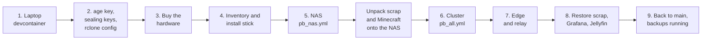

# Rebuild from nothing

This runbook is for the worst case: the house and every machine in it are
gone. The NAS, the Turing Pi, the NUCs and `ws03` are lost, and so is
everything stored on them. What is left:

- the **paper kit**: the age private key and the logins to GitHub, Google,
  Backblaze and Cloudflare;
- **a laptop**;
- **GitHub**: this repository, and with it every manifest, role and
  SealedSecret;
- **the off-site copies**: Google Drive, folder `home-cluster-offsite`
  (`backups/` and the Minecraft nightly tarballs and archive), and the
  Backblaze B2 bucket `gk-cluster-offsite` (`backups/` only, each upload
  locked for 30 days).

The plan is to buy new hardware, build the NAS, build a cluster, put back
the sealing keys so the SealedSecrets in Git decrypt, then restore the data
from B2 or Drive. The other recovery cases (one node, the control plane,
the NAS alone, an attacker) are in {doc}`/explanations/architecture/backups`
and {doc}`/how-to/backup-restore`.

## What comes back, and what does not

| Data | Off site in | After the rebuild |
|------|-------------|-------------------|
| Configuration: roles, manifests, SealedSecrets | GitHub | Everything |
| Sealing keys | B2 and Drive, `backups/etcd/sealed-secrets-keys/` | Restored, so the SealedSecrets in Git decrypt |
| scrap | B2 and Drive, `backups/scrap/` | Up to a day lost (the nightly run at 00:30) |
| Grafana dashboards and settings | B2 and Drive, `backups/grafana/` | Up to a day lost |
| Jellyfin database and config | B2 and Drive, `backups/jellyfin/` | Up to a day lost; metadata and subtitles are rebuilt by a library scan |
| Minecraft store, worlds and deleted worlds | Drive only, `minecraft/nightly/` | Up to a day lost |
| Minecraft world archive | Drive only, `minecraft/archive/` | Everything |
| etcd snapshot | B2 and Drive, `backups/etcd/` | Not needed: see {ref}`dr-etcd` |
| Cloudflare OpenTofu state | B2 and Drive, `backups/config/cloudflare/`, if it was copied there | The newest copy; or re-import it |
| The media library | Nowhere: the owner's choice | **Lost** |
| The photo archive | Its own copy on Drive, outside this cluster | Restored by hand, outside this runbook |
| Prometheus history | Nowhere | **Lost**: history starts again |
| The OpenWrt router's settings | Nowhere | **Lost**: set up again by hand |

(dr-before)=
## Before a disaster: what must be off site

Nothing in this repository records what the paper kit holds. The docs say
only that the age private key is kept "offline, in two places"
({doc}`/explanations/architecture/backups`), and that the Cloudflare state
passphrase is in "the password manager". Issue #681 plans a break-glass
kit with the age key, the provider recovery codes and a one-page runbook.
Use this list to check the kit. Everything on it must be somewhere that
does not burn with the house.

| Item | Why it is needed | Without it |
|------|------------------|------------|
| The age private key (`AGE-SECRET-KEY-1...`), at least one copy away from the house | Decrypts every backup and every sealing key export | **Nothing can be restored.** No other loss is this bad |
| GitHub login and 2FA recovery codes | The repository, `gh`, the GitHub OAuth apps behind Dex and oauth2-proxy | No code, no sign-in to the cluster's web apps |
| Google login and 2FA recovery codes | The Drive copy (the only copy of the Minecraft data) | No Minecraft worlds; one fewer copy of the rest |
| Backblaze login and 2FA recovery codes | The B2 copy, and a new read-only key for the restore | Restore from Drive instead |
| Cloudflare login and 2FA recovery codes | The DNS zone, the tunnel and Access, if anything there has to change | The edge keeps working; it just cannot be changed |
| The password manager, reachable without the house | Holds the Cloudflare state passphrase | Re-import the state ({doc}`/how-to/cloudflare-as-code`) |
| Tailscale login | The VPS relay, and Jellyfin over the tailnet | No Minecraft from outside, no remote Jellyfin |
| The VPS provider's login | The VPS that runs frps for the relay | Only matters if the VPS was lost too |
| The domain registrar's login for `gkcluster.org` | Renewing the domain | Only matters if it is not Cloudflare |
| Anthropic console login | scrap's Claude API key, if it is to be replaced | scrap's enrichment stops |

Then check, while the cluster is up, that the copies are there and open.
`just drill-monthly` already does most of it ({ref}`restore-drills`):

```bash
just drill-monthly            # Drive and B2 decrypt, the keys open every SealedSecret
```

Two things it does not check:

- **The age key on paper is the right key.** Type it into a file in RAM and
  compare its public key with the one the cluster encrypts to:

  ```bash
  (umask 077; cat >/dev/shm/age.key)    # type the key, then Ctrl-D
  age-keygen -y /dev/shm/age.key
  grep etcd_backup_age_recipient group_vars/all.yml   # must be the same age1...
  rm /dev/shm/age.key
  ```

- **The Cloudflare state copy is current.** It is copied by hand to the NAS
  after each `just cf-apply` ({doc}`/how-to/nas-setup`), and from there goes
  off site. List it on B2 and compare the newest date with the last apply:

  ```bash
  rclone --config /dev/shm/rclone.conf lsf b2:gk-cluster-offsite/backups/config/cloudflare
  ```

(dr-gaps)=
### Gaps found while writing this page

These are open, not fixed. Each is a question for the owner.

- **The paper kit is not written down.** No doc lists what it holds or
  where its two copies are. If both copies of the age key are in the
  house, a fire loses every backup.
- **2FA recovery codes.** Nothing says the GitHub, Google, Backblaze and
  Cloudflare recovery codes are in the kit. A lost phone and no codes
  means no way into those accounts.
- **Tailscale, the VPS, the registrar and the Anthropic console** are
  not mentioned anywhere as part of the kit.
- **The router.** The OpenWrt router's settings are not in Git or in any
  backup: the fixed DHCP leases (192.168.1.3 for the NAS, .82 to .92 for
  the nodes), the local DNS that resolves bare names (`nuc2`) and `.lan`
  names, and the `k3s.lan` record. The repository relies on all three.
- **The Ansible SSH key** (`~/.ssh/ansible_rsa` on `ws03`) has no off-site
  copy. That is fine: make a new pair and commit the new public half
  (step 1 below). It is listed so it is not a surprise.
- **The Cloudflare state copy** is made by hand after each apply. Nothing
  checks that it is there or current.
- **The Google OAuth client's JSON** for rclone is "kept offline", but
  where is not recorded. It is not needed if the sealing keys come back
  (step 2 rebuilds rclone's config from Git).
- **A copy of `.env`.** {doc}`/tutorials/build-the-cluster` says to keep one
  off the cluster. If one exists it is plaintext credentials and must be
  as safe as the age key; if not, the fresh-reseal path (step 6) has to
  collect each value again.
- **The Minecraft data is on Drive only.** Drive and the house together
  lose the worlds; the archive's "other copies" are not listed.
- **The devcontainer assumes a Linux host** with podman: it runs with
  `--net=host` and its `initializeCommand` calls `xhost`. A macOS or
  Windows laptop needs a Linux VM, or work on the devcontainer first.
- **Restoring old sealing keys onto a fresh install is not drilled.** The
  monthly drill proves the keys open the SealedSecrets offline, and
  `/rebuild-cluster` reseals instead. Step 6's path A has not been run end
  to end.

## Hardware

### What is tied to the old hardware

| Part | Where in the repo | On new hardware |
|------|-------------------|-----------------|
| Turing Pi BMC and RK1 flashing | `roles/flash`, `move_fs`, `rk1_os`; `turing_pis` and `turingpi_nodes` in `hosts.yml` | Not needed for x86 boxes. Leave the groups empty: the `flash` play then has no hosts |
| The QNAP embedded controller (fans) | `nas_qnap_ec_driver` in `roles/nas/defaults/main.yml` | Set it to `false` on anything that is not a TS-253D |
| The NAS's network ports | `nas_netplan_ethernets` (matched by MAC) | Set the new MACs **before** the first `pb_nas.yml`: the role removes the installer's netplan |
| The NAS's pool disks | `nas_pool_disks` (by `/dev/disk/by-id/`), `nas_backup_pool_disks` | Set the new disk ids (see the NAS's step 3 in {doc}`/how-to/nas-ubuntu-zfs`) |
| The NAS's install disk | The install stick's per-host settings | See the install stick (docs/how-to/install-stick.md) |
| Intel iGPU for Jellyfin | `intel_gpu_node` in `hosts.yml`; Jellyfin requests `gpu.intel.com/i915`; `jellyfin.render_gid` | Without an Intel iGPU the Jellyfin pod stays `Pending`: set `enable_jellyfin: false`, or buy a box with one |
| NVIDIA GPU | `nvidia_gpu_node`, `workstation` on `ws03` | Not needed: only GPU and monitoring pods ran there |
| nuc2's two NICs | `node_ip`, `flannel_iface` on `nuc2` | Drop both on a single-NIC box |
| Fixed addresses | DHCP leases on the router; `nfs.server`, `nas_nfs_clients`, `vps_relay.forwards`, `k3s.etcd_metrics_endpoints` | Keep the old addresses on the new router and almost nothing changes |
| `k3s.lan` | `k3s_api_name`, `dns_router` in `group_vars/all.yml`; `just k3s-api-dns` assumes OpenWrt | On another router, add the record by hand, or set `k3s_api_name` to the server's IP |

### The smallest rebuild: two x86 boxes

Two boxes are enough. Give them the old names and addresses, and most of
the configuration stays as it is:

| Box | Name and address | What it needs |
|-----|------------------|---------------|
| The NAS | `gknas`, 192.168.1.3 | Any x86 box that runs Ubuntu Server 26.04. A small OS disk, plus two data disks for the `tank` mirror. Without the media library, the data is the backups, scrap, and the Minecraft store and archive: tens of GB, so the size is set by what you want to add back later |
| The cluster | `nuc2`, 192.168.1.92 | An amd64 box with an NVMe and 32 GB or more. On 17 November 2026 the five nodes other than `ws03` used about 17.5 GiB together (`kubectl top nodes`), with Minecraft worlds stopped. An Intel iGPU for Jellyfin's transcoding |

The cluster is then one K3s server. The `cluster` role taints the control
plane `NoSchedule` only when there is more than one node, so a single
server runs every workload.

The edits, made on a branch (step 4):

- `hosts.yml`: remove `turingpi`, `node02`, `node03`, `node04`, `nuc1` and
  `ws03`. Keep `nuc2`, without `node_ip` and `flannel_iface` if it has one
  NIC, and with `intel_gpu_node: true` only if it has an Intel iGPU. Keep
  `gknas` in `nas`. The install stick adds its own per-host settings here.
- `group_vars/all.yml`: `control_plane: nuc2`, `standby_control_plane: ""`.
  Move the `grafana` and `prometheus` entries of `k8s_data_dirs` to
  `node: nuc2`, with paths `/home/k8s-data/grafana` and
  `/home/k8s-data/prometheus`.
- `kubernetes-services/values.yaml`: the same two moves in `local_storage`
  (node and path must match `k8s_data_dirs`), and
  `k3s.etcd_metrics_endpoints: [192.168.1.92]`. `minecraft.worlds.node` and
  the `minecraft` relay forward already name `nuc2` and .92.
- `roles/nas/defaults/main.yml`: `nas_pool_disks`, `nas_netplan_ethernets`,
  `nas_qnap_ec_driver: false` (unless it is a QNAP again), and
  `nas_backup_pool_disks: []` until there is a backup disk. Leave
  `nas_nfs_clients` and `nas_nfs_exports` alone: they name `nuc2` at .92,
  and the entries for the missing hosts admit nobody.

(dr-single-box)=
### Why not one box

One x86 box running both `pb_nas.yml` and K3s is not possible without
changing the roles, on purpose. The blockers:

1. **The `nas` role refuses.** Its first task asserts that the host is in
   `nas` and not in `all_nodes`.
2. **`just check` refuses.** `scripts/check-no-destroy` fails if any
   cluster playbook (every `pb_*.yml` but `pb_nas.yml`) targets a host of
   the `nas` group, and every one of them targets `all_nodes`.
3. **That guard is there for a reason.** `pb_decommission.yml` would run on
   the NAS: it uninstalls K3s, removes `/var/lib/rancher` and
   `/var/lib/kubelet`, and with `wipe_local_data=true` deletes the local
   data directories. Two inventory names for one address would get past
   both checks, and past their purpose with them.
4. **The two roles fight over unattended-upgrades.** Both `nas` and
   `update_packages` write `/etc/apt/apt.conf.d/20auto-upgrades`. The NAS
   is set never to reboot itself, while kured reboots every node in its
   nightly window.
5. **Port 9100 clashes.** The `nas` role installs Ubuntu's
   `prometheus-node-exporter` on port 9100; the cluster's node-exporter
   DaemonSet listens on the host's port 9100 too.
6. **NFS to itself.** Every pod would mount 192.168.1.3 from the same
   kernel. Loopback NFS works, but can deadlock under memory pressure.
7. **The OS settings are for a NAS.** The journal is kept in RAM only, so
   K3s's logs would be lost on every reboot.
8. **The design loses a copy.** The NAS is there to be a different machine
   from every node, and scrap's off-NAS copy (`scrap-backup-copy`) would
   land on the same disks. Off site would be the only second copy.

A way round that needs no role changes, untested: run the cluster node as
a virtual machine on the NAS box, with its own address (.92). Ansible then
sees two hosts and every guard holds. Jellyfin's iGPU would need passing
through to the VM, so plan to run it without hardware transcoding, or
not at all.

## The rebuild, in order



### 1. A laptop with the repository

1. Install a Linux desktop, podman, VS Code and the Dev Containers
   extension (with `dev.containers.dockerPath` set to `podman`), as in
   {doc}`/tutorials/build-the-cluster`.
2. Sign in to GitHub in the browser with the kit's login, then clone the
   repository and open it in its container (**Reopen in Container**).
3. Make a new Ansible key pair. The old private half was on `ws03`:

   ```bash
   ssh-keygen -t rsa -b 4096 -f ~/.ssh/ansible_rsa   # on the laptop
   ssh-add ~/.ssh/ansible_rsa                          # before opening the container
   ```

   The new public half replaces `pub_keys/ansible_rsa.pub` on the rebuild
   branch (step 4). The install stick and `pb_add_nodes.yml` both put that
   file on the machines.
4. In the container, `just setup` checks the forwarded agent and signs `gh`
   in. The Claude sandbox gets its own key once the node exists (step 6;
   {doc}`/how-to/claude-code`).

The container has `age`, `rclone`, `kubeseal`, `kubectl`, `yq` and `jq`.

### 2. The keys, and a way to read the off-site copies

Do this before buying anything: it proves the backups can be read.

1. **The age key.** Type it from paper into RAM, and check it:

   ```bash
   (umask 077; cat >/dev/shm/age.key)    # type the key, then Ctrl-D
   age-keygen -y /dev/shm/age.key        # must equal etcd_backup_age_recipient
   ```

2. **The sealing keys.** Sign in to the Backblaze web UI, open the bucket
   `gk-cluster-offsite`, and download the newest
   `backups/etcd/sealed-secrets-keys/sealed-secrets-keys-<UTC time>.yaml.age`.
   (Drive has the same file under `home-cluster-offsite/backups/etcd/`.)
   Check that it opens every SealedSecret in Git:

   ```bash
   just unseal-check --keys ~/Downloads/sealed-secrets-keys-<time>.yaml.age \
       --identity /dev/shm/age.key --all
   ```

   Then decrypt it into RAM for later steps:

   ```bash
   (umask 077; age -d -i /dev/shm/age.key \
       ~/Downloads/sealed-secrets-keys-<time>.yaml.age >/dev/shm/keys.yaml)
   ```

3. **rclone's config, from Git.** The off-site jobs' rclone configs are
   SealedSecrets in Git, and the keys open them. This needs no browser
   consent and no new key:

   ```bash
   for s in offsite-backup-rclone offsite-backup-b2; do
       KUBECONFIG=/nonexistent kubeseal --recovery-unseal \
           --recovery-private-key /dev/shm/keys.yaml -o json \
           < kubernetes-services/additions/backups/templates/$s-secret.yaml |
       jq -r '.data["rclone.conf"]' | base64 -d
   done | (umask 077; cat >/dev/shm/rclone.conf)
   rclone --config /dev/shm/rclone.conf listremotes   # drive: and b2:
   ```

   The `b2` remote uses the job's own key, which can write and hide
   files. After a fire that is fine. If an attack is possible, make a
   read-only key in the web UI instead ({ref}`offsite-b2-restore`), and
   follow {ref}`restore-after-attack`.

4. **Prove a restore.** Both off-site copies, without the cluster:

   ```bash
   just restore-test --target b2 --rclone-config /dev/shm/rclone.conf --identity /dev/shm/age.key
   just restore-test --target drive --with-minecraft \
       --rclone-config /dev/shm/rclone.conf --identity /dev/shm/age.key
   ```

`/dev/shm` empties on a reboot. Repeat these steps whenever the laptop
restarts.

### 3. Buy the hardware

See [the smallest rebuild](#the-smallest-rebuild-two-x86-boxes). Set the
new router up first: fixed DHCP leases by MAC (192.168.1.3 for the NAS,
192.168.1.92 for the cluster node), local DNS for bare names and `.lan`
names (`known_hosts` looks up `<host>.lan` and Ansible connects to bare
`nuc2` and `gknas`), and a `k3s.lan` record pointing at 192.168.1.92. On
OpenWrt, `just k3s-api-dns 192.168.1.92` adds the last one later.

### 4. The inventory and the install stick

1. Branch, as nothing is committed to `main`:

   ```bash
   git checkout -b rebuild-$(date +%Y%m%d)
   ```

2. Make the edits listed under
   [the smallest rebuild](#the-smallest-rebuild-two-x86-boxes), and
   replace `pub_keys/ansible_rsa.pub` with the new key's public half.
3. Record each new machine's disks and NICs, and build an install stick
   for each, as the install stick (docs/how-to/install-stick.md) describes:
   it has a "new hardware" entry for exactly this. The NAS's pool disk ids
   are read on the NAS once it runs (step 5).
4. Run `just check`, commit, and push the branch: ArgoCD will track it.

### 5. The NAS

1. Install Ubuntu from the stick, with the data disks out, as in
   {doc}`/how-to/nas-ubuntu-zfs` (steps 1 and 2 there). Then:

   ```bash
   ansible-playbook pb_nas.yml --tags known_hosts
   ansible-playbook pb_nas.yml --tags nas_os
   ```

2. Put the data disks in, read their ids
   (`ls -l /dev/disk/by-id/ | grep -v -- -part` on the NAS), set
   `nas_pool_disks` on the branch, then create the pool and everything on
   it. New disks are blank, so `nas_force` is not needed:

   ```bash
   ansible-playbook pb_nas.yml -e nas_create_pool=true
   ```

   This makes the datasets, the cluster's directories with their owners
   ({doc}`/how-to/nas-setup`), the exports, snapshots and health checks.
3. Add `Host nas` to `~/.ssh/config` (`HostName 192.168.1.3`,
   `User ansible`), as the other restore pages use `ssh nas`.

Put back the data that only lived on the NAS now, before the cluster
starts. Pick the newest of each with `rclone lsf`.

**scrap's newest run**, into `backups/` (its paths start `scrap/<run>/`).
scrap then refuses to start empty, and step 8 restores it:

```bash
rclone --config /dev/shm/rclone.conf lsf b2:gk-cluster-offsite/backups/scrap
rclone --config /dev/shm/rclone.conf cat b2:gk-cluster-offsite/backups/scrap/<run>.tar.age |
    age -d -i /dev/shm/age.key |
    ssh nas "sudo tar -xf - -C /bigdisk/k8s-cluster/backups &&
             sudo chown -R 10001:10001 /bigdisk/k8s-cluster/backups/scrap"
```

**Minecraft**, from Drive only. Stage the newest nightly on the NAS, then
unpack each part into its place ({ref}`restore-after-nas-loss` says what
each part is):

```bash
S=/bigdisk/k8s-cluster/restore-scratch
ssh -t nas "sudo mkdir -p $S && sudo chown \$(id -u) $S"
rclone --config /dev/shm/rclone.conf lsf drive:home-cluster-offsite/minecraft/nightly
rclone --config /dev/shm/rclone.conf cat \
    drive:home-cluster-offsite/minecraft/nightly/minecraft-<time>.tar.age |
    age -d -i /dev/shm/age.key | ssh nas "cat >$S/mc.tar"
ssh -t nas "set -e
  sudo tar --numeric-owner -xpf $S/mc.tar -C /bigdisk/k8s-cluster/minecraft --strip-components=1 store
  sudo tar --numeric-owner -xpf $S/mc.tar -C /k8s-dynamic stable
  sudo rm $S/mc.tar"
```

Then the world archive. `CURRENT.age` names the copy to restore:

```bash
rclone --config /dev/shm/rclone.conf cat drive:home-cluster-offsite/minecraft/archive/CURRENT.age |
    age -d -i /dev/shm/age.key
rclone --config /dev/shm/rclone.conf cat \
    drive:home-cluster-offsite/minecraft/archive/minecraft-archive-<fingerprint>.tar.age |
    age -d -i /dev/shm/age.key |
    ssh nas "sudo tar --numeric-owner -xpf - -C /bigdisk/minecraft-archive --strip-components=1 archive &&
             sudo chmod -R a-w /bigdisk/minecraft-archive"
```

The store and the worlds must be owned by `1000:1000`; `ls -ln` them to
check. Remove the scratch folder: `ssh -t nas "sudo rm -rf ${S:?}"`.

Grafana, Jellyfin and the etcd bundles need nothing on the NAS: the nightly
jobs refill `backups/`.

### 6. The cluster

The NUC-class box is installed from its stick, then brought under Ansible
and built up to K3s, without the `cluster` stage yet:

```bash
ansible-playbook pb_add_nodes.yml -e ansible_user=<login> -K   # if the stick did not make the ansible account
ansible-playbook pb_all.yml --tags tools,known_hosts,servers,k3s
```

`servers` makes `/home/k8s-data/*`, and `k3s` installs the server and the
nightly etcd backup timer. The `k3s` role stops unless `k3s_api_name`
resolves to the server.

The sealing keys can come back in two ways:

| | A: restore the old keys | B: reseal everything fresh |
|---|---|---|
| Needs | `/dev/shm/keys.yaml` from step 2 | `.env` with the six required values ({doc}`/tutorials/build-the-cluster`, "Collect the credentials") |
| Git | Nothing to commit but one Dex secret | Every SealedSecret is resealed and committed |
| Tokens held outside (scrap MCP, ntfy, the Drive consent, the B2 key) | Kept | Kept only if `.env` has them; otherwise new ones, and every client to update |
| How well trodden | Not drilled end to end: the keys are proven offline monthly | `/rebuild-cluster` runs it every time |

Use A. Fall back to B if A fails.

**A: restore the old keys.** Put the keys in before the controller starts,
so it uses them and makes none of its own, then run the `cluster` stage:

```bash
kubectl apply -f /dev/shm/keys.yaml
ansible-playbook pb_all.yml --tags cluster -e repo_branch=$(git branch --show-current)
just claude-ssh-bootstrap       # the Claude sandbox's key on the node
just set-admin-password
```

If the controller made a key of its own anyway, it seals new secrets with
that one, and the restored keys still decrypt the SealedSecrets in Git
({ref}`sealed-secrets-key-backup`). `admin-auth` is not in Git, so
`set-admin-password` makes it again. One
SealedSecret is expected to be wrong: `argocd-dex-secret` holds a client
secret derived from the old ArgoCD's `server.secretkey`, and the new
ArgoCD has a new one, so signing in to ArgoCD fails with `invalid_client`.
Re-derive it, commit, push, then restart Dex once ArgoCD has synced:

```bash
just seal-argocd-dex argocd
git add kubernetes-services/additions/argocd/argocd-dex-secret.yaml
git commit -m "Re-derive the Dex argo-cd client secret" && git push
just argocd-sync && just restart-dex
```

**B: reseal fresh.** Get `.env`: from a kept copy, or by reading each value
out of the SealedSecrets in Git with the keys
({doc}`/how-to/manage-sealed-secrets`, "Decrypt SealedSecrets without a
cluster"), or by issuing new ones at GitHub, Cloudflare and Tailscale.
There is no script that builds `.env` from Git. Then run the rest as in
{doc}`/tutorials/build-the-cluster`:

```bash
set -a && source .env && set +a
GENERATE_SECRETS=true ansible-playbook pb_all.yml --tags cluster \
    -e repo_branch=$(git branch --show-current)
```

Either way, check the result as in {doc}`/tutorials/build-the-cluster`,
"Verify": `just status`, `kubectl get sealedsecrets -A` (every one
`True`), `kubectl get certificate -A` (a new wildcard certificate from
Let's Encrypt in a few minutes), `kubectl get pv` (all `Bound`).

(dr-etcd)=
#### The etcd bundle is not used

Restoring it
({doc}`/how-to/recover-control-plane`) brings back the old cluster's
state: six Node objects, five of them dead, and PersistentVolumes pinned
to node04, whose node affinity cannot be changed. It would also bring back
the old keys and `admin-auth`, which A gets more simply. Keep the bundle
for the case it is made for: the same cluster with a lost control plane.

### 7. DNS, the tunnel and the relay

With path A nothing at Cloudflare changes. The zone, the tunnel, its
hostnames and Access are all at Cloudflare, and `cloudflared` connects
with the restored tunnel token. Check from outside the house that
<https://home.gkcluster.org> asks for a login.

The OpenTofu state is needed only to change the edge. Restore it into the
laptop's main checkout from `backups/config/cloudflare/` (decrypt it with
the age key; the state itself is also encrypted, with the passphrase from
the password manager), then expect `just cf-plan` to show no changes. If
there is no copy, re-import ({doc}`/how-to/cloudflare-as-code`, steps 3
and 4); that apply rotates the tunnel token, so finish with
{ref}`the rotation steps <cf-rotate-tunnel-token>`.

The VPS is not in the house. The relay pod reconnects over the tailnet with
its restored credentials, and its `minecraft` forward still targets
192.168.1.92. Install Tailscale on the new node by hand and sign it in
(Ansible does not manage it), for Jellyfin over the tailnet.

### 8. Restore the applications' data

**scrap.** Follow "Restore scrap" in {doc}`/how-to/backup-restore`: pause
it through Git, run the staged restore from the run unpacked in step 5
(`/backups/<run>`, with the `scrap-backups-nfs` claim), and revert the
pause. Pages written after that run are lost.

**Grafana.** Grafana's volume is new and empty. Restore the newest daily
tarball the same way as {doc}`/how-to/backup-restore`, "Restore — Grafana
sqlite": stop it through Git, then put `grafana.db` on the volume. On the
single node the volume is `/home/k8s-data/grafana`, so with Grafana stopped
the restore pod can be replaced by:

```bash
rclone --config /dev/shm/rclone.conf lsf b2:gk-cluster-offsite/backups/grafana
rclone --config /dev/shm/rclone.conf cat b2:gk-cluster-offsite/backups/grafana/<date>_<HHMM>.tar.gz.age |
    age -d -i /dev/shm/age.key |
    ssh ansible@nuc2 "sudo rm -f /home/k8s-data/grafana/grafana.db-journal /home/k8s-data/grafana/grafana.db-wal /home/k8s-data/grafana/grafana.db-shm &&
        sudo tar -xzf - -C /home/k8s-data/grafana grafana.db &&
        sudo chown 472:472 /home/k8s-data/grafana/grafana.db"
```

**Jellyfin.** Follow {doc}`/how-to/jellyfin`, "Restore from a backup":
`enable_jellyfin: false`, unpack the newest daily tarball over
`/home/k8s-data/jellyfin` as uid 122, then turn it back on. The new box
may have no `jellyfin` account, so use numbers:

```bash
rclone --config /dev/shm/rclone.conf cat b2:gk-cluster-offsite/backups/jellyfin/<date>_<time>.tar.gz.age |
    age -d -i /dev/shm/age.key |
    ssh ansible@nuc2 "sudo tar --numeric-owner --no-overwrite-dir -xzf - -C /home/k8s-data/jellyfin &&
        sudo rm -f /home/k8s-data/jellyfin/data/data/jellyfin.db-wal /home/k8s-data/jellyfin/data/data/jellyfin.db-shm &&
        sudo chown -R 122:124 /home/k8s-data/jellyfin"
```

The library itself is gone, so Jellyfin shows empty libraries until media
is copied back to `/bigdisk/media`. Check `jellyfin.render_gid`
(`getent group render` on the node) if the new box has an Intel iGPU.

**Minecraft.** The worlds were unpacked in step 5. If the dashboard
started before that, restart it:
`kubectl -n minecraft rollout restart deploy/minecraft-dashboard`.

### 9. Back to normal

1. Take the first backups, and prove them:

   ```bash
   just etcd-backup-now
   just offsite-backup-now
   just offsite-backup-now b2
   just drill-monthly /dev/shm/age.key
   ```

   The off-site jobs add only. While the cluster was down nothing pruned
   the off-site copies, and each keeps the 4 newest of every series.
2. Path B made a new sealing key: make a new offline copy of it
   ({ref}`sealed-secrets-key-backup`).
3. Open a pull request from the rebuild branch, merge it, and put ArgoCD
   back on `main`: `just switch-branch main`.
4. Wipe the RAM copies: `rm -f /dev/shm/age.key /dev/shm/keys.yaml /dev/shm/rclone.conf`.
5. Write down what went wrong, and what took how long, in issue #681.

## How long it takes

From the repo's own measurements and the NAS switchover of 17 November
2026. Buying the hardware is the long pole; the rest fits in a day.

| Step | Time | Evidence |
|------|------|----------|
| Laptop, devcontainer | An hour or two, mostly the container build | |
| Prove the off-site copies (`restore-test`) | Minutes: it downloads about 350 MB from B2 | The B2 run of 16 November 2026: scrap 249 MB, Jellyfin 67 MB, etcd 39 MB |
| Install Ubuntu on the NAS | About 20 minutes | The NAS switchover |
| `pb_nas.yml`, OS and pool | About 10 minutes | The NAS switchover |
| scrap and Minecraft onto the NAS | The download: about 0.25 GB for scrap, 3.7 GB for the Minecraft nightly, about 6 GB for the archive | {doc}`/how-to/backup-restore` |
| Install Ubuntu on the cluster node | About 20 minutes | As the NAS |
| `pb_all.yml`, K3s and cluster stages | 10 to 20 minutes, then a few minutes for ArgoCD to settle | {doc}`/tutorials/build-the-cluster` |
| Restores of scrap, Grafana, Jellyfin | Minutes each | |
| First off-site run | Minutes; a full first upload of `backups/` (about 3.3 GB) takes longer | {doc}`/how-to/backup-restore` |

(dr-desk-exercise)=
## Desk exercise

Rehearse this without touching the cluster or the NAS. Do it from a
machine other than `ws03`, ideally the laptop that would be used, with
only what is in the paper kit. Write down every step that needed something
not in the kit.

1. **The kit.** Check that it holds every item in {ref}`dr-before`. Sign in
   to each account from the laptop. Do not use up a recovery code: just
   check it is there.
2. **The laptop.** Clone the repository fresh, open the devcontainer and
   run `just setup`. Do not make a new Ansible key: that would need
   committing.
3. **The keys and rclone without the cluster.** Do all of step 2: type the
   age key from paper, download the key export from the B2 web UI, run
   `just unseal-check --keys ... --all`, build `/dev/shm/rclone.conf` from
   Git, and run both `restore-test` commands. These read only.
4. **A data restore into a throwaway pod.** The quarterly scrap drill
   ({ref}`restore-drills`) does it with a run from Drive.
5. **The configuration.** On a local branch that is never pushed, make the
   edits for [the smallest rebuild](#the-smallest-rebuild-two-x86-boxes),
   then:

   ```bash
   ansible-inventory --graph
   ansible-playbook pb_all.yml --list-hosts --tags servers,k3s,cluster
   just check
   ```

   Every play should list only `nuc2` (and `localhost`). Delete the branch
   afterwards.
6. **Time it.** Put the times in issue #681 and the table above.
7. **Clean up.** `rm -f /dev/shm/age.key /dev/shm/keys.yaml /dev/shm/rclone.conf`,
   and delete the downloaded key export.

A full rehearsal on spare hardware, with its own throwaway NAS and
cluster, is the next level. It would need its own inventory, addresses and
Cloudflare hostnames so that nothing in it can reach the live cluster or
the NAS, and is not described here.
