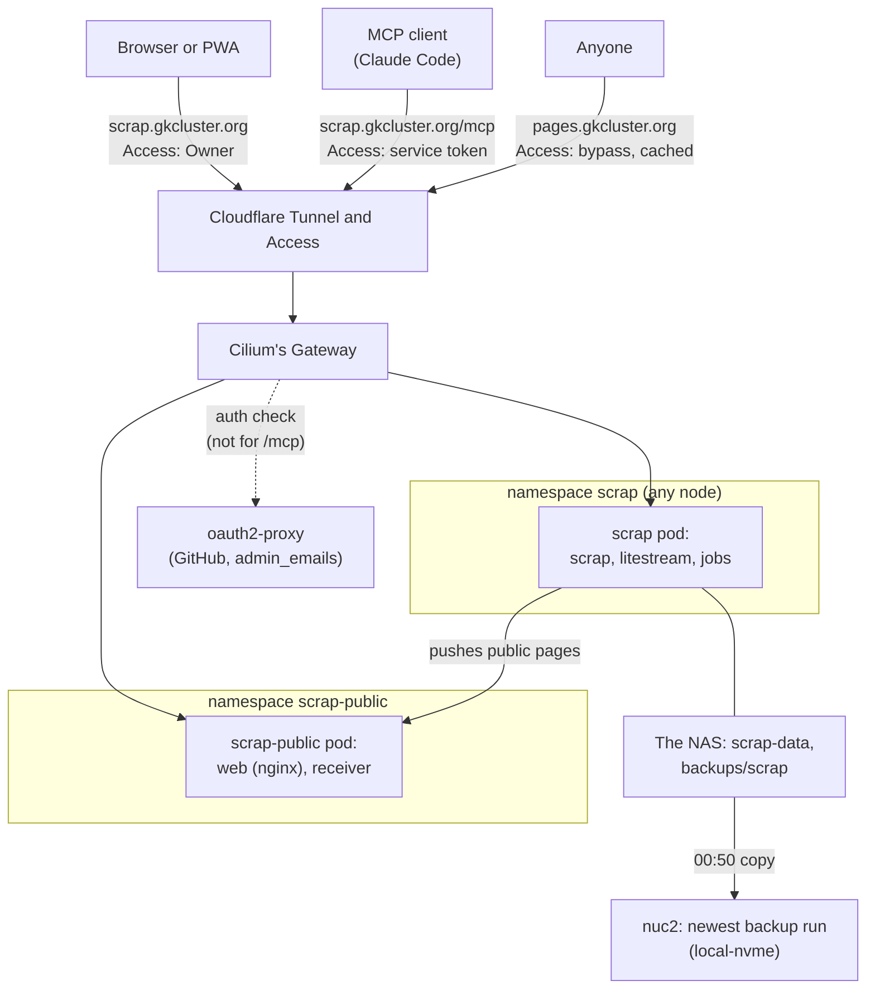

# Run scrap

[scrap](https://github.com/gilesknap/scrap) is a personal knowledge store: a
web app at <https://scrap.gkcluster.org> (installable as a PWA), an MCP
endpoint at `/mcp` for Claude Code and other AI tools, and a static site of
the pages marked Public at <https://pages.gkcluster.org>. The application and
its Helm chart live in the scrap repository. This repository provides the
cluster wiring.

## How it runs



The ArgoCD Application `kubernetes-services/templates/scrap.yaml` has three
sources:

- **The chart**, `ghcr.io/gilesknap/charts/scrap`, pinned to a release (chart
  version, app version and image tag are one number, so a bump is the
  `targetRevision`). It runs scrap in Litestream mode with a NetworkPolicy,
  Claude ingest (photo reading and text enrichment, with a daily spend cap),
  the nightly and monthly backup CronJobs and the public-pages site.
- **`kubernetes-services/additions/scrap/`**: the `/mcp`-only HTTPRoute, the
  SealedSecrets, the `scrap-public` namespace, the static NFS volumes and the
  nightly copy of the newest backup to nuc2.
- **`kubernetes-services/additions/ingress/`**: the main HTTPRoute for
  `scrap.gkcluster.org`, behind oauth2-proxy.

## Authentication layers

scrap has no login of its own, so access control is layered in front of it.

| Path | Layer 1, at the edge | Layer 2, in the cluster |
|------|----------------------|-------------------------|
| Web UI and PWA | Cloudflare Access: the Owner policy of the `clusterapps` application | oauth2-proxy GitHub login, limited to `admin_emails` |
| `/mcp` | Cloudflare Access service token (`CF-Access-Client-Id` and `CF-Access-Client-Secret` headers) | scrap's bearer token, `SCRAP_MCP_TOKEN` |
| `/mcp` from the claude-canary VPS, over the tailnet ({ref}`scrap-canary`) | None: the tailnet policy lets the VPS reach the Gateway on nuc2, not Cloudflare | The VPS's own bearer token, `SCRAP_MCP_TOKEN_CANARY` |
| `pages.gkcluster.org` | None: a bypass Access application, as the site is public | None: static files only, and nothing on that side can reach scrap |

The `/mcp` path cannot use oauth2-proxy, because an MCP client cannot complete
a browser login. It has its own HTTPRoute, `scrap-mcp`
(`additions/scrap/templates/mcp-route.yaml`), without the ExternalAuth filter;
Envoy picks the longest matching path prefix, so `/mcp` requests go there and
everything else goes to the gated `scrap` route.

The chart's NetworkPolicy admits no peers, and the `scrap-from-gateway`
CiliumNetworkPolicy admits only Cilium's Gateway, to the scrap pod, so nothing
else in the cluster can reach it or forge the identity headers that
oauth2-proxy sets.

:::{warning}
The `/mcp` route is switched by `mcp_route_enabled` in
`kubernetes-services/templates/scrap.yaml` (`true`). It is only safe with
`mcp.tokenSecret` set, as it is: without scrap's bearer token, Cloudflare
would be the only protection on `/mcp`, and the Gateway can be reached
directly from the LAN and the tailnet, bypassing Cloudflare.
:::

:::{note}
Hosted MCP connectors that run from a vendor's cloud (a chat app's custom
connector, for example) cannot send Cloudflare service-token headers, so they
cannot reach `/mcp` through this design.
:::

## Cloudflare

The edge half of the table above is code in `cloudflare/`
({doc}`/how-to/cloudflare-as-code`); nothing for scrap is set by hand in the
dashboard except the service token itself.

In `cloudflare/locals.tf`, two `tunnel_services` entries create the tunnel
routes to Cilium's Gateway and the proxied CNAMEs:

```hcl
{ name = "scrap" },
{ name = "pages", cache = true, access_bypass = true },
```

In `cloudflare/access.tf`, three Access applications apply. Cloudflare picks
the most specific one for a request: an exact hostname beats the wildcard, and
a hostname with a path beats the bare hostname for that path.

| Application | Covers | Policy |
|-------------|--------|--------|
| `clusterapps` | `*.gkcluster.org`, so `scrap.gkcluster.org` | `owner`: the owner's emails, through the GitHub login method, 24 hour session |
| `scrap` | `scrap.gkcluster.org/mcp` | `scrap_mcp`: a `non_identity` policy that admits only the `mcp-access` service token |
| `pages` | `pages.gkcluster.org` | `bypass`: everyone |

- **The service token** `mcp-access` is looked up by name, not managed:
  Cloudflare shows its client secret once, at creation, and it has to go to
  the MCP clients anyway. Create or rotate it in the dashboard (Zero Trust,
  Access, Service auth) and keep the secret with the clients. Managing it in
  code would put the secret in the OpenTofu state.
- **`access_bypass = true`** on `pages` is an allow-list entry. The guard in
  `cloudflare/access_guard.tf` fails `just cf-plan` if an application that
  lets anyone in targets a hostname without it, or if a tunnel hostname has no
  closed application in front of it. `scrap` needs no flag: the wildcard
  covers the host, and the `/mcp` application is closed.
- **`cache = true`** on `pages` adds a "cache everything" rule for the host
  (`cloudflare/zone.tf`), so the public site is served from Cloudflare's
  cache.

{ref}`cf-access-bypass` explains the pattern, and {ref}`cf-add-service` the
`just cf-plan` and `just cf-apply` routine.

(scrap-canary)=
## The claude-canary VPS

The owner's VPS (claude-canary, deliberately the riskier box) reaches scrap's
`/mcp` with a token of its own and over the tailnet, so it holds no copy of the
main MCP token and no Cloudflare service token.

**Its token.** `scrap-secrets` holds it as `SCRAP_MCP_TOKEN_CANARY`, next to
the main `SCRAP_MCP_TOKEN`. A third key, `SCRAP_MCP_TOKENS`, holds the two
comma separated (or the main token alone); it is the chart's
`mcp.tokenSecret.key`, so scrap gets it as its `SCRAP_MCP_TOKEN` variable and
accepts either token. `just seal-scrap-secrets` reseals `scrap-secrets` from
the live Secret and builds that key:

```bash
just seal-scrap-secrets --canary new     # a new canary token (or a rotation)
just seal-scrap-secrets --canary revoke  # drop it
```

Commit and push the sealed file, wait for ArgoCD to sync it, then restart
scrap, which reads its tokens at start (`kubectl -n scrap rollout restart
deploy/scrap`). After a revoke, `/mcp` answers 401 to the canary's token and
every other client is untouched. `just scrap-canary-token` prints the token
from the live Secret, for the VPS's scrap MCP entry; run it in a terminal of
your own, as its output is a secret. A rebuild keeps the token
(`scripts/export-external-creds` exports it) and never makes one.

**Its path.** On the VPS, `/etc/hosts` maps the real hostname to nuc2's tailnet
IP:

```text
100.125.90.58  scrap.gkcluster.org
```

nuc2 runs a ServiceLB pod for the Gateway's LoadBalancer Service
(`gateway/cilium-gateway-web`), which takes port 443 on every address of the
node, `tailscale0` included. The VPS therefore talks to the Gateway directly:
the wildcard certificate matches, the `Host` is the one scrap's DNS-rebinding
check expects, and Envoy routes `/mcp` to the `scrap-mcp` route as for any
other client. The MCP entry is the
usual `https://scrap.gkcluster.org/mcp` with only the
`Authorization: Bearer <canary token>` header.

The tailnet policy is code, `tailscale/policy.hujson` ({doc}`tailnet-as-code`).
The VPS is tagged `tag:vps`, and the only grant from that tag is nuc2's
tailnet IP on TCP 443; the policy's `tests` check that the VPS still cannot
reach SSH or Jellyfin on nuc2, the relay, or the LAN.

Limits:

- **The canary loses scrap whenever nuc2 is down** (or its ServiceLB pod, or
  Tailscale on nuc2). The path names one node, so nothing fails over;
  other clients, through Cloudflare, are unaffected.
- **nuc2's tailnet IP is written in two places**: the `nuc2` host alias in
  `tailscale/policy.hujson` and, by hand, the VPS's `/etc/hosts`. If nuc2
  rejoins the tailnet with a new IP (a reinstall or a logout), update both;
  until then the VPS just loses scrap.
- **The grant opens all of the Gateway on nuc2, not only scrap.** Every
  `*.gkcluster.org` host is reachable from the VPS without Cloudflare Access,
  as from the LAN. Hosts with a login of their own (the shared oauth2-proxy,
  argocd-monitor's own oauth2-proxy sidecar, Argo CD's Dex, Grafana, ntfy's
  tokens) still ask for it; only `echo` and `home`, which rely on Cloudflare
  Access alone, are readable without a login.

## Data, backups and failover

scrap runs in its chart's Litestream mode (ADR
{doc}`0013 </explanations/decisions/0013-scrap-litestream-on-nfs>`), with no
node pinning: SQLite stays on a local disk, where it belongs, and a replica
on the NAS lets the pod start anywhere.

| What | Where |
|------|-------|
| The database | An `emptyDir` on the pod's node, at `/db/scrap.db` |
| Its replica, about a second behind | `/data/litestream` on `scrap-data-nfs` (`/bigdisk/k8s-cluster/scrap-data` on the NAS) |
| Files and the preview cache | `/data` on `scrap-data-nfs` |
| Backups: `scrap-backup` daily at 00:30 Europe/London (keeps 7), `scrap-backup-monthly` at 00:40 Europe/London on the 1st (keeps 12) | `scrap-backups-nfs` (`/bigdisk/k8s-cluster/backups/scrap`) |
| The newest complete backup run, copied by `scrap-backup-copy` at 00:50 Europe/London (keeps 3) | The `scrap-backup-copy` claim: a `local-nvme` PV on nuc2, `/home/k8s-data/scrap-backup-copy` |

Both NFS volumes are static PVs at fixed directories
({ref}`scrap-nas-directories`), so a cluster rebuild binds the same data
again. The copy to nuc2 exists because the live data, the replica and the
backups are otherwise all on one NAS; a failed or stalled backup also shows
there as a failed Job. The off-site job then uploads the backup runs to Google
Drive ({ref}`offsite-backup`).

Each new pod's `db-init` init container restores the database from the
replica. It fails closed, rather than starting empty, when the volume looks
wrong. gc and the Claude passes (related pages, topics) run on their schedules
in the pod's `jobs` container, not as CronJobs:

```bash
kubectl -n scrap logs deploy/scrap -c jobs
```

- **Node death:** fence the node ({ref}`fence-a-dead-node`). scrap restarts on
  another node in about one to two minutes and loses about a second of writes.
- **Planned moves** (a drain, a kured reboot) lose nothing: Litestream does a
  last sync after scrap stops.
- **NAS down:** files cannot be read and replication stalls. After 20 minutes
  the pod leaves its Service, so scrap stops taking writes it cannot protect.
  It recovers by itself when the NAS returns.

Restores are staged, because Litestream would undo a plain `scrap restore`:
{doc}`/how-to/backup-restore`.

## Public pages

scrap publishes the pages marked Public to <https://pages.gkcluster.org>, open
to anyone. The chart's `public` section runs the site in its own namespace,
`scrap-public`: one pod with nginx (`web`), which serves the site, and an
upload `receiver` that scrap pushes each public page to. Nothing on the public
side can reach scrap. The scrap
[deployment guide](https://gilesknap.github.io/scrap/main/how-to/deploy-kubernetes.html#public-pages)
has the design.

This repository provides:

- the `scrap-public` namespace
  (`additions/scrap/templates/public-namespace.yaml`), labelled Pod Security
  `restricted`. The chart's `public.createNamespace` is `false`, so turning
  the site off does not delete the namespace and the Secret in it;
- the upload token, a SealedSecret `scrap-publish` (key `token`) sealed
  **twice**, once for each namespace, because a pod reads only its own
  namespace's Secrets: `scrap-publish-secret.yaml` (`scrap`) and
  `scrap-public-publish-secret.yaml` (`scrap-public`). Both must hold the same
  token; `kubernetes-services/additions/scrap/README.md` has the command that
  seals a new one into both;
- the HTTPRoute `pages` for `pages.gkcluster.org`, from `additions/ingress`
  in the `scrap-public` namespace, **without** the ExternalAuth filter (the
  chart's own `public.ingress` is off). Only nginx is on it; the receiver
  never is;
- `public.networkPolicy.webFrom` empty, which leaves nginx's port open to any
  peer, as it serves only public files (the `scrap-public-from-gateway`
  CiliumNetworkPolicy also admits the Gateway). The chart's NetworkPolicy
  admits only scrap's pods to the receiver, and denies all egress from the
  pod.

The site is held in an `emptyDir`, so it starts empty when the pod moves;
scrap checks the receiver's manifest at start and every 10 minutes and pushes
what is missing. The image, `ghcr.io/gilesknap/scrap-public`, is a public
package on GitHub, so no pull secret is needed.

## Secrets

| SealedSecret | Namespace | Keys |
|--------------|-----------|------|
| `scrap-secrets` (`scrap-secret.yaml`) | `scrap` | `ANTHROPIC_API_KEY` (Claude ingest), `SCRAP_MCP_TOKEN` (the main `/mcp` bearer token), `SCRAP_MCP_TOKEN_CANARY` (the claude-canary VPS's, optional) and `SCRAP_MCP_TOKENS` (those two, comma separated: the chart passes this key to scrap as its `SCRAP_MCP_TOKEN` variable) |
| `scrap-publish` | `scrap` and `scrap-public` | `token` (the public-pages upload token) |
| `scrap-ntfy` (`scrap-ntfy-secret.yaml`) | `scrap` | `url` (`SCRAP_NOTIFY_URL`, the ntfy topic URL with the token in it), `token` (the ntfy `scrap` user's token) |

`just seal-scrap-secrets` reseals the first from the live Secret (with
`--api-key` for a new Claude API key), and
`kubernetes-services/additions/scrap/README.md` has the command that reseals
the second by hand; {doc}`/how-to/manage-sealed-secrets` covers the general rules.
Without `scrap-secrets` the pod sits in `CreateContainerConfigError`.

`scrap-ntfy` is never sealed by hand: `just seal-ntfy` seals it together with
ntfy's `ntfy-auth`, and the rebuild does too. scrap reads its `url` as
`SCRAP_NOTIFY_URL` and POSTs one line there when its Claude ingest pauses
(credit, auth, budget or an outage), when gc gathers orphaned files, when a
scheduled job fails and when replication stalls or recovers. These arrive on
the phone on the `cluster-alerts` topic ({ref}`ntfy-scrap`). The variable is
optional: without the Secret, scrap runs and announces nothing.

A cluster rebuild reseals them: `scripts/export-external-creds` exports
`SCRAP_ANTHROPIC_API_KEY`, `SCRAP_MCP_TOKEN`, `SCRAP_MCP_TOKEN_CANARY` and
`SCRAP_PUBLISH_TOKEN` from the running cluster, and
`just generate-and-seal-all` seals them again. The MCP tokens are kept, so
MCP clients keep working; set
`SCRAP_ROTATE_MCP_TOKEN=true` to replace the main one, then update every
client (rotate the canary's with `just seal-scrap-secrets --canary new`).
Without `SCRAP_ANTHROPIC_API_KEY`, scrap's secrets are skipped.

## Upgrade scrap

Change `targetRevision` of the chart source in
`kubernetes-services/templates/scrap.yaml` to the new release and push. The
chart is published to the same OCI registry as the Minecraft dashboard's
(`ghcr.io/gilesknap/charts`, already in the AppProject).

## Notes on the unauthenticated path

- Kubernetes probes talk to the pod directly, so no health endpoint is exposed
  through the Gateway.
- oauth2-proxy sets one cookie on `.gkcluster.org`, shared by every service
  behind it. Its default lifetime is 168 hours with no refresh, and the cookie
  is `SameSite=Lax`. After it expires, background `fetch` calls from the PWA
  (an offline queue replay, for example) get a redirect to the login page
  instead of a response. Open the app in the browser to log in again, and the
  queue replays.
- A cross-site top-level POST (an Android share target started from another
  app) does not carry a `Lax` cookie, so the first share after expiry may land
  on the login page.
- The Gateway does not strip client-supplied identity headers on the `/mcp`
  path, which has no ExternalAuth filter.
  Nothing there relies on an identity header: the bearer token is the gate.

## Verify

```bash
kubectl -n scrap get pods,pvc,cronjobs,networkpolicy
kubectl -n scrap logs deploy/scrap -c db-init
```

- The pod is `3/3` (`scrap`, `litestream`, `jobs`), on any node.
- `scrap-data-nfs` and `scrap-backups-nfs` are bound to their NFS PVs, and
  `scrap-backup-copy` to `scrap-backup-copy-local`.
- `db-init` says it restored the replica. It never says it made a new database
  for an install that has data.
- A browser with no cookies is sent to Cloudflare Access, then GitHub.
- `/mcp` without the Cloudflare headers is refused at the edge; with them but
  without scrap's token it returns 401; with both it works.
- The `scrap-backup` and `scrap-backup-copy` CronJobs show a recent
  `LAST SCHEDULE` and their last Jobs completed.

For public pages:

```bash
kubectl -n scrap-public get pods,httproute,networkpolicy,secret
```

From outside the LAN and the tailnet:

- `https://pages.gkcluster.org/` returns 200, with no Cloudflare Access
  redirect.
- `https://pages.gkcluster.org/v1/manifest` returns 404: the receiver is not
  on the route.
- In scrap, `/api/health` shows `enabled: true` in its `publish` block.

## How it got here: the move off a local volume

scrap first ran pinned to nuc2, with its database on a `local-nvme` PV. It
moved to Litestream on NFS in one ArgoCD sync (ADR 0013): a one-off Job backed
up the live database and restored it into the NFS data volume, then the chart
switched mode. The old volume was kept as a frozen copy until the move was
proven, then retired on 22 Nov 2026, with the migration Job and
`just scrap-cutover-check`. Its folder on nuc2, `/home/k8s-data/scrap`, is no
longer used and can be deleted by hand.

Do not revert the pull request that made the move: scrap has taken writes
since, and the copy it would go back to is gone.
