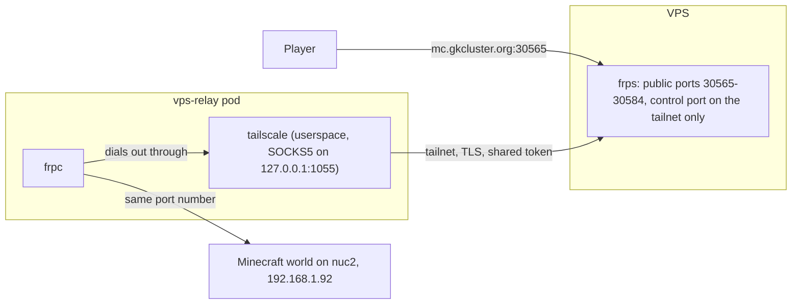

# Expose cluster ports through the VPS relay

The `vps-relay` service publishes chosen cluster ports on the fixed
public address of a small VPS. The Cloudflare Tunnel carries only
HTTP(S) ({doc}`/explanations/architecture/networking`); the relay is for
everything else, without forwarding a port on the home router or
publishing the home address.

## What runs today

| | |
|---|---|
| Forwards | One: `minecraft`, TCP `30565-30584` (twenty game ports) |
| Target | `192.168.1.92`, nuc2, where every Minecraft world runs on a NodePort in that range ({doc}`minecraft`) |
| Public name | `mc.gkcluster.org`, a DNS-only A record on the VPS's public address; players connect to `mc.gkcluster.org:<port>` |
| In the cluster | One `vps-relay` pod (two containers, `tailscale` and `frpc`) in the `vps-relay` namespace; it holds no state and runs on any node |
| On the VPS | `frps` v0.71.0 as a Podman Quadlet, its control port (7000) bound to the VPS's tailnet address only |
| Link between them | The tailnet. The pod dials `vps_relay.vps_tailnet_host`; nothing reaches the VPS's control port from the internet |

The settings are the `vps_relay` block in
`kubernetes-services/values.yaml`, switched on by `enable_vps_relay:
true`.

## How it works



- The `vps-relay` Deployment runs two containers in one pod:
  - **tailscale** joins the tailnet as an **ephemeral** node tagged
    `tag:vps-relay`, in **userspace mode** (no `NET_ADMIN`, no
    `/dev/net/tun`, no `hostNetwork`). It exposes a SOCKS5 proxy on
    `127.0.0.1:1055` inside the pod.
  - **[frpc](https://github.com/fatedier/frp)** connects through that proxy
    to `frps` on the VPS, authenticates with a shared token over TLS, and
    registers one proxy per forwarded port.
- `frps` on the VPS listens for players on each forwarded port and relays
  each connection back down the connection that frpc opened. frpc delivers
  it to the forward's `target` on the same port number.

**Every connection is opened from the cluster side.** The VPS never
initiates a connection into the home network, the tailnet policy gives the
VPS no access to the relay node, and the relay node advertises no subnet
routes. A compromised VPS can therefore reach only what the relay already
forwards to it, the game ports on nuc2, and the one thing the policy grants
it: Cilium's Gateway on nuc2's tailnet IP, for scrap's `/mcp`
({ref}`scrap-canary`).

| Piece | Where | Notes |
|-------|-------|-------|
| `vps-relay` Deployment and `vps-relay-frpc` ConfigMap | `kubernetes-services/additions/vps-relay/`, namespace `vps-relay` | `frpc.toml` is generated from `vps_relay.forwards` |
| `vps-relay-credentials` SealedSecret | `additions/vps-relay/templates/vps-relay-secret.yaml` | Tailscale OAuth client secret and the frp token |
| `frps` | The VPS (Podman Quadlet, run by systemd) | Control port bound to the VPS's tailnet IP only |
| Tailnet policy | `tailscale/policy.hujson` ({doc}`tailnet-as-code`) | `tag:vps-relay` may reach only the VPS's frp port; `tag:vps` only nuc2's tailnet IP on 443 |
| Public DNS name | The `mc` entry in `dns_only_records` ({doc}`cloudflare-as-code`) | A DNS-only A record on the VPS's public address |

### Trade-offs

- Services see every client as coming from the relay pod, not the client's
  real IP. IP-based bans and logs are of no use; name-based controls (such
  as Minecraft whitelists and ops) still work.
- The relay depends on Tailscale's coordination service to set up the
  tailnet connection between the pod and the VPS.

## Set up the relay

Steps 1 to 7 are how the relay was built, and are what to repeat for a
replacement VPS or after losing the Tailscale OAuth client. A cluster
rebuild needs none of them: the VPS side is untouched, and the two
credentials are carried over and resealed
({doc}`manage-sealed-secrets`).

Prerequisites:

- A VPS with a public IPv4 address, Podman 4.4 or newer, and already on
  the tailnet (`tailscale up`).
- Admin access to the tailnet's OAuth clients, and `just tailnet-apply`
  set up ({doc}`tailnet-as-code`).

### Step 1: Tailnet policy

**Tag the VPS** (`tag:vps`). An untagged VPS belongs to the owner's user,
so any rule that lets the owner's own devices reach things (the owner's
login, `autogroup:member`, or the default allow-all) would also let the VPS
reach the relay. A tagged VPS is a separate identity that is granted
nothing. Tagging also stops its key expiring; Tailscale SSH rules that reach
it must then name the tag.

The policy is `tailscale/policy.hujson`, applied with `just tailnet-apply`
({doc}`tailnet-as-code`). For the relay it has:

- `tagOwners` for `tag:vps` and `tag:vps-relay` (`autogroup:admin`);
- a grant from `tag:vps-relay` to `tag:vps` on `tcp:7000` (frps), and
  nothing else from that tag;
- a grant from `tag:vps` to the `nuc2` host alias (nuc2's tailnet IP) on
  `tcp:443`, and nothing else from that tag;
- `tests` that the relay reaches the VPS on 7000 but not on 22, and that the
  VPS reaches nuc2 on 443 but not SSH or Jellyfin on nuc2, the relay, or
  the LAN.

The `tag:vps` grant is the claude-canary VPS's path to scrap without
Cloudflare ({ref}`scrap-canary`); a VPS that needs no scrap needs no such
grant. It names nuc2's tailnet IP only, so it would not reach the LAN even
if nuc2 were a subnet router (the `192.168.1.92:443` test). No node is one:
the `k3s` role refuses a node that advertises routes (ADR 0015).

The `tests` run on every plan and apply, so a later policy change cannot
quietly let the VPS dial in. For a replacement VPS the policy needs no
change: tag the new VPS and the same rules apply.

Then apply the tag on the VPS (or in the console, **Machines → ⋯ → Edit ACL
tags**):

```bash
sudo tailscale up --advertise-tags=tag:vps --reset
```

`--reset` also clears any other `tailscale up` options set earlier, such as
`--ssh` or `--accept-routes`. Add them back on the same command, or use the
console instead.

:::{warning}
A new tailnet starts with an allow-all rule (`"src": ["*"], "dst": ["*"]`).
While that rule is present, every device on the tailnet, including the VPS,
can reach the relay node. `tailscale/policy.hujson` has no such rule; on a
new tailnet, apply it ({doc}`tailnet-as-code`) before the relay goes live.
:::

### Step 2: OAuth client

The pod authenticates with an OAuth client secret. Unlike auth keys, which
expire after at most 90 days, OAuth clients do not expire.

1. In the admin console go to **Settings → Trust credentials**, select
   **Credential**, then **OAuth**.
2. Grant the **Auth Keys** scope with **Write** access, and add the tag
   `tag:vps-relay`.
3. Select **Generate credential** and copy the **client secret**
   (`tskey-client-…`). It is shown only once.

The pod appends `?ephemeral=true&preauthorized=true` to the secret, so each
pod joins as an ephemeral node that Tailscale removes soon after the pod
goes away. No Tailscale state is stored in the cluster.

### Step 3: Set up frps on the VPS

`scripts/vps-relay-setup` does the whole VPS side. It needs Podman 4.4 or
newer and Tailscale up on the VPS, and it:

- writes `/etc/frp/frps.toml`, with the control port bound to the VPS's
  tailnet IP only and `allowPorts` set to exactly the ports it is given;
- generates the shared frp token into `/etc/frp/frps.env` (root-only) on the
  first run, and prints it once for sealing;
- installs frps as a Podman Quadlet (`/etc/containers/systemd/frps.container`),
  running as an unprivileged user with a read-only root filesystem, and
  starts it;
- opens the forwarded ports publicly and the control port on `tailscale0`
  only, with `ufw` or `firewalld` if either is active;
- checks that frps is listening on the tailnet IP.

It is idempotent: re-running it keeps the existing token, replaces only the
files that changed, and restarts frps only when something did, so players
connected through the relay are not dropped by a no-op run.

The frp control port is 7000. After a change to `vps_relay.frp_port`, run
the script with the same value (`sudo FRP_PORT=<port> ./vps-relay-setup ...`)
and change the port in the `tag:vps-relay` grant and `tests` in
`tailscale/policy.hujson` to match ({doc}`tailnet-as-code`).

In the devcontainer, print the forwards in the form the script takes:

```bash
just vps-relay-forwards        # tcp:30565-30584
```

Copy the script to the VPS and run it with those arguments:

```bash
scp scripts/vps-relay-setup <vps>:
ssh <vps>
sudo ./vps-relay-setup tcp:30565-30584
```

Save the printed token in the password manager: it is needed for Step 4.
`sudo ./vps-relay-setup --show-token` prints it again later.

Also open the forwarded ports in the VPS provider's cloud firewall, if it
has one. Do not open `7000` there.

### Step 4: Seal the credentials

Seal both values into the `vps-relay` namespace as the
`vps-relay-credentials` Secret. The file name must end in `-secret.yaml`
(singular), because the `.gitleaks.toml` allowlist only covers that pattern.
See {doc}`manage-sealed-secrets` for background.

```bash
# Prompt for both values (not echoed, not stored in shell history)
printf 'Tailscale OAuth client secret: '; read -rs TS_SECRET; echo
printf 'frp token: '; read -rs FRP_TOKEN; echo

kubectl create secret generic vps-relay-credentials \
    --namespace vps-relay \
    --from-literal=ts-oauth-client-secret="$TS_SECRET" \
    --from-literal=frp-token="$FRP_TOKEN" \
    --dry-run=client -o yaml | \
  kubeseal --controller-name sealed-secrets \
    --controller-namespace kube-system -o yaml > \
    kubernetes-services/additions/vps-relay/templates/vps-relay-secret.yaml

unset TS_SECRET FRP_TOKEN
```

The `vps-relay` namespace does not need to exist yet.

:::{tip}
A cluster rebuild does not repeat this step.
`just export-external-creds` reads the two values from the running
cluster as `VPS_RELAY_TS_OAUTH_CLIENT_SECRET` and `VPS_RELAY_FRP_TOKEN`,
and `just generate-and-seal-all` reseals them when both are set (and
skips them when neither is).
:::

### Step 5: Configure and enable the relay

Edit `kubernetes-services/values.yaml`:

```yaml
enable_vps_relay: true
vps_relay:
  vps_tailnet_host: 100.76.74.70  # the VPS's tailnet IP or MagicDNS name
  frp_port: 7000
  forwards:
    - name: minecraft
      protocol: tcp
      ports: 30565-30584          # single port or inclusive range
      target: 192.168.1.92        # LAN IP, or an in-cluster Service DNS name
```

Each forward publishes `ports` on the VPS and relays them to the **same port
numbers** on `target`. Because frpc runs inside the cluster, `target` can be
a Service DNS name such as `my-svc.my-namespace.svc.cluster.local`, so new
services do not need a NodePort. `protocol` is `tcp` or `udp` (frp carries
UDP over its TCP tunnel).

Commit and push. ArgoCD creates the `vps-relay` Application and namespace.

### Step 6: Point DNS at the VPS

The public name is an entry in `dns_only_records` in
`cloudflare/live.auto.tfvars` (gitignored, since it holds the VPS's
public address), in the form shown in `live.auto.tfvars.example`:

```hcl
dns_only_records = {
  mc = { type = "A", content = "<VPS public IPv4>" } # VPS relay
}
```

`just cf-plan` should show one DNS record to add; apply it with
`just cf-apply` ({doc}`cloudflare-as-code`). The record is DNS-only
(`proxied` defaults to `false`): Cloudflare's proxy carries only HTTP(S),
so a proxied record would not pass game traffic. The name itself is
`minecraft.dns_name` (`mc`) in `kubernetes-services/values.yaml`: players
connect to `mc.gkcluster.org:<port>`.

### Step 7: Verify

1. **Pod** — both containers are running and the tailscale container is
   Ready:

   ```bash
   kubectl get pods -n vps-relay
   kubectl logs -n vps-relay deploy/vps-relay -c tailscale | tail
   ```

2. **Tailnet** — on the VPS, `tailscale status` lists a `vps-relay` node
   (or `vps-relay-1` and so on, until Tailscale removes an earlier ephemeral
   node after a pod restart) tagged `tag:vps-relay`.
3. **frpc** — each forwarded port logs `start proxy success`:

   ```bash
   kubectl logs -n vps-relay deploy/vps-relay -c frpc | grep -c 'start proxy success'
   ```

4. **Public port** — from outside the home network (an online port
   checker, or `nc -vz mc.gkcluster.org 30565`), a forwarded port is open
   while its target is listening, that is, while a world is running on
   that port.
5. **Direction** — the VPS cannot open a connection to the relay node. On
   the VPS, `nc -vz -w 5 <relay-tailnet-ip> 22` must time out: the policy
   drops the packets. A prompt `connection refused` means the policy still
   lets the VPS reach the node (see the warning in Step 1).

## Adding a forward

1. Add an entry to `vps_relay.forwards`. Names must be unique. Never forward
   plain-text admin protocols such as the Minecraft worlds' RCON NodePorts
   (`minecraft.worlds.rcon_port_min`–`rcon_port_max`): they are LAN-only.
2. **On the VPS**, re-run `scripts/vps-relay-setup` with the new list from
   `just vps-relay-forwards`. It updates `allowPorts`, restarts frps and
   opens the ports. Firewall rules for ports that were *removed* are left
   in place; close them by hand. Check `frps`'s image version against
   `images.frpc` in `additions/vps-relay/values.yaml` at the same time:
   `FRP_VERSION` in the script keeps the two in step.
3. Commit and push. The ConfigMap checksum changes, so the pod restarts with
   the new `frpc.toml`.

:::{important}
Step 2 is a deliberate manual sync point. A forward in git does nothing
until the VPS allows its ports, so a mistaken or malicious change to the
repository cannot publish a new port on its own. frpc logs
`port not allowed` for a forward the VPS has not yet allowed.
:::

## Troubleshooting

### The pod is stuck in `CreateContainerConfigError`

The `vps-relay-credentials` Secret does not exist. The SealedSecret is
missing, or was sealed for another cluster or namespace.

### The tailscale container never becomes Ready

Check its log. `requested tags [tag:vps-relay] are invalid or not permitted`
means the OAuth client does not have the tag, or `tagOwners` does not define
it. An authentication error means the client secret is wrong or was revoked.

### frpc logs `connect to server error`

- `i/o timeout` or `connection refused` through the SOCKS proxy: the
  tailnet policy does not grant `tag:vps-relay` access to the VPS on the frp
  port, frps is not running, or it is bound to a different address.
- `token in login doesn't match`: the sealed `frp-token` differs from
  `FRP_AUTH_TOKEN` on the VPS.

frpc retries on its own, so a relay started before the VPS is ready
recovers without a restart.

### Rotating the credentials

Re-seal `vps-relay-credentials` as in Step 4 and push. The pod reads the
Secret only when it starts, and nothing restarts it when the Secret
changes, so the new values take effect at its next restart. Restart it
only once ArgoCD has synced the SealedSecret and the controller has
updated the Secret: the first command must print two equal numbers and
`True` (it prints no secret). A restart before that starts the pod with
the old values.

```bash
kubectl -n vps-relay get sealedsecret vps-relay-credentials -o \
  jsonpath='{.metadata.generation} {.status.observedGeneration} {.status.conditions[?(@.type=="Synced")].status}{"\n"}'
kubectl -n vps-relay rollout restart deploy/vps-relay
```

The frp token is in two places, and frps reads `/etc/frp/frps.env` only when
it starts. To rotate it, do one of these on the VPS first:

- edit `FRP_AUTH_TOKEN` in `/etc/frp/frps.env`, then
  `sudo systemctl restart frps`; or
- delete `/etc/frp/frps.env` and re-run `scripts/vps-relay-setup` with the
  current forwards. It generates a new token, prints it and restarts frps.

Then seal the same token, push, wait for the Secret and restart the pod,
as above. Between the two restarts frpc logs `token in login doesn't match`
and the forwards are down.

### The public port is closed

- Check `allowPorts` and both firewalls on the VPS; re-running
  `scripts/vps-relay-setup` with the current forwards fixes the first two.
- On the VPS, `sudo journalctl -u frps -n 20` shows why frps refused a
  proxy.
- Check the forward's target from inside the cluster, for example
  `kubectl run -it --rm nc --image=busybox -- nc -vz <target> <port>`.

## Removing the relay

Set `enable_vps_relay: false` and push. ArgoCD prunes the namespace's
resources and the ephemeral tailnet node disappears shortly afterwards.
Then, on the VPS, run `sudo systemctl stop frps`, delete
`/etc/containers/systemd/frps.container` and `/etc/frp/`, and close the
firewall ports. Finally remove `mc` from `dns_only_records` (and its ID
from `import_ids`, if it was imported), run `just cf-apply`, and revoke
the Tailscale OAuth client. Minecraft worlds are then reachable from the
LAN only.
