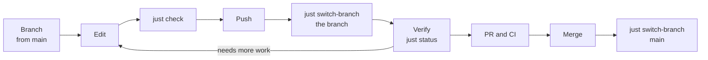

# Develop and ship a change

The day-to-day loop for changing this cluster. Nothing is applied to the
cluster by hand: a change is made in a branch, the cluster is pointed at
that branch to try it, and it reaches `main` through a pull request.



## 1. Branch from an up-to-date main

Never commit to `main`. Start every piece of work from the current tip:

```bash
git checkout main && git pull
git checkout -b my-change
```

Rebase a branch that has been open for a while over `main` before adding to
it (`git fetch && git rebase origin/main`). Merged commits have different
hashes from the originals, so a stale base produces conflicts that are not
real.

First check which branch the cluster is tracking:

```bash
kubectl -n argo-cd get application all-cluster-services \
  -o jsonpath='{.spec.source.targetRevision}{"\n"}'
```

If it is not `main`, another change is still being tried out. Pointing the
cluster at a new branch cut from `main` would roll that change back, and if
it re-sealed secrets, the cluster would be handed files it can no longer
decrypt. Merge the tracked branch first, or base the new work on it.

## 2. Make the change

{doc}`/tutorials/tour` has a table of which file to edit for what. In
short: `hosts.yml` and `group_vars/all.yml` for Ansible,
`kubernetes-services/` for anything ArgoCD delivers, `cloudflare/` for the
edge, `docs/` for these pages.

## 3. Run the checks

```bash
just check
```

`scripts/check` verifies that the age public key is the same in both files
that hold it, then runs `ansible-lint` and the Sphinx build side by side.
Both must finish with no warnings. A warning is fixed, not silenced: no
`# noqa`, no `warn_list` entries, no Sphinx suppressions.

Commit with `uv run git commit`, so the pre-commit hooks (YAML checks,
`ansible-lint`, the age key check and gitleaks) run in the project's
environment. gitleaks only lets a SealedSecret through if its file is
named `*-secret.yaml`.

## 4. Point the cluster at the branch

ArgoCD deploys what is on GitHub, so push first, then switch:

```bash
git push -u origin my-change
just switch-branch my-change
```

`switch-branch` runs `ansible-playbook pb_all.yml --tags cluster -e
repo_branch=my-change`. That re-renders the root application
`all-cluster-services` from `argo-cd/argo-git-repository.yaml` with the
branch in two places:

- its own `targetRevision`, so the chart in `kubernetes-services/` is read
  from the branch;
- the `repo_branch` value it passes to that chart, which every child
  application uses as the `targetRevision` of the sources it takes from
  this repo.

So one command moves the whole cluster, and every later push to the branch
is picked up by ArgoCD without running it again. `repo_branch` in
`group_vars/all.yml` stays `main` at all times; the branch is only ever
given as an override, never edited into the file.

Two things to know while the cluster is on a branch:

- The `cluster` tag also applies everything else Ansible owns in the
  cluster: ArgoCD's own Helm values and the AppProject in
  `argo-cd/argo-project.yaml`. A change to those takes effect at this step,
  from the files in the local checkout, not through an ArgoCD sync.
- Do not push a chart or image version that is not published yet. ArgoCD
  syncs the pushed tip, so the application fails until the version exists.

## 5. Verify

```bash
just status
```

All applications should return to `Synced` and `Healthy`. If ArgoCD has not
noticed a push after a minute or so, make it re-read the repo:

```bash
just argocd-sync
```

Then look at the thing that changed: the application in
<https://argocd.gkcluster.org>, the pod's logs, the page in a browser.
Fixes are further commits pushed to the branch.

### Changes that affect a rebuild

A change to the Ansible roles, to how secrets are generated or sealed, to
CoreDNS or to the application templates can leave the running cluster
healthy while breaking the path that builds it. Test those by rebuilding
the cluster from the branch before merging. In a Claude Code session:

```text
/rebuild-cluster test PR 123 on branch my-change
```

The command decommissions K3s, rebuilds it from the branch (keeping the
data under `/home/k8s-data`, `/var/lib/k8s-data` and on the NAS), verifies
the result, and brings the re-sealed secrets back onto the PR branch, so
that merging the PR delivers the fix and the new secrets together.
{doc}`/tutorials/build-the-cluster` describes what it does.

## 6. Open the pull request

```bash
gh pr create --fill
```

CI (`.github/workflows/docs.yml`) runs four jobs on every pull request:

| Job | What it runs |
|-----|--------------|
| `pre-commit` | `just pre-commit`: the same hooks as a local commit, over every file |
| `docs` | `just docs`: the Sphinx build with warnings as errors. On `main` it also publishes the pages |
| `shellcheck` | `shellcheck --severity=warning` on every bash script in `scripts/` |
| `tofu` | `tofu fmt -check` and `tofu validate` on `cloudflare/`, with no credentials |

Renovate opens its own pull requests for chart and image version bumps;
they go through the same checks.

## 7. Tidy the history and merge

A branch that was iterated on has commits like "fix typo" and "try again".
`/pr-squash` in a Claude Code session groups them into a few commits that
each say one thing, on a new `<branch>-squash` branch, and opens the pull
request from that. It proposes the grouping and waits for agreement before
changing anything, and it never rewrites the original branch.

Merge a pull request made by `/pr-squash` with a merge commit, which keeps
those curated commits:

```bash
gh pr merge --merge
```

Use `gh pr merge --squash` only for a pull request that did not go through
`/pr-squash`, where one commit for the whole change is what is wanted (a
branch of one or two commits, say).

## 8. Put the cluster back on main

Only after the merge, so that `main` already contains the change:

```bash
just switch-branch main
git checkout main && git pull
```

## Cloudflare changes

The edge configuration in `cloudflare/` is not delivered by ArgoCD. It
follows the same branch and pull request, with a plan and an apply in place
of the branch switch:

1. Change `cloudflare/` in a branch.
2. `just cf-plan` and read the plan. Run it from the main checkout of the
   repo: the encrypted state and `live.auto.tfvars` are there and are
   gitignored, so a git worktree has neither.
3. Open the pull request. CI checks formatting and validity only.
4. After review, the owner runs `just cf-apply` (Claude never does), and
   then merges.

{doc}`/how-to/cloudflare-as-code` has the detail, and
{ref}`cf-add-service` covers the common case of publishing a new hostname.
