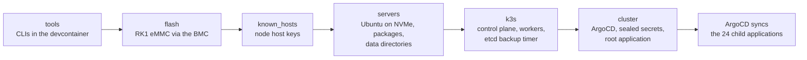

# Build the cluster from bare metal

This is the one end-to-end path from powered-off hardware to the running
cluster, as it is done for gkcluster.org. It is written for the owner
rebuilding after a disaster, and for a visitor who wants to see every step
such a build involves. The values shown are this cluster's; the
{ref}`last section <adapting-this-to-other-hardware>` lists what is specific to
this site.

Two neighbouring procedures have their own pages:

- re-flashing one node, or rebuilding K3s on machines that already run
  Ubuntu: {doc}`/how-to/reflash-rebuild`
- bringing back the *same* cluster (its etcd state and sealing key) from
  the encrypted backup: {doc}`/how-to/recover-control-plane`

## What must exist first

| What | Detail |
|------|--------|
| The hardware | The Turing Pi board `turingpi` with three RK1s (each with an NVMe drive), `nuc1`, `nuc2` and `ws03`, as on {doc}`/explanations/architecture/hardware`. The board's BMC has an ext4 SD card mounted at `/mnt/sdcard`, where OS images are staged |
| Names and addresses | The OpenWrt router at 192.168.1.1 gives every machine a fixed DHCP lease and resolves its name (`node02`, `node02.lan`). The inventory holds names, not addresses |
| Ubuntu on the amd64 machines | `nuc1`, `nuc2` and `ws03` are installed by hand (Ubuntu, 26.04 today), with a login that can `sudo`. Only the RK1s are flashed by Ansible |
| The NAS | The QNAP at 192.168.1.3 with the cluster's directories made by hand, per {doc}`/how-to/nas-setup`: `/bigdisk/k8s-cluster/` ({ref}`scrap-nas-directories`, {ref}`minecraft-nas-directories`) and `/k8s-dynamic/stable` ({ref}`nfs-csi-nas-share`). Ansible never touches the NAS |
| The Cloudflare zone | `gkcluster.org` on Cloudflare, with Zero Trust enabled and its two login methods (GitHub and one-time PIN) added in the dashboard ({doc}`/how-to/cloudflare-as-code`) |
| Two GitHub OAuth apps | One for Dex (ArgoCD, Grafana, argocd-monitor) and one for oauth2-proxy ({doc}`/how-to/oauth-setup`) |
| The tailnet and the VPS | A Tailscale OAuth client for the relay pod, and frps running on the VPS ({doc}`/how-to/vps-relay`) |
| The age key pair | The private key, kept offline, that decrypts every backup. Its public key is `etcd_backup_age_recipient` in `group_vars/all.yml` ({ref}`etcd-offsite-backup`) |

## Prepare the workstation

The build runs from the repo's devcontainer on a Linux workstation with
podman, VS Code and the Dev Containers extension (with
`dev.containers.dockerPath` set to `podman`).

1. **The ansible key.** One key pair gives Ansible its login on every
   node. Its public half is committed as `pub_keys/ansible_rsa.pub`; the
   private half stays on the workstation. Load it into `ssh-agent` before
   opening the container, because VS Code forwards the agent that is
   running at that moment:

   ```bash
   ssh-add ~/.ssh/ansible_rsa
   ```

2. **Authorise the key on the BMC.** The BMC is the one machine Ansible
   cannot prepare for itself. On a board that does not have the key yet:

   ```bash
   scp pub_keys/ansible_rsa.pub root@turingpi:.ssh/authorized_keys
   ssh root@turingpi     # must now work without a password
   ```

   Then set a strong root password on the BMC with `passwd`.

3. **Open the devcontainer.** `code .` in the repo, then **Reopen in
   Container**. The build installs the cluster tools (`kubectl`, `helm`,
   `kubeseal`, `argocd`) with `ansible-playbook pb_all.yml --tags tools`.
   `just setup` then checks the forwarded agent and signs `gh` in
   ({doc}`/how-to/claude-code`).

## The three configuration files

Everything about the cluster that is a choice lives in three files. On a
rebuild of this cluster they are already right; read them rather than edit
them.

`hosts.yml` is the inventory: which machines exist and what is special
about each.

```yaml
turingpi_nodes:
  hosts:
    node02:
      slot_num: 2
      type: rk1
      root_dev: /dev/nvme0n1      # install Ubuntu on the NVMe
    node03: ...
    node04: ...

extra_nodes:
  hosts:
    ws03:
      nvidia_gpu_node: true       # NVIDIA container toolkit
      workstation: true           # taint NoSchedule
    nuc2:
      node_ip: 192.168.1.92       # multi-homed: use this subnet
      flannel_iface: enp3s0
      intel_gpu_node: true        # Iris Xe for Jellyfin
    nuc1:
```

`group_vars/all.yml` holds the Ansible-side choices:

```yaml
control_plane: node02
standby_control_plane: node03
k3s_api_name: k3s.lan
dns_router: root@192.168.1.1
cluster_domain: gkcluster.org
repo_remote: https://github.com/gilesknap/tpi-k3s-ansible.git
repo_branch: main
```

It also carries `admin_emails`, `domain_email`, the age public key and
`k8s_data_dirs`, the host directories behind the `local-nvme` volumes.

`kubernetes-services/values.yaml` holds what ArgoCD reads: the service
switches, chart versions and storage locations.

```yaml
k3s:
  minor: v1.34
enable_oauth2_proxy: true
enable_cloudflare_tunnel: true
enable_minecraft: true
enable_vps_relay: true
enable_jellyfin: true
nfs:
  server: 192.168.1.3
  cluster_share_path: /bigdisk/k8s-cluster
nfs_csi:
  stable_share: /k8s-dynamic/stable
```

Two things in these files must agree across them, and the comments in the
files say so: `admin_emails` appears in both `all.yml` and `values.yaml`,
and each `local_storage` entry in `values.yaml` must name the same node and
path as its `k8s_data_dirs` entry in `all.yml`. {doc}`/reference/inventory`
and {doc}`/reference/variables` describe every setting.

:::{note}
`hosts.yml` still lists `node01`, the CM4 in slot 1 that was the control
plane before node02. It is not a member of the cluster today, but it is
powered on and answers SSH, so a playbook run over the whole inventory
would upgrade it and join it as a worker. The run below leaves it out with
`--limit 'all:!node01'`.
:::

## Point the API name at the control plane

Workers join the cluster, and the kubeconfig reaches it, through the name
`k3s.lan` rather than through node02's address, so that the control plane
can move to another node later. Create the record on the router before the
run:

```bash
just k3s-api-dns 192.168.1.82
```

The recipe adds or updates the record on the OpenWrt router over SSH and
checks that the name now resolves in the devcontainer. The `k3s` role
refuses to start if it does not.

## Put the NUCs and the workstation under Ansible

The RK1s get their `ansible` account when they are flashed. The three
hand-installed machines get it from a small playbook, run once with an
existing login on them:

```bash
ansible-playbook pb_add_nodes.yml -e ansible_user=<login> -K
```

It creates the `ansible` user, authorises `pub_keys/ansible_rsa.pub` and
grants passwordless `sudo`. `-K` asks for the login's `sudo` password. From
here on the main playbook treats all six machines alike.
{doc}`/how-to/node-operations` has the same steps for adding one node to a
running cluster.

## Collect the credentials

Every SealedSecret in the repo is encrypted to the sealing key of the
cluster that made it. A newly built cluster has a new key, so every one of
them is sealed again during the build. Most secret values are random and
are simply generated afresh; a few come from outside and have to be
supplied:

| Variable | Where it comes from |
|----------|---------------------|
| `GITHUB_CLIENT_ID`, `GITHUB_CLIENT_SECRET` | The GitHub OAuth app for Dex |
| `OAUTH2_PROXY_CLIENT_ID`, `OAUTH2_PROXY_CLIENT_SECRET` | The GitHub OAuth app for oauth2-proxy |
| `CLOUDFLARE_API_TOKEN` | cert-manager's DNS-01 token ({ref}`cf-dns01-token`) |
| `CLOUDFLARE_TUNNEL_TOKEN` | The tunnel's token, held in the OpenTofu state |
| `VPS_RELAY_TS_OAUTH_CLIENT_SECRET`, `VPS_RELAY_FRP_TOKEN` | The Tailscale OAuth client and the frp token (optional: without them the relay's secret is skipped) |
| `SCRAP_ANTHROPIC_API_KEY`, `SCRAP_MCP_TOKEN`, `SCRAP_PUBLISH_TOKEN` | scrap's Claude API key and its two tokens (optional: without the API key scrap's secrets are skipped) |
| `OFFSITE_BACKUP_RCLONE_CONF_B64` | rclone's Google Drive credentials for the off-site backup (optional) |
| `NTFY_<USER>_TOKEN` | ntfy's access tokens; any that are missing are generated |

The first six are required. While the old cluster is still running, one
command reads all of them out of it into `.env` at the repo root, which is
gitignored:

```bash
just export-external-creds
```

It also exports the tokens that clients hold copies of (scrap's MCP token,
the ntfy tokens), so a rebuild does not invalidate every phone and Claude
session. Keep a copy of `.env` somewhere safe and off the cluster: after a
real disaster it is the quick way back, and without it each value has to be
fetched again from where it was issued.

The tunnel's token is not in a dashboard to copy: this repo reads it from
the OpenTofu state (Cloudflare's API can return it too, but only to an
edit token, so the code does not ask). The other copy is the old
cluster's Secret. With the state to hand, put the token in `.env` without
printing it. Run this from the root of the main checkout, where the state
is, not from a git worktree:

```bash
(umask 077; t=$(scripts/cf-tofu output -raw tunnel_token) &&
  touch .env && chmod 600 .env &&
  sed -i -e '/^CLOUDFLARE_TUNNEL_TOKEN=/d' -e '$a\' .env &&
  printf 'CLOUDFLARE_TUNNEL_TOKEN=%s\n' "$t" >> .env)
```

It makes `.env` readable by its owner only, removes any old
`CLOUDFLARE_TUNNEL_TOKEN` line, and ends the last line if it has no
newline, so the token goes on a line of its own. If `cf-tofu` fails,
`.env` is not touched.

With no tunnel at all (a new Cloudflare account), create it first:
{ref}`build the edge from nothing <build-edge-from-nothing>`, below, comes
before the playbook in that case.

## Run the playbook

The build commits the newly sealed secrets and pushes them, and nothing is
ever committed to `main`, so it runs on a branch that ArgoCD is told to
track:

```bash
git checkout main && git pull
git checkout -b rebuild-$(date +%Y%m%d)
git push -u origin HEAD      # ArgoCD cannot track a branch that is not on GitHub

set -a && source .env && set +a
GENERATE_SECRETS=true ansible-playbook pb_all.yml --limit 'all:!node01' \
  -e do_flash=true -e repo_branch=$(git branch --show-current)
```

`all:!node01` keeps `localhost` and `turingpi` in the run, which the
`tools`, `flash` and `cluster` stages need.



Each stage is a tag in `pb_all.yml` and can be run on its own
({doc}`/reference/playbook-tags`):

| Stage | What it does |
|-------|--------------|
| `tools` | Installs `kubectl`, `helm`, `kubeseal`, `argocd` and the port-forward scripts in the devcontainer |
| `flash` | For each RK1 that does not answer SSH: builds an eMMC image from two pinned downloads (Ubuntu's 26.04 preinstalled server image and Armbian's build of mainline U-Boot), copies it to the BMC, flashes it with `tpi flash` and boots it. This is a staging copy of Ubuntu; the eMMC ends up holding only U-Boot. The RK1s are flashed one after another |
| `known_hosts` | Records each node's host key for the devcontainer and for the Claude sandbox |
| `servers` | On each RK1, writes the same Ubuntu image to the NVMe, clears the eMMC's partition table so U-Boot boots the NVMe, and reboots into it. Then on every node: package upgrades, unattended-upgrades, the NVIDIA runtime on ws03, and the `k8s_data_dirs` directories on node04 and nuc2 |
| `k3s` | Installs K3s on node02, joins the other five through `k3s.lan` with their labels (and ws03's `workstation` taint), and installs the nightly encrypted etcd backup on node02 |
| `cluster` | Taints node02 `NoSchedule` and node03 `PreferNoSchedule`, installs ArgoCD with its Dex login and RBAC, waits for the Sealed Secrets controller, generates and seals every secret, commits and pushes them, then creates the root application `all-cluster-services` |

The root application is created last on purpose: if ArgoCD started syncing
before the new SealedSecrets were pushed, it would apply the old ones,
which the new controller cannot decrypt.

**How long it takes.** An RK1 takes about 25 minutes from bare metal:
about ten to flash the eMMC, a few to boot the staging system, and about
five to install the NVMe and reboot. With three RK1s flashed in turn, the
flash stage is most of the run. The K3s and cluster stages take ten to
twenty minutes, and ArgoCD needs a few more minutes after the playbook ends
to bring every application to `Healthy`. The controller needs about 6 GB
free in `/tmp` while it builds the RK1 image.

:::{warning}
`-e do_flash=true` flashes the eMMC of any Turing Pi node that does not
answer SSH, so check that every node you want kept is up before using it.
It never wipes an RK1's NVMe that has a partition table: the play stops and
asks for `-e flash_force=true`. That flag re-flashes running nodes too, and
wiping an NVMe is a fresh install that destroys the node's
`/var/lib/k8s-data`. On node04 that is Grafana's and Prometheus's data.
Read {doc}`/how-to/reflash-rebuild` before passing it.
:::

An untagged run ends with one more play, `claude_key`, which authorises
Claude's own SSH key on every node. On a workstation where that key has not
been made yet the play fails after everything else is done; run
`just claude-ssh-bootstrap` afterwards ({doc}`/how-to/claude-code`).

On later runs leave `do_flash` out. Every stage is idempotent and skips
what is already done.

### What the secrets step did

With `GENERATE_SECRETS=true` the `cluster` stage ran
`just generate-and-seal-all`, which:

1. generated every random secret (the Dex client secrets, cookie secrets,
   the shared admin password) and combined them with the values from
   `.env`;
2. sealed them all against the new cluster's key into the `*-secret.yaml`
   files under `kubernetes-services/additions/`;
3. ran `just set-admin-password`, which creates the `admin-auth` Secret in
   the `monitoring` namespace.

The admin password is printed in the playbook output and saved to
`/tmp/cluster-secrets/admin-password.txt`; set `ADMIN_PASSWORD` beforehand
to choose it. `admin-auth` is the one Secret that is created directly and
not sealed: Grafana's chart needs it to exist for the built-in admin
account. That account cannot be used to sign in, because the password form
is turned off, so Grafana is only usable once `grafana-oauth-secret` (one
of the sealed secrets above) exists and Dex is answering.

If a run was made without `GENERATE_SECRETS`, do the same afterwards by
hand: source `.env`, run `just generate-and-seal-all`, then commit and push
the changed files.

## The Cloudflare edge

The public side (DNS records, the tunnel and its hostnames, Cloudflare
Access, cache and rate-limit rules) is OpenTofu code in `cloudflare/`. It
is separate from the cluster and survives a rebuild untouched. On a
rebuild, `.env` already carried the tunnel's token, so cloudflared
reconnects by itself and this confirms nothing has drifted:

```bash
just cf-init      # once per checkout: provider and encrypted local state
just cf-plan      # expect "No changes"
```

(build-edge-from-nothing)=
Building the edge from nothing is the same commands plus an apply, and it
is done before the playbook runs, not after: the playbook needs the
tunnel's token, and the tunnel does not exist until the apply has created
it.

Run these in the main checkout, not in a git worktree: the state is
gitignored and stays in the checkout that made it, and the token is read
from it there.

```bash
just cf-init
just cf-plan      # everything shows as "to add"
just cf-apply     # asks for the edit token and for confirmation
```

Then put the new token in `.env` with the command under
[Collect the credentials](#collect-the-credentials), and the playbook seals
it with every other secret. {doc}`/how-to/cloudflare-as-code` has the
tokens, the state passphrase, `live.auto.tfvars` and the things a new
account needs before the first plan.

Once the cluster is up, a later change of token is sealed by
`just cf-seal-tunnel-token`. It reads the token from the encrypted state,
writes `kubernetes-services/additions/cloudflared/tunnel-secret.yaml`
without ever printing the token, and updates the `CLOUDFLARE_TUNNEL_TOKEN`
line in `.env` if there is one. It needs the running cluster's Sealed
Secrets controller, so it cannot stand in for the step above.

## Verify

Work down this list; each item depends on the ones above it.

1. **Nodes.** Six nodes `Ready`; node02 has the roles
   `control-plane,etcd`.

   ```bash
   kubectl get nodes -o wide
   ```

2. **Applications and secrets.** All 25 applications `Synced` and
   `Healthy`, and every SealedSecret decrypted.

   ```bash
   just status
   kubectl get sealedsecrets -A
   ```

   A SealedSecret that says `no key could decrypt secret` means ArgoCD is
   still on the old files: run `just argocd-sync`. Then restart the pods
   that read secrets at start-up with `just restart-dex`.

3. **The wildcard certificate.** `wildcard-cert` in `cert-manager` shows
   `READY True`. cert-manager gets it from Let's Encrypt with a DNS-01
   challenge, which takes a few minutes.

   ```bash
   kubectl get certificate -A
   ```

4. **Volumes.** Every PV is `Bound`, including the static `local-nvme`
   ones (`grafana-local`, `prometheus-local`, `jellyfin-local`,
   `scrap-backup-copy-local`, `scrap-local`) and the NFS ones.

   ```bash
   kubectl get pv
   ```

5. **Logins.** Open <https://home.gkcluster.org> and sign in to ArgoCD and
   to Grafana with GitHub. Then open Headlamp and paste a token from
   `just headlamp-token`. {doc}`/tutorials/tour` walks through every
   service.

6. **Backups.** Run the two backups that have a recipe. The first leaves
   an encrypted bundle on the NAS under
   `/bigdisk/k8s-cluster/backups/etcd/`; the second uploads what is on the
   NAS to Google Drive and follows the job's log:

   ```bash
   just etcd-backup-now
   just offsite-backup-now
   ```

   The other backup jobs run overnight; look the next morning
   ({doc}`/how-to/backup-restore`).

7. **An off-site file decrypts.** Download one file from the
   `home-cluster-offsite` folder on Google Drive and decrypt it with the
   offline age key ({ref}`offsite-backup`). A backup that has never been
   decrypted is not yet a backup.

8. **Merge.** Open a pull request from the build branch, merge it, and put
   the cluster back on `main` ({doc}`/how-to/work-in-branches`):

   ```bash
   just switch-branch main
   ```

## Let Claude drive it

Two commands in `.claude/commands/` run these steps from a Claude Code
session in the devcontainer.

`/rebuild-cluster` is the one used here. It rebuilds K3s and everything
above it on machines that are already installed; it does not re-flash. Its
eight phases are: preparation (a gate that checks the Minecraft worlds will
survive, the rebuild branch, a copy of the wildcard certificate so Let's
Encrypt is not asked again, and `just export-external-creds`);
decommission with `pb_decommission.yml`, which keeps `/home/k8s-data` and
`/var/lib/k8s-data`; the rebuild itself, the `GENERATE_SECRETS=true` run
above with `--tags k3s,servers,cluster`; post-rebuild fixes (sync, restore
the certificate, restart Dex); a health check that polls until everything
is healthy; checks by `curl`; checks in a browser; and preparing the pull
request. It works without asking at each step and commits to its own
branch. It is also how a change to the roles or to secret handling is
tested before it is merged ({doc}`/how-to/work-in-branches`).

`/bootstrap-cluster` is the first-build interview: it asks about the
hardware, the domain, the repository and the optional features, writes the
three configuration files from the answers, checks the ansible key, runs
the playbook (with `GENERATE_SECRETS=true` if all six credentials are
exported) and writes the credentials it generated to
`/tmp/cluster-credentials.txt`. It was written when the repo was meant to
be forked, so it asks questions whose answers are already in the files
here; for this cluster the steps on this page are shorter.

(adapting-this-to-other-hardware)=
:::{admonition} Adapting this to other hardware
:class: tip

This repo builds one particular cluster, and is not a template. Someone
borrowing from it would need to change at least:

- `hosts.yml`: the machines, their slots, and the per-node flags.
- `group_vars/all.yml`: `cluster_domain`, `domain_email`, `admin_emails`,
  `repo_remote`, `control_plane`, `k3s_api_name`, `dns_router` (the
  `k3s-api-dns` recipe assumes OpenWrt) and the age public key.
- The `local_storage` and `k8s_data_dirs` pair, which pins each
  `local-nvme` volume to a named node and path.
- `nfs` and `nfs_csi` in `values.yaml`: the NFS server and its paths, and
  the directory layout made by hand on the NAS.
- Every SealedSecret: they can only be decrypted by this cluster, so each
  must be sealed again from your own values.
- `cloudflare/live.auto.tfvars` (from `live.auto.tfvars.example`): the
  account, zone, team and email values behind the OpenTofu code.
- `admin_emails`, `cf_access_team` and the Minecraft, VPS relay and
  Jellyfin blocks in `values.yaml`, which name this site's nodes and
  addresses.
- The Network row of the home page, hard-coded in
  `kubernetes-services/additions/home/templates/manifests.yaml`.
:::
